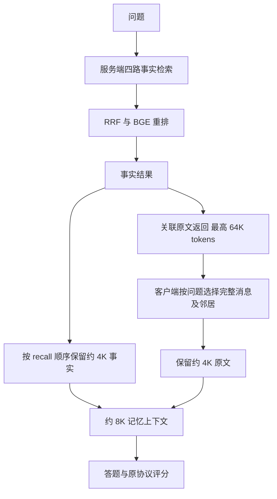

# LoCoMo 优化目的与效果记录

记录日期：2026年11月20日。实验结果日期：2026年11月19日。

本轮优化要解决的是：**已存储的相关原文，在 recall 返回预算和客户端打包阶段被省略，答题模型因此看不到具体证据。** 实验扩大原文候选预算，再按问题选择完整消息窗口，保持最终记忆上下文约 8K tokens。在 LoCoMo 类别 1–4 的同一批 1540 题上，通过题数从 **1419 增至 1442**，净增 **23 题**；其中 **36 题转对、13 题回退**。

这是 ContextBase 加客户端原文窗口打包的答题效果优化。它没有证明服务端四路检索本身变得更准确，也没有带来检索提速。原文候选传输和选择开销增加，部分题目反而丢失了关键消息；模型回答变化、原文歧义和裁判波动也参与了最终分数变化。

## 优化目的与发现依据

记忆问答中的证据需要依次经过：存储、检索、返回、打包、答题。事实检索命中，并不保证关联原文已返回；原文返回，也不保证它能进入最终上下文。

早期错题检查发现，有些答案线索已在 recall 回包中，但因事实或原文配额被打包器省略。例如城市问题中的 Paris、Rome 事实排在第 49、64 位，被事实配额省略；开业时说过什么的问题，相关原句已返回，却未进入最终输入。这些案例提出了检查返回和打包阶段的理由，不能据此认定所有错误都来自截断。见[早期证据分析](plan.md#8k-退化归因与配置只读核查)。

随后在 conv-30 上检查消息窗口打包的离线覆盖：参考证据 ID 的覆盖总数从 90 增至 93，所有参考证据均出现的题数从 70 增至 71。这是位置覆盖诊断，不是新答题分数，也不能证明模型能正确理解证据。见[窗口覆盖记录](results/conv30-window-coverage-20261119.json)。

再对三个问题做只读原文预算探针，发现：

| 项目 | 原文预算 8192 | 原文预算 65536 |
| --- | ---: | ---: |
| 返回原文 chunks | 11–12 | 31 |
| 返回原文 tokens | 8192 | 19843 |
| q37 的 Shia 原词 | 已返回 | 已返回 |
| q44 的 graceful 原词 | 已返回 | 已返回 |
| q73 的 magical 原词 | 未返回 | 已返回 |

三个探针的返回事实内容和顺序均相同。它们说明原文预算可以影响证据可见性；q37、q44 的原词原本就存在，不能宣称三个问题都依靠扩大候选才获得证据。探针没有调用答题或裁判模型。见[原文预算探针](results/conv30-raw64k-probe-20261119.json)。

据此形成的实验假设是：**在最终 token 预算不变时，多返回一些已召回事实关联的原文，再选择与问题相关的完整消息及邻居，可以减少整段原文和顺序打包造成的证据浪费。**

## 具体改动与处理位置

| 配置 | 基线 | 本轮窗口方案 |
| --- | --- | --- |
| 服务端事实 recall 预算 | 8192 | 8192 |
| 服务端原文返回预算上限 | 8192 | 65536 |
| 客户端打包算法 | complete-json-separate-budgets-v2 | query-turn-windows-v1 |
| 原文选择 | response_order，按完整条目装入 | query_relevance，按消息相关性选择窗口 |
| 最终记忆预算上限 | 8192 | 8192 |
| 最终事实与原文配额 | 4000＋4000 | 4000＋4000 |

65536 是原文候选预算上限，不是每题固定返回量，也不是给答题模型的上下文长度。三个探针实际返回约 19.8K 原文 tokens，最终仍只打包约 8K 记忆 tokens。

客户端的 `pack_query_windows()` 只读取 recall 已返回的 chunks：解析完整消息，用问题词与消息词计算 BM25 式词面分数，另加相邻词匹配奖励；为命中消息保留前后各一条，合并重复窗口，在原文和总 token 配额内装入。分词含英文停用词处理和 Porter stemming，采用的是自定义 BM25 式评分，不等于直接调用 PG 的 BM25 排名。

事实仍按 recall 顺序打包；本轮没有用 Python BM25 重排这份事实列表，也没有从完整原始数据额外取回未返回的消息。参考答案和证据 ID 只用于事后诊断，不输入选择器。实现见 [support.py](support.py) 中的 `complete_turns()`、`pack_query_windows()` 和 `pack_context()`。

### 为什么四路检索之后还选择原文消息

四路检索、RRF 和本轮 BGE 重排主要决定哪些抽取事实相关；关联原文展开后，一个长 chunk 可以同时含相关和不相关消息。事实级相关性不能直接给出 chunk 内哪句话最值得保留。

因此，这一层的目的在于选择段内证据和控制上下文，而不是用第二次词面排序替换已有的语义排序。它仍可能因词面偏好丢失同义表达、指代关系或必要答句；后面的 13 道回退题说明这并非无代价的补充。

检索后压缩和句子选择有公开框架先例，例如 [LlamaIndex 的节点后处理](https://developers.llamaindex.ai/python/framework/module_guides/querying/node_postprocessors/node_postprocessors/)和 [LangChain 的上下文压缩](https://www.langchain.com/blog/improving-document-retrieval-with-contextual-compression)。这些先例支持这一问题的存在，不证明当前 Python 算法优于服务端消息检索，也不证明主流 agent memory 产品使用同样的客户端流程。

## 实验条件与评分口径

本轮是本机 8892 的 LoCoMo 实验，不是 113.47.6.31 上的 BEAM GLM/Qwen 实验。

| 项目 | 本轮条件 |
| --- | --- |
| 数据 | 原始 LoCoMo，类别 1–4，共 10 个会话、1540 题 |
| Bank | 复用全量基线的同一批 10 个 Bank，不重新抽取 |
| AMB | 固定提交 28b644bd4dd653c0207c7507280439390c829155 |
| 记忆抽取 | gpt-6.1-sol，原 Bank 中已完成的抽取 |
| Embedding | doubao-embedding-vision，1024 维 |
| 神经重排 | 本地 BAAI/bge-reranker-v2-m3，CPU、FP32、batch 8 |
| 答题与裁判 | 均为 gpt-6.1-sol，reasoning effort 为 low |
| 对照保持 | 原始数据、gold、裁判规则、答题与裁判模型、指令模板、事实预算、最终记忆预算 |
| 方法改动 | 原文候选预算与客户端消息窗口选择 |
| 资源变化 | 窗口运行期间 reranker 并发从 1 改为 2，时延分段归档 |

这里的“通过”直接采用固定 AMB LoCoMo 裁判的 `correct` 布尔值。**它不是 BEAM 单题 rubric 得分 ≥0.5 的规则。** 同时保留原版 LoCoMo 答案 F1，二者不互相替代。原始分数没有因人工来源检查而修改。

环境指纹及实际部署差异见[环境清单](results/environment-20261119.json)。两轮均完成全部 1540 题，失败和待完成均为 0。传输恢复只补齐中断题的 answer/judge，其余 1539 题的既有答案和判定保持原样，细节见[诊断记录](results/locomo1540-window-diagnostics-20261119.json)的 `transport_completion_audit`。

## 效果与成本

| 指标 | 基线 | 窗口方案 | 变化 |
| --- | ---: | ---: | ---: |
| 通过题数 | 1419/1540 | 1442/1540 | ＋23 题 |
| AMB 裁判通过率 | 92.14% | 93.64% | ＋1.49 个百分点 |
| 错题数 | 121 | 98 | 减少 23 题 |
| 原版答案 F1 | 27.65% | 28.01% | ＋0.36 个百分点 |
| 平均记忆上下文 tokens | 7805.92 | 7980.32 | ＋174.39 |
| 平均检索耗时 | 14.39 秒 | 21.17 秒 | 增加 6.78 秒 |
| 检索 P50 | 15.31 秒 | 21.99 秒 | 增加 6.69 秒 |
| 检索 P95 | 19.47 秒 | 32.91 秒 | 增加 13.45 秒 |

变化值按未舍入原始数值计算。检索耗时与服务端 recall 对应，不是完整答题时延。窗口轮次包含 reranker 并发 1→2 的资源变化，不能据这组整体时延单独测算选窗或候选传输的成本。确定的结果是：这轮整体检索更慢，不能将其描述为性能提速。

答题模型记录的输入 tokens 从 11,372,590 增至 11,807,173。这些用量不包含 retain 和检索内部模型调用，部分尝试缺用量回报，因此不据此计算完整费用。Python 选窗本身没有额外 LLM 调用。

两轮判定的完整关系为：**1406 题持续通过＋36 题转对＋13 题回退＋85 题持续错误＝1540 题**。窗口方案的 98 道错题由 13 道新增错题和 85 道持续错题组成。

原始统计见[全量基线](results/locomo1540-baseline-20261119.json)、[全量窗口结果](results/locomo1540-window-20261119.json)。

### 按会话查看收益和回退

| 会话 | 题数 | 基线通过 | 窗口通过 | 转对 | 回退 | 净增 |
| --- | ---: | ---: | ---: | ---: | ---: | ---: |
| conv-26 | 152 | 138 | 145 | 8 | 1 | +7 |
| conv-30 | 81 | 75 | 79 | 4 | 0 | +4 |
| conv-41 | 152 | 143 | 147 | 5 | 1 | +4 |
| conv-42 | 199 | 184 | 184 | 1 | 1 | +0 |
| conv-43 | 178 | 162 | 160 | 1 | 3 | -2 |
| conv-44 | 123 | 113 | 112 | 1 | 2 | -1 |
| conv-47 | 150 | 140 | 142 | 3 | 1 | +2 |
| conv-48 | 191 | 176 | 180 | 5 | 1 | +4 |
| conv-49 | 156 | 139 | 145 | 7 | 1 | +6 |
| conv-50 | 158 | 149 | 148 | 1 | 2 | -1 |
| 合计 | 1540 | 1419 | 1442 | 36 | 13 | +23 |

conv-43、conv-44、conv-50 的通过题数下降，conv-42 持平。总体收益没有覆盖所有会话。

## 哪些原有错题转对

完整 36 题及逐题两轮答案、gold、判定理由、来源检查见[转对题附录](locomo-optimization-cases.md#原有错题转对)。以下案例用于说明不同类型的变化。

| 题目 | 两轮变化 | 可以支持的解释 |
| --- | --- | --- |
| conv-30_q37 何时提到 Shia Labeouf | 不匹配 gold → July 23 | 新上下文含原句，答案使用对应日期；支持具体证据恢复 |
| conv-30_q44 如何描述照片中的舞者 | 未命中目标描述 → so graceful | 原句可见且答案明确采用；支持证据恢复 |
| conv-47_q71 为对方找宠物提供什么帮助 | 原答案未命中 → 帮忙找到合适宠物 | 新窗口保留 help find the perfect one，答案对应原句 |
| conv-49_q99 为解梦建议看什么 | 原答案未命中 → dream interpretation book | 旧打包缺该书籍建议，新窗口保留 D6:15 |
| conv-49_q141 如何继续寻找自己的爱情 | 泛化建议 → 将尝试新事物与找爱联系起来 | 新窗口恢复相关原句的关系，而非仅增加关键词 |
| conv-30_q73 舞蹈带来什么感受 | 错 → 对，但 F1 仍为 0 | magical 已可见，答案仍说 joy/freedom；不能把转对全部算作有效使用原词 |
| conv-41_q4 加入支持小组的日期 | 两轮同为 December 19–25，判定不同 | 裁判对“上周”的周界接受程度变化，不是日期检索恢复 |
| conv-47_q147 玩 FIFA 前应练什么 | 新答案多说熟悉 controls，获判通过 | 目标原句 D30:18 仍未返回；不能声称 gamepad 和 timing 的完整证据缺口已修复 |

36 道转对不等于 36 种独立能力改善：conv-41 的 q0/q95 共享一次母女晚餐事件，conv-48 的 q74/q99 是重复问题。部分答案只覆盖 gold 的一部分，原裁判仍接受；这类结果保留原判，但不宣传为完整证据修复。

29 道转对题沿用已有来源检查；conv-26 的 q21、q26、q80、q85、q132、q133、q135 在11月20日补查了两轮保存的上下文。补查发现，q132 的真正答句 D16:8 在旧上下文中缺失，新窗口补进了“Seven years now”；但 q135 的陶艺伤情原句两轮都存在，转对涉及 reader 选择事件。q26 恢复了“去年读过”这一时间线索，但书名仍需指代判断。逐题结果保留这些差异，不从通过标签直接反推检索原因。

## 新增的十三道错题

这些问题均为基线通过、窗口方案未通过。完整答案和判定保存在[回退题附录](locomo-optimization-cases.md#新增错题)。

| 题目 | 回退表现 | 来源核查及优化含义 |
| --- | --- | --- |
| conv-26_q68 艺术练习多久 | 七年 → 起始时间不详 | seven years 已返回却没装入新窗口；同义题 q132 则转对。选窗对问题措辞敏感 |
| conv-41_q94 母亲准备哪些菜 | 具体菜品 → 未记录菜名 | 同一 chunk 中保留了做饭及追问，丢掉 D13:18 答句；邻居窗口没有保证问答完整 |
| conv-42_q23 哪些剧本被拒 | 部分识别，旧通过新未通过 | 第一部作品题材已在新上下文，作品关联和裁判部分分接受程度共同影响结果 |
| conv-43_q48 脚踝何时受伤 | 含当前伤情 → 只答 last season | 当前伤情和旧伤事实仍在；图片搜索 query 的 ankle 细节被窗口表示移除，可能削弱事件关联 |
| conv-43_q49 脚踝受伤几次 | 两次 → 一次 | 事件独立性与图片元数据使用范围共同影响计数，尚未隔离因果 |
| conv-43_q166 最喜欢哪个系列 | Harry Potter → LOTR | gold 对应的 favorite 原句由 Tim 说出，题却问 John；不能把人物标注冲突包装成检索退化 |
| conv-44_q37 公园事故日期 | 两轮答案逐字相同，判定改变 | 都答 October 16–22；对 gold October 19–24 的区间重合，裁判接受程度不同 |
| conv-44_q55 何时给狗准备室内空间 | 家中 safe space → 混到日托空间 | 具体原句未入窗口，但 safe-space 事实仍在；原句遗漏与事件消歧混合 |
| conv-47_q56 哪些亲人来访 | 姐妹和母亲 → 只答母亲 | sister 相处事实仍在，明确“来访”的 D17:28 未打包；关系证据比人物词出现更重要 |
| conv-48_q188 建议一起做什么户外活动 | surfing → sunrise | surfing 事实仍在，新窗口还含 sunrise；是竞争事件的答题选择，不是 surfing 未召回 |
| conv-49_q104 当天分享什么食物照片 | 炒菜及沙拉 → 只答炒菜 | 沙拉原句已返回却未打包；属于明确的窗口覆盖回退 |
| conv-50_q130 如何平衡工作与生活 | 含 one day at a time → 省略该策略 | 原句在回包中，但新事实和原文上下文均未保留该短语；属于窗口选择回退 |
| conv-50_q136 何时卖掉修复的汽车 | 两轮近乎同义，判定改变 | 原文 last year 明确修饰修复时间，售出时间不明确；涉及时间修饰歧义和裁判波动 |

窗口算法确实会损失原有证据，也会改变不同事件的相对显著性。但不能把 13 道回退全部归因于 Python BM25：其中有逐字相同答案得到不同判定，也有人物和日期标注争议。

## 对收益的归因边界

可以确认的是，这个候选预算与窗口打包组合在本次固定题集上净增 23 道通过题，并有具体原文恢复案例。尚不能将这 23 题全部解释为检索能力提升，原因是：

- 原文预算和窗口算法同时改变，没有做完整的单变量消融。
- 每个配置只有这一轮完整答题和判题，未估计重复采样的分数波动。
- 部分答案在相同证据下改变了选词或推断强度，部分裁判对相近甚至相同答案给出了不同判定。
- 错题分析已使用这批题的 gold 做诊断；后续在同一批题上继续挑配置，不能代替未见会话验证。
- 原文选择可恢复措辞和细节，却不能找回未被 recall 返回的独立证据，也不能保证正确的时间推理和事件归属。

因此，当前可用的结论是“提高相关原文的最终可见性具有实验价值，当前组合在这批题上有效”；Python BM25 式窗口是否值得长期采用，仍要与其他选择方法及服务端实现比较。

## 后续验证方向

| 验证问题 | 对照方法 | 观察指标 |
| --- | --- | --- |
| 收益主要来自更多候选还是选窗 | 8192/65536 原文候选 × 顺序/消息窗口选择；保持约 8K 最终预算及同一模型 | 通过率、F1、原文证据可见性、回退题 |
| 为什么问句留下但答句丢失 | 比较当前前后各一条与保持问答关系的窗口 | q94 等关系证据保留情况，额外 token 成本 |
| 词面打分是否压过语义关联 | 在相同返回 chunks 上对比词面、语义与保持原排序的选择 | 同义问法稳定性、指代和多事件问题 |
| 需要哪些图片元数据 | 显式区分 caption 与 image-search query 后做独立对照 | 人物/伤情/图片指代，不把搜索 query 当实际观察 |
| 能否减少传输和客户端工作 | 将消息级候选选择、邻居展开与预算控制纳入服务端原型 | 等价证据保留、响应体积、服务端/客户端分段耗时 |
| 改善是否能迁移 | 固定配置后使用未参与调参的会话，必要时重复评分 | 稳定收益、代价及不同会话的退化 |

同一题集的离线覆盖检查只用于定位，不替换真实答题。来源冲突和裁判争议单独记录，不修改本轮 gold、答案或分数。PG Recall 下推的等价性和提速工作是另一个专项，不能把其结果算作本轮窗口方案的收益，见[专项入口](recall-pushdown/README.md)。

## 复测与证据入口

- [基线复用配置](config.baseline-reuse.example.json)与[窗口配置](config.window-v1.example.json)：方法入口；配置准备及复测命令见 [README](README.md#同一runner选择上一轮或本轮方案)。
- [基线结果](results/locomo1540-baseline-20261119.json)与[最终窗口结果](results/locomo1540-window-20261119.json)：1540 题原始答案、判定、F1 及上下文统计。
- [逐题诊断](results/locomo1540-window-diagnostics-20261119.json)：来源检查、运行恢复与资源阶段记录。
- [49 道判定变化题附录](locomo-optimization-cases.md)：完整 36 道转对和 13 道回退，附两轮答案、判定理由及来源结论。
- [环境清单](results/environment-20261119.json)：模型、服务端版本、部署差异及资源配置。新复测模板统一 reranker 并发 2，不代表逐值复现历史混合资源时延。

以上实验发生于11月19日；本记录整理于11月20日，没有新增答题、判题或配置变更。
