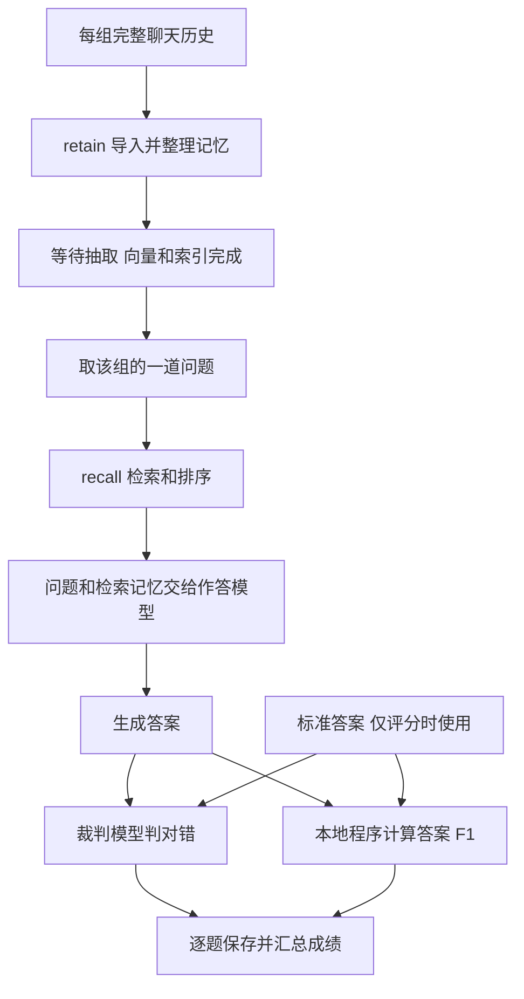

# LoCoMo 测试方法与 ContextBase 执行计划

更新：2026-11-19。

本文与报告已统一迁入代码仓 `benchmarks/memory/`。下文历史证据路径 `.local-archive/benchmarks/…` 均相对于 `/Users/zhuqingping/Work/Database/Context/ContextDB-Research/`；旧证据不移动、不提交。

LoCoMo 测试的是：**系统读完一段很长的聊天后，能否记住信息，并在后来提问时找到信息、回答正确。** 可以把它理解成“读聊天做笔记，再查笔记答题，最后批卷”。

本文从数据、流程和真实题目讲起，再说明模型、评分、公平对比及资源预算。后半部分维护本机环境、后续待办和执行记录；友商已发布成绩统一见[友商评测报告](report.md)。

**当前状态：完整1540题基线已完成并通过完整性核验，1419题正确、失败0，准确率92.14%、答案F1 27.65%，平均上下文7806 tokens，检索P50/P95 15.31/19.47秒；121道错题全部逐题分析。完整数据和模型/预算见[基线结果](results/locomo1540-baseline-20261119.json)、[错误分析](results/locomo1540-error-analysis-20261119.json)和[报告](report.md)。独立8K窗口候选正在运行，复用原10个Bank、不重新导入，尚无候选完整成绩。**

阅读顺序：[数据规模](#数据是什么) → [测试流程](#从导入到出成绩的流程) → [真实案例](#用一道真实题目走完整流程) → [三家方案对照](#mem0-hindsight-与-contextbase-方案对照) → [指标](#成绩怎样计算) → [公平对比](#怎样与-mem0-和-hindsight-公平比较) → [固化脚本](#固化脚本与复测方法) → [耗时](#一轮测试需要多久) → [资源预算](#存储和-token-预算) → [本轮结果诊断](#conv-30-结果诊断及-hindsight-对比)。

## 数据是什么

首轮使用官方 `locomo10.json`：**10 组长对话、272 场聊天、5882 条消息、1986 道问题**。首轮与 Mem0、Hindsight 已核实运行的题目范围对齐：排除 446 道对抗题，回答 **1540 题**。

| 名称 | 在测试中代表什么 |
| --- | --- |
| 一组对话 conversation | 一对人物的完整长期聊天；对应一个独立 Bank，共 10 个 Bank |
| 一场聊天 session | 这对人物某个时间的一次聊天，带日期，包含多条消息；每个 session 作为一份文档写入所属 Bank，共 272 份文档 |
| 一条消息 message | 某个人说的一段话；5882 指的是这种原始消息 |
| 一条记忆或事实 | ContextBase 导入时整理出的内容；一条消息可能产生多条事实，也可能不产生事实，条数须导入后统计 |
| 一道题 QA | 所属对话组的问题，数据中还提供标准答案及相关原文编号，供评测使用 |

### 为什么首轮排除对抗题

对抗题主要考“没有答案时会不会编造”，正确行为通常是识别信息不足。原始 LoCoMo 包含这类题，也在评分代码中单独处理；排除它们是评测方案的选择，不是原始数据集的强制规则。[原论文](https://aclanthology.org/2024.acl-long.747.pdf)、[原始评分代码](https://github.com/snap-research/locomo/blob/main/task_eval/evaluation.py)

Mem0 论文说明，因这类题缺少用于常规答案比较的标准答案，评测中将其排除；其已核实代码只评类别 1–4。Hindsight 的 AMB 代码同样明确跳过类别 5，本文对应的 92.0% 运行共 1540 题。首轮采用相同范围，便于对比。[Mem0 论文第 3.1 节](https://arxiv.org/html/2504.19413v1#S3.SS1)、[Mem0 类别配置](https://github.com/mem0ai/memory-benchmarks/blob/4b61c5d31b9c668a12b4f5e78064248a02c82d2b/benchmarks/locomo/prompts.py)、[Hindsight AMB 类别过滤](https://github.com/vectorize-io/agent-memory-benchmark/blob/28b644bd4dd653c0207c7507280439390c829155/src/memory_bench/dataset/locomo.py)

**1540 题成绩不覆盖“信息不足时是否拒答”的能力。** 如后续需要验证，可增加独立的 446 题对抗评测，固定拒答规则并单独报告；不能直接沿用鼓励尽力作答的 prompt 后将分数混入主表。

### Bank 与 session 的对应关系

**本轮 ContextBase 采用 10 组对话对应 10 个独立 Bank，272 个 session 作为 272 份文档写入各自所属 Bank。** Bank 是整组长期记忆的隔离边界，session 是 Bank 内的历史聊天分段。

```text
Bank 对应 conv-26
├─ session_1 → 文档 1
├─ session_2 → 文档 2
└─ … 共 19 份 session 文档、419 条原始消息
   该组 152 道题均查这个 Bank，可跨 19 个 session 找记忆

Bank 对应 conv-30
└─ … 共 19 份 session 文档、369 条原始消息
   该组 81 道题均查这个 Bank，可跨 19 个 session 找记忆

其余 8 组同理，共 10 个 Bank、272 份 session 文档
```

**同一 Bank 内允许跨 session 检索，不同 Bank 之间隔离。** 每题调用所属 Bank 的 `recall`，不只查某一个 session，也不混查其他 Bank；人物同名时仍按 Bank 隔离。LoCoMo 的 session 在这里映射为导入文档，不要求创建额外的产品 Session 对象。Bank 名称示意对应对话 ID，实际需带本轮测试隔离前缀并确认适配器生成规则。

下面是每个 Bank 对应的数据规模：

| 对话 ID | session 数 | 原始消息数 | 全部题数 | 本轮题数（排除对抗题） |
| --- | --- | --- | --- | --- |
| conv-26 | 19 | 419 | 199 | 152 |
| conv-30 | 19 | 369 | 105 | 81 |
| conv-41 | 32 | 663 | 193 | 152 |
| conv-42 | 29 | 629 | 260 | 199 |
| conv-43 | 29 | 680 | 242 | 178 |
| conv-44 | 28 | 675 | 158 | 123 |
| conv-47 | 31 | 689 | 190 | 150 |
| conv-48 | 30 | 681 | 239 | 191 |
| conv-49 | 25 | 509 | 196 | 156 |
| conv-50 | 30 | 568 | 204 | 158 |
| **合计** | **272** | **5882** | **1986** | **1540** |

**固定的是原始聊天、题目、标准答案和证据标注；系统最终生成的记忆、检索结果和回答不固定。** 正式测试需锁定文件哈希和题目列表，避免官方后续修订影响比较。

同一组的题共享这组记忆：一条记忆可以帮助回答多道题，一道题也可能需要结合多条记忆。10 组之间保持隔离，即使人物同名也不能混查。[官方数据](https://github.com/snap-research/locomo/blob/main/data/locomo10.json)

## 从导入到出成绩的流程



### 第一步 导入完整历史

每组建立一个独立 Bank，按 session 整理并保留日期、说话人、消息编号及约定的图片文字描述。将全部 272 个 session 分别作为文档调用 `retain` 写入所属 Bank，让 ContextBase 抽取事实、生成向量并建立索引。

整套历史通常只导入一次，供后面多道题反复查询。必须导入该组完整允许历史，不能根据题目只挑答案所在的几句。**问题、标准答案和“这道题的答案在哪条消息”的 evidence 标注都不写入记忆。** 原始聊天自带的消息编号可保留。

导入需等待所有异步任务完成；HTTP 返回接收成功不等于记忆已经可查。可以先完成全部 10 组再答题，也可以逐组完成导入后回答该组的题。

聊天跨几个月，不意味着要真的等几个月；但“昨天、上周、去年”必须参照原始聊天日期，不能参照测试当天。当前协议不设统一的导入秒数上限，需记录实际耗时与超时设置。

### 第二步 逐题调用 recall 找记忆

测试程序拿一道问题，指定所属 Bank 调用 `recall`，允许在该 Bank 的全部 session 记忆中检索，不能访问其他 Bank。ContextBase 在内部检索、融合和排序，再返回相关事实或原文。每题按固定预算选择上下文；不能把全套聊天直接交给作答模型代替检索。

首轮采用 **recall 加外部固定作答模型**。`reflect` 会进一步组织、推理并生成回答，适合另做 Agent 模式实验；本轮不把它混入公共答题流程。

### 第三步 把问题和检索记忆交给模型答题

作答模型收到“统一答题指令＋题目＋本次检索出的记忆及其日期”，据此生成答案。reader 就是这里的作答模型。

作答模型看不到标准答案或人工 evidence 标注。每题独立作答，不携带上一题的答案，也不把生成答案写回记忆。

### 第四步 裁判模型判题并计算 F1

另一次模型调用接收“问题＋标准答案＋生成答案”，按照固定评分规则判断对错。judge 就是这里的裁判模型。使用同一个型号答题和判题，也应是独立调用。

与此同时，本地程序比较生成答案与标准答案，计算词项重合的答案 F1，不再调用模型。裁判输出与解释只保存在评测记录中，不写回待测记忆。

### 第五步 汇总而非一次回答全部问题

1540 道题各自检索、作答、判题，再汇总成绩。不同题可以并行，但不会把 1540 道题作为一个大问题一次性交给模型。

逐题保存问题 ID、所属对话、题型、实际检索内容、模型答案、裁判结果、F1、Token 和耗时，方便之后判断错误发生在哪一步。

## 用一道真实题目走完整流程

下面的题目、标准答案和聊天证据来自官方数据；检索记忆与模型回答是预期示例，没有实际调用系统。

| 项目 | 真实数据 |
| --- | --- |
| 所属对话 | `conv-26`，完整历史共 19 场聊天、419 条消息，本轮回答 152 题 |
| 聊天日期 | 2023 年 5 月 8 日下午 1:56 |
| 聊天内容的中文转述 | Caroline 说她昨天参加了 LGBTQ 支持小组，感触很深 |
| 题目 | `When did Caroline go to the LGBTQ support group?` |
| 中文意思 | Caroline 什么时候参加了 LGBTQ 支持小组？ |
| 标准答案 | `7 May 2023`，即 2023 年 5 月 7 日 |
| 题型和人工证据 | 时间推理；原文编号 `D1:3` |

**导入时**，把这组全部 419 条消息按 19 个 session 交给 ContextBase。若抽取正确，一条可能的记忆是“Caroline 在 2023 年 5 月 7 日参加了支持小组”；也可能保存成带 5 月 8 日时间戳的“昨天参加了支持小组”。两种形式都需要保留日期依据。

**检索时**，用问题调用 `recall`，让系统自己找到相关记忆。人工已知的 `D1:3` 只用于事后核验，不能指定系统必须返回这一条。

**答题时**，作答模型得到的内容可以简化理解为：

```text
检索出的记忆：2023 年 5 月 8 日，Caroline 说她昨天参加了支持小组。
问题：Caroline 什么时候参加了 LGBTQ 支持小组？
```

预期可推算出答案“May 7, 2023”。关键能力是保留原日期，并正确理解“昨天”。[案例原始数据](https://github.com/snap-research/locomo/blob/main/data/locomo10.json)

**判题时**，裁判得到问题、标准答案 `7 May 2023` 和生成答案。两种日期写法相同应判对，但具体宽容度取决于评分 prompt，也就是给裁判的指令。

我们核对的 Mem0 固定版本 prompt 允许日期相差 14 天，列表答中至少一项也可判对。因此本题按该版本规则应这样理解：

| 假设生成答案 | 按该版本规则的预期判定 |
| --- | --- |
| 2023 年 5 月 7 日 | 对，日期一致 |
| 2023 年 5 月 8 日 | 对，在日期容差内 |
| 2023 年 6 月 7 日 | 错，超出日期容差 |

这是规则解释，不是裁判实际输出；不能用这一份代码推断所有历史成绩都采用同一规则。已保存的 Mem0 四月样例为 `with_evidence=false`，首轮拟同样不给裁判额外原文证据；若改变，须单列评分配置。[Mem0 评分规则](https://github.com/mem0ai/memory-benchmarks/blob/4b61c5d31b9c668a12b4f5e78064248a02c82d2b/benchmarks/locomo/prompts.py)

若答错，可顺着流程检查：日期是否没存下来、相关事实是否没找出来，或者找到了但作答模型算错。答案与标准答案表达不同，还需区分真实错误和评分差异。

## Mem0 Hindsight 与 ContextBase 方案对照

本表对比友商公开运行与 ContextBase 当前 AMB 方案。**当前模板 reader/judge 为 gpt-6.1-sol；旧 conv-30 结果使用 Mem0 prompt，新 AMB 裁判协议尚未实测。** “已确认”表示资料可追溯；“拟一致”表示新协议准备对齐但未实测；“待确认”表示缺少对应运行的配置。 Mem0 四月结果样例与新版 92.5% 成绩分开看，源码默认值不自动等于某次成绩的生效值。

| 比较项 | Mem0 官方资料 | Hindsight 官方资料 | ContextBase 当前方案 | 一致性与待确认项 |
| --- | --- | --- | --- | --- |
| 对应状态 | 四月样例 1410/1540，约 91.6%；新版主表 92.5% 的完整模型配置未绑定 | 已核实 AMB 历史运行 1417/1540，92.0% | **新 AMB 协议未运行、无分数**；旧 conv-30 记录另列 | 对照表用于说明条件；历史分数不是三家统一条件的成绩 |
| 题目范围 | `locomo10` 类别 1–4，共 1540 题；排除 446 道类别 5 对抗题 | 同为 1540 题，代码明确跳过类别 5 | 默认先选 conv-30 的 81 题；全量目标同为 1540 题，固定数据哈希和题目 ID | **范围拟一致**；友商对应数据文件哈希及逐题内容尚未全部比对 |
| 导入和隔离 | 每组聊天按日期处理；固定代码默认每条消息作为一个写入 chunk | 数据加载器每 session 一份文档，结果记录导入 272 份文档 | **10 组对话对应 10 个 Bank，272 个 session 各作为文档写入所属 Bank** | 都按对话隔离；写入粒度与 Mem0 代码不同，不能称导入完全一致；同 Bank 跨 session 检索 |
| 导入抽取模型 | 托管运行的抽取/摘要模型未完整披露，不能套用 OSS 默认值 | 历史结果未完整记录；固定内嵌代码默认 Gemini 2.5 Flash Lite，尚未绑定该次运行 | 拟沿用已检查配置 **gpt-6.1-sol / openai-codex** | **尚未对齐**；ContextBase retain 操作级生效配置执行前复核；比较整套产品配置 |
| Embedding 和排序 | 该托管运行的完整模型与参数待确认 | 该历史运行的 embedding、维度和重排模型待确认 | 已记录 **doubao-embedding-vision，1024 维；RRF 多路排序融合**，执行前复核 | **待确认**；三家分别披露内部配置，不假定相同 |
| 检索和答题方式 | 固定评测代码为检索后交外部模型答题，四月样例 Top-200 | 历史运行 `mode=rag`、`oracle=false`；recall 后外部作答 | **recall + 外部作答**，每题一次检索；不调用 reflect 答题 | **流程拟一致**；各家检索算法和参数仍不同 |
| 答题模型 | **四月样例 GPT-5，Azure provider**；不能直接套到新版 92.5% | **Gemini 3.1 Pro Preview**，结果文件已记录 | **gpt-6.1-sol / openai-codex，low** | 当前模板与两家公开运行模型都不同；运行时冻结参数与 provider 源码 |
| 裁判模型 | 四月样例 **GPT-5**；新版完整配置待确认 | **Gemini 2.5 Flash Lite**，结果文件已记录 | **gpt-6.1-sol / openai-codex，low，独立调用** | 与两家公开运行型号不同；同型号自评也须披露 |
| 裁判规则 | 固定 `4b61c5d` 代码：二元对错、日期容差 14 天、列表答中至少一项可判对；四月样例 `with_evidence=false` | 固定 `28b644b` AMB 代码：二元对错、宽容语义判断，日期指向同一日期/时段即可；**没有明确的 14 天数值容差** | 改为固定 `28b644b` AMB LoCoMo 裁判 prompt；不额外提供原文 evidence | **与固定 Hindsight/AMB 代码规则一致，与旧 Mem0 规则不同**；裁判模型仍不同，历史成绩不视为同条件 |
| 上下文预算 | 四月样例 Top-200；新版主表平均约 **7K tokens/题**，是实际均值，不是硬上限 | 固定代码默认事实 **32768**、原文 **16384 tokens**；历史实测平均 **36235.4 tokens/题** | 拟设每题最多 **8192 个记忆上下文 tokens**，含事实、原文及包装；统一 tokenizer 和截断规则 | **尚不一致**；Hindsight 默认预算能被覆盖；Top-K、均值与硬上限不能直接等同 |
| 对外质量指标 | 当前 LoCoMo 主表公布裁判准确率；本表未核实到同次运行的答案 F1 | 此次结果公布裁判准确率；未记录答案 F1 | **准确率、答案 F1**，另报题型和对话组结果 | 准确率指标名称一致，但模型和规则不同；F1 为本轮补充 |
| Token 和时间指标 | 当前主表：平均上下文 tokens、**P50**；主表未列 P95 | 此次结果：平均上下文 tokens、**平均检索时间**、导入时间；未给 P50/P95 | 平均上下文 tokens、检索 **P50/P95/均值**；各阶段总用量、成本、导入及作答时间另记 | Token 均需核对计数边界；**平均检索时间不是 P50**，客户端网络条件也须披露 |

**全量目标题目范围相同；当前 ContextBase 改用固定 AMB 规则，但 reader/judge、内部模型和上下文预算尚未与厂商历史运行统一。** 因此不能直接拿 ContextBase 新成绩与 Mem0 92.5%、Hindsight 92.0% 判定胜负。真正的三家主对照需按下文共同方案重新运行。

来源：[Mem0 四月结果](https://github.com/mem0ai/memory-benchmarks/blob/4b61c5d31b9c668a12b4f5e78064248a02c82d2b/results/platform/locomo_results.json)、[Mem0 导入与评测代码](https://github.com/mem0ai/memory-benchmarks/blob/4b61c5d31b9c668a12b4f5e78064248a02c82d2b/benchmarks/locomo/run.py)、[Mem0 裁判规则](https://github.com/mem0ai/memory-benchmarks/blob/4b61c5d31b9c668a12b4f5e78064248a02c82d2b/benchmarks/locomo/prompts.py)、[Mem0 当前主表](https://github.com/mem0ai/mem0#new-memory-algorithm-april-2026)、[Hindsight 历史结果](https://github.com/vectorize-io/agent-memory-benchmark/blob/28b644bd4dd653c0207c7507280439390c829155/outputs/locomo/locomo-hindsight/rag/locomo10.json.gz)、[AMB 数据及裁判规则](https://github.com/vectorize-io/agent-memory-benchmark/blob/28b644bd4dd653c0207c7507280439390c829155/src/memory_bench/dataset/locomo.py)、[AMB 检索及内嵌配置](https://github.com/vectorize-io/agent-memory-benchmark/blob/28b644bd4dd653c0207c7507280439390c829155/src/memory_bench/memory/hindsight.py)。本机配置来自下方只读环境检查记录。

## 成绩怎样计算

| 指标 | 小白理解 | 本轮统计口径 |
| --- | --- | --- |
| 裁判准确率 | 多少题被裁判认为答对 | 正确题数 ÷ 1540；另报题型及对话组结果，不能只算成功返回的题 |
| 答案 F1 | 回答与标准答案的词语有多大重合 | 按固定 LoCoMo 评分代码的题型规则逐题计算后汇总；与裁判准确率不同，也不是检索 F1@K |
| 平均上下文 Token | 每题交给答题人的记忆笔记有多长 | 统一 tokenizer 和包装边界；主报均值，保留中位数；完整作答输入另记 |
| 检索 P50 | 一半请求能在多长时间内查完 | 客户端发出 recall 到收到完整返回，不包含后续作答和判题 |
| 检索 P95 | 95% 请求能在多长时间内查完 | 与 P50 使用相同计时边界，体现慢请求情况；同时保存均值 |
| 总 Token 和成本 | 整场考试实际花了多少资源 | 导入、检索相关模型、作答和裁判分别记录输入/输出，embedding 单列 |
| 补充耗时 | 记忆整理和回答各要多久 | 分别记录导入、作答及完整流程时间，避免与检索时延混用 |

例如，1540 题中有 1386 题被判对，则准确率为 **1386 ÷ 1540 = 90%**。这是计算示例，不是 ContextBase 成绩。裁判看语义是否符合规则，F1 看词项重合，所以两者数值不同很正常；日期格式变化也可能影响 F1。

所有失败、超时、重试和未完成项均须保留，不能静默删题提高分数。尚缺裁判结果的运行标为未完成；完整范围和逐题记录验收后才能称为正式全量结果。[LoCoMo 原始评分代码](https://github.com/snap-research/locomo/blob/main/task_eval/evaluation.py)

## 怎样与 Mem0 和 Hindsight 公平比较

**首轮主对照：三家用相同的外部“答题人”和“判卷人”。** 获准测试且具备对应服务访问条件后，ContextBase、Mem0、Hindsight 在同一评测程序下重新运行。Mem0 托管版与 OSS 必须分列；只运行 ContextBase 时，仅报告本机成绩，并把厂商历史值列为背景参考。

- **相同试卷：**固定数据哈希、同一 1540 题、会话隔离、同一历史及图片文字处理；答案与 evidence 仅用于评分。
- **相同答题条件：**三家均单次检索、统一外部 reader/judge（当前本机模板为 gpt-6.1-sol）、固定 AMB 提示词、reasoning、输出上限及错误处理；使用同一 provider 和可固定的模型版本，不以相同显示名称替代版本对齐。
- **相同记忆预算：**主对照拟定每题最多 **8192 个记忆上下文 tokens**，使用统一 tokenizer 和确定的打包/截断规则，保留来源、人物及时间；上限包含事实、原文和其包装，不含公共问题/指令。另记录完整作答输入 tokens。该值是新设的共同预算，不是 Mem0 官方 7K 均值的复现；Top-200 也不等于固定 token 数。若增加预算，三家同档另测。
- **明确比较对象：**各家可保留产品原生抽取、向量及排序，披露模型、成本和配置，衡量完整记忆产品。若要单独比较算法，后续仅在可配置版本中统一抽取模型另开受控实验；托管内部模型未知时不宣称已完全控制变量。
- **一致统计边界：**同样计算准确率/F1/上下文 tokens，计入全部应测题；检索 P50/P95/均值均从客户端发请求到完整返回。本机 PG 与远程托管的网络条件分开说明，不能把客户端延迟差全部归因于数据库性能。

**Hindsight 补充对照（后续）：**若要对齐其已公开 92.0% 运行的外部模型组合，再统一用 **Gemini 3.1 Pro Preview 作答、Gemini 2.5 Flash Lite 判题**。三家都使用同一组合及同一预算，作为单独一组结果。首轮不混合两套模型产生统一排名；仅替换 reader/judge 且检索行为不变时，可复用冻结记忆及检索结果。

Mem0 四月文件记录 GPT-5/GPT-5（Azure），但不能据此认定新版 92.5% 的全部条件已齐；Hindsight 历史文件也未完整固定其内部模型及机器环境。因此新跑的统一条件成绩与厂商历史宣传成绩分开呈现。模型不可用时记录阻塞，不静默替换型号。

来源：[Mem0 四月 LoCoMo 运行](https://github.com/mem0ai/memory-benchmarks/blob/4b61c5d31b9c668a12b4f5e78064248a02c82d2b/results/platform/locomo_results.json)、[Hindsight LoCoMo 运行](https://github.com/vectorize-io/agent-memory-benchmark/blob/28b644bd4dd653c0207c7507280439390c829155/outputs/locomo/locomo-hindsight/rag/locomo10.json.gz)。更完整的已知/未知条件见[友商报告](report.md)。

## 固化脚本与复测方法

**当前正式复测入口采用固定版本 AMB，加 ContextBase 适配；尚未启动真实测试。** AMB 固定为 `28b644bd4dd653c0207c7507280439390c829155`，不能自动跟随 main。已验证的打包、HTTP 导入、隔离、配置归档和 F1 工具收敛为 `support.py`；旧的独立答题/裁判驱动仅作本地历史归档，不提交、不维护双份流程。

### 复用哪些内容，调整哪些内容

| 环节 | 当前方案 | 与 AMB 的关系 |
| --- | --- | --- |
| 数据与范围 | 原始 LoCoMo；类别 1–4；默认 conv-30 的 81 题，也可预先限定范围 | 调用固定 AMB `LoComoDataset` 加载，准备阶段校验题目、session 原文及日期一致 |
| 导入 | 每组对话独立新 Bank；每 session 一份文档；等待父子操作完成、抽取无错误，并核对原文 | 复用现有 HTTP 导入与配置归档；AMB 评测阶段固定 `skip_ingestion=True`，不能由它重置或删除 Bank |
| 检索 | 每题在所属 Bank 调用一次 recall；跨 session，不能跨 Bank；不用 reflect | 新增 `MemoryProvider` 适配；成功回包和打包审计单独归档 |
| 上下文 | 总上限 8192 tokens；事实配额 4000、原文配额 4000，剩余用于包装；完整条目，不能硬切字符串 | 复用 v2 打包；明确覆盖 AMB 优先注入原始回包的捷径，只把打包后 JSON 送给 reader |
| 答题 | 使用 AMB `RAGMode` 和原有 LoCoMo 答题指令、日期、问题模板 | 模型连接使用现有 provider 工厂；支持当前 Codex OAuth，结构化输出与调用证据归档 |
| 判题 | 使用固定 AMB `GeminiJudge` 的 LoCoMo 判题 prompt 和布尔判定，模型可独立配置 | 不再使用旧版 Mem0 裁判规则；类名为 GeminiJudge 不代表必须用 Gemini |
| 汇总 | 使用 AMB `EvalRunner` 运行并保存原生结果；额外输出统一 summary | 补充原始答案 F1、实际上下文 Token、模型用量及检索 P50/P95 |

这是**明确披露了打包调整的 AMB LoCoMo RAG 协议**，协议名 `amb-locomo-cat1to4-packed-v1`。不能声称与厂商历史公开运行完全同条件，也不能把旧版 91.36%/25.15% 改写成此协议的成绩。后续比较时仍须统一 reader、judge、预算及题目范围。[固定 AMB 题库与 prompt](https://github.com/vectorize-io/agent-memory-benchmark/blob/28b644bd4dd653c0207c7507280439390c829155/src/memory_bench/dataset/locomo.py)、[RAG 流程](https://github.com/vectorize-io/agent-memory-benchmark/blob/28b644bd4dd653c0207c7507280439390c829155/src/memory_bench/modes/rag.py)、[公共评测驱动](https://github.com/vectorize-io/agent-memory-benchmark/blob/28b644bd4dd653c0207c7507280439390c829155/src/memory_bench/runner.py)。

### 文件与配置

代码和文档统一在代码仓 `benchmarks/memory/`；当前分支为 `memory-benchmark`，基于 `zhuqingping/contextbase_v1` 的 `4cdec7b5…` 创建。8892 部署及旧 Bank 不因分支切换而改变。

| 文件 | 用途 |
| --- | --- |
| `runner.py` | 当前入口：init、preview、ingest、verify、run、report |
| `config.example.json` | 模型、凭据引用、固定源码版本、数据哈希、范围、预算、并发、超时和重试模板 |
| `tests/test_runner.py` | 调用真实固定 AMB 代码，搭配合成会话、本地模拟 HTTP 和脚本化模型的离线验证 |
| `support.py` | 当前入口必需的配置、打包、导入及原始 F1 工具；没有旧版独立答题/判题流程 |

模板声明本机 API 为 `http://127.0.0.1:8892`；retain 为 gpt-6.1-sol medium，reader/judge 为 gpt-6.1-sol low，向量 1024 维，RRF，observations 关闭。**声明的 memory_profile 与实际服务快照分别保存**；隐藏的内部模型、硬件以及模型别名背后的版本，不能仅凭模板视为已验证。当前模型组合用于本机流程验证，不代表已对齐厂商历史运行。

API Key 只保存环境变量名或私有文件引用；公开配置快照中的密钥字段遮蔽。`init` 不解析业务凭据、不创建模型或 HTTP 会话。没有自动模型降级；Codex 通道不支持的温度/输出上限必须保持 null，不能宣称已经生效。

### 指标口径

| 指标 | 保存与计算方式 |
| --- | --- |
| 答题准确率 | 固定 AMB 裁判判对数 / 冻结应测题数；失败、缺失题不从分母移除 |
| 答案 F1 | 原始 LoCoMo 函数；类别 1 使用分项答案规则，类别 2–4 使用 token F1；类别 3 按原方法取分号前的参考答案。参考答案预处理直接按原始 LoCoMo 规则实现；不再依赖 Mem0 prompt 源文件 |
| 记忆上下文 Token | 对**实际注入**的完整 JSON 计算；主口径 o200k_base，记录总量、均值、最大值；同时输出 AMB 的 cl100k_base 均值。8192 上限是 o200k_base 口径 |
| 完整答题 prompt Token | 另算指令＋日期＋记忆＋题目，不能与“记忆上下文 Token”混为一谈 |
| 模型实际 Token 用量 | reader/judge 分别保存服务返回的 input/output/cache/total 用量；包括已记录的重试；未知用量单列，不当作 0 次调用；不包含 retain 或检索内部模型用量 |
| 检索 P50/P95 | 成功 recall 的 HTTP 往返与响应解析耗时，单位 ms；不含上下文打包、答题、判题和准备阶段的文档核验；按 NumPy 默认线性分位数计算，保存样本数。续跑复用原始耗时，不记成缓存命中速度 |

**对外看 `summary.json` 的全体应测题口径。** AMB 原生部分结果文件可能只包含已完成题，其暂存 accuracy 不等于完整范围的成绩。运行不完整、服务配置漂移或失败时，统一汇总不会标为有效完整结果。

### 命令与归档

| 命令 | 是否访问服务或模型 | 作用 |
| --- | --- | --- |
| `init` | 否 | 要求本地已有固定源码 checkout；冻结源码、输入、配置、运行环境及哈希；离线核对 AMB 加载范围 |
| `preview` | 否 | 检查已保存 recall 的打包；不重新检索、不作答、不产生新成绩 |
| `ingest` | 是 | 只创建带新 run_id 的 Bank，导入与核验；保留环境 |
| `verify` | 是，只读、不调用模型 | 复用已有 Bank 时，核对完整原文、所有导入任务、公开配置与服务版本；禁止重新导入 |
| `run` | 是 | 先检查已完成导入或复用核验、原文、版本和公开配置，再进入 AMB 的按组隔离流程；组内按固定并发答题 |
| `report` | 否 | 从归档重算汇总，不能调用服务或模型 |

每个新运行目录保存 `manifest.json`、`runner.py` 与 `support.py` 副本、`amb-source/`（固定源码、pyproject、uv.lock）、`inputs/`、`state.json`、服务版本/配置及导入操作快照、`retrievals/`（原始回包、完整打包文本、入选与省略项、耗时）、`calls/`（实际 prompt、响应 schema、模型原回复、用量、每次尝试）、`results/`（原生逐题结果及 F1）、`amb-output/`（AMB 原生输出）和 `summary.json`。

配置、源码、依赖、输入和检查点都校验哈希。已保存答案只续判题，已判对或判错的模型结果不重新生成；失败不得以反复重跑择优替换。检索失败/打包失败保留证据并阻止静默重新检索；模型瞬态重试次数在配置中固定，中断后的未知调用计入尝试预算。当前入口不暴露 oracle、只重答错题、直接重判等改变成绩的选项。 中断恢复可以在新目录声明 `checkpoint_source`（旧 manifest 路径与哈希）；配置及问题一致时，所有已完成的答案和判定原样沿用、来源副本和哈希归档。对完全没有返回内容的连接失败，可显式增加一次传输尝试上限并保留此前失败；不得据此重答或替换任何已有语义判定。操作失败按失败保留、继续其他题；未全部成功的运行不标为有效完整结果。任何新方法或模型改动使用新 run_id；旧 v1/v2 结果不能交由 AMB 入口续跑。

### 后续执行示例 当前不执行

工作目录为 `/Users/zhuqingping/Work/Database/Context/hindsight`。复制并审阅模板后准备新目录；以下仅是未来命令，不代表已启动：

```bash
export CONTEXTBASE_AMB_CHECKOUT="/Users/zhuqingping/Work/Database/Context/ContextDB-Research/.local-archive/benchmarks/tools/amb-28b644b"
export LOCOMO_SOURCE_DIR="/Users/zhuqingping/Work/Database/Context/ContextDB-Research/.local-archive/benchmarks/runs/locomo-conv30-20261118-200523/sources"
RUN_DIR="$PWD/benchmarks/memory/.local/runs/locomo_conv30_amb_v1_20261118"
.venv/bin/python benchmarks/memory/runner.py init \
  --config benchmarks/memory/config.example.json \
  --run-dir "$RUN_DIR" --run-id locomo_conv30_amb_v1_20261118
```

`init` 只准备文件。新建 Bank 使用 ingest → run；复用已存在 Bank 时，先在配置中声明 `reuse_banks`，使用 verify → run，不执行 ingest。复用模式的 HTTP 层只允许指定 Bank 的 GET 与 recall；不能创建、写入、删除或 reflect。以下是新建模式示例：

```bash
.venv/bin/python "$RUN_DIR/runner.py" ingest "$RUN_DIR"
.venv/bin/python "$RUN_DIR/runner.py" run "$RUN_DIR"
.venv/bin/python "$RUN_DIR/runner.py" report "$RUN_DIR"
```

无需安装 AMB 全部友商依赖：入口加载固定源码中的 LoCoMo/RAG/runner 相关模块，绕过与本次无关的全部厂商注册表；源码不修改。上游 uv.lock 和本机实际 Python/依赖版本均归档，不能把保存 lock 文件误解为已安装其全部依赖。

### 本次离线验证 2026-11-18

**本次基于个人分支整理后，21 项离线检查全部通过，无跳过。** 保留 16 项 AMB 适配检查和 5 项打包回归，移除只验证旧独立驱动的重复测试。此前旧布局的 32 项验证记录单独保留，不与本次计数混用。 新验证调用实际的固定 AMB 代码，输入全部是合成会话，服务为临时随机端口的本地 HTTP 模拟，模型为脚本化响应；额外阻止访问真实产品端口或下载数据集。覆盖实际 prompt 与预算、无答案泄露、父子导入完成核验、双 Bank 隔离、同 Bank 并发、断点恢复、终态保护、检索失败、运行时配置漂移、哈希篡改、F1、两种 Token 口径及 P50/P95。

本目录 Ruff、类型检查通过。全仓 lint 入口已运行，但个人分支基线的 `hindsight-api-slim/hindsight_api/api/http.py` 存在未使用变量 `config`（F841），因此全仓检查未通过；本次不修改业务源码，lint 自动格式化的无关变动均已撤回。本次证据归档在研究目录的 `.local-archive/benchmarks/harness-validation/20261118-memory-branch/`；此前 AMB 布局验证保留在 `20261118-amb-v1/`。**本次未导入真实 LoCoMo 数据、未调用真实模型、未访问旧 Bank、未产生新的 benchmark 分数。** 旧运行 114 个校验文件全部保持原哈希，Bank 与环境保留。

此前 v2 已对旧的 81 份缓存 recall 离线检查：81/81 完整 JSON、保留原文、不超过 8192 tokens；旧答案的 F1 重算一致。该历史证据继续保存在 `harness-validation/20261118-v2/`，本次没有再次跑这 81 题。

## 一轮测试需要多久

每家产品的基础流程约有 **1540 次外部答题和 1540 次判题**，另加导入与检索内部调用。导入一次可以反复查题，不需要每道题重新导入整组历史。

下面仅作算术示例：假设每题检索 1 秒、答题 20 秒、判题 3 秒，共 24 秒。

| 方式 | 1540 题的理想时间 |
| --- | --- |
| 串行逐题处理 | 约 10.3 小时 |
| 同时处理 10 题 | 约 62 分钟 |
| 同时处理 20 题 | 约 31 分钟 |

这些时间未包含导入、限流、排队、推理波动和重试，不是工期承诺。单题仍按检索、答题、判题的依赖顺序执行；不同题可并行，判题也可作为流水线处理。获准测试后先通过小范围冒烟测出实际速度，再决定并发和全量预算。

## 存储和 Token 预算

下面把原始数据规模与尚未实测的资源预算分开列示。预算按**完整历史写入一次、1540 题各检索/作答/裁判一次**计算，使用已有 1024 维 embedding 配置作为容量假设。

| 项目 | 规模及口径 |
| --- | --- |
| 原始数据 | `locomo10.json` 2805274 字节，约 **2.81 MB（2.68 MiB）**；10 组对话、272 个 session、5882 条消息 |
| 题目 | 全部 1986 题；首轮排除 446 道对抗题，测 **1540 题**；QA、标准答案和 evidence 不写入记忆 |
| 纯消息正文 | 726954 字节；`o200k_base` **159658 tokens**，`cl100k_base` **166408 tokens**，不含说话人/日期/JSON 等 |
| AMB 风格导入内容 | 每 session 使用 `json.dumps(turns)`：共 1286143 字节；上述两个 tokenizer 分别 **371697 / 379721 tokens**，含 turn 元数据和图片文字描述等；不含实际图片文件及额外抽取 prompt |
| PG 增量规划 | 假设抽取 **1万–3万条向量化事实**，不是已测事实数；1024 维 float32 pgvector 每条约 4104 字节，仅向量约 **41–123 MB**。加原文、事实、实体关系及索引，先按 **0.1–0.5 GB** 规划，建议每套配置预留 **1 GB** 数据与索引余量；WAL、日志、备份及库基础占用另计；此范围不是容量上限 |

数据来源：[LoCoMo 官方数据](https://github.com/snap-research/locomo/blob/main/data/locomo10.json)；静态读取版本 SHA-256 `79fa87e90f04081343b8c8debecb80a9a6842b76a7aa537dc9fdf651ea698ff4`。Token 以 tiktoken 0.12.0 逐 session/逐消息计数；供应商 tokenizer 与最终序列化改变时应重算。[AMB 导入格式](https://github.com/vectorize-io/agent-memory-benchmark/blob/28b644bd4dd653c0207c7507280439390c829155/src/memory_bench/dataset/locomo.py)、[pgvector 存储公式](https://github.com/pgvector/pgvector#vector-type)。

**Token 消耗主要发生在逐题重复读取记忆，而非一次性导入。** 下表按普通单轮 RAG 估算，M=百万 tokens；输入与输出费用应分别计算，embedding 单列，推理模型的隐藏 reasoning 用量另计。

| 阶段 | 一轮全量的预算假设 |
| --- | --- |
| 写入抽取 | 原始 session JSON 约 **0.37–0.38M 输入**；加抽取 prompt、输出及可能的实体处理，暂按 **0.5–2M LLM tokens** 预估，合并/反复处理可能超出 |
| Embedding | 暂留 **0.2–1M embedding tokens**，由实际事实文本及是否给原文/实体也做向量决定；与 LLM tokens 分开记账 |
| 作答：平均上下文 7K/题 | **1540 × 7000 = 10.78M 上下文输入 tokens**；需另加问题、prompt、输出和 reasoning；7K 是预算场景，不保证取得 Mem0 分数 |
| 作答：Hindsight 历史上下文规模 | **1540 × 36235.4 ≈ 55.80M 上下文输入 tokens**；同样不含其他阶段，不是 ContextBase 的实测消耗 |
| 裁判 | 简短答案、单次评分先按 **0.5–1.5M 输入及输出 tokens** 预估；若更换长 prompt、长答案或推理裁判，需要追加预算 |
| 答案 F1 | 本地词项统计，**不额外调用模型** |

若采用平均 7K 上下文、简短答案、关闭额外记忆合并且不重试，首轮可先准备 **12–20M LLM tokens** 的基础预算，另计 embedding；按 Hindsight 历史约 36K 上下文则先准备 **60–70M**。这两项是规划区间，不是调用硬上限或价格承诺；reasoning、大量重试、自动合并、工具循环和更长输出会增加消耗。正式执行应冻结各阶段上限，写入后复用记忆跑不同 reader/judge；抽取模型、写入策略或 embedding 改变时，需重新构建相应记忆。

## 当前环境与状态

用户选择现有本机 ContextBase。本轮只读检查结果如下，端口与空间在实际执行前再次确认。

| 项目 | 已知情况 |
| --- | --- |
| 旧实例 | API 127.0.0.1:8891，UI 9991；进程目录 `releases/pr90-9b4817aa1` |
| 新实例候选 | API 127.0.0.1:8892，UI 9992；部署 `gpt61-20261107-dd5521cb9` |
| 8892 数据库 | 本机 PostgreSQL 127.0.0.1:5432，库名 `contextbase_gpt61_20261107`；实际进程连接与配置一致 |
| 8892 模型配置 | openai-codex / gpt-6.1-sol；doubao-embedding-vision 1024 维，embedding batch=10；2026-11-19 切换本地 bge-reranker-v2-m3 / CPU FP32，固定版本及参数见末节 |
| 健康与接口 | 两个 API 的 health/readiness 均返回健康、数据库已连接；OpenAPI 可读取，含 retain/recall/reflect/config/operations |
| 评测解释器 | 已有 Python 3.12；系统默认 Python 3.14 不作为 AMB 安装环境 |
| 尚未验收 | 最终目标端口、测试空间与 Key 权限、实际模型调用、客户端兼容、异步完整写入、成本及并发限额 |

健康接口可用不等于模型或业务链路已验收。本轮没有建测试空间、导入材料、调用模型或产生 benchmark 分数。

## 推进顺序

| 顺序 | 项目 | 范围与用途 |
| --- | --- | --- |
| 1 | LoCoMo | 获准开始后，一个会话内 20 题冒烟，随后完整 1540 题 |
| 2 | LongMemEval-S | 先 2 题检查各自完整历史，再运行 500 题 |
| 3 | BEAM | 100K 验证链路，再推进 1M 完整 split；平均分与通过率分列 |
| 4 | DolphinBench | 固定 30–60 个开发用例预研，之后决定是否跑完整 600 项任务 |
| 诊断 | PrecisionMemBench、BEIR SciFact | 前者标原版/移植版与 Active Pass，后者标全量/切片及检索模型 |
| 后续 | PersonaMem、知识库 QA、LifeBench、BEAM 10M、sde-bench | 按腾讯/阿里对标需要、区分度、成本和首轮结果安排 |

## 待办

本表是唯一任务清单，状态随实际进展更新。

| 对应事项 | 状态 | 完成条件或下一步 |
| --- | --- | --- |
| 环境选择与资料收集（B001/B002/B005） | 已完成 | 现有本机；友商资料与来源已合入 report.md |
| 本机只读检查（B010） | 初查完成 | 已确认健康、进程和 8892 配置；最终目标与完整生效环境尚待固定 |
| 评测版本与预算（B003/B004） | 固定 AMB 协议与模板已实现，实测未执行 | 当前本机 gpt-6.1-sol reader/judge、8192 记忆 tokens；每次 init 冻结具体配置、输入与源码；旧结果不混用 |
| 补齐友商条件（B006） | 待补充 | 阿里作者及正式评测、腾讯 split/judge、OpenViking 完整配置、Mem0 新版逐题结果 |
| 测试隔离与接入（B011/B012/B013） | 本轮单 Bank 验证完成 | 已确认独立 Bank、19 份原文及异步写入；AMB 适配已通过合成双 Bank 与组内并发验证；真实全量隔离仍待验收 |
| LoCoMo（B020/B021） | 81 题旧流程与 AMB 8K 复测完成；全量未运行 | 原始记录 74/81、F1 25.15%；新 AMB 为 70/81、F1 21.98%，两版评分尺度不同；本轮不重跑，环境保留 |
| LongMemEval-S 与竞品对照（B022/B023/B024） | 待开始 | 同协议 Hindsight；Mem0 OSS/Cloud 分列，各系统独立记忆 |
| 失败分析及优化（B030/B031/B032） | 诊断、只读复用及 AMB 8K 实测完成；更高预算实验未执行 | 已对齐 Hindsight 81 题，修复完整条目打包并保留全部配置与恢复记录；8K 新分数单列，旧分不变 |
| BEAM、DolphinBench、扩展（B040/B041/B042） | 待开始 | 根据首轮成本及收益推进，不提前跑大规模数据 |
| 结果验收与发布（B050） | 待开始 | 全量结果可追溯、失败可见；实际提交另记链接、日期和收录状态 |

## 执行约束与优化方法

上游 Hindsight HTTP 适配器包含删除重建路径，因此当前 ContextBase 使用专用适配器：新 run_id 生成新 Bank，创建时要求不存在；不提供删除命令，也不允许 AMB reset。写入成功后核对父子任务和原文，不能仅靠缓存统计开始答题。

当前 ContextBase 入口为 `benchmarks/memory/runner.py`，显式传入配置中的模型连接，不读取 AMB 默认 Groq/Gemini 选择来替代模板。Hindsight 自带的 `run-amb` 是另一个启动包装器，不用于本次本机接入；当前固定版本及归档方法见上方“固化脚本与复测方法”。

提分优先验证写入完整性、日期与否定、人物归属、助手已确认动作、事实加原文、多路召回/重排及预算。先分清“没写进去、没找出来、找到却答错、数据或评分问题”，再改变一个主要变量；改抽取模型或策略需重写入，改 embedding 需重建向量。固定开发集筛选后冻结配置跑全量，保留无收益与退化结果，不使用 oracle、挑题或成功重试替换失败来构造正式成绩。

BEAM 固定 rubric 和 judge；DolphinBench 按原日期顺序写入、每用户独立记忆、固定完成后的只读检查点，每题重置会话和模拟应用状态，测试不能污染后续题目的记忆。预算以实际用量估算，分开记录写入、检索相关模型、作答及裁判费用。

## 执行与结果记录

### conv-30 8K 复测对照

执行日期：2026-11-18。复用 `locomo_conv30_20261118_200523`，不重新导入、不修改记忆原文或提炼事实。执行前后通过文档 API 核对 19 个 session、369 条消息；109 条事实的 ID 与正文与旧回包一致。旧运行的 114 个校验文件全部保持原哈希。

最终运行：`benchmarks/memory/.local/runs/locomo8k_20261118_232951/`。题目、模型及预算固定：conv-30 类别 1–4 共 81 题；reader/judge 为 gpt-6.1-sol low；recall 事实/原文预算各 8192；最终上下文总上限 8192，事实/原文配额各 4000。未使用 reflect、oracle 或挑选题目。

| 指标 | 旧版 Mem0 风格 | 新版 AMB 8K | 差异 |
| --- | --- | --- | --- |
| 成功答题并判题 | 81/81 | **81/81** | 最终无失败、无待完成项 |
| 裁判判对数 | 74 | **70** | 少 4 题 |
| 准确率 | 91.36% | **86.42%** | -4.94 个百分点 |
| 答案 F1 | 25.15% | **21.98%** | -3.17 个百分点 |
| 平均记忆上下文 Token，o200k_base | 8165.79 | **7765.44** | -400.35，约 -4.90% |
| 上下文 Token 总量 | 661429 | **629001** | 均为实际送入的记忆部分 |
| 已知 reader＋judge 输入 Token | 844822 | **634660** | 不含未知用量尝试及额外适配失败开销 |
| 已知 reader＋judge 可见输出 Token | 5433 | **11491** | 新版结构化输出还包含显式 reasoning，不能仅看输入判断成本 |
| 检索 P50 | 270.25 ms | **260.78 ms** | -9.47 ms |
| 检索 P95 | 533.48 ms | **537.96 ms** | +4.48 ms |
| 检索均值 | 324.33 ms | **308.30 ms** | 单次小样本，不能据此判断稳定性能提升 |

结构验证：**81/81 是完整 JSON、81/81 含原文、81/81 不超过 8192 tokens**，最大 8004。这里保证的是不再由客户端硬切整个 JSON；服务端仍可能按原文预算裁剪片段，本轮选入的原文中有 **27 次片段标记 `truncated=true`**，不能宣称所有原文片段都未经服务端裁剪。

逐题对齐：双方都对 67 题、双方都错 4 题；旧错新对 3 题（q013 开业日期、q037 Shia、q047 店址）；旧对新错 7 题（q027、q029、q031、q071、q073、q075、q078）。q031 两版都答约五个月，但旧裁判接受其时长容差，新裁判因标准为六个月判错；q071/q073 等也有接受泛化表述尺度不同的问题。F1 公式未变，但实际答案和上下文组织已变；本轮不能证明单独修复打包导致分数下降，也没有证据宣称整体提分。 **已确认的预算退化例子是 q029：recall 返回了 Jon 去过 Paris 和 Rome 的两条事实，但都因 `fact_quota` 没进入 4K 事实配额，最终上下文没有这两个城市。** 新版平均只保留约 44.32 条事实；修复 JSON 硬截断并不代表预算分配已经最佳。此证据保存为 `packing-regression-q29.json`。

**连接中断与恢复均保留：**

- `locomo8k_20261118_231510`：首批 4 次模型调用返回结构化对象，暴露旧适配器按字符串解析的问题；已修复并保留原记录。额外已知用量为输入 29456、输出 378，共 29834 Token，未混入最终成绩。
- `locomo8k_20261118_231655`：网络连接超时中断整组；据此补齐逐题失败隔离和检查点恢复。
- `locomo8k_20261118_232312`：所有题均已尝试，77 题完成、4 题没有答案；该部分运行的 67/81、82.72%、F1 20.69% 保留，不作为最终完整成绩。
- `locomo8k_20261118_232951`：仅补齐 q034、q070、q073、q081 四个无答案项。原 77 份答案和判定**逐项完全一致，包括判错项**，没有重答择优。恢复阶段并发降为 1；主要运行并发为 4。模型尝试上限明确从 2 → 3 → 4，历次失败未删除；这些传输配置变化与固定 8K 内容预算分开记录。

最终调用证据含 **197 次模型阶段尝试，其中 35 次没有用量回报**；未知用量不当作零消耗。最终 summary 的已知输入＋可见输出为 **646151 Token**；连同最初适配失败的额外 29834，为 **675985 个已知 Token**，另有上述未知用量。所有这些均不含检索内部 embedding 等调用。检索统计含 80 份原先保存的成功回包和 1 份恢复后成功回包，复用耗时没有重记为缓存命中速度。

完整证据位于上述最终运行目录：`summary.json`、`verification.json`、`comparison.json`、`paired-comparison.json`、`calls/`、`retrievals/`、`results/`。`checkpoint-source/` 保存被沿用的原始检查点及哈希，原运行目录不覆盖。新增只读复用、结构化返回和恢复机制通过 **27 项离线回归**，专项 Ruff 与类型检查通过；全仓既有 F841 问题仍单列。


### 8K 退化归因与配置只读核查

本节仅分析已保存答卷和现有部署，未重新答题、未改服务/PG 配置。准确率从 74/81 到 70/81，是旧错改对 3 题、旧对改错 7 题的净结果；不是同一裁判下仅改变打包的一次对照。

| 新增错题 | 已核实证据 | 结论 |
| --- | --- | --- |
| q027 双方是否参赛 | Jon 舞队获奖事实在 recall 第 58 位，因 fact_quota 被省略；对应 D1:16 原文也未进入输入 | 排序＋事实/原文预算取舍导致证据丢失 |
| q029 去过哪些城市 | Paris、Rome 事实在第 49/64 位，均因 fact_quota 省略 | 不是没存、没查到，而是查到后没交给 reader |
| q031 开店用了多久 | 两版均答约五个月；旧裁判明确接受 50% 时长容差，新裁判按六个月判错 | 确定存在评分规则变化 |
| q071 舞室如何 | “studio looks amazing”没有进入相关事实或原文召回；旧裁判接受泛化的正面描述 | 原有证据覆盖不足被宽松评分掩盖 |
| q073 舞蹈感受如何 | “it's magical”完整出现在实际输入的 D15:8 原文；reader 仍只答 joy/freedom | reader 忽略精确信息，同时存在旧评分过宽 |
| q075 开业时说什么 | D15:12 的 live it up / great memories 已在 recall 原文中，但被打包省略 | 原文配额取舍＋旧评分过宽 |
| q078 为何适合当导师 | 特定的 positivity / determination 未进入相关提炼事实和原文召回；旧裁判接受泛化品质 | 抽取/原文覆盖不足＋旧评分过宽 |

**不能把新旧差值全算成截断。** 旧版的 JSON 字符串硬截断已修复，但固定“事实 4K＋原文 4K”仍会省略完整证据；当前分配只是工程基线，并非经过寻优的最佳配置。独立 reranker 有机会将关键事实提前，是否提高分数尚需固定裁判、预算的对照验证。

本机 8892 部署及 PG 只读核查：

| 层次 | 实际配置 | 判断 |
| --- | --- | --- |
| 神经模型重排 | `HINDSIGHT_API_RERANKER_PROVIDER=rrf`；部署源码 RRFPassthroughCrossEncoder 明确关闭 neural reranking | **没有独立 rerank 模型**。enable_reranking=true 只表示执行该阶段，不能据此认定启用了模型 |
| 全文检索 | native、english、`tsvector`；`GIN(search_vector)` 索引 valid/ready；109/109 条事实的 search_vector 非空 | 是适合英文的基础方案，不是缺全文索引；尚无证据称为最优或认定需要替换 |
| 关键词排序 | 部署 SQL 使用 `ts_rank_cd`，并非严格的 BM25 排名公式 | 可对照 BM25 后端，但须实测，不能把索引结构与相关性评分混为一谈 |
| 向量检索 | pgvector 0.8.6；HNSW cosine 索引 valid/ready；embedding 为 doubao-embedding-vision 1024 维 | 已启用；还没有系统测不同向量/搜索参数对题目证据覆盖的影响 |
| PG 资源 | PostgreSQL 18.4；shared_buffers=128MB，work_mem=4MB，effective_cache_size=4GB，max_connections=100；多项为默认值 | **未完成系统调优验收**；109 条事实规模下，不能将错误答案归咎于 PG 内存或连接数 |

只读诊断 OR 关键词查询的 EXPLAIN 选择 Seq Scan；该表只有 109 条事实，这本身不是索引故障，也不代表该诊断 SQL 就是应用本次实际执行的 SQL。全库累计统计见本地快照，不用它冒充本轮单独的性能采样。

GIN 是 PostgreSQL 官方推荐的全文索引类型；“换一种全文后端”与“增加模型重排”是两个不同变量。[PG18 全文索引说明](https://www.postgresql.org/docs/18/textsearch-indexes.html)、[文本匹配与排名](https://www.postgresql.org/docs/18/textsearch-controls.html#TEXTSEARCH-RANKING)。

下一轮优先固定 AMB reader/judge 和预算，检查排序/打包的证据保留；然后分别测 reranker、事实与原文配额。PG 索引/内存优化应依据查询计划及负载单独做性能验证，不能宣称调大资源会自动提高 LoCoMo 准确率。原文召回不足和 reader 已见依据却漏答也要分别处理。

证据集中在 `benchmarks/memory/.local/analysis-post-8k/`：`seven-new-wrong-evidence.json`、`postgres-readonly-audit.json`、`bank-index-validation.json`。未修改旧 Bank、测试结果、索引或数据库参数。

### conv-30 的 81 题流程验证

**81 题调用及数值计算已核验，环境保留；后续诊断发现打包缺陷，见下节，原始记录不改分。** 运行 ID：`locomo-conv30-20261118-200523`；日期 2026-11-18。范围仅为 conv-30；题型分布为类别 1 共 11 题、类别 2 共 26 题、类别 3 共 0 题、类别 4 共 44 题。

| 项目 | 实测结果 |
| --- | --- |
| 导入 | **19 份 session 文档、369 条消息、109 条事实**；原文与输入逐份核对一致，3 个导入子任务全部完成、抽取错误 0 |
| 答题完成情况 | **81/81 完成，调用失败 0；74 题判对、7 题判错**，没有删除失败或答错题来改分 |
| 裁判准确率 | **74/81 = 91.36%** |
| 答案 F1 | **0.251458，即 25.15%**，按原始 LoCoMo 代码重新计算核验一致 |
| 记忆上下文 | 平均 **8165.79 tokens/题**，合计 661429；所有题均不超过 8192 的硬上限 |
| 检索时间 | 客户端 recall **P50 270.25ms、P95 533.48ms、均值 324.33ms**，81 个样本；P95 用 NumPy 默认线性插值；并发为 4 |
| 导入耗时 | **225.31 秒，约 3 分 45 秒** |
| 检索答题判题阶段 | **163.07 秒，约 2 分 43 秒**，含首题串行验证及后续 4 路并发；两阶段耗时之和约 6 分 28 秒，不含环境与脚本准备 |
| Bank 存储 | 独立 PG schema 的表、索引及 TOAST 合计 **6152192 字节，约 6.15 MB**；包含该 schema 基础表，不含 WAL、共享元数据、日志或备份 |
| 保留状态 | 测试后仍为 19 份文档、109 条事实；4 个父子任务均完成，API 健康；Bank 和本机实例不清理 |

实际模型和配置：导入沿用本机 `openai-codex / gpt-6.1-sol`、reasoning medium；embedding 为 doubao-embedding-vision 1024 维，RRF 排序。GPT-5 连通检查明确收到 Codex OAuth `model_not_found` 后，用户选择 **gpt-6.1-sol 作为作答与裁判，reasoning low**。调用 recall，不用 reflect；observations 关闭，回答和裁判结果不写回记忆。没有进行模型回退或依据答案调参重跑。

本轮用独立 HTTP 驱动脚本，复用固定 Mem0 `4b61c5d` 的作答及裁判 prompt，不给裁判额外原文 evidence；原始 LoCoMo 评分函数按原代码计算 F1。记忆上下文使用 `o200k_base` 统一序列化并截断到 8192 tokens。调用超时 180 秒，温度参数未传；4096 输出上限虽传给封装层，但当前 Codex 通道未透传到后端，**不宣称该输出上限已生效**。实际解释器 Python 3.11.15、NumPy 2.3.4；固定文件、配置和代码哈希随原始证据保存。

| Token 阶段 | 输入 | 可见输出 | 另报 reasoning |
| --- | --- | --- | --- |
| 外部作答 | 784168 | 2725 | 658 |
| 外部裁判 | 60654 | 2708 | 31 |
| **合计** | **844822** | **5433** | **689** |

以上为供应商返回的作答及裁判用量，合计 850255 个输入及可见输出 tokens，reasoning 另报；**不含未完整归集的导入、检索内部模型和 embedding 用量，不能称为全流程总消耗**。导入 session JSON 本身静态计数为 20495 tokens，这也不是完整抽取 API 用量。未按订阅调用推算美元费用。

首题真实结果：问题为“When Jon has lost his job as a banker?”，标准答案“19 January, 2023”；模型回答他在 2023 年 1 月 19 日失去银行工作，裁判判对。该题 F1 为 46.15%，说明完整句回答虽然语义正确，词项 F1 仍可能较低。7 道判错题已保留：`q011`、`q013`、`q037`、`q043`、`q044`、`q047`、`q056`；例如 q013 将开网店时间回答为 2023 年 1 月，而标准答案为 2023 年 3 月 16 日。

接入核验发现统计接口存在缓存延迟：父任务完成时仍显示 17 份文档。开始答题前已直接核对 PG 的 19 个文档 ID，并核对各子任务完成及抽取错误 0；最后再次确认全部 369 条消息与原始输入一致，事实数量未因答题增加。没有修改服务或清理环境。

**保留环境入口：**API `http://127.0.0.1:8892`，UI `http://127.0.0.1:9992`，Bank `locomo_conv30_20261118_200523`。注意这是新建的专用测试 Bank；其他 Bank 未导入本轮材料。

证据目录：`.local-archive/benchmarks/runs/locomo-conv30-20261118-200523/`。`summary.json` 为汇总，`questions/` 保存 81 份完整逐题结果，`verification.json` 为核验结论，`storage-final.json` 为存储明细，`sources.json` 和 `checksums.json` 记录来源与哈希；原始凭据不复制到证据目录。历史执行代码只以该证据目录中的 `runner-source.py` 为准；旧独立驱动不再作为当前维护入口。

#### conv-30 结果诊断及 Hindsight 对比

分析日期：2026-11-18。只读取本轮 81 份结果、现存 Bank 的 109 条事实、原始聊天，以及 Hindsight 固定版本公布的逐题结果；**没有调用模型、重新 recall、重新导入或重跑任何题目**。原始 114 个校验文件的哈希全部保持不变。此前核验覆盖了导入完整性和公式计算，遗漏了对上下文打包完整性的检查；本节补充这一发现，不覆盖或修饰原始分数。

**准确率和 F1 的差距主要来自答案长度、词项匹配与裁判宽容度；7 道判错题还暴露了输入证据缺失和作答选错。** 不能把分数差简单归为记忆系统性能差。

| 离线对齐项 | ContextBase 本轮 | Hindsight 公开结果中的 conv-30 |
| --- | --- | --- |
| 题目和标准答案 | 81 题 | 同一 81 题，按原始问题下标逐一核对，题目及标准答案全部相同 |
| 原裁判标签 | 74 对、7 错，91.36% | 74 对、7 错，91.36%，由公开逐题文件提取计算 |
| 原始答案 F1 | 25.15% | **31.64%**，本次使用相同 LoCoMo 评分代码离线重算，非 Hindsight 主表公布值 |
| 每题上下文 | 平均 8165.79 tokens，`o200k_base` | 文件记录平均 23746.69；使用同一 `o200k_base` 离线数得 23259.64，约本轮 2.85 倍 |
| 作答和裁判 | gpt-6.1-sol / gpt-6.1-sol；固定 Mem0 评分 prompt | Gemini 3.1 Pro Preview / Gemini 2.5 Flash Lite；采用原文件裁判标签，不重新判题 |
| 日期参考 | 本轮以最后一个 session 的 2023-07-23 为 query_timestamp | 文件中 81 题 meta 均为 2023-04-09，与本轮不同；仅记录观察，不据此单独归因 |

| 原裁判标签交叉结果 | 题数 |
| --- | --- |
| 两家都判对 | 68 |
| ContextBase 判错、Hindsight 判对 | 6 |
| ContextBase 判对、Hindsight 判错 | 6 |
| 两家都判错 | 1，即 q043 |

两家总分相同，但有 12 道题的标签不同。模型、裁判和上下文条件不同，这个交叉表用于定位问题，不能证明两家产品能力相同或谁更好。[Hindsight 原始结果文件](https://github.com/vectorize-io/agent-memory-benchmark/blob/28b644bd4dd653c0207c7507280439390c829155/outputs/locomo/locomo-hindsight/rag/locomo10.json.gz)

**为什么 91.36% 准确率对应 25.15% F1**

- **长句降低词项精确率。** 本轮标准答案平均 4.81 个英文词，模型答案平均 21.91 个词。q000 的标准答案是 2023 年 1 月 19 日，模型完整句答对日期；按原代码归一化后，3 个标准词项全部命中，但完整句有 10 个词项，精确率 30%、召回率 100%，F1 为 46.15%。74 道判对题中有 42 道包含全部归一化标准词项，这 42 题的平均原始 F1 仍只有 35.11%。
- **同义表达不会自动获得词项分。** q068 用“不放弃”表达“不退出”，裁判判对，但 F1 为 0；q045 用兴奋、热情表达高兴，同样判对而 F1 为 0。74 道判对题中，9 道 F1 为 0，30 道低于 20%。
- **原始评分对 Unicode 标点敏感。** q042 明确答出作品名 Finding Freedom，但模型使用弯引号，原代码只移除 ASCII 标点，导致这题 F1 为 0。只在离线诊断中统一标点，该题变为 30.77%；全组从 25.15% 变为 25.56%，增加约 0.41 个百分点。该诊断不替换原始成绩，也说明标点不是整个差距的主要原因。
- **裁判有过宽接受。** q077 标准答案为连帽衫，模型只回答“衣服”，裁判以类别包含关系判对，F1 为 0。这是具体信息不足仍被接受的明显例子；不能把 74 个 CORRECT 全部理解为精确答中了标准事实。q031 约五个月也因固定 prompt 的时长 50% 容差被判对。

本轮 9 道“判对但 F1 为 0”的题是 q042、q045、q050、q068、q071、q073、q075、q077、q078。原始 F1 计算没有发现公式或汇总错误，但指标本身与宽容语义判题衡量的内容不同。

**本轮驱动的上下文打包缺陷**

80 道题的 recall 返回了 Bank 全部 109 条事实，另有原文 chunks；只有 q043 返回 8 条事实。本轮驱动将事实、重复的 context 和文档/分块元数据放在 JSON 前部，把原文 chunks 放在最后，再将整个字符串硬截断到 8192 tokens。

结果是 **80/81 题的原文 chunks 字段未进入实际作答输入，且 JSON 在字段中途被截断**；平均只完整保留约 51.9 条事实。以 q000 为例，109 条事实的 text 本身共约 4981 tokens，但包含重复元数据和原文的打包结果共约 21982 tokens，最终直接切为 8192。失去的是原文兜底和一部分事实，不是 Bank 中的原始数据。

不完整 JSON 不等于模型完全不能阅读；确定的缺陷是数据打包过程中丢掉了已检索到的内容。因此不能把“reader 没看到”全部算成引擎 recall 没找到，也不能把这 80 题都算为答题失败。优先修复驱动的字段预算分配和完整条目打包，然后才能做下一次受控评测；该次诊断未改代码、未重跑；后续获准构建的 v2 脚本只完成离线验证，见“固化脚本与复测方法”。

**ContextBase 的 7 道判错题逐题定位**

题号均为原始 JSON 的零基下标，例如 q011 对应本轮文件 `conv30_q011.json`；原文 D 编号用于此次事后核验，没有用于导入或检索答案选择。

| 题号及问题 | 标准信息与本轮回答 | 已有证据链与主要判断 | Hindsight 对应结果 |
| --- | --- | --- | --- |
| q011 纹身何时获得 | 标准是几年前；本轮只说 2023-02-08 前已有 | D5:15 有“几年前”，但纹身事实遗漏该时间；recall 原文也未含这句，实际输入无关键时间。**抽取丢细节＋原文片段召回不足** | 判对，从保留的 D5:15 原文答出几年前 |
| q013 网店何时开业 | 标准 2023-03-16；本轮答 1 月 | 3 月 16 日“已开业”的事实在实际输入中；同时有 1 月广告、2 月经营/筹备等历史，抽取把开业事件弱化为现状，模型错选早期经营时间。**作答事件日期选择为主，抽取表述增加歧义**；不属于没召回 | 判对；它的输入明确记为 3 月 16 日开业，并保留 D6:6 原文 |
| q037 何时提到 Shia | 标准 2023-07-23；本轮答 2 月 8 日 | 109 条事实都没有该专名；recall 原文已含 D19:4 和名字，但打包后这段不在实际输入。**抽取漏专名＋驱动截掉已召回原文**；作答又猜了无依据日期 | 判对，从保留的 D19:4 原文答出 7 月 23 日 |
| q043 照片舞者代表什么 | 标准是在节庆演出；本轮解释为舞室想培养的人才 | 这是唯一实际输入保留完整 chunks 的题，D1:24–26 的节庆依据已送达，但模型选错照片含义。**作答的照片指代消歧失败**；题目仅称“照片”，多张照片也增加歧义 | 也判错；原文同样在输入中，却选了其他照片故事 |
| q044 Gina 如何评价照片舞者 | 标准是优雅；本轮说他们需要表达自我的空间 | 精确评价未进入抽取事实，相关 D1:25–26 片段未在此次 recall 原文中；节庆相关事实虽在返回列表较后位置，也未完整进入打包输入。**抽取细节遗漏＋原文召回不足，打包还丢失相关事实** | 判对，从 session 1 原文找出优雅的评价 |
| q047 2 月 1 日为店铺找到什么 | 标准是理想店址；本轮答批发商同意合作 | 抽取仅保留批发商，遗漏邻句的店址；recall 原文已有 D3:3 的理想地点，打包后被丢弃。**抽取遗漏＋驱动截掉已召回原文** | 判对，结合 D3:2–3 的原文答出地点 |
| q056 创业历程比作什么 | 标准是共同跳舞、相互支持；本轮答过山车 | 抽取把 D6:15–16 概括为相互鼓励，丢掉跳舞比喻；此次原文召回也未含关键句，实际输入缺依据。**抽取过度概括＋原文片段召回不足** | 判对；答案包含过山车，也包含与伙伴跳舞，原裁判接受后者 |

按“关键依据是否已进入实际输入”分，7 道中 **5 道输入缺关键细节，2 道已有关键依据却选错**。缺依据的 5 道里，q037/q047 是原文已召回后被打包丢掉，q011/q044/q056 则在原文召回阶段就缺了关键句。各环节可同时有问题，这不是通过重跑分离出的独立贡献。

Hindsight 答对其中 6 道，重要差别是它的实际输入保留了这些原文；不能据此断言它的抽取模型更强。例如 q011、q037 的 Hindsight 已公布 context 中，同样未在事实标题里找到关键纹身时间或专名，但原文段落保留了依据。

**Hindsight 自己的 7 道判错题**

其判错编号为 q017、q031、q043、q048、q057、q071、q073；除 q043 双方都错，其余 6 道在本轮 ContextBase 标签中为对。以下审阅原标签及理由，不重新调用裁判、不修改其公开成绩。

| 题号 | Hindsight 回答与原裁判理由 | 与本轮标签对照后的判断 |
| --- | --- | --- |
| q017 为何开店 | 已答失业及热爱时尚；原裁判因额外提到雇主和舞蹈判错 | 标准答案本来就含失业与时尚，主要信息已命中。**高可信判题疑点**；本轮内容接近而判对 |
| q031 开舞室花多久 | 按 1 月 19 日至 6 月 20 日算约五个月零一天；原裁判因标准写六个月判错 | 本轮也答约五个月，但使用 50% 时长容差判对。**评分容差和标准答案粗略程度的差异**，不是检索胜负 |
| q043 照片舞者含义 | 列出另外两张照片的含义，未锁定节庆演出 | 双方都有目标原文却选错，主要是**作答指代消歧** |
| q048 为店铺设计什么 | 已答空间、家具和吊灯，又补充衣服及连帽衫；原裁判因额外细节判错 | 核心信息已命中。**高可信判题疑点**；本轮较短回答空间和家具被接受 |
| q057 经营建议 | 给出保持动力、社交媒体、社交联系等，未明确客户关系和品牌形象；原裁判判错 | 本轮也未完整覆盖三点，但裁判把坚持解释为保持积极并给部分答对。**覆盖不足和部分得分规则差异**，不能把本轮判对当作全点命中 |
| q071 如何描述舞室 | 回答成长与自我表达空间，缺少标准的具体赞美词；原裁判判错 | 本轮回答同样偏泛化，但裁判以正面情绪相同判对。主要是**语义接受尺度差异** |
| q073 舞蹈带来的感受 | 回答减压、表达自我等，未说标准的具体形容词；原裁判判错 | 本轮回答自由、喜悦等也没说标准词，却因同类正面情绪判对。主要是**语义接受尺度差异** |

q017/q048 的“额外细节所以判错”理由，与公开 AMB prompt 所强调的宽容语义判断并不一致，应作为人工复核候选；没有证据说明需要先修它们的检索。q031 的日期运算与标准近似值也需要单独看，不能仅凭原标签判定模型算错。

**后续优先级 只提出方案不执行**

1. 修复驱动打包：为事实和原文分别分配预算，去掉重复元数据，保留人物和日期，按完整条目打包，记录实际送入内容；不靠增加 PG 规格解决。
2. 调整抽取的保真度：保留相对时间、人物/作品名、原话中的比喻和评价，区分筹备、经营与开业；保留可追溯原文作为兜底。
3. 在固定原文预算下改进片段选择和照片指代；对 q013/q043 单独检查事件时间与目标照片的选择依据。
4. 冻结更明确的裁判规则，人工复核泛化回答、部分正确、时间容差及额外细节；在最终报告中并列 F1 和语义判定，禁止用更宽裁判改分。
5. 后续若获准做修复验证，必须使用新 run_id，保留本轮原始结果；三家统一 reader/judge 和上下文条件后再讨论直接胜负。

完整对齐记录见本轮证据目录 `analysis/paired-81-results.json`；摘要为 `analysis/comparison-summary.json`，打包证据为 `analysis/packing-diagnostics.json`，只读 Bank 事实快照为 `analysis/facts-snapshot.json`，新增分析文件由 `analysis/analysis-checksums.json` 单独校验，原始成绩文件的校验清单保持不变。Hindsight 源文件 SHA-256 为 `2c70253b80555de105d19ceaca6cea3fd10a0ddee030623991f597bc8007dc1c`；来源仍为前述固定官方逐题文件。[原始 LoCoMo 评分代码](https://github.com/snap-research/locomo/blob/main/task_eval/evaluation.py)、[固定 Mem0 判题规则](https://github.com/mem0ai/memory-benchmarks/blob/4b61c5d31b9c668a12b4f5e78064248a02c82d2b/benchmarks/locomo/prompts.py)、[固定 AMB 判题代码](https://github.com/vectorize-io/agent-memory-benchmark/blob/28b644bd4dd653c0207c7507280439390c829155/src/memory_bench/dataset/locomo.py)。

每次记录包含：唯一 run_id、日期/时区、负责人及状态；目标实例/空间/Bank、服务与评测 commit、数据及题目哈希；实际命令、生效模型、prompt、预算、并发/超时/重试；写入终态和样本总数；准确率/F1/tokens/耗时/错误/用量；原始证据路径及关键哈希；结论、遗留问题及下一步。中断恢复留在同一记录，条件变化则使用新 run_id。

完整应测范围、配置和逐题证据可追溯，所有失败/未完成均可见，异步写入完成且无跨运行污染，才作为正式全量结果。部分运行和开发集标清用途，未测值不填零，公开提交不能只凭内部计划标为已发布。

脚本、测试、配置、计划和报告统一维护在代码仓 `benchmarks/memory/`；历史原始证据仍放研究目录 `.local-archive/benchmarks/runs/<run_id>/`，新运行可放本目录 `.local/runs/<run_id>/`，凭据留在私有配置。等实际记录增多再按需要拆分；本文件持续维护当前状态。

### BGE reranker 三题验证

2026-11-19（北京时间）已使用华为 ModelArts MaaS `bge-reranker-v2-m3`，接口 `https://api.modelarts-maas.com/v1/rerank`，完成 conv-30 的 q027、q029、q073 三题排序检查。来源为 `locomo8k_20261118_232951` 冻结的 recall，每题 109 条事实；事实仍占 4000 tokens、原文 4000、总预算 8192。仅重排事实，保留原文输入顺序；未重新导入、未改实例配置、未重新答题判题。服务当前仍为 RRF，尚未启用这个模型。

| 题目与关键事实 | 原位置 → 重排位置 | 原打包 → 新打包 |
| --- | --- | --- |
| q027，Jon 团队参赛获第一 | 58 → 19 | 省略 → 纳入 |
| q029，Jon 去 Paris | 49 → 1 | 省略 → 纳入 |
| q029，Jon 去 Rome | 64 → 2 | 省略 → 纳入 |
| q073，Gina 形容 dance 为 magical | 候选事实没有该词；原文含该依据 | 原文原有 → 仍有 |

这证明前两题有可改善的排序与配额问题；不能据此宣称已答对。q073 的关键信息在原文中本来已存在，事实重排无法单独证明解决 reader 漏答。三题上下文分别为 7843 / 7790 / 7774 tokens，均未加大预算。

限速实测：并发 1，请求起始间隔至少 10 秒；前两次成功。第三题首次 429，等待 30 秒后重试成功，共 4 次请求、3 次成功。成功调用耗时约 4.57 / 8.07 / 10.31 秒；这是独立 rerank API 耗时，不是完整 recall P50/P95。服务报告成功调用 tokens 合计 **21786**，429 用量未知，不视为零。后续脚本默认间隔已提高为 30 秒；这不是已验证的服务额度承诺，若继续限流需继续退避。

证据目录：`benchmarks/memory/.local/rerank-bge-20261119-preview/`。`*-call.json` 保存真实返回分数与尝试记录；`*-comparison.json` 保存逐条排名和新上下文；`manifest.json` 和冻结源码记录实际执行版本，`checksums.json` 单独封存。这三题从已知失败例中选择，是诊断样本，不能计算总体准确率或外推收益。维护脚本随后补充了结构化归档类型及代码哈希，并将默认间隔提高至 30 秒，实测冻结脚本仍保留原版本。

接口格式来源：[华为云官方 rerank 调用说明](https://support.huaweicloud.com/model-call-maas/model-call-028.html)。后续若做完整对照，需明确是客户端重排已返回事实，还是服务端在预算裁剪前重排；保持 reader/judge、题集与 8K 配额一致，并将 rerank 耗时、tokens 和失败次数计入端到端统计。

验证：评测目录 32 项离线测试全部通过，新增脚本 Ruff/格式/ty 通过；使用归档真实响应离线回放，新维护脚本得到的三个上下文与实测逐项一致。基线 711 个文件哈希全部不变，归档未发现密钥。项目全局 lint 仍因已有 `hindsight-api-slim/hindsight_api/api/http.py:5846` 的 F841 失败；该脚本产生的无关格式变化已撤回，未修改业务代码。

### 本机 BGE 固定版本验证

2026-11-19（北京时间）完成独立进程 CPU 验证。模型为 **BAAI/bge-reranker-v2-m3**，固定官方完整 revision **953dc6f6f85a1b2dbfca4c34a2796e7dde08d41e**，不是 bge-m3 向量模型；从已加载模型实数 **567,755,777 个参数（约 0.568B），FP32**。华为文档声明同名模型，但未核实 MaaS 的具体 revision、权重哈希与推理精度，不能宣称两端完全相同。[固定官方仓库](https://huggingface.co/BAAI/bge-reranker-v2-m3/tree/953dc6f6f85a1b2dbfca4c34a2796e7dde08d41e)、[MaaS 模型说明](https://support.huaweicloud.com/model-call-maas/model-call-028.html)。

模型目录：`/Users/zhuqingping/Work/llm-learning/models/bge-reranker-v2-m3/953dc6f6f85a1b2dbfca4c34a2796e7dde08d41e/`；父目录 `model-lock.json` 保存版本、参数量和逐文件 SHA-256。文件实际放在指定位置，与已完成的 Hugging Face 缓存文件使用硬链接，共享磁盘块，不依赖缓存软链接。主权重 **2,271,071,852 bytes**，从文件创建到下载完成约 **132.6 秒、平均 17.13 MB/s**；分词器首次超时后单独补齐约 3.29 秒。速度不含此前联网探测、重试和归档时间。下载前目标磁盘可用 229.94 GiB，空间足够。权重 SHA-256 为 `d9e3e081faff1eefb84019509b2f5558fd74c1a05a2c7db22f74174fcedb5286`，与 Hugging Face 内容寻址 blob 一致；分词器也核验哈希。

测试环境：Apple M5、24 GiB，独立进程 CPU FP32；PyTorch 2.13.0、Transformers 5.12.1、sentence-transformers 5.7.0；CPU threads=4、interop=1、batch=8、max_length=512、Sigmoid 分数。仅复用上节保存的三个请求，每题 **109 条相同候选事实**，不传标准答案。实际最大输入分别为 116 / 111 / 115 个模型 tokenizer tokens，**没有输入截断**。沿用事实 4000、原文 4000、总预算 8192。启用 HF_HUB_OFFLINE 和 TRANSFORMERS_OFFLINE，不访问 MaaS 或 Bank；不更改已有实例、不重新导入、不调用 reader/judge。

| 题目 | 本机三次推理耗时（秒） | 本机均值 | 前次 MaaS 成功调用 | 前 20 集合与 MaaS 重合 |
| --- | --- | --- | --- | --- |
| q027 | 4.019 / 4.089 / 4.271 | **4.126 s** | 4.572 s | 20/20 |
| q029 | 3.989 / 3.911 / 3.905 | **3.935 s** | 8.070 s | 20/20 |
| q073 | 4.087 / 4.029 / 4.029 | **4.049 s** | 10.308 s | 20/20 |

本机计时覆盖 tokenize 与 predict，不含排序打包；MaaS 为请求发出到完整回包，包含网络和服务耗时，不含前次 429 等待。三题九次均值约 **4.04 秒/题**。模型加载 **0.790 秒**，完整 q027 预热 **4.189 秒**，均单列并排除正式计时；进程峰值 RSS 约 **2.87 GiB**。未测试多请求并发、GPU/MPS、其他 batch/线程配置，不能称为最优性能或据此给出完整 LoCoMo 检索 P50/P95。

关键事实排序与 MaaS 一致：q027 Jon 参赛 **58 → 19**；q029 Paris **49 → 1**、Rome **64 → 2**，均进入原事实预算。三题各自重复三次的完整排序均一致。两端前 20 集合相同，但其中部分顺序及尾部候选有差异：全 109 个候选同排名分别为 97 / 66 / 93；最大绝对分数差约 0.00327 / 0.00366 / 0.00562。两端打包事实集合差异数分别为 0 / 2 / 3，不宣称完整上下文一致。新上下文 tokens 为 **7843 / 7783 / 7774**。q073 的 magical 仍在原文中，事实候选中没有该词，不能仅凭重排宣称修复答题问题。

原始证据：`benchmarks/memory/.local/local-bge-20261119/`，包含实际执行 `probe.py`、冻结 helper、模型/配置 manifest、三题逐条分数/排名/纳入情况、九次计时、stdout 和校验清单。这是一次独立实验，维护入口仍为本目录现有脚本；未增加产品接口或修改服务端 reranker。**没有产生新的准确率/F1。** 旧 AMB 结果 711 个文件和前次 MaaS 验证 11 个文件哈希全部不变。离线测试 32 项通过，实验脚本 Ruff、格式与 ty 通过；全局 lint 仍被原有 http.py F841 阻塞，自动格式化的无关变更已撤回。

### 8892 接入本地 BGE 与 81 题复测

2026-11-19 按用户指令修改现有 `runtime/api.env`，通过既有 `manage.py stop/start` 重启 API 与同组 UI。服务源码和数据库参数未修改。部署环境只新增 12 个本地模型依赖，原有包版本全部保持不变，`uv pip check` 通过；实际版本与独立测试一致。私有原配置和依赖清单备份于部署目录 `tuning/local-bge-20261119_004602/`，原始 api.env 不进入代码仓。

生效配置：provider=local；使用前节固定版本的模型绝对路径；force_cpu=true、fp16=false、batch_size=8、max_concurrent=1。另设 OMP_NUM_THREADS=4、TOKENIZERS_PARALLELISM=false、HF_HUB_OFFLINE=1、TRANSFORMERS_OFFLINE=1。首次启动因新依赖冷加载超过管理入口 60 秒窗口退出，独立完成依赖预加载后第二次启动就绪；日志明确记录 local / CPU / max_concurrent=1。

三题通过真实 recall 验证，预算保持 8192 事实 / 8192 原文的 API 上限，客户端仍打包为事实 4000＋原文 4000、总计不超过 8192：

| 题目 | recall 总耗时 | 关键事实与上下文 |
| --- | --- | --- |
| q027 | 6.643 秒 | Jon 参赛事实 58 → 6，进入答题上下文 |
| q029 | 6.008 秒 | Paris 49 → 1、Rome 64 → 3，均进入答题上下文 |
| q073 | 6.341 秒 | magical 所在 session-15 原文块未返回，仍有原文证据丢失问题 |

三题均返回 109 条相同 ID、相同文本的事实。服务端会将 context 和日期加入模型输入，并将 CE 分数结合时间等信号排序，所以排名不要求与前节“直接重排 API 返回文本”相同。q073 表明事实排名改善仍可能改变原文选择；本轮保持预算和方法不变，以全 81 题衡量净变化。冒烟原始请求、返回和打包见 `.local/live-bge-smoke-20261119/`。

正式复测复用 Bank `locomo_conv30_20261118_200523`，只读核验 19 份原文与异步任务终态，不执行 ingest。导入沿用 gpt-6.1-sol medium；reader/judge 均为原来的 gpt-6.1-sol low、固定 AMB prompt，答案 F1 使用原 LoCoMo 代码。首阶段 `locomobge_20261119_004641` 使用并发 2，遇到无完整响应的 ClientPayloadError 后中止并保留记录；补齐传输重试及 checkpoint 恢复白名单，在 `locomobge_20261119_005630` 降至并发 1 继续。模型尝试总上限仍为 4，未增加；21 份已完成模型响应（包括 10 份对错判定）逐项复用，不重答择优。恢复逻辑通过真实本地 HTTP 截断回包测试及既有判错保留测试，合计 34 项离线测试通过。

测评并发与 reranker 并发独立：reranker=1 时仍可让两题的远程 LLM 与 CPU 检索重叠。降测评并发为 1 是本轮保守排障选择，没有对照证据证明并发 2 导致连接错误，不据此认定并发 2 不受支持或触发限流。后续应独立比较并发 1/2 的错误率与吞吐，保持内容参数固定。

本轮已于北京时间约 **01:18** 完成，81/81、失败 0、pending 0，valid_complete_run=true。两阶段实测运行时间合计约 **26 分 28 秒**，不包含部署准备、首次冷启动和恢复修复间隔。新证据目录 `.local/runs/locomobge_20261119_005630/`，首阶段单独保留，旧 RRF 81 题结果和旧版 74/81 结果均不覆盖。


最终对照（同一 conv-30 81 题、同一 Bank、相同 AMB reader/judge prompt 与模型、相同预算；旧版 74/81 的 Mem0 风格裁判不作为本表因果基线）：

| 指标 | RRF 基线 | 本地 BGE | 变化 |
| --- | --- | --- | --- |
| 正确数 / 准确率 | 70/81，86.42% | **76/81，93.83%** | **+6 题，+7.41 个百分点** |
| 答案 F1 | 21.98% | **26.64%** | **+4.66 个百分点** |
| 平均上下文 tokens（o200k） | 7765.44 | **7707.37** | −58.07；本轮最大 7993，81 份上下文均为合法 JSON 且不超过 8192 |
| 上下文 tokens 总计 | 629001 | **624297** | −4704 |
| 检索 P50（81 个 API 样本） | 260.78 ms | **6341.65 ms** | 约 **24.3 倍** |
| 检索 P95（81 个 API 样本） | 537.96 ms | **6849.86 ms** | 约 **12.7 倍** |
| 检索平均 | 308.30 ms | **6397.09 ms** | 完整 recall，包含 embedding、混合检索、服务端重排与传输 |
| 答题＋判题已知总 tokens | 646151 | **644192** | −1959；不代表完整账单 |
| 未知用量的模型尝试 | 35 | **10** | 不能按零计算；不包含 embedding / 本地重排内部用量 |

本轮答题已知 input/output/total 为 **593534 / 8426 / 601960**；判题为 **39466 / 2766 / 42232**。共 172 次模型尝试：162 次完成，10 次连接异常（ClientConnectorError 5、ServerDisconnectedError 1、ConnectionTimeoutError 3、ClientPayloadError 1），均保留原记录，最终没有遗留失败题。没有以更宽裁判改分，也没有重答已完成的错题。检索延迟是在本轮实际负载下测得，首阶段测评并发 2、恢复阶段为 1，reranker 始终为 1；不能将其当作统一负载的吞吐或并发性能实验。

逐题变化：**69 题一直答对、4 题一直答错；7 题由错变对、1 题由对变错**。改善为 q011、q027、q029、q056、q071、q075、q078；唯一退步为 q037。q027 与 q029 已验证关键事实进入上下文后答案正确；q071 正确给出 amazing，q075 补足庆祝与创造美好回忆，q078 补足 positivity and determination。其余 5 题错误如下，均保持原判定、不重跑：

| 题号 | 观测与判断 | 下一步定位方向 |
| --- | --- | --- |
| q031 | 新旧都回答五个月，gold 为六个月；原文证据日期是 1 月 20 日与 6 月 19 日说明次日开业 | 时间计算与标注口径存在差异，不能擅自改 gold 或裁判；不属于单靠 rerank 能解决的问题 |
| q037（本轮新增错误） | 事实候选没有 Shia LaBeouf；正确 session-19 原文存在于 recall 返回，但没有进入客户端上下文，旧 RRF 上下文有该句 | **4K 原文配额与打包选择**，不是 Bank 丢失 |
| q043 | 正确 festival 原文与 D1:25/D1:26 均在最终上下文，回答却泛化为工作室的包容与创造力 | **答题对图片/人物语境的定位**，不能归咎于没有召回依据 |
| q044 | graceful 在 recall 原文中，但未进入最终上下文；答案仍指向另一次舞蹈课合影 | **原文打包选择及语境区分** |
| q073 | magical 不在抽取事实；旧 RRF 曾返回并打包正确原文，本轮该 session-15 原文块未返回 | **事实细节抽取遗漏＋服务端原文选择/预算**；本轮 reader 没有见到这句依据 |

所有 81 题返回的事实 ID/文本集合与 RRF 基线一致，所有 19 份原文在运行前后通过只读核验。旧版 114 个、RRF 711 个、MaaS 预览 11 个、本机独立预览 14 个已封存文件哈希均未变化。8892 readiness=200，9992 返回登录跳转 307，8891 readiness=200；本轮只验证服务可达性，不代替完整 UI 功能回归。api.env 哈希与修改后快照一致，权限 0600，固定 BGE 配置保留。

完整逐题对照：`.local/bge-live-analysis-20261119/comparison.json`；运行配置、响应、调用尝试、延迟、校验清单：`.local/runs/locomobge_20261119_005630/`。本次说明支持“当前 conv-30 上准确率和 F1 提升，但 CPU 重排显著增加检索延迟”；样本只有一个 Bank、81 题，reader/judge 也有生成波动，不能外推为完整 1540 题成绩或严格因果估计。

全量时间换算：1400×6 秒约 2 小时 20 分，1540×6 秒约 2 小时 34 分，均仅表示假设每题固定 6 秒的检索/重排部分。答题、判题、导入与连接重试另计，其他 Bank 的候选量也可能不同。后续优先保持内容配置，单独比较测评并发 1/2 的吞吐与错误率，以及 CPU 线程/批大小对重排耗时的影响，再决定是否采用 GPU 等部署方式；不因本轮偶发连接错误就认定并发 2 不可用。

本轮最终代码检查：34 项离线测试通过，Ruff、格式与 ty 通过；全局 lint 仍因既有 `hindsight-api-slim/hindsight_api/api/http.py` 的 F841 失败，自动产生的无关变更已撤回。没有修改 API/PG 业务源码。


## 2026-11-19 夜间自主任务

**当前授权与目标。** 用户明确要求保存并提交分析/脚本，自主跑完 Mem0/Hindsight 常用的完整 1540 题范围作为 ContextBase 基线，再逐错题优化并追求尽可能高的成绩。这里是对本机 ContextBase 执行同题集，不宣称已经实际部署或重跑 Mem0/Hindsight 产品。阶段目标为超过已核实的完整公开对照；任何“第一/满分”只以完整、可复核的同口径结果为依据，不预先承诺。

**夜间任务输入。** 角色为主执行/开发/验证/复核；场景为 performance-optimization，依据 workflow-night-run 的 night-agent-runbook / worktree-protocol / agent-task-template；本项目没有适用的独立 PG domain profile，采用 CLAUDE.md 与项目 code-review 标准。起点为 memory-benchmark 分支 `69de69624`；主工作区仅有原有未跟踪 hindsight-control-plane/、verification/，不触碰。

**授权操作与边界。** 可以读源码与给定方案、运行真实模型和必要网络调用、创建独立实验 Bank、修改评测/分析脚本与隔离优化代码、运行验证、保存并本地提交。主目录可改范围为 `benchmarks/memory/**` 及其 README 导航；原始数据、密钥和日志只在忽略目录或现有私有运行目录。后续 native 检索优化放独立 worktree `codex/locomo-opt-20261119`，边界预先限定为 engine/search、engine/memories/pg、相应测试及实验配置；需要扩大范围先在此记录新阶段。baseline 始终执行已冻结 runner/support 和当前部署源码，避免被维护脚本改动影响。

**禁止操作。** 不重写旧 Bank/旧结果，不把 gold、evidence ID 或裁判结果传入抽取/召回/打包；不改 gold、不放宽裁判、不重答已完成题目挑最高分。不得推送、合并、对外发布/发送信息、购买新服务或变更账户凭据。不得替换共享 PG 二进制、改变全局扩展或修改基线数据库全局参数来同时影响两个实验；PG SQL/索引优化先限于独立实验空间。用户当前授权包含本地提交和既有模型调用，不另设未经请求的 token 预算。

**冻结基线。** `locomo1540_20261119_012639`，10 个全新 Bank，272 session、5882 消息、1540 题，类别 1–4，旧 Bank 全保留。retain=gpt-6.1-sol medium；reader/judge=gpt-6.1-sol low；doubao-embedding-vision 1024 维；BGE revision 953dc6f6f85a1b2dbfca4c34a2796e7dde08d41e，CPU FP32、batch8、重排并发1。API recall 事实/原文各8192，上下文总8192、事实4000/原文4000；QA 并发 **2**，模型单阶段尝试上限4，ingest 单 Bank超时7200秒。ABI、数据、评分与运行配置均在 manifest 固定。先完整导入并核验，再启动 QA；不复用先前81题的答案，以免混入不同抽取结果。

**执行命令。** 本次源目录不切分支；完整 run 路径由 `/tmp/contextbase-locomo-full-active-run` 指向，永久目录为 `.local/runs/locomo1540_20261119_012639/`。使用本机 `.venv/bin/python <run>/runner.py ingest <run>`，成功后运行同一冻结脚本 `run <run>`；不在维护源码变化时悄悄替换在途实现。ingest 日志为 `/tmp/contextbase-locomo1540-ingest.log`，QA 日志为 `/tmp/contextbase-locomo1540-eval.log`，终态归档回 run。机器级配置及凭据引用保存在本机；可提交的完整结果由 analysis.py 离线导出至 results/，不包含密钥、原始 prompt 或大段上下文。

**优化阶段。** 先利用完整基线的所有错题生成证据清单，区分事实抽取、候选缺失、服务端原文预算、客户端打包、reader 定位/推理及标注争议。优先在原8K预算内验证原文检索/打包改进；扩大预算的实验单列，不能混称同预算胜出。参考研究仓《Hindsight记忆检索执行分析与PostgreSQL增强方案.html》：延迟物化、依赖并行、SQL融合主要验证延迟；BM25/原文全文检索、检索参数可能改变质量，必须分别测候选/证据覆盖与完整QA。模型、预算、评分或方法变化使用新 run_id；仅根据系统性新假设开展下一轮，不对同一答案反复采样择优。

**验证与停止条件。** 运行离线 pytest、Ruff/format/ty 与项目全局lint（现有F841另记），所有Bank导入终态必须 completed 且无 extraction_errors；配置、来源哈希、隔离、题目完整性与账目需校验。认证/额度错误停止相关调用并如实记录，429遵守退避，不切账户规避。跨越文件/数据库边界、验证无法执行或有数据污染风险时停止该优化阶段，保留可独立推进的基线工作；不擅自清理证据。部分运行不标完整成绩。

**早间复核。** 检查1540/1540终态、失败/未知用量、全部模型/提示词/版本/预算、Bank隔离和旧结果哈希；读取每道错题与优化依据、每轮配置及同口径净变化；复核patch范围与测试。只有完整通过的候选可形成成绩单，仍需区分开发集反复调优与独立留出验证，以及厂商不同模型口径。未完成项目明确列出进度，不用后台进程存在代替完成证据。


夜间准备检查点（约01:45）：分析脚本、CPU/recall诊断脚本、81题脱敏逐题数据和完整配置已提交 `0dcb58703`，35项离线测试通过；新CPU入口在固定模型上复现q027第19名。优化工作区实际为 `.worktrees/locomo-opt-20261119`，分支 `codex/locomo-opt-20261119`，基于0dcb58703，尚未修改native检索代码。全局lint仍受既有http.py F841阻塞；自动格式化无关变更已撤回，冻结基线的脚本/SDK源码/依赖/题集复核通过。

完整基线已验证3/10个Bank，尚在导入阶段；新conv-26为159条事实，新conv-30为113条事实（旧Bank109条保留），说明同模型重新抽取也存在变化，因此没有拿旧81题答案拼接全量结果。夜间守护已作为独立会话进程启动，源代码固定在 `<run>/supervisor/`，状态为 `<run>/night-supervisor.json`，PID文件为`<run>/night-supervisor.pid`。初始生产者PID79502存在时仅观察，不重复执行；其退出后按state与运行锁接续，真实失败转needs_attention交由主任务处理，完整成功才离线导出。没有通过平台定时任务轮询，也没有对外发布成绩。


夜间优化检查点（约02:01）：基线生产者79502/79504和独立守护81810均实测存活，完整基线仍在导入，已验证5/10个Bank，conv-44正在处理；没有基于部分导入启动QA。实验分支 `codex/locomo-opt-20261119` 已提交原文窗口原型 `aeb59f2f4`，主分支未切换、未将候选混入基线。

原型仅用原API回包与题目做完整消息窗口选择，固定原8K/4K事实/4K原文上限；41项离线测试通过，含真实本地HTTP/固定AMB端到端及源输入不变、跨Bank验证、无未召回原文补入。81题离线回放中，按题计106个参考证据ID，API已返回97个；最终上下文覆盖90→93，全参考ID都在上下文的题数70→71。q037的Shia原句和q044的graceful原句重现；q044参考ID标在D1:26，实际措辞在D1:25，因此ID覆盖只是诊断代理。q073原文未返回，单纯打包不能恢复。

该原型**没有新的答题/判题成绩**，不得把覆盖改善换算为准确率。实验数据在该分支 `results/conv30-window-coverage-20261119.json`；本机原文上下文与冻结源码、哈希封存在该worktree `.local/window-coverage-export-20261119/`，与独立回放得到的81个上下文逐项完全一致。全局lint仍受原有F841阻塞，自动格式变化已撤回。下一阶段继续原文预算/检索补充与窗口选择研究，待完整基线后再做真实QA对照。

夜间对照检查点（约02:11）：完整基线已核验7/10个Bank，正在导入conv-48，生产者及守护仍存活。主分支新增离线官方结果对照入口，固定Mem0/Hindsight两个源文件哈希，全部1540题按原数据逐项核验后导出；不读取或影响基线模型调用。历史原判定为1410/1540和1417/1540，模型差异及派生F1、检索百分位在report明确标注。基线结束后可逐题关联双方的对错，不把不同模型/裁判运行称为严格控制变量实验。

PG只读能力核验保存在 `.local/night-pg-capabilities-20261119.json`；当前应用账号无权读取预加载库，已如实记未知，未提权。主线新测试覆盖官方结果错序对齐、重复、改题、改gold、缺题/分母及错误索引拒绝，离线41项通过，无真实服务/模型调用。

夜间实验准备检查点（约02:18）：完整基线生产者79502/79504、守护81810仍实测存活，8/10个Bank已核验，conv-49正在处理。原文预算三题证据及可复用probe覆盖/只读核验已在隔离分支提交 `1ab6dfb17`；离线42项通过，global lint仍受既有http.py F841阻塞，自动格式化的无关变更均撤回。

下一轮候选已**仅离线初始化**为 `locomow8_20261119_0218`，目录由 `/tmp/contextbase-locomo-window-candidate-run` 指向。其1540题scope、两阶段模型、记忆profile、来源、SDK代码及AMB源码哈希均与完整基线一致，复用基线10个新Bank、QA并发2、不导入、不复用答案。声明差异仅为API原文预算8192→65536和客户端完整消息窗口；reader总预算仍8192、事实4000/原文4000。`candidate-origin.json`保存两份manifest哈希及启动门槛：必须先确认完整基线valid_complete_run且生产者/运行锁结束，再以该候选目录冻结的runner执行 `verify`、成功后 `run`。当前没有启动候选QA，也没有与基线同时竞争reranker或LLM。

全量导入完成检查点（约02:28）：10/10个Bank全部终态核验通过，原生产者PID79502已从shell顺序执行切为冻结Python runner的QA，守护81810继续监视；没有启动第二个生产者。10个Bank共272文档、1942事实、588原文chunk，embedding均1024维，查询到的所有相关索引有效。只读SQL脚本、完整9/10 Bank元数据与零事实关联chunk诊断封存到run的 `environment-audit/`，带逐文件校验和，未变更数据/DDL/PG全局参数。

原文诊断继续发现独立问题：旧conv-30回包31个chunk都是完整合法JSON，解析355/355句，没有跨chunk解析丢句；数据库实际36个chunk/369句，未返回的5个chunk均无事实关联（14句），但未命中该组参考证据。新完整基线中46个chunk/108个可见dia_id无事实关联，其中4题的部分参考证据受影响：conv-26_q142、conv-47_q147、conv-49_q81、conv-50_q140；这不证明题目必错，其他位置可能还有支持。已有9个非JSON零关联chunk也单独计数，没有假设它们是完整消息。此问题可作为独立原文检索的验证方向，不以改gold或按证据ID检索解决。

主线新增 `analysis.py --progress` 只读入口：固定AMB的skip-ingestion分支整批gather后才落最终结果，但每题answer/judge已单独持久化，故需按模型检查点统计真实进行中进度。首次实测已完成23题reader与judge、25次检索、0阶段失败、0已知调用错误；这不是完整成绩。离线41项通过，新增断言覆盖“answer/judge已完成而最终results尚无文件”的真实检查点场景，不写回或重跑原记录。global lint仍是既有http.py F841阻塞，自动格式化无关变更已恢复。

统一裁判准备检查点（约02:45）：基线已完成105题answer/judge，107次检索，尚无记录到的操作失败或调用错误；所有运行配置保持不变。q5的Saturday原文/gold Sunday冲突已核实，且Hindsight公开答案与当前答案逐字相同、判定相反，故增加共同裁判对照，不靠放宽我们的裁判获得升分。

新增 `rejudge.py`：基于固定公开答案、完整同scope源基线、同一judge模型/设置和同一AMB LoCoMo prompt；只调用judge。完整prompt身份相同则先复用基线判定，再去重共享新调用，复用源记录带SHA校验，新增用量不重复计入借用记录。失败会取消本轮其他任务并保留检查点；完整输出前需3080个产品/题目判定齐全。离线42项通过，其中真实固定AMB+本地HTTP测试验证：基线未完整时拒绝启动、无额外记忆HTTP、无新reader、并发重复prompt只调用一次、用量不重复、重启不重判、输入篡改拒绝。全局lint在独立worktree运行，仍是既有F841，格式变更已撤回，未在基线依赖目录执行自动改写。

实际准备目录为 `.local/rejudge1540_20261119_0242_v2/`，指针 `/tmp/contextbase-locomo-rejudge-active-run`。v1仅离线准备，随后补了“执行代码必须等于封存源码”检查而保留未执行；以v2为后续入口，不覆盖v1。源基线目前未完整，真实门槛核验拒绝run，新增judge调用检查点为0；q5按我们的原prompt重建后与已存调用完全一致，后续应直接借用原false判定。执行时使用该目录 `source/rejudge.py run <directory>`，不能用变更后的维护源码替换在途实现。输出是共同裁判的历史答案对照，不是Mem0/Hindsight新服务运行。

保存错误与恢复检查点（03:05起）：首组conv-26的152题/304次模型调用已完成，原固定脚本在NativeResult保存时将数字gold按字符串校验，遇2022而中断。该问题属于本地归档schema，不是LLM限流或记忆质量；原脚本及失败目录 `locomo1540_20261119_012639` 完整保留。新增真实数字gold回归和全1540题离线schema审计（1534字符串、6数字），152条已有原生结果逐条验证不改gold/答案/判定。

修复允许新建Bank模式仅转为“严格复用源完整Bank映射”的只读恢复，复制并核验原配置/版本快照，保留导入耗时与此前QA时间，verify前把Bank标记为未核验。先前恢复 `locomo1540r_20261119_025718` 遗漏开启中断召回恢复，conv-30_q0/q1的两条 `interrupted_unknown` 被沿用，遂停止并补齐；复核这两题没有任何answer/judge调用，NativeRunner仅产生操作失败占位，没有额外空答案判题费用。已完成的其他记录没有重答。`030311`仅离线准备未执行；所有尝试保留。

**当前唯一基线执行者：** `locomo1540r_20261119_030518`，指针 `/tmp/contextbase-locomo-full-active-run` 和 `/tmp/contextbase-locomo-full-recovery-run` 均指向该目录；生产者PID89825，exec session92215；独立守护PID89829（PPID1）。日志 `/tmp/contextbase-locomo1540-recovery2-verify.log`、`/tmp/contextbase-locomo1540-recovery2-eval.log`。343条已完成模型记录无损接续，q0/q1仅补未完成召回；模型、8K预算、并发2、尝试上限4、gold及原裁判规则不变。10个Bank只读核验完成，已封存152条最终结果，最新观测173题完成judge、175次检索、0失败/调用错误；仍是部分结果。主线与实验分支各44项离线测试通过，包含完整固定AMB+本地HTTP的数字保存中断→只读恢复，以及中断召回只补未答题、不重答已完成题。全局lint在隔离worktree仍受既有F841阻塞，格式变更已撤回。

后续候选和共同裁判也已重新封存数字类型修复，评测配置未变：窗口候选 `.worktrees/locomo-opt-20261119/benchmarks/memory/.local/runs/locomow8_20261119_0308`（指针 `/tmp/contextbase-locomo-window-candidate-run`），原预注册配置逐字段完全相同；共同裁判 `.local/rejudge1540_20261119_0308`（指针 `/tmp/contextbase-locomo-rejudge-active-run`）。两者都绑定当前恢复基线manifest，尚未调用模型。旧0218窗口候选、0242/v2共同裁判仅为历史准备，不能拿已中断原run当成完整基线启动；统一使用最新指针，并以实际进程/锁和valid_complete_run校验后续启动条件。

逐题诊断准备（第三组进行中）：持续观测生产者89825与守护89829存活，完整基线推进至261题judge、233条最终逐题结果，无操作/模型错误。新增analysis.py的 `--wrong-snapshot` 离线入口，保存原始参考句及±1邻轮、时间、答案/裁判和来源哈希，特别保留参考ID错位的可能，不以ID覆盖自动判定因果。45项离线测试通过，覆盖正常错题的原文定位与数字gold、源档案不写回、不访问HTTP/模型、操作失败与语义错题分离、已有快照不覆盖。global lint在隔离worktree仍是已有F841，自动格式变更撤回。

首233题20个错题均已做来源检查，详见 `.local/triage-first233-v2-20261119.json` 和 `.local/triage-first233-review-20261119.json`。初版诊断快照保留，执行源码按其记录SHA逐字节核验归档在 `.local/triage-first233-source-20261119/`（源码由随后的几行诊断功能修改逆向还原，匹配原执行哈希；不涉及benchmark数据变化）。当前版本另加强了模型阶段操作失败识别。待1540完整后用同入口生成全量错题证据，并继续逐题检查，不发布这些部分数据的榜单准确率。

离线v1对q132现有API回包重打包已验证：Seven years now从旧上下文缺失变为存在，7980tokens，无模型调用，故暂不新增跨chunk窗口变体。事实信息、图像描述/视觉指代不足、标注时间和指代歧义需分开。官方项目已核实虚拟人设生成机制；合成任务来源说明只列为后续独立reader候选，未修改目前预注册方法。固定AMB分类展示标签与原编号含义不一致，总体1540题及模板不变，分类汇总使用原数字编号。

03:57检查点：基线连续观测到442题judge，385条最终记录；生产者89825、守护89829仍实测存活，无已记录错误。第三组新增9道错题已逐题检查，累计29道的脱敏问题、gold、原答案/裁判理由、F1、证据哈希和诊断建议提交到 `results/locomo1540-error-analysis-20261119.json`；这是385/1540范围的部分诊断，不含总体成绩。完整原文证据快照和检查稿保留 `.local/triage-first385-20261119.json`、`.local/triage-first385-review-20261119.json`，执行源码归档 `.local/triage-first385-source-20261119/`。

q4/q61的last week已在提炼事实中成为前一周一至周日区间，而gold的周界限不同；q63时间间隔受到同一归一化影响。这是日历周/周起始日/相对周界限的口径问题，不能靠SQL提速解决，也不直接认定原文给过某个精确日期。先保留原词与session锚，作为后续独立reader/时间处理候选；当前基线和预注册窗口均未变更。

当前接电运行，为生产者89825附加临时 `caffeinate -i -w 89825`（PID92996），仅阻止该进程存活期间的空闲系统睡眠，显示器可熄屏，退出自动解除，没有改全局电源设置。记录在run的 `power-assertion.json`；后续切换到另一个生产者时需重新检查其运行与电源状态。

第四组完整归档检查点：conv-42全部199题落盘，累计584条最终结果，仍无操作失败/模型错误。新增15道错题全部逐题检查，合计44道，私有快照及冻结诊断源码为 `.local/triage-first584{,-review,-source}-20261119` 对应文件/目录，精简分析更新同一个results JSON；不新增人读报告。原文third time、童年信及图像query已实际核对，未将标注冲突当成索引缺失，也未修改在途配置或候选v1。

维护入口统一检查点：窗口v1、只读probe overrides及81题/三题诊断数据已从隔离优化分支选择性整理回memory-benchmark；保留主线官方对照、进度、错题、共同裁判与数字gold恢复逻辑，不覆盖旧实现。52项离线测试全部通过（含真实固定AMB+本地模拟HTTP的两种打包完整往返及无额外模型调用），Ruff/ty通过。完整基线/已准备候选继续使用各自冻结代码，本次维护不改8892、SDK依赖或在途源码。

第五组检查点：conv-43全部178题落盘，累计762条最终结果，0操作失败/模型错误；全部60道错题已逐条检查并更新同一结果JSON。私有快照、review及冻结源码使用triage-first762对应路径，源码SHA为1bc9c8c920525519495c2ad78d7667fb54574669163fb366e725c111e40fb7c5。发现明确人物/事件日期gold冲突，按原协议继续评分；尚未改reader prompt或候选v1。基线生产者仍为89825，守护89829，没有重新启动。

第六组检查点：conv-44全部123题落盘，累计885条最终结果，全部70道错题已逐题检查，原始诊断/审阅/封存源码采用triage-first885对应路径。没有操作失败或模型错误；地图及gaming-room原图网页获取分别失败/403，标为视觉未核验，不下载绕过，不据gold编造图像描述。没有新增benchmark答题、判题或修改在途配置。

第七组检查点：conv-47全部150题落盘，累计1035条最终结果，全部80道错题已逐题检查，私有诊断/审阅/源码按triage-first1035路径封存。q147已与既有只读SQL零关联chunk档案交叉确认，作为后续独立原文全文检索假设；当前未执行额外召回/答题、未改Bank或配置。完整运行继续，无操作失败/模型错误。

第八组检查点：conv-48全部191题落盘，累计1226条最终结果，95道错题均已逐题检查；triage-first1226对应私有快照/审阅/源码封存，精简数据继续更新同一个JSON。新增两次传输/流错误都在原max4设置内第二次成功；失败调用usage未知2次，原记录保留，不能将已知Token总数称全部实际消耗。0操作失败题；未调整并发、Bank、reader、judge或裁判规则。

第九组检查点：conv-49全部156题落盘，累计1382条最终结果，112道错题均已逐题检查，triage-first1382对应文件/源码封存。累计观察到UpstreamHTTPError1次、CodexStreamError6次，尚无失败题，逐调用尝试/成功usage/原记录哈希已更新同一分析JSON；最终未知用量及完整总量待结束后重新核验。q32已确认最终事实配额瓶颈，为后续32K上下文实验提供全局假设，尚未修改预先冻结的8K窗口候选。


完整基线检查点（2026-11-19约07:42）：冻结生产者89825正常退出0，1540/1540 answer、judge、检索与最终结果齐全，全部1419正确/121错误，failed0、pending0、valid_complete_run=true。守护已完成并独立导出public-results，维护analysis导出与其逐字段完全一致。全部121道错题已逐题检查；6160个sealed记录文件哈希、10个Bank与版本前后字节一致证明、来源恢复调用逐条不变证明保存于 `.local/full-baseline-audit-20261119.json`。前两阶段已完成的304/343次调用payload均未改变（两组重叠，不相加），仅新封装fingerprint/checksum不同。原失败目录、旧Bank和旧81题结果保留。

完整结果提交至 `results/locomo1540-baseline-20261119.json`；同一个错误分析JSON更新到完整121题，并附Mem0/Hindsight原公开答案与判定，明确原裁判差异。已知答题+判题Token12,350,234，12次失败尝试usage未知（CodexStreamError11、UpstreamHTTPError1），无证据将其简单称限流。分类、模型、硬件、预算和效率完整说明已补report；不宣称第一或同模型优胜。

窗口候选启动检查点：基线退出、锁空闲和有效完整门槛通过后，候选冻结runner verify对同一10个Bank全部成功，再启动run，未执行ingest、未导入旧答案/裁判记录。实际目录由 `/tmp/contextbase-locomo-window-candidate-run` 指向，producer1156、supervisor1157、scoped caffeinate1158；日志 `/tmp/contextbase-locomo-window-eval.log`。守护源码与校验和封存在候选supervisor/，launch.json记录实际基线run及manifest哈希。已有真实answer/judge完成，尚无完整候选成绩。当前不并行启动共同裁判任务，以免与整轮QA竞争模型调用；继续按预先冻结顺序验证，不在途中更改窗口规则。
