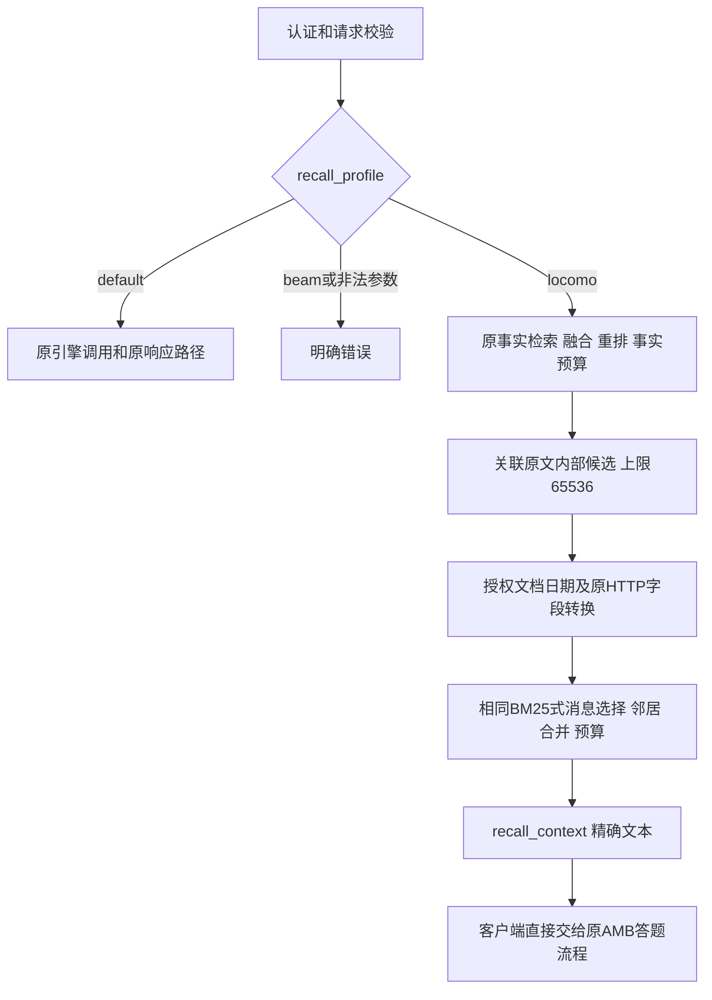

# Recall Profile 服务端原文选窗迁移设计

日期：2026年11月20日。范围：LoCoMo 客户端 `query-turn-windows-v1` 等价迁移、功能测试和限定场景复测。BEAM 只保留策略名，不启用新行为。

## 目的和边界

`recall_profile` 表示召回结果及原文上下文的选择策略，不是“开启后一定提速”的性能开关。本轮把已有客户端的消息级 BM25 式选窗移入 ContextBase 服务端，避免每个客户端重做选择，并减少原文候选传输。第一阶段以正确性和等价性为优先，不改变评分目标或选择算法。

它与 PG Recall 下推无关：不修改四路候选 SQL、RRF、索引、存储格式、BGE 模型及其排序。元数据读取和消息窗口处理都位于事实检索之后。后续不得把两个专项的收益合并宣称为本轮提速。

先确认相同候选输入得到相同上下文，再确认真实 HTTP 接入与授权、文档日期来源正确，最后用预先固定的 LoCoMo 子集进行答题和评分复测。不能只比较最终分数接近就认定实现等价。

## 接口参数

在已有 POST `/v1/default/banks/{bank_id}/memories/recall` 请求中增加：

| 参数 | 默认值 | 含义 |
| --- | --- | --- |
| `recall_profile` | `default` | 省略或`default` 为原行为，`locomo` 为消息窗口 v1，`beam` 预留但返回422 |
| 原有 `max_tokens` | 原接口默认值 | 仍约束引擎事实结果；基准等价复测显式设8192，不改写成最终上下文总预算 |
| 原有 `budget` | 原接口默认值 | 仍控制引擎检索力度；复测固定high |
| 原有 `query_timestamp` | 原接口默认值 | 原样传递，不由profile更改 |

`locomo` 第一版使用固定、带版本的配置，不开放任意权重和算法参数，避免配置漂移：依赖NLTK 3.10.4及tiktoken 0.12.0；原文候选65536 tokens，最终上下文8192，事实4000，原文4000，`o200k_base`，最多128个候选中心，中心前后各一条消息。权重是现有BM25式公式及相邻词奖励，不改词干、停用词或图片字段。

请求示例：

```json
{
  "query": "When did Gina mention Shia Labeouf?",
  "recall_profile": "locomo",
  "budget": "high",
  "max_tokens": 8192,
  "query_timestamp": "2023-08-07T00:00:00+00:00",
  "include": {"entities": null}
}
```

LoCoMo profile 内部必须读取原文候选，调用方不需要开启 `include.chunks`。第一版禁止将 `locomo` 与显式 `include.chunks` 混用并返回422，避免将内部64K候选误作为外部原文回包。默认profile的 `include.chunks` 及预算语义完全不变。

请求运行时默认值为default；用default_factory避免在OpenAPI中生成会被SDK主动发送的默认值，新SDK未启用策略时省略该字段。未知profile、空白locomo问题和预留beam均明确失败，不静默回退。选择locomo但缺可选依赖时返回503并提示安装 `hindsight-api-slim[recall-profiles]`；default不加载NLTK或该策略tokenizer。

## 响应与客户端约定

显式locomo响应新增 `recall_context`，包含 `profile=locomo`、`version=message_windows_v1`、`format=locomo-packed-json-v1`、`tokenizer=o200k_base`，以及 `text`、token统计、选中事实/原文ID和省略理由。`text` 就是客户端原本会生成的完整JSON记忆上下文，不改变键顺序、空值省略或日期字符串。

原 `results` 保留引擎事实结果及顺序。内部原文候选不返回为 `chunks`，选中的原话已经在 `recall_context.text` 中。部分消息窗口不会冒充原始完整chunk。

客户端选择服务端模式时须原样使用 `recall_context.text`，不得再运行客户端BM25、重新格式化JSON、按本地tokenizer裁剪或静默回退。缺少正确profile/version/format属于错误。客户端原模式继续按原流程运行，以支持等价对照和回退。评测配置选择locomo时还必须声明65536候选tokens和冻结的v1打包参数，参数不匹配时初始化失败，防止配置记录与服务端实际预算不一致。

不传profile与传default均走原有引擎调用和响应组装；没有额外日期查询，不出现 `recall_context: null` 新字段，也不改变原有facts/chunks/entities/source_facts返回。

## 实现位置

| 位置 | 职责 |
| --- | --- |
| `hindsight_api/api/http.py` 的 RecallRequest、RecallResponse、api_recall | 校验profile，配置内部候选预算，复用现有响应转换，调用策略，输出选中上下文 |
| `hindsight_api/engine/recall_profiles/models.py` | 轻量、无NLTK依赖的响应契约 |
| `hindsight_api/engine/recall_profiles/locomo.py` | 从客户端移植的纯选择算法，不访问数据库、网络、模型或QA标注 |
| `MemoryEngine._recall_document_dates` | 在原bank和调用方授权下读取session日期；不读基准gold |
| `benchmarks/memory/runner.py` 和 support.py | 显式选择客户端或服务端上下文模式，仍使用同一AMB答题、裁判和原版F1 |

HTTP层完成现有core-to-wire转换后再调用选择器，因为基线打包使用的是HTTP字符串日期及字段表示；直接把引擎内部对象序列化可能改变bytes和token边界。选择器在工作线程运行，避免CPU密集的分词和反复token计数阻塞ASGI事件循环。



## 等价契约

必须保持以下细节，不能在迁移时顺便优化：

1. 事实保持返回顺序和既有字段投影，4000事实配额不能改成取前K条。
2. 原文候选来自原recall关联chunk路径，不额外全库搜索，不突破bank、tag或时间范围。
3. 只解析可观察到的完整消息；截断JSON尾部不得补全文字，非JSON维持原fallback行为。
4. 保留speaker、dia_id、speech和BLIP caption；v1不把image-search query当caption加入。
5. 词频、候选集合内IDF、长度归一化、相邻词奖励、浮点计算顺序、排序tie-break完全保持。
6. 同分按原chunk枚举顺序和消息位置排序。改变dict顺序、SQL返回顺序或并行合并顺序均需检测。
7. 前后各一条邻居不跨物理chunk；窗口按原消息顺序合并，间隔标记原样保留；不顺便修复问答链。
8. 每次按完整JSON序列化重新计数，包含外壳和日期。总配额与原文配额同时成立，不能相加估算。
9. 对比最终文本bytes、选中事实ID及顺序、选中chunk ID及顺序、tokens与omitted列表，而不是只比答案或分数。
10. 处理后不修改输入候选，也不改变另一个请求的配置；不使用跨请求可变状态缓存词频/IDF。

## 文档日期与权限

客户端原来从准备好的session元数据取日期；服务器必须从同一原文的retain元数据 `event_date` 获取。不得使用created_at、当前日期、事实推断日期或QA参考日期代替。日期需有时区，字符串表示须与客户端基线核对；不能仅证明日期语义相同而忽略序列化造成的预算差异。

只读取本次已授权事实与候选chunk引用的文档，bank参数从请求上下文确定。复用原身份认证、RECALL读权限和tag范围检查。缺失、不可见或日期不兼容时停止该profile请求，返回明确错误，不返回部分上下文伪装成功。

第一版复用store已有文档读取接口；这些元数据读单独计量，不能纳入“一次候选SQL”的检索下推承诺。是否批量优化元数据读取由后续独立测量决定。

## 验证与验收

| 层次 | 验证 | 通过条件 |
| --- | --- | --- |
| 纯函数边界 | Unicode、同分、重复窗口、跨bank、空输入、截断JSON、caption、极小预算、输入不变 | 与客户端参照一致或按既有规则失败 |
| 全量历史重放 | 固定窗口运行1540份recall回包，使用冻结客户端已保存packing和reader正文作为独立oracle | 上下文1540/1540字节一致；结构化打包及差异全部记录 |
| HTTP路由集成 | 真实api_recall handler，控制引擎候选及元数据边界 | default兼容、locomo内部预算、输出和错误行为正确 |
| 权限和元数据 | RECALL权限、tag不可见、错误bank、缺event_date、不合法日期 | 不泄漏、不替代日期、不静默降级 |
| 原生小范围复测 | 隔离测试实例，同一Bank快照和模型；预先固定LoCoMo范围 | 客户端/服务端上下文一致；记录通过数、F1、模型用量及耗时 |
| 兼容与发布工件 | OpenAPI、生成SDK、相关既有测试、lint/typecheck | default契约不变，新参数可显式调用 |

历史重放不能证明数据库接入和真实HTTP均正确；HTTP mock边界测试不能冒充真实PG检索；模型分数接近也不能替代上下文等价。任何不一致保留题号和差异，不通过更换gold、宽松judge或挑选答案消除。

LoCoMo复测只复用原Bank或隔离副本，不重新抽取。答题与裁判、提示词、问题和gold固定。迁移算法若使最终上下文一致，仍可能因模型/裁判随机性得到少量不同标签，需同时报告逐题差异；不能保证复刻旧分数到最后一位。

## 回退与后续

关闭策略即不传 `recall_profile`，客户端恢复原窗口选择方式；不需要回滚表或重建Bank。LoCoMo策略有独立版本，后续修复13道回退题、改变图片字段或改语义选择都应新建版本和实验。

BEAM只预留名称，第一版不复用LoCoMo窗口、不加入分类提示，也不宣称获得优化收益。检索下推和本轮策略分别维护、分别验证。

实施进度、实际测试命令、结果与未覆盖部分记录在同目录验证报告，不以本设计中的验收条款代替执行证据。
