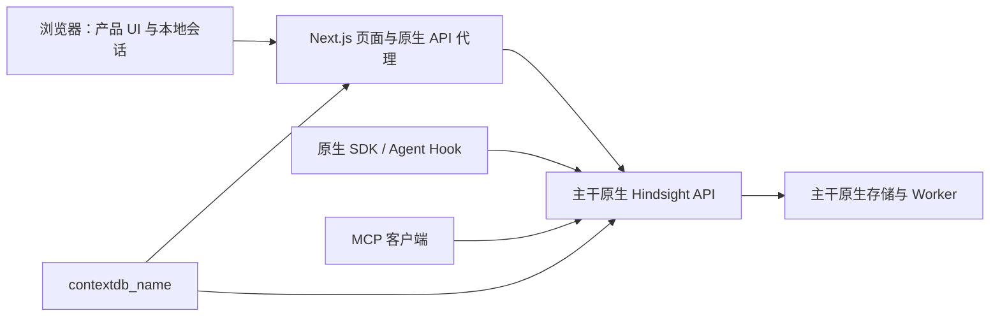

# 品牌/UI 独立提交设计

状态：DESIGN_READY。2026-10-17。本设计限定提取既有成果和解除其依赖，不重新设计产品或实现同事的身份方案。

## 1. 结果形态

一条直接基于 `origin/main` 的产品分支，包含早期 M2 产品界面、后续 F02/F03/F04 品牌配置与术语调整，以及这些能力所需的通用修复。原生数据服务提供已有的记忆功能与认证扩展；本分支没有独立用户/Key 管理服务。

“产品改名”和“权限方案”是独立职责。运行名称不参与 bank/instance/schema/授权身份计算。后续若接入同事的权限实现，应在独立变更中处理它的用户、凭证与授权接口，不能保留对本地旧方案的隐藏依赖。

## 2. 来源选择

| 模块 | 固定来源 | 提取规则 |
| --- | --- | --- |
| 布局、导航、原生功能页、图表/动效、指南/接入页 | `74b522bd8` 相对 `a67445f21` | 仅 control-plane 源码及相关测试；不合并该分支的 hosted manager/runtime 祖先 |
| UI 独立登录、Origin/Host、撤销、下载与传输修复 | 同上 | 属于早期产品交付，不等同多用户认证；保留并重新验证 |
| session 运行目录不进入 Next 构建追踪 | 后续固定快照中的 `lib/auth/session.ts` | 仅通用修复，不引入 access 配置 |
| F02 品牌配置和 F03/F04 定位/Workspace | 后续固定快照 | 优先成熟的 follow-up-simplified 文件；混合文件按片段合成 |
| 语言切换、英文回落和错误语言一致性 | 同一快照 | 保留查询参数/hash，保留既有 locale URL/cookie；明确产品仅完整维护 zh-CN/en |
| OpenAPI / Python / TypeScript / Go | 新分支最终 API | 必须重新生成，不从含权限变更的后续 SDK 整体复制 |
| 旧验收报告、运行器、hosted 设施 | 保留原位置 | 不作为新分支通过证明；仅记录来源，替换为本分支独立验证 |

后续未提交文件已冻结到主仓 `.local/product-brand-ui/source-snapshot`；源清单为 `.local/product-brand-ui/source-manifest.json`，SHA-256：`a9539a73c8ea810305067aefa0afc25198f714c736a6dfc9abb06d6044c1aef5`。快照包含 856 个非 docs 的变更文件，包含不少排除项；快照是取证，不是合入清单。

## 3. 文件级解耦

| 文件/目录 | 最终处理 |
| --- | --- |
| `hindsight-control-plane/src/lib/product-config*.ts` | 保留名称解析、部署环境读取；验证目标只来自 `HINDSIGHT_CP_DATAPLANE_API_URL`，移除 `hosted/access-config` 和 management URL |
| `src/lib/product-guard.ts` | 原生请求发送前检查品牌；返回普通产品错误，不保留 access 合同版本、operation_id、恢复只读例外 |
| `src/components/product-runtime.tsx` | 动态名称上下文、旧页签提示、草稿保留；删除“操作记录页面/恢复账本已保留”等依赖旧方案的承诺 |
| `src/components/bank-selector.tsx` | 从早期 UI 版本起步，只增通用 productFetch；不采用后续 access 入口、创建 Key 回跳、旧授权提示 |
| `src/app/[locale]/connect/page.tsx` | 早期独立接入页 + 动态 MCP 连接名称；凭证向部署管理员取得，不链接本地 Key 管理 |
| `src/messages/*.json` | 品牌/Workspace 新文案 + 原独立凭证说明；移除 `brand.access`、`resourcePages.manageKeys` 与失效入口 |
| `src/proxy.ts` | UI 会话保护、产品 guard、产品图标与配置只读入口；不得带入访问管理 BFF |
| `api/http.py` | 只取 API title/description/contact、metrics/tracing 默认服务名、`GET /product-config`；其余原生逻辑等同基线 |
| `api/mcp.py` | 只取 HTTP MCP server 名称；不带入授权上下文/策略相关修改 |
| `.env.example` 与 embed 副本 | 品牌 + 独立 UI 会话变量，两份字节一致；不引入管理服务配置 |
| `tsconfig.json` | 删除历史端口生成的 `.next-*` include；保留标准 Next types 与 standalone 排除 |
| `scripts/hooks/lint.sh` | 如资源约束需要，可单独提取通用 `LINT_SERIAL=1` 支持；不得加入 hosted/contracts/access-review 专用任务 |
| `hindsight-clients/**` | 根据新 API 生成；生成代码改名导致文件头广泛变化可以接受，但不得新增旧权限字段/响应 |

拒绝路径：`deploy/hosted-single-tenant`、`hindsight-extensions/hosted-single-tenant`、`src/lib/hosted`、`src/components/access*`、`src/app/api/access`、`src/app/api/hosted`、访问管理页面、原生 engine/worker/alembic 的权限或 schema 隔离改动。

## 4. 配置与行为合同

### 4.1 品牌

- 固定键：`contextdb_name`；默认：`agentstratum`；规则：`[a-z][a-z0-9-]{0,39}`，无 trim/lowercase。
- API 与 UI 在运行时读取；不使用 NEXT_PUBLIC 构建期品牌常量。同一生产构建在两个合法值下重启验证。
- `GET /product-config` 返回 `{product_config_version: 1, contextdb_name: string}`，`Cache-Control: no-store`；仅非秘密信息。
- UI 使用当前配置的数据 API 地址和路径前缀访问该端点，不需要管理 API，不向该端点发送凭证。
- API title 为 `${name} HTTP API`；HTTP MCP serverInfo.name 为 `${name}-mcp-server`；实际 MCP 工具名和路由不变。
- 新图标使用中性几何图案；metadata 图标遵守现有 basePath。

### 4.2 旧页签与错误

- 首次 HTML 固定该页签品牌；同源 productFetch 带 `X-Product-Name`。
- 旧名称请求返回 409 `PRODUCT_NAME_STALE`，数据 API 品牌错配返回 503 `PRODUCT_CONFIG_MISMATCH`，不可用/非法响应返回 503 `PRODUCT_CONFIG_UNAVAILABLE`。
- 拒绝发生在业务请求转发之前；不自动刷新、重发或丢弃草稿。
- 登录、退出、会话状态与非秘密诊断仍可用；产品服务故障不能阻止退出。
- 不增加新的幂等/恢复账本，提示不承诺本分支没有的能力。

### 4.3 会话与原生客户端

- 默认 UI local 模式配置不完整时关闭访问；bootstrap 必须显式选择。
- 本地会话 Cookie/签名绑定 origin/basePath，服务端私有目录支持撤销与重启后持续失效。
- 数据 API Key 留在服务端，独立于 UI 访问密码。认证继续由主干已有扩展负责。
- Workspace 与 bank 一一对应，仅展示术语改变；继续正确编码包含 `/`、`%`、`.`、中文等字符的 ID。
- 不改 Hook 集成/SDK/CLI 包名。来源中没有 Agent Hook 品牌补丁；不能把此项登记为已完成改造。

## 5. 提交组织

建议拆为可审查的逻辑提交：

1. 独立产品 UI 与通用会话/下载修复（含所需依赖与测试）。
2. API/MCP/UI 运行品牌配置、Workspace 术语与语言修复（含解耦测试和配置文档）。
3. 从最终 API 重生成的接口产物，以及最终验证/来源/审查文档。

如果保持中间提交可构建需要调整边界，可以合并前两个实现提交；分支最终必须完整独立，不得为了拆提交引入临时双栈或 broken commit。推送和 draft PR 前完成仓库要求的 code-review。主干合并留给用户。

## 6. 已知实施风险与解决路径

- 当前工作区是提前生成的草稿，已有代码不等于被审查通过；接收 session 应先核对所有差异和 manifest，再继续。
- 当前没有安装新 worktree 依赖，npm 安装被共享重型锁拒绝；不能把这算成依赖安装失败或测试失败。等待锁释放并继续其他轻量工作。
- `cargo`、`go` 未在当时 PATH 中发现，Java 可用。优先检查现有工具；源码生成可复用固定版本 Java generator，编译若无法运行应明确标记。不得把“生成完成”当“编译完成”。
- 现有全仓 lint 默认并行；有界执行时应先增加/提取通用串行支持，避免在 3 GiB 限额内并发类型检查。
- 系统测试通用启动器硬编码 `pg0://hindsight-systest:15499`，不能直接拿来操作本机未知共享数据库。独立验证要使用明确归属的数据库和端口；不得 sweep 其他 session 的 systest banks。
- 新系统测试草稿依赖尚未生成的 `ProductApi`；先生成 SDK，再运行，不能以临时 import skip 掩盖缺失。
- 前端 inherited 文案、provider、login、locale 与品牌插值的组合需用真实 production build/browser 验证；尤其缺失 NEXT_PUBLIC/env、登录页 guest 请求和 basePath。
- 全新部署没有旧权限管理状态迁移需求；不能因此删除第一阶段 UI 会话保护或更改主干数据语义。
