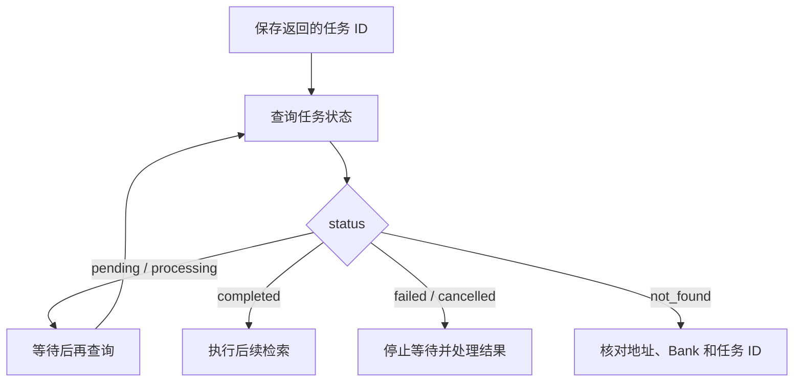

# 异步任务

异步调用先提交任务，再查询执行结果。收到任务 ID 与内容已经可检索，是两个不同的时刻。

## 提交后台写入

Retain 请求设置 `async=true`：

```json
{
  "items": [
    {
      "content": "Alpha 项目使用 PostgreSQL 16。",
      "document_id": "alpha_project_overview"
    }
  ],
  "async": true,
  "operation_id": "550e8400-e29b-41d4-a716-446655440000"
}
```

`operation_id` 可以由应用提前生成并保存，也可以省略，由服务分配。示例 UUID 仅用于说明，实际请求应为每次新的业务操作生成自己的 ID。

响应示例：

```json
{
  "success": true,
  "bank_id": "project_alpha",
  "items_count": 1,
  "async": true,
  "operation_id": "550e8400-e29b-41d4-a716-446655440000"
}
```

部分批量请求会返回多个 `operation_ids`，例如使用不同条目处理策略时。应跟踪全部任务，不能只等待第一个。

## 查询状态

**GET `/v1/default/banks/{bank_id}/operations/{operation_id}`**

```json
{
  "operation_id": "550e8400-e29b-41d4-a716-446655440000",
  "status": "completed",
  "operation_type": "retain"
}
```



| 状态 | 含义 | 建议处理 |
| --- | --- | --- |
| `pending` | 等待处理或等待后续执行时机 | 继续轮询 |
| `processing` | 正在处理 | 继续轮询 |
| `completed` | 当前任务完成 | 进入后续业务步骤 |
| `failed` | 任务失败 | 读取 `error_message` 并处理 |
| `cancelled` | 任务已取消 | 停止等待 |
| `not_found` | 未找到任务 | 核对地址、Bank 和任务 ID |

轮询应设置合理间隔和总等待时间。客户端等待超时，不代表服务端任务已取消；记录任务 ID 后，可以稍后继续查询。

首次检索应等待对应 Retain 任务完成。观察整理或知识页刷新等独立任务有各自的完成状态，不随 Retain 完成而一并保证更新。

## 响应丢失与重复提交

异步写入可以使用客户端生成的 `operation_id`。响应丢失时，用相同 ID 重试同一请求，可以复用原任务，避免重复入队。

一次新业务操作使用一个新 UUID，并保存该 ID 与请求的对应关系。不要用同一个 ID 提交不同内容，也不要在超时后立即生成新 ID 重复发送同一笔写入。

`operation_id` 只用于异步 Retain；同步调用会忽略它。不要将同步写入超时视为服务端未执行。

## SDK 中的两个“异步”

| 调用方式 | 客户端行为 | 服务端行为 |
| --- | --- | --- |
| Python `retain(..., retain_async=False)` | 同步等待调用 | 等待主要处理完成 |
| Python `await aretain(..., retain_async=False)` | 异步 I/O 等待调用 | 等待主要处理完成 |
| Python `await aretain(..., retain_async=True)` | 异步 I/O 等待提交结果 | 后台处理 |
| Node.js `await retain(..., { async: false })` | 等待调用结果 | 等待主要处理完成 |
| Node.js `await retain(..., { async: true })` | 等待提交结果 | 后台处理 |

返回 [API 参考](README.md)。
