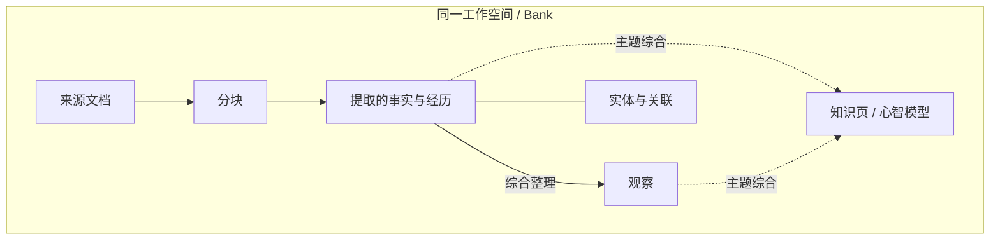

# 核心概念

使用 ContextBase 时，先确定内容属于哪个工作空间，再用文档标识管理来源，用检索和回答接口使用其中的记忆。

## 工作空间与 Bank

工作空间是组织内容和授权访问的基本单位，在 API 和 SDK 中称为 **Bank**，通过 `bank_id` 指定。

同一服务中的多个应用或 Agent，只要获得相应授权，就可以访问同一个 Bank。不同 Bank 的内容分别管理。一次 Recall 或 Reflect 请求只访问一个 Bank；一个 Key 获得多个空间的权限，并不表示单次请求会联合查询这些空间。

| Bank ID 示例 | 保存内容 | 使用方 |
| --- | --- | --- |
| `project_alpha` | 项目规范、设计决策、开发记录 | 项目编程助手 |
| `support_team` | 问题处理记录、服务经验 | 客服与运维 Agent |

Bank 由管理员创建并授权。安装 SDK 或工具适配器不会自动创建 Bank。

## 文档、分块与记忆

| 概念 | 含义 |
| --- | --- |
| 文档 | 一份来源内容，例如项目说明、会议记录或一段会话 |
| 分块 | 文档在处理过程中形成的内容片段，用于内容处理和来源追溯 |
| 记忆 | 从来源内容中提取或综合形成的信息，可以被检索和引用 |
| 实体 | 内容涉及的人物、组织、项目等对象，用于关联相关信息 |
| 关系 | 记忆与实体、其他记忆之间的关联，辅助检索和理解 |

下图表示概念之间的联系，不表示所有内容都会自动生成知识页：

一篇文档可以产生多条记忆，因此文档数与记忆数通常不同。Recall 返回的记忆也不一定是文档原文；需要原始上下文时，可以请求来源分块或读取文档详情。

### 用文档 ID 管理来源

建议为每份独立来源设置稳定且唯一的 `document_id`，例如 `alpha_project_overview`。后续用相同 ID 更新或删除该来源。

会话也可以作为文档保存，例如使用 `conversation_20261105_001` 作为文档 ID。应用可以额外记录自己的会话标识，但不会仅因在元数据中填写 `session_id` 就自动创建会话管理或隔离规则。

同一段来源可以在不同层次被使用：

| 层次 | 示例 | 适合的用途 |
| --- | --- | --- |
| 文档 | 一份完整的 Alpha 项目评审记录 | 查看完整背景，更新或删除来源 |
| 分块 | 其中讨论数据库变更的一段 | 回到命中信息的原始上下文 |
| 提取的记忆 | 评审确定了发布前验证要求及其理由 | 按问题检索相关信息 |
| 观察 | 从多次记录中综合形成的稳定认识 | 减少重复阅读，理解长期模式 |
| 知识页 | 按主题整理的“数据库变更规范” | 持续浏览和复用主题材料 |

这是用途示意，不是对某次模型提取结果的固定要求。来源写得越清楚，后续越容易判断提取信息是否准确。

## 记忆类型

| 类型 | API 值 | 含义 |
| --- | --- | --- |
| 世界事实 | `world` | 关于人物、事物、环境和事件的信息 |
| 经历 | `experience` | 与所代表主体的行动、交互和任务经历有关的信息 |
| 观察 | `observation` | 基于已有事实综合整理出的认识 |

类型描述的是信息本身，而非来源文件格式。同一份会话或文档可能产生不同类型的记忆，不能将所有会话内容都视为 `experience`。

“世界事实”描述来源对外部信息的陈述，不等于内容已经核实。应用提交的资料中如果包含猜测、否定或历史结论，应在正文里明确说明，不能仅依靠记忆类型补全语义。

## 时间与来源标识

文档创建、更新时间说明来源何时进入或更新到服务；记忆的发生、提及时间帮助理解内容对应的事件。一次今天导入的旧故障记录，故障发生时间并不因此变成今天。

| 标识或字段 | 用途 | 不应据此假定的行为 |
| --- | --- | --- |
| `bank_id` | 选择授权的工作空间 | 自动联合查询其他空间 |
| `document_id` | 定位和维护来源 | 跨空间共享同名文档 |
| `session_id` 等元数据 | 保存应用自己的会话来源信息 | 自动隔离或限定检索范围 |
| `tags` | 筛选内容 | 替代 Key 的空间授权 |
| 事件时间 | 理解发生时序和时间相关检索 | 自动决定相互矛盾的结论谁仍有效 |

对现行规范、偏好等内容，应用应明确维护策略。可以用稳定文档 ID 保存当前版本，将历史事件分开记录，而不是假定服务总会把最后提交的一句话视为最终事实。

## 知识页与心智模型

心智模型保存围绕某个主题综合形成的结果。知识页以这类内容为支撑，通过文件夹组成可以浏览和搜索的知识目录。

例如，团队可以围绕项目架构、发布流程或常见故障整理知识页。原始文档提供来源，知识页面向主题组织内容。页面是否生成、何时刷新，取决于页面配置和相关任务状态。

知识页搜索与普通 Recall 使用不同接口。Recall 不会固定先搜索知识页；知识页的 `page_id` 与心智模型 ID 也不能互换使用。

三种入口各有用途：

| 你需要什么 | 使用入口 |
| --- | --- |
| 围绕当前问题找相关记忆 | Recall |
| 围绕当前问题生成回答 | Reflect |
| 查找已经整理好的主题页面 | 知识页搜索或目录 |

知识页是独立保存的综合内容。来源更新、纠正或删除后，应确认页面是否需要刷新，不能仅凭来源操作完成判断页面正文已经改变。

创建流程见[控制台使用](console.md#7-创建并维护知识页)。

## Key、权限与标签

业务 API Key 用于接口认证，并限定能够访问的 Bank 和操作。只读 Key 可以检索和调用 Reflect；读写 Key 额外允许写入及授权范围内的内容修改、删除。

标签用于在 Bank 内筛选内容，例如 `project:alpha`、`topic:database`。它不替代服务端授权。需要分别控制项目访问权限时，应使用不同 Bank 并分别授权 Key。

权限说明见[快速开始](quickstart.md#权限与控制台)，标签规则见[记忆 API](api/memories.md#标签筛选)。
