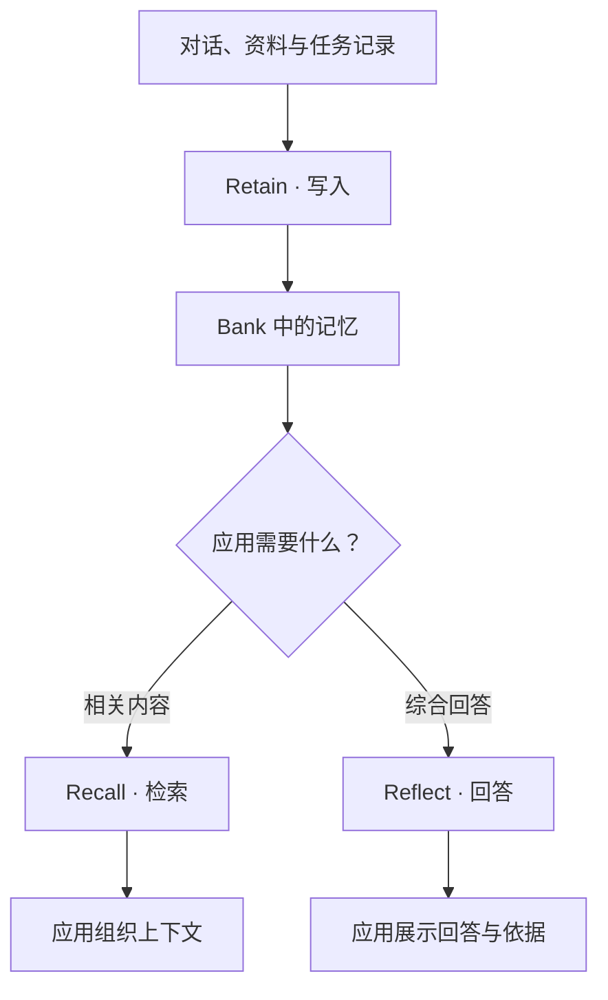

# 产品介绍

ContextBase 帮助 AI 应用和 Agent 保留需要长期使用的信息，并在后续交互中按需取回。应用将对话、项目资料和任务记录写入服务后，可以跨会话查询这些内容，也可以围绕具体问题生成回答。

例如，开发团队可以保存项目约定、技术决策和故障处理记录。新的会话或另一个获得授权的 Agent，可以继续使用这些背景，减少重复解释和查找资料的工作。

## 适用场景

| 场景 | 使用方式 |
| --- | --- |
| 编程助手 | 保存项目规范、设计决策和排障经验，为后续开发提供背景 |
| 对话助手 | 保留需要长期使用的信息，在后续会话中按需召回 |
| 任务型 Agent | 记录处理过程、结果和经验，供后续任务参考 |
| 团队协作 | 让多个获得授权的应用或 Agent 共享同一工作空间的记忆 |
| 资料问答 | 从已提交的内容中检索信息，或围绕问题整理回答 |

## 三项核心能力

| 能力 | 做什么 | 应用拿到什么 |
| --- | --- | --- |
| Retain：写入记忆 | 处理提交内容，提取事实并建立检索所需的信息与关联 | 写入结果，或用于跟踪后台处理的任务 ID |
| Recall：检索记忆 | 根据问题查找相关记忆 | 记忆条目，以及按需请求的来源信息 |
| Reflect：基于记忆回答 | 检索已有记忆并调用模型组织回答 | 回答，以及按需请求的依据 |

需要自行控制模型、提示词或回答流程时，使用 Recall 取得相关内容，再由应用继续处理。希望直接围绕已有记忆归纳、解释或总结时，可以使用 Reflect。

## 选择接入方式

| 接入方式 | 适合的工作 |
| --- | --- |
| [Python SDK](python.md) / [Node.js SDK](nodejs.md) | 将写入、检索和回答能力嵌入自己的应用 |
| [REST API](api/README.md) | 使用其他语言，或直接控制 HTTP 请求 |
| [Agent 与工具接入](agents.md) | 为已有编程工具配置记忆能力，或通过远端 MCP 按需调用 |

应用决定哪些内容值得保存、何时提交，以及如何使用检索结果。工具适配器可以协助完成部分工作，但自动保存能力取决于具体宿主和配置。

ContextBase 根据提交的资料提取和整理信息。需要确认关键结论时，可以结合来源文档和回答依据核对。

下一步：[了解核心概念](concepts.md)，或直接[完成第一次调用](quickstart.md)。
