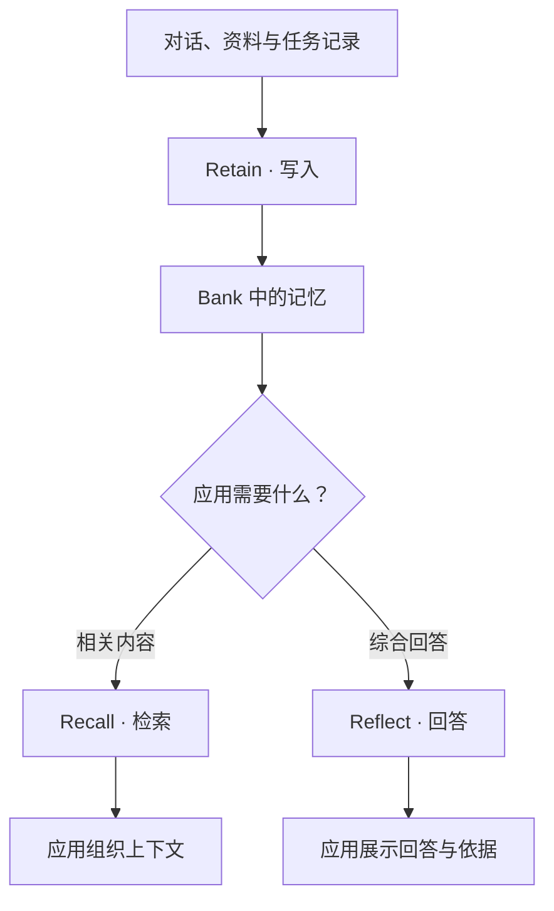

# 产品介绍

ContextBase 帮助 AI 应用和 Agent 保留需要长期使用的信息，并在后续交互中按需取回。应用将对话、项目资料和任务记录写入服务后，可以跨会话查询这些内容，也可以围绕具体问题生成回答。

例如，开发团队可以保存项目约定、技术决策和故障处理记录。新的会话或另一个获得授权的 Agent，可以继续使用这些背景，减少重复解释和查找资料的工作。

## 它解决什么问题

一次对话可以容纳当前问题、工具结果和临时推理，但应用往往还需要使用更早的信息：团队为什么采用某个方案、用户已经表达过什么偏好、上次故障最终怎样处理。这些内容分散在历史会话和文档里，既不适合每次全部放入提示词，也不能只依靠当前会话保存。

ContextBase 提供一个由应用持续写入、按需检索的记忆空间。应用在合适的时机提交来源内容，服务从中提取事实与经历、建立关联，并可进一步整理观察和主题知识。后续请求再根据问题取回相关内容。

以项目助手为例：

| 使用阶段 | 应用提供的内容或问题 | ContextBase 的作用 |
| --- | --- | --- |
| 项目建立时 | 技术规范、发布要求 | 保存来源，提取可检索的约定 |
| 讨论形成决策后 | 决定、理由、适用范围和日期 | 让后续会话能查到“为什么这样做” |
| 故障处理结束后 | 现象、原因、处理和验证结果 | 为类似问题提供已有经验 |
| 新成员开始任务时 | “修改数据库结构前需要做什么？” | 召回相关规范，或基于记忆组织回答 |
| 约定发生变化时 | 新的完整规范 | 通过稳定的文档 ID 更新来源 |

服务保存和处理的是应用提交的内容。SDK 不会自行读取整个项目、监听全部对话或收集所有用户行为；这些采集与写入时机由应用或对应工具适配器决定。

## 适用场景

| 场景 | 使用方式 |
| --- | --- |
| 编程助手 | 保存项目规范、设计决策和排障经验，为后续开发提供背景 |
| 对话助手 | 保留需要长期使用的信息，在后续会话中按需召回 |
| 任务型 Agent | 记录处理过程、结果和经验，供后续任务参考 |
| 团队协作 | 让多个获得授权的应用或 Agent 共享同一工作空间的记忆 |
| 资料问答 | 从已提交的内容中检索信息，或围绕问题整理回答 |

完整的[项目助手案例](project-assistant.md)展示了资料组织、跨会话查询、来源核对、更新和清理；[更多应用场景](use-cases.md)介绍对话助手和运维助手的接入思路。

## 三项核心能力

| 能力 | 做什么 | 应用拿到什么 |
| --- | --- | --- |
| Retain：写入记忆 | 处理提交内容，提取事实并建立检索所需的信息与关联 | 写入结果，或用于跟踪后台处理的任务 ID |
| Recall：检索记忆 | 根据问题查找相关记忆 | 记忆条目，以及按需请求的来源信息 |
| Reflect：基于记忆回答 | 检索已有记忆并调用模型组织回答 | 回答，以及按需请求的依据 |

需要自行控制模型、提示词或回答流程时，使用 Recall 取得相关内容，再由应用继续处理。希望直接围绕已有记忆归纳、解释或总结时，可以使用 Reflect。

### 同一个问题，两种用法

对于“Alpha 项目上线前需要检查什么”，Recall 可以返回相关的发布要求、技术决策和故障经验。应用可以把这些记忆放入自己的提示词，也可以直接展示检索结果及来源。

Reflect 则会围绕问题检索并组织回答。需要展示来源时，请求返回回答依据，再将依据和结论一起呈现。

前者更适合已经有问答或 Agent 编排流程的应用；后者适合希望直接使用 ContextBase 回答能力的应用。两者都需要应用明确选择 Bank 和检索范围。

## 与会话上下文、文档检索怎样配合

| 机制 | 主要承载什么 | 在应用中的位置 |
| --- | --- | --- |
| 当前会话上下文 | 当前问题、近期对话和本次任务的临时信息 | 随当前请求一起交给模型 |
| 文档检索 | 与问题相关的来源段落 | 为回答提供原文材料 |
| ContextBase 记忆 | 从来源提取的事实、经历及综合形成的认识 | 为跨会话使用提供可维护的背景 |
| ContextBase 知识页 | 围绕固定主题整理的内容 | 供人或应用持续浏览、查询和复用 |

这些能力可以一起使用。例如，应用保留最近几轮对话，用 Recall 补充项目约定，再在需要核对细节时读取来源分块。模型最终收到的上下文由应用组织，不必每次重放全部历史。

ContextBase 也保留文档与分块的访问方式，因此可以从记忆回到来源。是否能读取完整原文，取决于原文保存配置。

## 从一次调用到持续使用

应用接入通常需要明确四件事：

1. **保存什么**：优先保存对后续任务有用的约定、明确偏好、决策及处理结果，并提供足够背景。
2. **何时保存**：可以在一轮对话结束、任务完成或资料更新时提交。不要把尚未形成结论的猜测写成已经确认的事实。
3. **何时读取**：在模型作答或 Agent 制定计划前，根据当前问题检索相关记忆。
4. **如何维护**：来源变化时更新原文，提取错误时纠正事实，需要作废时调整状态，并确认相关知识页是否已刷新。

ContextBase 不会因写入资料而修改基础模型的权重。长期使用的效果来自持续维护的资料、检索与回答过程，而不是一次模型训练。

## 选择接入方式

| 接入方式 | 适合的工作 |
| --- | --- |
| [Python SDK](python.md) / [Node.js SDK](nodejs.md) | 将写入、检索和回答能力嵌入自己的应用 |
| [REST API](api/README.md) | 使用其他语言，或直接控制 HTTP 请求 |
| [Agent 与工具接入](agents.md) | 为已有编程工具配置记忆能力，或通过远端 MCP 按需调用 |

应用决定哪些内容值得保存、何时提交，以及如何使用检索结果。工具适配器可以协助完成部分工作，但自动保存能力取决于具体宿主和配置。

ContextBase 根据提交的资料提取和整理信息。需要确认关键结论时，可以结合来源文档和回答依据核对。

下一步：[了解核心概念](concepts.md) · [快速开始](quickstart.md) · [项目助手完整案例](project-assistant.md) · [控制台使用](console.md)。
