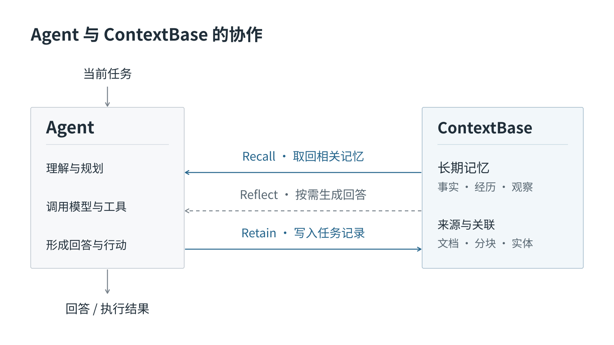

# ContextBase

**面向 AI 应用与 Agent 的长期记忆与知识服务**

ContextBase 将对话、文档与任务记录转化为可检索、可关联、可维护的记忆，为 AI 应用提供跨会话延续的业务背景。通过统一的写入、检索与回答接口，应用可以在新的交互中使用已积累的信息，让项目约定、技术决策和处理经验持续发挥价值。

从记住一项用户偏好，到理解一段项目历史，再到复用一次已经验证的故障处理经验，ContextBase 为应用连接过去的记录与当前的问题。开发者可以将它接入现有模型与 Agent 工作流，也可以直接基于记忆生成回答。

Agent 负责当前任务的理解、规划与执行，ContextBase 为它提供长期记忆。应用按需调用 Recall 或 Reflect，并通过 Retain 保存值得保留的记录，供后续任务使用。

## 让业务背景持续可用

AI 应用处理的工作往往跨越多次会话：一项决策有形成过程，一条规范有适用范围，一次故障有定位证据和处理结果。这些信息只有在后续任务中能够被找到、理解和更新，才会成为可复用的经验。

ContextBase 围绕这一过程组织记忆与知识：

| 价值 | 应用中的体现 |
| --- | --- |
| **延续上下文** | 在新会话和后续任务中，按需取回已保存的约定、偏好与历史背景，减少重复说明 |
| **关联分散信息** | 从来源中提取事实与经历，建立实体关联，并通过观察整理已有信息中的共性 |
| **保留使用依据** | 按需取得命中记忆的来源标识、相关分块或回答依据，帮助核对结论与原始背景 |
| **支持持续维护** | 更新来源、纠正或作废事实，检查并刷新相关知识页，让应用能够管理内容变化 |

例如，项目助手可以持续保存研发规范、设计决策与故障复盘。当开发者询问“这次数据库变更上线前需要做什么”时，应用能够取回相关要求和历史经验，结合本次任务组织回答。规范调整后，再通过稳定的文档 ID 更新来源，使后续使用有明确的维护入口。

## 从来源记录到记忆与知识

ContextBase 以工作空间组织内容，在 API 和 SDK 中称为 **Bank**。应用为请求选择相应 Bank，并在授权范围内写入、检索和维护信息。多个获得授权的应用或 Agent 可以共享同一 Bank 的业务背景。

同一份来源可以在不同层次发挥作用：

| 内容层次 | 承载的价值 |
| --- | --- |
| **文档与分块** | 保存来源及其上下文，支持资料维护与出处核对 |
| **事实与经历** | 将来源中的信息转化为可检索的记忆，供后续交互使用 |
| **观察与实体关联** | 综合已有信息，连接相关对象、事件和经验，辅助理解与检索 |
| **知识页与心智模型** | 围绕固定主题整理内容，形成便于持续浏览和复用的知识 |

知识页需要相应的创建与刷新配置。来源更新、记忆整理和知识刷新有各自的处理过程；应用应根据任务状态确认相关内容是否已经就绪。概念与标识的详细关系见[核心概念](concepts.md)。

## 三项核心能力

### Retain · 将有价值的信息沉淀为记忆

应用提交需要长期保留的内容，ContextBase 从中提取事实与经历，建立检索所需的信息与关联。来源可以是一份技术说明、一段会话，也可以是一次任务的处理记录。

为独立来源使用稳定的文档 ID，可以在内容变化时更新或删除对应资料。写入支持同步处理和后台任务；观察整理、知识页刷新等后续处理可能更晚完成。

### Recall · 为当前问题找回相关背景

Recall 根据问题检索已有记忆，结合语义、关键词、实体关联与时间信息寻找相关内容。应用可以按类型、标签和内容预算控制返回范围，并按需请求来源分块或观察所依据的事实。

检索结果可以进入应用自己的提示词、规划与工具调用流程，也可以直接呈现给用户。例如，对“Alpha 项目上线前需要检查什么”的查询，Recall 可以返回相关规范、技术决策与故障经验，由应用继续组织上下文。

### Reflect · 基于已有记忆形成回答

Reflect 围绕问题检索记忆并调用模型组织回答，适用于归纳、解释与总结。应用可以按需请求回答依据，将结论与相关记忆一同呈现。

对于相同的上线检查问题，Reflect 可以基于已有资料整理检查建议。关键结论仍应结合来源与当前任务条件核对。

| 应用需要 | 选择 |
| --- | --- |
| 保存来源并提取记忆 | Retain |
| 自行控制模型、提示词或 Agent 编排 | Recall，将结果交给现有工作流 |
| 直接围绕已有记忆生成回答 | Reflect，按需返回回答依据 |

## 记忆、知识与应用上下文协同

ContextBase 可以与现有会话管理和文档检索一起使用。近期对话提供当前任务的即时信息，长期记忆补充历史背景，来源分块支持细节核对，知识页提供按主题组织的材料。

例如，应用保留最近几轮对话，用 Recall 补充项目约定，再在需要核对细节时读取来源分块。最终交给模型的上下文由应用组织，无需为每个请求重放全部历史。

知识页通过独立入口浏览与搜索，普通 Recall 没有固定先搜索知识页的步骤。应用可以按任务需要选择相应入口。

## 覆盖个人、项目与团队的持续协作

| 场景 | 记忆与知识的使用方式 |
| --- | --- |
| **编程助手** | 延续项目约定、架构背景与排障经验，为后续开发提供上下文 |
| **对话助手** | 维护已确认的偏好和背景，在新会话中继续使用 |
| **任务型 Agent** | 记录执行过程、结果与经验，为后续任务提供参考 |
| **运维与服务助手** | 从工单、复盘和处理记录中查找相似问题，结合当前状态辅助排查 |
| **团队知识协作** | 在授权空间内共享项目记忆，并将稳定主题整理为知识页 |

完整的[项目助手案例](project-assistant.md)展示了资料组织、跨会话查询、来源核对、更新和清理；[更多应用场景](use-cases.md)介绍对话助手与运维助手的接入思路。

## 将记忆能力接入现有应用

| 接入方式 | 适用需求 |
| --- | --- |
| [Python SDK](python.md) / [Node.js SDK](nodejs.md) | 将写入、检索与回答嵌入应用逻辑 |
| [REST API](api/README.md) | 使用其他语言，或直接控制 HTTP 请求 |
| [Agent 与工具接入](agents.md) | 为已有编程工具配置记忆能力，或通过远端 MCP 按需调用 |
| [控制台](console.md) | 查看内容、验证检索、维护知识，并管理成员与访问凭据 |

应用决定保存什么、何时提交，以及如何使用返回内容。SDK 处理应用明确提交的资料；工具适配器的自动采集与保存能力取决于具体宿主和配置。

在日常使用中，建议优先沉淀已确认的约定、偏好、决策及处理结果，在模型作答或 Agent 制定计划前按需检索，并随业务变化维护来源与派生知识。ContextBase 通过记忆、检索和知识整理持续提供背景，写入资料不会修改基础模型的权重。

下一步：[快速开始](quickstart.md) · [了解核心概念](concepts.md) · [项目助手完整案例](project-assistant.md)。
