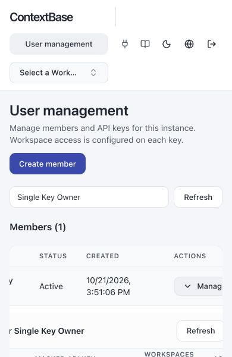
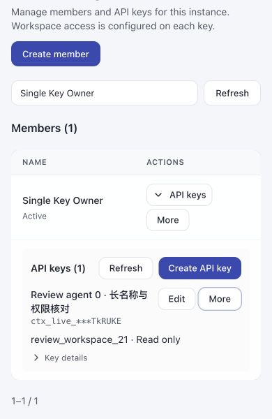
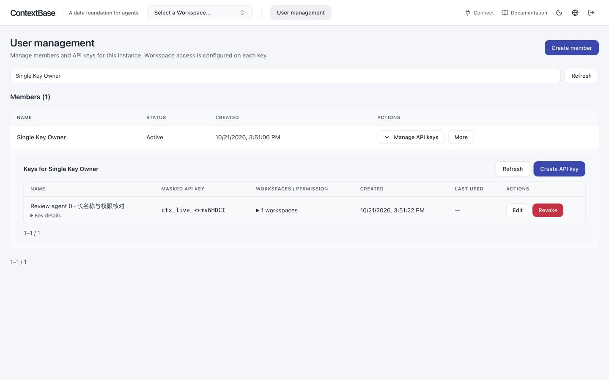
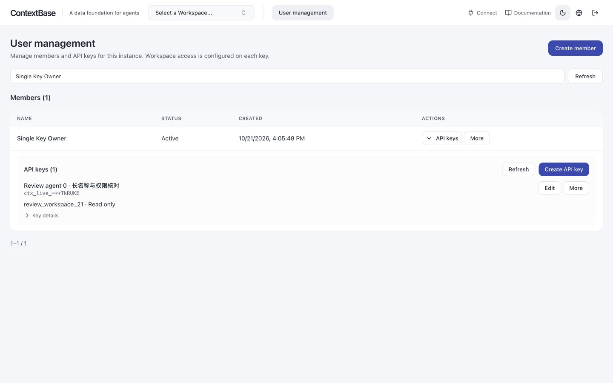

# ContextDB 团队分支集成代码检视

本次修复PR基线为已合并团队main `1dc0ad37e`，不是原管理功能基线57bbfd2。Issue #19逐项判断见[第16章](#issue19-resolution)。第13～14章保留历史阶段，当时“未提交/不推送”描述不再代表当前发布请求。

当前已落地项先查 [第15章：已落地优化索引](#implemented-optimization-index)。该索引区分已提交基线、工作区修复、已有等效修复、有意撤回及待办；第13～14章保留实施过程，不再从历史记录重复推导当前状态。

## 1. 检视结论与证据入口

本文件是实现者按项目 `.claude/skills/code-review/SKILL.md` 完成的自检及专家阅读指南，不代表独立专家已批准。最终测试状态见 [VALIDATION.md](VALIDATION.md)；评审必须同时查看设计约束与验证范围，不能仅依据冲突已消除或本地提交存在批准合入。

本次集成范围为工作空间、用户、API Key扩展，以及直接需要的UI、部署、测试和CI适配；不包含无关运行时重构、现有部署/数据库操作或远端发布。开发步骤不再单独维护为PLAN文档。

固定团队基线：`57bbfd2d39685091ce65a4742e43c6efbcb4c78e`。初始功能来源：`ddf5c360001f1db46f925b1822803ac9bff1119e`；公开功能来源：`a05b80885883b36f879abdb2ce8a9c8f63b0922c`，历史增量适配经amend纳入eb055aff3。S16～S26最初来自该来源基准上的冻结未提交代码，当时目标状态和指纹保留在第13章；当前修复按第16章对齐main并送审。下列命令用于回溯原管理功能；本次修复PR另看git diff 1dc0ad37e...HEAD。

```sh
git log --oneline 57bbfd2d39685091ce65a4742e43c6efbcb4c78e..HEAD
git status --short
git diff --stat 57bbfd2d39685091ce65a4742e43c6efbcb4c78e
git ls-files --others --exclude-standard
git diff 57bbfd2d39685091ce65a4742e43c6efbcb4c78e -- hindsight-api-slim/hindsight_api
```

历史功能已归并为单个提交；本轮先查看`git diff HEAD`以及status/ls-files列出的新文件，再核对相对团队基线的完整差异。最后一条预期没有输出：本次管理能力不修改原生 Python 运行代码；团队既有改动保留。专家不应以官方 v1.0.0 为差异基线而将团队已有改造归入本特性。

## 2. 必须先读的设计

统一以 [DESIGN.md](DESIGN.md) 为完整设计依据：第1章对象/架构，第2章部署/密码/配置，第3～4章用户操作与业务权限，第5.1节认证及SEC-01、第5.2节生命周期、第5.3节PG、第5.4节API，第6章边界/Q&A。本文件仅记录代码走读和检视发现；所有读者审阅同一份设计，不另设角色版本。

## 3. 逐层阅读顺序

| 顺序 | 文件/目录 | 重点 |
| --- | --- | --- |
| 1 | `hindsight-extensions/contextdb-service/hindsight_ext_contextdb/models.py`、`schema.sql` | 六张元数据表、对象身份、版本、Key授权输入与显式权限 |
| 2 | 同目录 `security.py`、`repository.py`、`authorization.py` | 全Key的HMAC、PG角色、用户启停、selected/all、空间UUID绑定、请求内复用边界 |
| 3 | `asgi.py`、`transport.py`、`tenant.py`、`validator.py`、`mcp.py` | 正确启动入口、REST/MCP当前消息身份、schema路由、Worker任务边界、诊断脱敏 |
| 4 | `http.py`、`lifecycle.py`、`migrations.py`、`bootstrap.py` | 管理API、短事务、同步创建删除、离线初始化、唯一管理员保护 |
| 5 | `hindsight-control-plane/src/proxy.ts`、`src/lib/contextdb.ts`、`src/app/api/contextdb/[...path]/route.ts` | 团队会话叠加Admin检查、同源/Host、固定上游、白名单、ETag、无自动重放 |
| 6 | `src/app/api/auth/login/route.ts`、`src/instrumentation.ts` | 先校验密码和Admin身份再签发会话、启动时配置及后台身份验证 |
| 7 | `src/lib/contextdb-api.ts`、`src/lib/contextdb-mode.tsx`、`src/components/contextdb/` | 产品身份请求头、一次性Key展示、分页/搜索、结果未知提示、统一创建对话框 |
| 8 | 布局、登录页、Bank选择器/详情/配置/总览及 `src/i18n/*` | 团队品牌/主题/语言回退保留、禁用原生生命周期入口、管理导航 |
| 9 | 扩展 `deployment.py`、`launch.py`、`ui_probe.py`、`deployment/` | 秘密隔离、别名优先级、会话存储权限与持久化、Host安全探测 |
| 10 | 扩展测试、插件`tests/system/test_100_*`～`test_118_*`、UI测试与CI | 核对下列风险有实际行为覆盖，确认生产UI故事不会在CI静默跳过 |

目录均相对仓库根；以上同目录简称均指 `hindsight_ext_contextdb/`。

## 4. 11个冲突的解决决策

| 冲突路径（UI路径省略前缀 `hindsight-control-plane/src/`） | 决策 |
| --- | --- |
| `app/[locale]/banks/[bankId]/page.tsx` | 保留团队翻译状态；ContextDB模式隐藏原生克隆入口 |
| `app/[locale]/layout.tsx` | 团队ProductRuntime/metadata/dataset叠加ContextDBModeProvider；本地系统字体 |
| `app/[locale]/login/page.tsx` | 团队登录布局/productFetch叠加独立UI密码说明 |
| `app/api/auth/login/route.ts` | 保留配置、Host/Origin和磁盘会话；验证当前Admin身份后签发 |
| `app/globals.css` | 保留团队主题色与语义token；使用本地字体变量 |
| `components/bank-selector.tsx` | 保留团队资源导航与productFetch，合入用户入口和统一空间创建对话框 |
| `i18n/request.ts` | 合成团队语言回退、品牌替换与管理词条 |
| `instrumentation.ts` | 团队产品配置校验加ContextDB后台身份启动检查 |
| `lib/i18n/api-errors.ts` | 团队locale解析与回退保留，合入管理模式兼容 |
| `middleware.ts`（修改/删除） | 删除旧文件，将所需策略接入团队 `proxy.ts` |
| `hindsight-system-tests/hindsight_system_tests/server.py` | 保留团队外部专用PG覆盖和环境隔离，合入扩展入口/解释器注入与失败清理 |

自动合并的 `banks-overview.tsx`、`bank-config-view.tsx`、Vitest、CI和OpenAPI仍单独审阅；自动合并不等于行为兼容。

## 5. 检视发现与闭环

| 编号 | 级别 | 具体问题 | 处理与覆盖 |
| --- | --- | --- | --- |
| C01 | Must fix | 新增contextdb.ts导入团队已删除的ACCESS_KEY_COOKIE，Git不会报冲突 | 使用sessionCookieName；覆盖撤销后重放会话、配置别名、origin绑定 |
| C02 | Must fix | 旧middleware与团队proxy不能并存；直接选一边会丢安全或管理策略 | 删除旧入口，在proxy合成；覆盖本地化登录、私有页、静态资源、带扩展名API ID和生命周期限制 |
| C03 | Must fix | 旧部署模板缺PUBLIC_ORIGIN/SESSION_DIR且只读容器无会话写目录 | 新意图字段、0700目录和独立rw挂载；覆盖渲染、错误地址、路径权限与符号链接拒绝 |
| C04 | Must fix | 新管理代码只读HINDSIGHT前缀，团队前缀优先级会不一致 | 统一controlPlaneEnv；启动器保留团队配置和产品名，私有文件覆盖两套秘密；冲突变量行为测试 |
| C05 | Must fix | 管理fetch未带团队标签页产品身份，旧标签页保护不完整 | 使用productFetch；jsdom验证X-Product-Name及浏览器无Admin Authorization |
| C06 | Must fix | 本地健康探测Host与公网origin不同，会返回421 | 专用异步探测连接本地并发送规范化Host（大小写/默认端口/IDNA/IPv6）；shell显式传递origin/port（仅source不会export）；覆盖200/302/421/503、非法origin及实际Compose健康命令 |
| C07 | Must fix | CI未构建生产UI，端到端UI测试可能跳过 | 上一轮system job构建并用require标志；本轮改为独立test-contextdb-system-ui正式构建+双Worker JUnit完整性门禁，普通system不重复构建 |
| C08 | Important | 原生/新增故障用例断言内部异常原文，与团队脱敏契约冲突 | 保留运行代码，适配Worker重试/最终错误和MCP故障用例，状态/重试/无数据丢失等断言仍保留；视觉能力错误继续使用安全提示 |
| C09 | Important | 代理测试只设置HTTP_PROXY时，被宿主http_proxy遮蔽 | 测试显式清理小写变量，保留真实TCP代理断言 |
| C10 | Important | 原管理UI测试依赖旧布局导航mock和原生Bank术语 | 适配团队Link/usePathname和现有词条，不恢复旧团队已移除的外部模板链接 |
| C11 | Important | 迁移测试复用固定PG实例/端口，可能连接旧实例并因凭据冲突失败 | 新建module级私有PG工厂，唯一名称/端口/临时目录、明确停止；10个迁移/向量测试模块23项通过 |
| C12 | Important | 未分类的真实LLM及Docker/S3测试混入非外部依赖路径 | 补hs_llm_core/integration标记，保留对应测试；不使用xfail或静默断言替换真实能力 |
| C13 | Important | 原生测试尚未跟随团队品牌名、metrics和配置前缀变化；Copilot构造依赖宿主登录状态 | 测试契约适配；mock只覆盖认证元数据准备，仍验证真实provider工厂携带timeout；不改变任何原生运行文件 |
| C14 | Important | 共享PG的不同xdist Worker执行并发索引DDL，干扰索引修复断言 | 验收模式为每个Worker分配私有PG；默认开发/CI连接方式不变，不增加重试或跳过 |
| C15 | Important | 方言单例保存异步索引锁，前一用例竞争后的锁绑定已关闭的事件循环 | 测试夹具逐用例清理方言单例，同一用例的backend/store仍共享实例；直接双循环诊断可复现；未改运行代码，未声称解决生产跨循环使用 |
| C16 | Deferred baseline issue | 团队基线的概览页引用不存在的what-contextbase-does.json，文档生成钩子失败 | 已由 [Issue #14](https://github.com/RSIXDB/hindsight/issues/14) 独立跟踪；按用户范围要求移除相关修复，109个文档/生成文件均恢复团队基线；不属于管理功能依赖，不宣称该检查通过 |

原生测试适配全部位于 `hindsight-api-slim/tests/`，与移植业务代码分开阅读。修改范围包括公开品牌/错误契约和测试夹具/分类，不修改记忆算法、任务状态机或数据库迁移实现。

C08中原生两个Worker测试的失败断言在修改前已单独复现，且其运行文件与团队基线一致。调整的是安全输出契约的测试期望，未通过重新暴露内部错误换取测试通过。

## 6. 自检清单与剩余专家判断

- 分支直接从固定团队main创建；只有本特性和必要兼容/测试/文档变更。
- 不新增原生内核钩子、advisory lock、BaseHTTPMiddleware或管理调度循环。
- 管理路由解析输入后调用Repository/生命周期层；SQL仍集中在扩展持久层，动态标识经过校验。
- selected权限按UUID绑定，列表/搜索分页，Key完整值不进入普通列表、错误和浏览器持久存储。
- 授权复用仅限同请求/目标/凭据；新请求及新MCP消息重新认证。
- 管理删除有身份绑定ETag，超时结果未知不自动重放；不宣称并发删除安全。
- 保留团队产品配置v2、品牌模板/生成文件、会话撤销及UI配置优先级。
- lint、类型、构建、契约及功能测试证据集中记录；完整文档生成钩子保留Issue #14所述基线失败，不混入通过项；日志、.venv、node_modules和构建产物不提交。

专家仍需确认删除停止访问的产品约束、目标RDS权限和镜像交付要求。真实LLM评测、目标ECS/RDS、镜像漏洞扫描与生产压测不由本地stub回归替代；详见验证记录。原生敏感日志Issue #3按已有范围约定独立跟踪。


## 7. 关键代码调用链与逐步核对

以下路径省略扩展前缀 `hindsight-extensions/contextdb-service/hindsight_ext_contextdb/`；symbol便于重新定位，避免仅依赖易变行号。不是要求审阅者仅看这几个函数，还应追查上下游和错误分支。

### 7.1 管理HTTP认证到元数据提交

`http.ContextDBHttpExtension.get_router` 建立ManagementRoute，包装器先调用 `Repository.authenticate_admin`，再由FastAPI验证body；即使业务Key提交坏body也应先拒绝身份。`security.bearer_credential` 拒绝重复Authorization。`Repository.authenticate` 用完整Key的HMAC验证PG用户角色和状态；前缀/all不授予admin。

13项路由调用Repository或Lifecycle。检查所有变更事务是否先 `_instance_lock`、是否记录真实管理员公开key_id、审计是否与成功变更同事务；失败不得产生成功记录。输入错误只输出白名单字段位置，不回显Pydantic input、未知字段名或SQL诊断。

### 7.2 REST内容访问

`asgi.create_app` → `WorkspaceAuthorizationMiddleware.__call__` → `Repository.authenticate(key,bank)` → `authenticated_request`/`bank_target` → 原生Tenant认证 → `ContextDBTenantExtension.authenticate` → 原生引擎Validator钩子 → `ContextDBOperationValidator._authorize`。

检查目录、文件下载、内容清空等特殊路径；Bank/schema匹配必须在引擎执行入口仍成立。transport对非Bank路由放行，不能因此声称全API统一私有；SEC-01和version/OpenAPI必须单独评估。

### 7.3 MCP发现与执行

`mcp.ContextDBMCPExtension` 中间件读取当前HTTP消息Bearer，设置实际工具Bank；Tenant/Validator筛选当前工具集合及授权实际目标。`filter_mcp_tools` 在原生外层恢复ContextVar之后仍从当前HTTP request取凭据/目标。检查新session与旧session、工具发现并集和实际执行、path Bank与参数Bank不同的冲突行为。

静态工具隐藏只是减少误调用，不能覆盖执行授权。优先打开system test_104/105/111，核对先writer后reader、跨空间和吊销后重放session的断言。

### 7.4 受信管理调用与Worker

`authorization.workspace_management` 在已认证管理路由和状态过渡后构造原生internal RequestContext，绑定workspace_id/bank/schema/action和当前asyncio task。`management_call` 要求同一context对象与owner task；退出后active=false。检查客户headers、普通Worker、继承ContextVar的子任务不能取得生命周期权限。

Worker发现走 `list_tenants` / `worker_workspaces`，普通后台任务仍校验注册空间与schema；不因原客户Key吊销而丢弃已接受处理。不得将此解释为删除期间执行安全保证。创建/删除中的任务发现及周期任务入队限制以validator实际分支为准。

### 7.5 创建与删除

`Lifecycle.create` → Repository预留creating → 原生migration/update_bank/profile确认 → finish_workspace_creation。

`Lifecycle.delete` → Repository检查原ETag并记deleting → schema检查/原生delete_bank → finish_workspace_deletion → `_destroy_workspace`。

逐个await检查元数据连接是否已经归还；最终事务需再次验证状态/版本/归属/外部依赖。取消不被Exception捕获为普通失败，因此会保留未知状态；没有shield或自动后台恢复。对比test_lifecycle_metadata中短事务、取消、最终回滚、外部依赖测试，检查原生清理的事务外副作用不能被PG回滚测试覆盖。

### 7.6 UI与部署

`proxy.ts`保留团队Host/Origin/产品身份/会话流程，ContextDB配置有效后叠加后台身份与原生生命周期限制。`login/route.ts`先密码与后台身份，再签发团队磁盘会话。`requireContextDBAdmin`路由自身复验会话/写Origin；管理转发实际由API校验Admin，因此不另缓存后台身份。

管理代理只接受users/workspaces固定路径，转发q/limit/offset和If-Match；body限制为JSON对象、业务字段由Python模型校验，响应递归防御过滤秘密字段。`contextdb-api.ts`用productFetch，组件保留旧ETag/预期空间ID、一次性secret和结果未知状态。

`deployment.load_config/render` → `bootstrap.prepare_deployment/load_deployment_secrets` → `launch` → `ui_probe`。检查密码两套前缀覆盖、PG/模型秘密不传UI、UI凭据不传API/Worker；会话rw挂载和秘密ro目录分离；健康探测发送规范化公网Host但不携带秘密。

## 8. 契约、代码和测试追踪矩阵

扩展测试简称E，目录为 `hindsight-extensions/contextdb-service/tests/python/`；系统简称S，目录为同插件`tests/system/`；UI测试简称U，目录为同插件`tests/ui/`。运行实现的UI路径仍相对hindsight-control-plane/src。文件名/symbol可用rg定位。所有RUN结果在VALIDATION，不由本矩阵重复宣称。

| 契约ID / 设计 | 实现symbol / 路径 | 具体证据 / 仍需核对 |
| --- | --- | --- |
| T01 全Key统一认证，role来自PG（D3/D5.1） | security.key_digest、Repository.authenticate/authenticate_admin | E test_repository::test_member_cannot_manage_keys_or_directory；test_security；S test_111全空间业务Key仍不能管理 |
| T02 selected/all和read矩阵（D3.3～3.4） | models.ApiKeyCreate/ApiKeyPatch；Repository._replace_authorization/_selected_principal；validator | E test_extensions::test_read_key_covers_knowledge_memory_and_reflect；test_http::test_key_name_edit_preserves_mixed_authorization_and_secret；S test_113 |
| T03 每消息MCP身份（D1.3/D4.1） | tenant._current_mcp_credential；mcp；validator.filter_mcp_tools | E test_extensions::test_mcp_uses_current_http_key_instead_of_initialize_identity；S test_104/105及test_111吊销后旧session |
| T04 Worker隔离及internal边界（D1.3/D4.1） | Tenant.list_tenants；validator._authorize；authorization.management_call | E test_extensions::test_internal_worker_is_scoped_but_cannot_create_delete_bank；S test_100双空间Worker隔离 |
| T05 名称规范化/拒接孤立schema（D1.2/D5.2.3） | models.workspace_name；Repository.create_workspace | E test_readable_workspaces::test_readable_bank_and_schema_are_canonical_and_bounded、test_unregistered_schema_is_never_adopted |
| T06 同名重建/旧ETag/旧picker（D3.3/D4.3/D5.2） | http._workspace_condition；Repository.delete_workspace/_replace_authorization/_destroy_workspace | E test_readable_workspaces::test_same_name_successor_does_not_inherit_selected_grants_or_stale_deletes、test_grant_expectation_rejects_same_name_successor_for_new_and_existing_key；S test_115 |
| T07 同步201/204及无自动重放（D5.2/D6） | Lifecycle；UI contextdb-api和组件 | E test_http::test_creation_response_waits_for_native_migration_without_polling；S test_103::test_lost_management_response_is_resolved_by_query_without_replaying_write；U contextdb-workspaces.test.ts |
| T08 短事务/取消/最终回滚（D5.2.5/D5.3.7） | Lifecycle；Repository.finish_workspace_* | E test_lifecycle_metadata::test_native_awaits_do_not_hold_shared_pool_connection、test_cancellation_preserves_unknown_state_without_recovery_or_shield、test_final_cleanup_rolls_back_authorizations_and_key_versions |
| T09 schema所有者/依赖（D5.3.7） | Repository.verify_workspace_schema/_has_external_schema_dependencies | E test_lifecycle_metadata::test_external_dependencies_are_never_dropped；test_customer_pg_boundary是PG客户角色边界，不能冒充全部DDL依赖覆盖 |
| T10 管理错误/秘密/一次性展示（D3.2/D5.4） | http.ManagementRoute；UI管理代理；components/contextdb/user-keys-panel | E test_http::test_auth_precedes_body_validation_and_errors_hide_credentials；test_credential_repr；U contextdb-users-view.test.tsx、contextdb-boundaries.test.ts；S test_112/114 |
| T11 请求内复用、下一次重查（D1.3/D5.1） | authorization.authenticated_request/authenticated_principal | E test_query_efficiency::test_request_reuses_target_auth_but_next_request_rechecks_revocation；S test_111 |
| T12 1000授权与数据库约束（D5.3.6） | schema.sql延迟触发器；Repository._replace_authorization | E test_query_efficiency::test_thousand_grants_use_bounded_sql_and_still_reject_overflow；SQL计数不是生产性能基准 |
| T13 团队会话/Origin/产品身份（D3.2.1） | UI proxy.ts、auth/session.ts、contextdb.ts、productFetch | U contextdb.test.ts、contextdb-boundaries.test.ts、contextdb-native-entrypoints.test.tsx；S test_112退出后Cookie重放 |
| T14 配置别名/秘密隔离/会话挂载（D2.4.2） | deployment.py、bootstrap.py、launch.py | E test_deployment_contract、test_bootstrap_deployment、test_release_hardening；U contextdb配置测试 |
| T15 Host探测与Compose实际shell（D2.4.4） | ui_probe.py、deployment/compose.yaml | E test_ui_probe.py：规范化地址矩阵、302/421/503拒绝、实际shell命令 |
| T16 默认原生兼容/生产UI构建（D2/D3.2.1） | 未启用插件的原生路径、artifacts.py、CI | S test_107原生默认兼容；test_102构建指纹；test_112生产UI；缺UI/缺用例/跳过由独立双Worker JUnit门禁拒绝 |
| T17 原生配置响应字段过滤一致性（D5.1.1） | Tenant.get_allowed_config_fields vs原生_get_bank_config_authenticated | 已在自研transport内修复；插件16项投影/传输回归及test_114双WorkerSDK故事，见第12章与VALIDATION第10章 |

D表示DESIGN章节。矩阵证明“去哪检查”，不证明每个交错、字段或攻击面已穷尽。

## 9. 当前发现状态与独立检视缺口

C01～C15是移植过程中发现且已按所列测试修正的实现者记录；C16是明确分离的基线问题。SEC-01此前为配置响应过滤不一致；当前在插件transport内补齐投影，最新验证见第12章和VALIDATION第10章。

尚无本分支独立专家/committer审查批准；现有本机测试不是独立安全审查。删除支持前提、公开功能位策略、SEC-01处置、Issue #14门禁及目标环境验收需在统一设计对应问题及本文件记录具体决定。报告应把未运行、已接受范围、开放缺陷分别说明，不使用无具体指向的“with risks”。


## 10. a05b808增量适配记录（SEC-01修复前历史）

来源为ddf5c360→a05b808的113文件差异，不以整个来源目录覆盖团队代码。四处冲突为package.json、bank-selector.tsx、tsconfig.json和迁移后的test_112；其余自动合并仍逐层核对。这些变化与初始管理功能通过amend整理为一个提交；本节保留增量适配的具体依据。

| 项目 | 来源变化及集成决定 | 核验入口 |
| --- | --- | --- |
| UI组件/状态 | 合入components/contextdb目录和成员/Key/picker/只读核对分工；bank-selector保留productFetch及团队导航 | UI全量、Key状态/响应、生命周期入口回归 |
| TypeScript配置 | 保留团队standalone排除及标准.next路径，只增加插件UI测试；不带入来源累计的临时.next-端口条目 | tsc、正式Next构建 |
| 服务端凭据 | 合入server-only；保留controlPlaneEnv、动态会话Cookie、PUBLIC_ORIGIN和后台Admin复验 | 团队认证、别名、撤销及productFetch测试 |
| 共享检查/授权 | database_checks、固定grant SQL、permission_scopes/discovery_scopes与来源一致；schema/OpenAPI未变 | 插件Python、MCP发现查询计数、跨语言Key合同 |
| 生产UI owner | 使用来源的新普通owner；补回团队local/public-origin/session-dir和退出后旧Cookie拒绝断言 | 插件system test_112，两种Worker |
| 迁移/独立Worker | 保留三套API前缀清理，使用现有主库和task-owned PG；不操作部署库 | 原生/插件系统故事，临时资源故障清理 |
| 迁移收集遗漏 | 源增量不包含旧集成独有test_ui_probe；手动迁入python并修正路径，productFetch用例迁入ui | 21项健康探测和产品身份用例继续通过 |
| CI | 接入来源独立生产UI job、跨语言合同、双Worker JUnit检查及汇总；移除旧普通system中的重复UI构建/无效require变量 | test_production_ui_gate、CI YAML走读；远端CI未执行 |
| 隔离验收入口 | verify_integration增加contextdb-system/contracts，原system仅原生，extension显式tests/python | 当前回归命令与结果见VALIDATION |

T18：新响应边界及Key投影 → contextdb-api.ts → tests/ui/contextdb-responses、contextdb-key-types、tests/contracts/test_ui_key_contract。

T19：MCP目录无逐空间查询 → authorization.discovery_scopes、validator.filter_mcp_tools → tests/python/test_mcp_discovery（1/10/1000空间、空目录、当前消息和执行权限）。

T20：UI状态归属/secret迟到清理 → components/contextdb/user-keys-panel、key-editor-dialog → tests/ui/contextdb-key-state和contextdb-users-view；实际进程见system/test_112。

T21：生产UI门禁拒绝skip/缺失 → scripts/check_production_ui.py → tests/python/test_production_ui_gate；CI接线见独立job。

本轮原生Python运行目录相对团队base仍零差异，团队既有错误脱敏/品牌测试适配保留。SEC-01的config/overrides字段过滤不一致未在最新来源中解决，继续OPEN；不混入Issue #14修复。本轮回归已完成，最终结果见VALIDATION第8章；不复用来源的334/486/61作为当前团队计数。


本轮原生dotenv适配：来源把托管禁用dotenv用例移到插件，增量应用后原生entrypoint测试失去旧集成对PYTHON_DOTENV_DISABLED的显式清理。在本轮受控验收环境中复现失败；只在该测试恢复enabled-path环境并保留所有优先级断言，不更改运行策略、不新增skip/xfail。定向5通过/1既有条件跳过；完整重跑结果见VALIDATION。

MCP原生路由测试隔离：API完整首轮出现test_mcp_bank_named_sse_routes_to_single_bank teardown错误；日志显示默认poller领取前面测试故意留下的8个pending任务，随后与memory fixture关闭竞争。本轮仅对该MCP路由测试模块关闭无关poller，其memory仍用同步task backend；不修改Worker运行代码，不改变专门Worker测试及61项真实系统故事。加入两套配置前缀的局部monkeypatch，路由/瞬时提取失败/dotenv定向19通过、1既有条件跳过；最后全量回归另记。


本轮最终自检：原生API10857通过、186条件跳过、5既有预期失败，0失败/错误；插件Python359、UI593、跨语言合同1、ContextDB系统61全部通过；原生系统354通过、2既有条件跳过、11子测试通过。构建、指纹、类型检查、最终lint和静态差异检查通过。证据、首轮失败及两项测试隔离适配均在VALIDATION第8章，不以首轮失败或来源结果替代本轮结果。未发现新增的适配阻断项；SEC-01继续OPEN，Issue #14的文档生成门禁仍为已知基线失败，远端CI及独立批准尚未执行。本段记录提交整理前的验收快照；最终发布检查见VALIDATION第9章，未进行部署。


## 11. amend提交与PR检视前复核（首次PR时点）

按用户要求，将a05b808适配、完整设计恢复、检视记录及验证证据一起amend到本特性提交，保持团队main上只有一个功能提交。原先0e283e923为本轮验收前的历史快照；amend后的当前提交以git rev-parse HEAD及PR显示为准，正文不硬编码自身提交哈希。

本轮只更新文档中的状态和问题表述，没有新增运行行为。完整DESIGN保留总体方案、部署、凭据、UI、REST/MCP、生命周期、PG、13项API与Q&A；CODE-REVIEW保留代码调用链、冲突决策、发现闭环和T01～T21追踪。所有读者使用同一套完整正文，PLAN.md删除；没有恢复角色任务文档。资料仓原始设计/检视正文存在其他未提交修改，本轮不覆盖它们；本次PR内的设计作为团队分支同版阅读副本，并记录固定来源。

Findings：Critical无新增；Important为OPEN SEC-01（字段过滤不一致及配置可见性需求待确认），以及已由Issue #14跟踪的文档生成基线失败；不把它们标成已解决。Minor无新增需阻止本次送审项。SEC-01的场景、现象、按当前实现规则的预期和当前行为见DESIGN第5.1.1节；它不能直接证明任意秘密泄漏，也不能将当前实现规则当成已经确认的产品需求。

Verification：VALIDATION第8章列出实际本机测试及跳过；第9章记录提交前复核和已知钩子例外。当前原生运行目录仍与团队基线一致；无新增provider/SDK/原生配置标志或原生迁移，因此不生成无关客户端/原生OpenAPI，不重新引入Issue #14的文档修复。

Recommendation：送PR检视；不代替专家批准或宣告可直接发布。Open questions：普通业务Key应看到哪些空间配置；SEC-01处置及端到端补证；Issue #14门禁的合入安排；目标环境验收。创建PR是提交检视请求，不是关闭这些问题或自动合入。


## 12. SEC-01插件内修复的最终复核

先在原仓实现插件投影并通过350项Python及63项完整ContextDB系统测试，再同步到团队目录。此前尝试的原生MemoryEngine过滤和4项新增原生用例已全部撤回；不能把该尝试的96项结果当成本轮插件验证。原生运行目录继续相对各自基线零差异，不增加原生方法替换或monkey patch。

实现为transport._bank_config_json及WorkspaceAuthorizationMiddleware._project_json_response。前者按宿主公开BankConfigResponse模型校验，并以已经过滤的config键筛选overrides；后者复用现有任务诊断缓冲机制，只拦截选定配置成功JSON响应。没有新增权限查询/钩子调用、没有存储写回，也不在中间件中重建原生GET/PATCH/DELETE业务逻辑。配置错误状态原样返回，非法成功响应安全503；分块/编码/长度和无关路径均有测试。

E test_transport新增16项矩阵和HTTP边界回归，旧任务诊断测试一并验证。S test_114新增故事、两种Worker，发布SDK读取仍成功，当前member两部分为空，Admin读写/重置不丢存储，跨空间拒绝，MCP get_bank保留。原生默认兼容和双Worker生产UI属于完整系统验收，不因插件修复跳过。实际结果见VALIDATION第10章，不将针对性和完整轮重复相加。

Findings：Critical无新增，Important无新增插件修复阻断；Issue #14独立作为团队基线文档生成问题，非本特性缺陷。SEC-01字段投影在当前实现关闭，公开version/schema策略仍按原设计边界处理。Verification：原仓和集成的插件实现/测试一致、原生运行差异为空、lint及实际JUnit核对；最终计数见VALIDATION。Recommendation：按明确插件边界送审，不代替独立专家批准或生产验收。

## 13. S16～S26修复适配与独立检视（2026-10-21，未提交）

本轮只修改团队目标工作区；开始时feature/contextdb-management的HEAD为eb055aff32e581bc355da1f3b06cbdbc1faac376，status干净。未切换/重置分支，未提交、amend或推送。来源只读：a05b80885883b36f879abdb2ce8a9c8f63b0922c上的未提交修复，完整冻结补丁SHA-256为650ab6ac472cc9737323da3bd8ab2aaf891bf19fde184d2a68aa6db70840d708，包含3个来源未跟踪的新文件；逐文件SHA-256另存任务工件。不能把当前修复归入a05b808提交。

### 13.1 逐项适配

路径前缀：E=`hindsight-extensions/contextdb-service/`；C=`hindsight-control-plane/src/components/`；U=`E/tests/ui/`。

| 条目 | 状态 | 实现/测试与必要差异 |
| --- | --- | --- |
| S16 | 本轮适配 | E/scripts/service.sh移除public迁移，system/support/deployment移除准备并在故事后检查无public表；test_deployment_contract真实非超级用户重复init、管理员与秘密文件保持；不删除public或用户库 |
| S17 | 本轮适配 | E/hindsight_ext_contextdb/schema.sql仅Description英文；test_metadata_initialization核对PG表/字段、显式注释、批量约束注释及audit目标Key/操作者Key语义；元数据版本不变 |
| S18 | 本轮适配 | C/contextdb/key-editor-dialog及管理词条，权限说明分行和共同管理限制；既有权限模型不变 |
| S19 | 本轮适配 | C/contextdb/user-keys-panel，取消定时/纯隐藏清理，保留pagehide/卸载/切用户/明确关闭；复制反馈以Secret及attempt校验防迟到；U/contextdb-key-state、users-view |
| S20 | 本轮适配 | 只在E/hindsight_ext_contextdb/transport.py追加chunk路径和原生codec回编码检查；test_transport正反例，新增system/test_116真实SDK双Worker闭环；不改原生引擎或Tenant保护 |
| S21 | 本轮适配 | users-view、workspaces-view、user-keys-panel及use-key-workspaces区分GET状态；失败不显示确定0和空实例，不重放写请求；原unknown/ETag语义保留 |
| S22 | 本轮适配，有意团队差异 | bank-selector在stripBasePath之后匹配完整管理路径和locale白名单；保留resourcePage、documents视图条件、产品与资源导航；测试覆盖basePath、locale和合法users空间 |
| S23 | 本轮适配 | use-key-workspaces复用q分页、abort和offset=0；key-editor草稿独立按UUID保留，不以页面缺失判失效、不升级只读；测试第51项后、迟到搜索、清空及翻页 |
| S24 | 本轮适配 | users-view、实际展开user-keys-panel使用useLocale及原生toLocaleString；U/users-view参数化en/zh-CN和空时间，时区不变 |
| S25 | 本轮适配 | 现有Table/Select/token、局部DirectoryPagination，单一用户展开入口，准确Key创建/编辑动词及完整辅助详情；原长文本/描述/UUID/确认/未知核对保留 |
| S26 | 本轮适配，视觉待验 | 仅管理Dialog局部宽度class；公共ui/dialog.tsx及全局主题未改；真实浏览器不可用，不以JSDOM/HTTP代替 |
| SEC-01 | 目标已存在等效修复，保留 | 未重复复制来源前置投影；现有GET/PATCH/DELETE、gzip/分块JSON、诊断和流式路径测试保留；只追加chunk delta |
| 团队配置别名 | 目标旧HEAD缺少团队后续修复，本轮补齐 | 复用团队49d727664的environment/service_env及offline/preflight/健康探测合同与测试；service.sh保留CONTEXTBASE优先和显式空值语义。其历史public迁移部分按S16移除，不带入无关UI错误文案 |

未修改ProductRuntime、productFetch、proxy.ts、会话目录/签名/持久化/撤销、Host/Origin安全校验或原生API运行目录。没有新增公开API、配置、表、依赖、调度器、删除屏障或测试工程。同步13项API、六表、原生Bank并发及删除先停业务的边界保留。

### 13.2 自检与独立检视

实现自检已核对冻结来源、团队差异及测试入口。首轮注释测试把批量生成的约束Description误计入显式COMMENT等式，断言已拆分并完整重跑；没有减少原有英文/字段语义断言。根lint顺带修改的3个无关embed格式差异已查看并恢复开始字节，差异工件保留，不纳入适配。

独立检视按Hindsight/Python、UI/TS、测试完整性三个只读角色分别执行；发现、处理及复核结论将在本节追加，不能用来源检视报告替代目标独立检视。验证命令和实际目标计数统一见VALIDATION第11章。

### 13.3 独立检视闭环

三个角色均只读，未与实现者并行改文件；最终无剩余Must fix或Should fix。报告摘要另存任务工件independent-reviews.md，不以来源检视替代。

| 检视 | 发现 | 处理及复核 |
| --- | --- | --- |
| Hindsight/Python | Should fix：团队49d的Compose set -a导出整份ui.env，与既有最小探测环境设计不符 | 只传解析后的origin/port，保留CONTEXTBASE存在但为空的优先级；真实shell+两前缀秘密哨兵guard及空值负例通过，后端只读复核关闭 |
| UI/TS | 无Must fix/Should fix；保留真实浏览器视觉风险 | 逐项检查Secret身份/attempt、GET状态、UUID草稿、完整管理路径、locale和局部Dialog；保护目录未变，运行源码此后未修改 |
| 测试完整性 | Must fix：直接pytest的CI没有ADMIN_URL时，真实init被skip；另有S21/S24断言缺口 | 默认复用既有database_url私有PG，不改CI、不新增框架；清除ADMIN_URL后全套403通过。补Key/空间/picker读取状态5例及空时间直接断言，UI624通过；只读复核关闭 |

最终证据：插件Python403、UI624、ContextDB系统67、合同1全部通过零跳过；生产UI双Worker独立2项及现有JUnit门禁通过，2项不重复累计。原生相关132通过、1既有收集期条件跳过，精确选择与边界见VALIDATION第11章。正式隔离UI构建/指纹、类型、根lint、格式及CI同主版本knip阻断检查通过；原生运行目录对开始HEAD和团队基线均零差异。

公开API、表、版本、安全和删除前提不变；无需扩大架构。未完成真实浏览器、远端CI、Node24/Linux、Docker原样镜像、目标ECS/RDS、真实MaaS、性能及恢复验收。当前可交用户审阅，不代替专家批准或生产发布。


### 13.4 撤回两处等价重构（2026-10-21）

按用户要求，仅将`hindsight_ext_contextdb/launch.py`和`ui_probe.py`恢复为开始HEAD的完整字节：撤掉新增`service_env`引用，恢复原内联环境变量读取。两处原实现已支持CONTEXTBASE/HINDSIGHT优先级与显式空值，不需要为本轮缺陷修复改动；`environment.py`在其他修复中的使用保留。

撤回前逐文件指纹与上一轮证据一致，未发现他人新增修改。撤回及lint后，除上述两文件外的34个原修改/新增文件均与上一轮指纹一致，再更新本次文档；`bank-selector.tsx`必要接入和全部其他修复未改。相对eb055aff3的修改/新增范围从36降至34个文件，两文件现无差异；原生Python运行目录仍对开始HEAD和团队基线零差异。bank-selector仍是本轮唯一修改的社区既有文件，属于必要UI接入，不是原生引擎修改。

本次按既有标准自检，未新增独立检视轮次；第13.3节报告属于撤回前版本。重跑Python全量403项、UI全量624项及仓库lint通过，命令和未重跑范围见VALIDATION第11.5节。没有提交、推送、操作现有服务或用户数据库。


## 14. 质量修复选择性适配（2026-10-21，未提交）

### 14.1 基准与范围

本轮开始HEAD仍为eb055aff32e581bc355da1f3b06cbdbc1faac376，已有34个未提交修改/新增文件，逐文件与上一轮撤回重构后的指纹一致；这些改动属于已有S16～S26，保留而非重置。来源是c56c7ac17加独立`contextdb-quality-20261021-004226` worktree的未提交补丁e2c14176b562a174346e8d9bc5aadc1ff2dc8287e40c68f60b5216f50191cd7a，已冻结完整补丁、18个来源文件及每文件增量；不是声称来源主目录/提交已包含修复。

| 项目 | 目标处理 | 代码及测试 |
| --- | --- | --- |
| N-P001 | 本轮适配 | 自研create-workspace-dialog关闭/卸载取消、迟到成功检查、controller身份清理；entrypoints追加2例，保留团队完整路径反例 |
| N-P002 | 本轮适配 | 自研contextdb-api新增createContextDBUser，users-view创建分支采用；响应矩阵、Unicode/Python strip及未知结果仅GET核对 |
| N-P003 | 本轮适配 | 插件transport将prompts/preview限Admin，含尾斜杠；test_114真实SDK双Worker覆盖selected/all与两类权限，GET config投影保留 |
| N-P004 | 本轮适配并收窄来源边界 | database_checks/tenant/validator/mcp/routing仅包插件元数据，不包原生执行；协议及六hook故障、原生recall/list_banks错误边界测试 |
| N-P005 | 已有等效修复，跳过来源增量 | test_deployment_contract保留目标ADMIN_URL或私有database_url fixture及额外断言，不重复引入来源写法 |
| N-P006 | 本轮补强 | test_110/111的任意异常改为HTTPStatusError+401；拒绝后SDK核对记忆与队列不变 |
| 生命周期失败 | 本轮补充测试 | 新test_117在fixture自有PG注入真实提交故障；创建激活/删除最终提交×两Worker，显式恢复、旧ETag/selected UUID与all继任语义 |
| 小型简化 | 本轮适配 | 展开状态仅存user_id；删除未调用select_workspace及`_admin`转发，保留原检查 |

逐文件应用必要增量，未整份git apply或复制同名文件覆盖。contextdb-api是本特性自研文件，官方和团队基线均不存在；新增函数仍走团队productFetch、basePath、标签页身份及原错误处理。bank-selector、本轮此前撤回的launch/ui_probe、共享Dialog、proxy、产品身份、会话、安全Host/Origin策略及SEC-01投影保持；没有新增原生Python运行修改、公开API、生产变量、依赖或元数据表。冻结源测试中entrypoints不能直接套用，手工追加新用例，不覆盖目标既有路由/basePath测试。

### 14.2 独立检视与修复

实现由主控串行完成，三个检视者只读分别检查后端、UI/TS和测试完整性。后端发现BR-01：来源补丁把整个MCP list_banks adapter包在metadata_errors内，连原生backend/profile/hydration故障也误报元数据不可用。已将adapter调用移出，只在routing的两项元数据读取处使用边界；不改变认证、过滤或原生错误策略。新增3阶段×2错误的6个回归，先检出错误改写，再通过；目录故障测试改用真实adapter，仍返回安全错误。后端独立复核关闭该Should fix，未发现Must fix。

UI检视无Must fix/Should fix，确认团队请求管道、未知结果、Unicode和controller竞态保留。测试完整性首轮确认新增断言与434/642结果一致；最终目标Python440、UI642、系统73及生产UI双Worker门禁均通过，最终复核与精确边界见VALIDATION第12章及本轮工件。独立报告保存在本轮任务工件，不继承来源ACCEPT；真实浏览器、默认容器和云环境仍单独列限制。

N-P007平台SIGILL没有代码修复可移植；N-P008～010布局/焦点/名称上限与复制待归因未纳入，来源也未修复。镜像启动免扫描、MCP缓存/查询复用、Trace/Audit/Webhook等后续方案不顺带实施。原同步API、删除先停业务/排空和失败后显式核对/恢复决策保持。


<a id="implemented-optimization-index"></a>

## 15. 已落地优化索引（当前状态，2026-10-21）

### 15.1 使用方式与版本

**后续适配、检视先查本章；同一项已实现且回归有效时，直接复用结论，不重新开发或重复分析。** 本章集中记录当前状态；设计规格仍以DESIGN为准，实施过程见第13～14章，实际命令和验收边界见VALIDATION第10～13章。新证据若证明回归或需求变化，应更新对应行并说明原因，不能仅因来源补丁又出现相同代码就重复移植。

- 目标目录：`integration/rsixdb-contextdb`；分支：`feature/contextdb-management`。
- 原适配起点：`eb055aff32e581bc355da1f3b06cbdbc1faac376`；历史功能基线57bbfd2。当前修复PR基线为团队main `1dc0ad37e9d814826199a3bf7e07dc24fb68adbe`，本次修复提交以所在Git提交为准，不在文档内自引用最终SHA。
- **“已落地”表示源码已实现，不等于已合入main或生产部署。** 本次将S16～S26及质量修复整理成一个修复提交送审；SEC-01、必要配置别名、团队UI安全提示及管理日志已在PR基线，保留而不重复计入修复。第13～15章记录的47文件是原eb055aff3工作树阶段；对齐main后本PR为43文件，具体用git diff main...HEAD核对。
- S16～S26来源：a05b808基准上的冻结补丁`650ab6ac472cc9737323da3bd8ab2aaf891bf19fde184d2a68aa6db70840d708`。质量修复来源：c56c7ac17基准加独立worktree冻结补丁`e2c14176b562a174346e8d9bc5aadc1ff2dc8287e40c68f60b5216f50191cd7a`；不要把基准提交当作已包含未提交修复的版本。
- 本索引覆盖已核对的SEC-01、S16～S26及质量修复，不将更早基础管理功能重新命名为新的优化。基础管理13项API、六表、同步生命周期等见第2～12章与完整设计。

### 15.2 已实现与已有等效修复

路径缩写：E=`hindsight-extensions/contextdb-service/`，P=`E/hindsight_ext_contextdb/`，C=`hindsight-control-plane/src/components/`，U=`E/tests/ui/`。下列测试均保留在最新目标套件中；专项是全量的组成部分，不再重复累加通过数。

| 编号 | 当前状态与具体结果 | 实现位置 | 回归与追溯 |
| --- | --- | --- | --- |
| SEC-01 | HEAD已有，保留；Bank config的config/overrides统一按可见字段投影，业务Key保持200空字段，不改成整接口403 | P/transport.py | test_transport、system/test_114；DESIGN §5.1.1、VALIDATION第10/12章 |
| S16 | 本次修复已实现；实例init不迁移public业务表，只准备元数据/管理员/秘密；空间创建初始化自己的schema，public保留扩展 | E/scripts/service.sh、system/support/deployment.py | test_deployment_contract真实非超级用户重复init；系统故事结束再检查public无表；第13章 |
| S17 | 本次修复已实现；六表及关联对象COMMENT完整保留并改英文，key_id为目标Key、control_key_id为操作者Admin Key；DDL/权限/版本不变 | P/schema.sql | test_metadata_initialization完整性/英文/字段语义；第13章 |
| S18 | 本次修复已实现；只读/读写行为分行，共同标明不能管理空间、用户或Key；权限模型不变 | C/contextdb/key-editor-dialog.tsx、i18n/contextdb-catalogs.json | U/contextdb-users-view、contextdb-key-state；第13章 |
| S19 | 本次修复已实现；取消60秒/仅标签隐藏清Secret，保留明确关闭/pagehide/卸载/切用户清理，抑制迟到签发及旧复制回调 | C/contextdb/user-keys-panel.tsx | U/contextdb-key-state、contextdb-users-view；正常复制/原生粘贴已通过当前提交Chrome实测；负面竞态仍见自动化证据；第17章 |
| S20 / B-P01 / F1 | 本次修复已修复；chunk路由复用原生codec识别canonical Bank并建立空间认证上下文；不按下划线拆分或重复解码 | P/transport.py | test_transport、system/test_116；真实SDK异步retain→等待→recall/chunks，双Worker及特殊ID/拒绝路径 |
| S21 | 本次修复已实现；目录/Key/picker区分加载、GET失败、成功空、无匹配、刷新失败；重试只GET，未知写不重放 | C/contextdb/{users-view,workspaces-view,user-keys-panel,use-key-workspaces} | U目录/Key状态测试，含独立检视补齐5例；第13章 |
| S22 | 本次修复已实现；完整管理路由及locale/basePath判断、选中态、隐藏空间内容动作；合法users空间不误判 | C/bank-selector.tsx | U/contextdb-native-entrypoints；保留团队resourcePage、documents和产品导航；第13章 |
| S23 | 本次修复已实现；q服务端分页搜索、取消旧请求、搜索offset归零；授权按不可变UUID独立保留，不丢只读、不让同名继任继承 | C/contextdb/{use-key-workspaces,key-editor-dialog} | U/contextdb-key-state；第51项后、搜索迟到/替换/清空及授权保持 |
| S24 | 本次修复已实现；用户及实际展开的Key日期跟随UI locale，空时间为“—”；时区策略不变 | C/contextdb/{users-view,user-keys-panel} | U/contextdb-users-view的en/zh-CN与空时间；第13章 |
| S25 | 本次修复已实现；复用Table/Select/token及小型分页组件、用户单一展开入口、准确创建/编辑动词，完整ID/时间仍可看 | C/contextdb/、i18n/contextdb-catalogs.json | U目录与Key用例；保留UUID、ETag、确认、分页及未知结果核对；第13章 |
| S26 | 代码已落地；Chrome窄屏留白通过，关闭焦点已在本地修复未提交；第18章；公共Dialog未改 | C/contextdb管理弹窗 | 组件/生产构建通过，不替代真实宽度、焦点、键盘验收；第13章 |
| 团队配置别名 | 团队main已有并保留；CONTEXTBASE优先、存在但为空不回退HINDSIGHT；保留团队部署/预检合同 | P/{environment,config,preflight,__main__}.py、E/scripts/service.sh | test_environment、部署/预检/健康测试；第13章 |
| 健康探测最小环境 | 本次修复已修复；Compose不再导出整份ui.env，只传有效origin/port，不把UI秘密带入探测进程 | E/deployment/compose.yaml | test_ui_probe实际shell、双前缀秘密哨兵及空值反例；§13.3 |
| N-P001 | 本次修复已修复；空间创建关闭/卸载后迟到成功不导航；旧finally不能清掉新controller | C/contextdb/create-workspace-dialog.tsx | U/contextdb-native-entrypoints两项先红后绿；第14章 |
| N-P002 | 本次修复已修复；用户创建成功JSON必须通过身份/名称/状态/版本/时间校验，否则进入未知结果，只GET核对 | src/lib/contextdb-api.ts、C/contextdb/users-view.tsx | U/contextdb-responses、contextdb-users-view；Unicode NFKC/Python strip及损坏响应；第14章 |
| N-P003 | 本次修复已修复；Prompt Preview含run_settings，仅Admin可用；原config字段投影不变 | P/transport.py | system/test_114双Worker，selected/all与read/read_write；不定性为任意秘密泄漏 |
| N-P004 | 本次修复已修复；元数据PG/IO错误不回传原文，认证/过滤失败关闭；原生执行保持宿主错误处理 | P/{database_checks,mcp,tenant,validator,routing}.py | 新test_mcp_metadata_errors；六hook/协议错误及原生错误反例；第14章 |
| N-P005 | 目标前轮已等效修复，本轮不重复移植；缺外部ADMIN_URL时也用fixture自有PG真正执行init，不静默skip | E/tests/python/test_deployment_contract.py | test_real_source_init_preserves_secrets_without_public_business_tables；清除ADMIN_URL后全Python零skip；§13.3/第14章 |
| N-P006 | 本次测试已补强；MCP停用/吊销明确断言HTTP401，拒绝后记忆与队列保持不变 | system/test_110、test_111 | 双Worker真实API/SDK/MCP；第14章 |
| 生命周期部分失败 | 本次修复已补测试；原生动作后元数据激活/最终提交失败可观察、使用新ETag显式清理恢复，旧selected UUID不继承 | system/test_117_contextdb_management_failures.py | 两故障×两Worker四项；仅fixture自有PG触发器注入，业务断言走API/SDK |
| 小型简化 | 本次修复已实施；用户展开只存user_id；删除无调用select_workspace及只转发的异步_admin，原Admin检查保留 | C/contextdb/users-view.tsx、P/repository.py | 全量UI/权限/生命周期回归；§14.1 |
| BR-01 | 目标适配独立检视发现并已闭环；MCP list_banks仅包两项元数据读取，不把原生backend/catalog/hydrate误报元数据故障 | P/mcp.py、P/routing.py | 原生3阶段×2错误六项有效红绿，专项37项已计入Python440；§14.2 |

### 15.3 有意差异、撤回与未完成项

| 项目 | 当前决定 | 后续不要重复实施的边界 |
| --- | --- | --- |
| launch.py / ui_probe.py等价重构 | eb工作树阶段曾撤回；送审对齐main后保留main原有helper，两文件无PR差异 | 不把main已有实现再改回内联；两阶段语义相同，§13.4是历史，不是要求回退团队提交 |
| 社区UI接入 | S22保留bank-selector必要改动；质量适配未再改它 | 不为消除文件差异新增前端插件框架；原生Python内核对HEAD/团队基线均无差异 |
| 团队能力 | 保留品牌、productFetch/标签身份、配置优先级、proxy、安全Host/Origin、会话持久化/撤销及渲染策略 | 不用来源同名文件整体覆盖；contextdb-api为自研模块，不是新增社区内核侵入 |
| 删除并发 | 仍要求管理员先停业务、等待在途及后台结束；超时/取消/空队列不证明执行结束 | 不恢复执行代次、删除屏障、调度器或连接池；生命周期失败测试不扩大服务承诺 |
| N-P007 / O02 | 来源默认ARM容器SIGILL未修复，移交其他环境验收；目标本轮未测Docker | 不把诊断OPENSSL_armcap覆盖写入生产默认，也不将来源冒烟当目标默认部署通过 |
| N-P008～010 / O01 | 来源页头/焦点/超长提示与复制需分开核对：目标关闭焦点已复现并在本地修复未提交（第18章）；390页头无整页溢出，正常复制/粘贴通过；长名提示待补验，见第17章 | 不据来源首轮ACCEPT关闭；不把JSDOM/HTTP故事当真实浏览器通过 |
| O01-C01 | 复制内容核对归因未定，未修复 | 不把“已复制”反馈等同真实内容核对，也不直接认定产品缺陷 |
| O03/O04及其他后续项 | 镜像启动免扫描、MCP查询复用/遥测去重、Trace/Audit/Webhook等未实施 | 只有新需求明确授权并有目标证据时再分析；不把已有测试当该方案已实现 |
| 独立原生问题 | Issue #14文档生成、原生敏感日志等另行跟踪 | 不混入管理特性，不绕过钩子或修改持久Git配置 |

### 15.4 验证基准与后续更新规则

原eb工作树阶段代码快照已完成：Python **440**、UI **642/74文件**、ContextDB系统 **73**、Key合同 **1**全部通过且零跳过；独立生产UI **2**项及严格JUnit门禁通过（2项包含在系统覆盖中，不重复累加）；原生相关 **132**通过、**1**项既有可选LangChain收集跳过。正式构建/源码及bundle指纹、类型、lint、knip5.88.1、格式、diff检查通过。后端BR-01关闭，三类独立检视无剩余Must fix/Should fix。命令与限制统一引用VALIDATION第12章，不以来源391/523等计数替代。

最初索引整理只改本文和README，未重跑功能测试；随后送审阶段对齐团队main并重新验收，最新结果以VALIDATION第13章为准，不再用440/642代替新快照。真实目标浏览器、Node24/Linux、原样Docker、远程CI、ECS/RDS、真实MaaS、性能/HA及备份恢复仍未验。

本地证据定位：S16～S26为`/tmp/contextdb-rsix-adaptation-path`，质量修复为`/tmp/contextdb-rsix-quality-path`；对应目录保留冻结补丁、target-before、最终补丁、JUnit、命令日志与独立报告。临时路径仅是本机辅助证据，代码库内的本章和VALIDATION才是持久阅读入口；跨机器或临时目录被清理时，应携带冻结补丁/日志或重新验证，不能虚构为已有提交。质量验收的final-result.json及target-final-files-sha256.json记录的是索引整理前快照，本次文档变化另存optimization-index子目录，不改写历史指纹。

后续每个新增优化先匹配上述编号及具体行为：已有等效实现则记“保留”；需要新增时更新对应行的实现、验证和状态，并在实施章节补来源基准/补丁指纹。只有代码变更、失败、新证据或需求变化才重开分析/回归；提交或合入后补实际提交号，届时才可将“工作区已实现”更新为“已提交/已合入”。


<a id="issue19-resolution"></a>

## 16. Issue #19逐项复核与本次送审（2026-10-21）

> 本章为送审前静态复核历史；当前Chrome实测及重新分级以[第17章](#issue19-chrome-review)为准，尤其U4/U5/U10不再一律要求代码改动。

### 16.1 明确结论

**Issue #19尚未全部解决，当前PR不能据此自动关闭Issue。** F1分块详情401已修复并有双Worker真实SDK闭环；F2是团队main已修复的前缀问题，本PR保留并回归。UI意见有代码完成项，也有仅部分完成和未验收项，不能用“整体优化”代替逐项结论。以下以本次送审代码与2026-10-21重新读取的Issue正文为准；不擅自更新其checkbox，也不添加Fixes/Closes自动关闭标记。

| Issue条目 | 结论 | 当前代码、证据与剩余差异 |
| --- | --- | --- |
| F1 | 已解决 | S20/transport使用原生codec建立chunk认证；system/test_116两Worker，Admin/read/read_write成功，跨空间及无效/吊销Key拒绝，特殊文档ID及上下文恢复 |
| F2 | main已有修复，保留并回归 | 团队49d727664已修正前缀优先级；service.sh/环境/健康探测合同保留。S16有意取消public迁移，不恢复旧迁移测试 |
| U1 表格/主题 | 代码已整改，视觉待验 | 三类目录用公共Table继承卡片/边界/11px表头与主题token；本快照未完成浅/深色真实浏览器对照，不宣称视觉验收关闭 |
| U2 页面布局 | 代码已整改，视觉待验 | users/workspaces统一全宽、p-4/md:p-6与页头间距；是否达到1440px对齐及切页观感需同版浏览器确认 |
| U3 搜索/分页 | 已实现对应行为，外观待验 | 搜索placeholder与可访问名称、服务端q、搜索offset归零；小型DirectoryPagination复用公共Button，单页不显示无效翻页按钮；未强行套入另一套分页状态 |
| U4 动作层级 | 部分解决 | 用户只留一个Key展开入口、删除菜单标为危险色、Key创建/保存动词区分；空间删除与Key吊销仍是常驻destructive按钮，Issue要求的全部强调层级尚未完成 |
| U5 Key子详情 | 部分解决 | 完整Key ID/时间收进辅助details，突出名称/范围/动作，单页无翻页按钮；仍保留面板标题和刷新/创建工具栏，重复控制栏及纵向密度需视觉评审，不能称全部完成 |
| U6 表单/空间搜索 | 对应代码与行为已实现 | 公共Select、分行权限解释及服务端q分页；第51条后空间、迟到搜索、UUID及只读授权保持均有测试；未做大规模性能承诺 |
| U7 读取状态 | 已解决所列逻辑问题 | S21区分loading/失败/成功空/无匹配/刷新失败，失败不显示确定0或旧列表；GET重试，写结果未知仍只读核对 |
| U8 管理导航 | 已解决所列逻辑问题 | S22完整管理路径含locale/basePath、导航选中、隐藏添加文档，保留上次空间返回；合法users空间反例通过 |
| U9 窄屏/弹窗 | 部分解决，未完成验收 | 管理Dialog局部留白、Key次要列可收起/辅助查看，公共Dialog未改；表格仍可能横向滚动，390/1024/1440真实目标页与主要动作可达性未验，不据来源弹窗截图关闭 |
| U10 日期/图标 | 部分解决 | 日期跟随UI locale，用户主展开改Chevron，en/zh-CN含实际展开Key面板与空时间有测试；Key辅助details仍用浏览器原生箭头，全部展开控件统一未完成 |
| U11 一次性Secret | 代码反馈与主次按钮已整改；保留规则有经确认的设计变更，真实复制待验 | 复制主按钮/关闭次按钮、成功与失败反馈及迟到保护已实现。按后续S19决策取消60秒/纯隐藏清理，保留明确关闭/pagehide/卸载/切用户；这不是照单保留Issue旧规则，也不是遗漏。真实剪贴板内容核对未验，不自动关闭 |

来源后续浏览器报告另有N-P008～010（页头、焦点、长度提示）和复制待归因，它们不等于目标已复现/已修复，当前仍列待办。本次没有扩大UI整改范围来补完全部视觉意见。

### 16.2 代码与文档一致性修正

原文有几处已过时：DESIGN仍写独立检视待完成、SEC-01仍列在TODO、管理日志尚未增加，以及索引把旧工作树未提交状态/47文件当当前状态。已修正当前正文，历史第13～14章及VALIDATION第11～12章保留时点；当前PR采用main1dc0ad37e基线，累计43文件。新补本节的F1/F2/U1～U11矩阵，不再把S25/S26代码落地等同Issue整体验收。

团队main的49d/6993已被保留：中性客户错误消息、管理request_id关联日志、配置别名及其新增测试均在本次送审快照中；不覆盖为较旧eb版本。先保存完整源码快照及自有stash，快进当前分支到main，再恢复修复；四处冲突均为S16或最小探测环境及相应测试的有意差异，按已验证语义解决。未重写团队提交或切换分支。

原生Python运行目录相对main及旧团队基线零差异；launch/ui_probe、productFetch/身份、proxy/会话、公共Dialog与依赖/CI未新增PR改动。独立检视已在前轮完成，本次基线对齐后再次自检并回归；最新证据见VALIDATION第13章，不冒称重新执行了三类独立检视。

## 17. 当前提交Chrome复核：U1～U11（2026-10-21）

<a id="issue19-chrome-review"></a>

> 本章记录修复前Chrome复核；其中焦点/名称待修项已在[第18章](#dialog-focus-and-name-fixes)本地修复，未提交。

### 17.1 结论与范围

复核提交为`c41e8ab2b0383fef9a1afeaf0db80c0eb9430760`，开始时工作树干净。使用Chrome、该提交独立生产构建、任务自有PG/API/UI及模型替身，未连接现有部署。不是用开发页面或来源仓截图代替目标验收。生产build-ui重新执行通过（19.07秒），ui_owner校验目标源码与manifest/bundle匹配。另启同一bundle、关闭ContextDB目录的原生工作空间列表作为样式参考；这是同版公共组件参考，不是历史PR #15的前后运行对比。

**原问题已经大部分整改；需要继续修复的是实际复现的局部问题，不应把每一条风格建议变成强制代码改动。** 本轮确认两项后续修复：管理弹窗关闭焦点未返回触发按钮；工作空间行名称继承表头uppercase。U4/U5/U10先前“仍必须改代码”的表述过重，现降为可选样式改进。Issue保持OPEN，避免把仍存在的键盘问题或未验边界算作通过。

### 17.2 逐项重新评估

| 条目 | 当前实测与判断 | 后续处理及原因 |
| --- | --- | --- |
| U1 表格/主题 | 原表格/主题问题在本轮页面未复现。1440px管理目录表头11px，浅色rgb(82,88,102)、深色rgb(148,168,201)，与同版原生目录一致；公共Table边界/卡片可读。另发现空间行名称视觉大写，但DOM/API名称仍小写 | **局部待修**：workspaces-view的行头覆盖text-transform，保留scope=row。不要改公共Table。不是Bank身份或鉴权数据被改写 |
| U2 页面布局 | 两个管理目录1440px均x=24、宽1392，页头/工具栏一致。原生目录x=112、宽1216，属于不同页的最大宽度选择；390px管理页无整页横向溢出 | 原目录相互不对齐问题已消除；不为强求所有页面等宽修改公共布局或bank-selector |
| U3 搜索/分页 | 空实例0–0/0；56个空间可翻至21–40/56；无匹配有清空筛选说明；从第二页搜索得到1–1/1，offset归零；单页不显示无效翻页按钮 | 所列行为通过；专用清空图标是可选易用性，不需再建分页状态层 |
| U4 动作层级 | 用户仅一个Key展开入口；编辑与创建动词区分；吊销红色且有独立确认，默认焦点Cancel，取消后Key保留 | 已整改主要问题。常驻红色按钮不等于功能缺陷；移入菜单只是可选产品取舍，会增加操作步骤，不列必须整改 |
| U5 Key详情密度 | 单Key名称、脱敏值、权限、主要动作清晰；完整ID/时间可展开。空Key面板仍有子表头及0计数 | 核心可读性通过；空面板隐藏表头/0计数可选。所属成员标题、刷新/创建是面板作用域和必要动作，不能直接认定冗余，也无需通用详情框架 |
| U6 表单/授权搜索 | 真实UI搜索首50项之外review_space_53；GET带q/limit=50/offset=0；用键盘选中、切只读，清空搜索仍选中且只读；成功签发后范围显示53只读。公共Select键盘可用 | 功能及键盘路径通过；保持现有UUID草稿/hook。慢搜索迟到、同名新UUID隔离沿用已有自动化证据，本轮不冒称都再做浏览器竞态验证 |
| U7 读取状态 | 实际阻断用户GET：首次失败显示无法读取，数量—；刷新失败隐藏旧列表并明确不是最新；2200ms慢读显示加载中。恢复后刷新成功，捕获的失败/重试均GET | 原“失败显示0/空实例”通过复核。空用户、空Key与无匹配也已看见。授权选择器及所有目录故障组合未逐一重演，保持已有自动化覆盖，不重写通用CRUD状态机 |
| U8 管理导航 | 合法/banks/users保留Add Document；进入/users后隐藏该动作，管理按钮aria-current=page，仍保留上次users空间 | 原管理上下文问题通过；浏览器验证默认路由，locale/basePath路由变体仍为已有组件测试证据 |
| U9 窄屏/弹窗 | 实际innerWidth确认390/1024/1440。390px无整页溢出，目录表格局部横向滚动；Key弹窗宽358、左右各16px、高约832/视口844，创建按钮可见；空间弹窗358×463。**取消、X或Escape关闭后焦点落BODY**，工作空间创建和成员创建均复现 | **焦点待修**。局部滚动是合理承载，不应要求消灭所有滚动。完整窄屏键盘循环、所有表格尾部动作和系统原生辅助技术未穷尽，不作全量无障碍认证 |
| U10 日期/图标 | 实际展开Key面板：zh-CN日期2026/10/21，en日期10/21/2026，用户与Key均跟随语言，未使用为—。用户主Chevron唯一；Key details/授权详情原生summary可Enter展开 | 日期和键盘行为通过。主导航展开与辅助details不同层级，统一箭头属可选视觉；不值得新增Disclosure组件或修改公共控件 |
| U11 Secret | 真实UI签发，键盘触发复制；成功反馈可见，剪贴板内容与当前一次性Secret一致，再原生Cmd+V粘贴到未提交的测试草稿，内容完全一致；关闭后明文节点清除 | 正常复制/关闭通过，来源复制异常在当前目标未复现。保留S19明确关闭/pagehide/卸载/切用户清理，不恢复60秒或标签隐藏清理。拒绝剪贴板权限/API缺失和迟到回调本轮未做Chrome故障注入，沿用自动化验证 |

### 17.3 两个明确问题与最小修复计划（尚未实施）

1. **焦点恢复（优先，U9）：** 键盘打开创建空间或成员弹窗，按Escape/Cancel关闭；预期焦点返回原触发按钮，实际document.activeElement为BODY。当前受控Dialog与页面按钮分离，调用方没有有效触发元素恢复。先在自研调用点保存触发按钮ref，通过现有Radix onCloseAutoFocus恢复，或在合适调用点使用DialogTrigger；跨组件创建对话框仅传可选返回焦点ref/回调，不建全局注册表。用户/Key/空间各自维护局部生命周期；目标消失时使用同页确定的安全备用按钮。不得为了焦点新增写入重试、改变Secret清理或自动再次签发。候选文件为components/contextdb/{create-workspace-dialog,workspaces-view,users-view,user-keys-panel,key-editor-dialog}.tsx，按实际触发链只改必要者；bank-selector仅在它的创建入口无法通过现有接口返回焦点时才评估最小接线，不先行扩大。验证Enter打开、Tab/Shift+Tab约束、Escape/Cancel/X恢复、嵌套Select关闭及切用户/签发迟到。
2. **名称如实显示（局部，U1）：** 搜索review_workspace，API/DOM为review_workspace，屏幕显示REVIEW_WORKSPACE；tbody th计算样式为uppercase。workspaces-view.tsx的TableHead(scope=row)继承列标题样式。优先在该行头局部加normal-case并检查tracking/字号与正文一致，保留语义。只改自研组件，验证小写/数字/下划线名称、复制/打开目标、深浅色和窄屏；公共TableHead列标题仍大写。

可选密度/箭头/危险按钮样式单独作为产品取舍，不阻断上述修复，也不一并改造。长名称边界提示、授权选择器GET失败、全部窄屏尾部动作属于后续补验，未证实为当前缺陷，先复现再定代码。已有F1/F2、认证/Secret竞态/UUID搜索不重新开发。

**侵入边界：** 本轮只更新文档，产品代码零改动。建议修复集中自研contextdb组件及插件目录既有UI测试；不改原生Python、REST/MCP/SDK、schema/元数据、公共Table/Dialog、主题、proxy/产品身份、会话、部署或依赖。不建立通用CRUD/分页/Disclosure/焦点管理框架；重复少量调用点ref优于增加跨目录耦合。

### 17.4 证据与验收边界

工件由`/tmp/contextdb-chrome-review-path`定位，目录`/var/folders/76/jvhrtkrx7wl0g1tf9jq6_9h00000gn/T/contextdb-chrome-review-20261021-7r9hvxda`。保存生产构建日志/结果、initial.json、environment.json、observations.json、clipboard-result.json、search-requests.json、retry-requests.json、截图、report.md与清理记录；不保存真实用户凭据，测试秘密及临时数据库随清理删除。

关键截图：01/03/04管理目录浅色、07同版原生1440浅色、09授权保留、11无匹配、12第二页、13～15读取失败/加载、16/18管理Key深色、17同版原生深色、23实际390 Key弹窗、24/25实际390目录深浅色、26/29实际1024深浅色、27危险确认、28管理导航、30名称大写、31实际390空间弹窗。**以observations中的实际viewport为准**：06参考页尺寸未匹配不用于对照，19抓到加载态不用于日期结论，20/22文件名含390但主标签实际1440，不作为窄屏证据；其后用标签页CDP明确390并核对innerWidth才纳入窄屏判断。英文Key日期来自实际展开面板22（1440），不是加载截图19。

这是人工Chrome行为/视觉复核，不是新一轮448/645/73自动化回归，也不是新独立专家检视。没有执行默认Docker、Node24/Linux、远端CI、云部署、真实MaaS或性能/恢复验证。未修改、提交或推送产品代码；所有服务/数据库均任务自有，未动8888/9999及PG5432。临时网络/视口覆盖恢复，测试剪贴板清除、标签页关闭、fixture退出后清理重型构建与秘密；Issue和文档更新不代表PR已合并。


## 18. 弹窗焦点与空间名称修复（2026-10-21，提交前验收快照）

<a id="dialog-focus-and-name-fixes"></a>

> 本章保留提交前验收身份；用户随后授权整理为独立后续提交并推送PR #20。代码身份以Git及PR提交列表为准，验收不再重复归属给旧c41提交。

> U4/U5/U9/U10后续明确整改与当前本地验收见[第19章](#u4-u5-u9-u10-final-decision)。

### 18.1 当前状态与最小实现

本轮按用户授权修复第17章两个明确问题，基于HEAD `c41e8ab2b0383fef9a1afeaf0db80c0eb9430760`，**尚未提交或推送**，不是PR #20已有提交。开始时四份管理文档已有上轮修改，全部保留。代码/测试文件指纹集合SHA256为`8cb66ccde0bffb52b277a68a8e5e3d11b13e96a6d7418230750707177f090d35`（code-sha256.json及冻结新增文件），不可把未提交修复归属给c41提交。

| 问题 | 修复前 → 当前行为 | 修改与必要边界 |
| --- | --- | --- |
| U9 管理弹窗关闭焦点 | Escape/取消/X关闭后落BODY → 返回实际触发按钮；原按钮移除或禁用时尝试同页备用按钮；新Dialog已接收焦点时不抢回 | 自研dialog-focus.ts仅一个恢复函数，无全局状态/监听/定时器。各页面/Key面板持有自己的按钮ref，通过现有onCloseAutoFocus接线；菜单编辑/删除返回More；Secret关闭返回创建Key；只读核对窗口返回稳定的目录/选择器入口 |
| U1 空间名称视觉大写 | DOM/API为review_workspace_21、屏幕变大写 → 真实名称原样显示，14px正文，不改数据/路由 | 只在workspaces-view.tsx的TableHead(scope=row)加normal-case/tracking-normal/text-sm；列标题仍沿用公共TableHead，行头语义保留 |

自研实现涉及create-workspace-dialog、workspaces-view、users-view、user-keys-panel、key-editor-dialog、workspace-result-check及小型dialog-focus函数。Key编辑关闭和Secret打开可能同一轮发生，恢复函数检测另一个活动Dialog，避免把新Secret窗口焦点拉到后台；现有签发/清理/迟到保护不变。组件持有ref，卸载后不另安排延迟恢复；不建立通用焦点管理框架。

**唯一原生组件增量是bank-selector.tsx增加4行**：一个选择按钮ref、ref绑定、向ContextDB创建与结果核对窗口各传一个returnFocusRef。下拉菜单的创建按钮会卸载，不能返回该临时DOM，因此回到稳定选择按钮；不改原生模式创建逻辑。若不接线，该第二创建入口仍会落BODY。原生Python、公共ui/Dialog/Table、认证/路由/会话/productFetch、部署及依赖均无本轮改动；不把“尽量自研内完成”表述为完全没有接入修改。

### 18.2 测试与Chrome闭环

新增14项测试，继续使用插件目录与原Control Plane工具链：workspace-view覆盖三种关闭、删除取消及名称行头；users-view覆盖三种关闭、菜单编辑/删除、Key编辑/吊销取消、编辑→Secret焦点及明确关闭；dialog-focus测试覆盖移除/禁用目标备用返回、不抢新Dialog焦点及页面断开。取消路径断言没有写请求；不新增skip/xfail。

最终UI全量**659 passed /75文件/0 skipped**（此前645，增加14）；TypeScript、仓库LINT_SERIAL=1 scripts/hooks/lint.sh、knip@5 files/dependencies、改动文件Prettier、git diff --check均通过。正式build-ui隔离构建通过（6.72秒，复用任务自有构建缓存）；目标源码/manifest/bundle经ui_owner核验一致。真实生产UI故事双Worker**2 passed/0 skipped**（17.91秒），check_production_ui.py完整性门禁exit0。

Chrome使用任务自有API/PG/生产UI、模型替身：**18个焦点恢复检查通过**，覆盖1440/1024/390px；包括创建空间/成员三种关闭、菜单编辑/删除取消、下拉创建返回选择器、Key创建/编辑/吊销取消、Secret明确关闭及窄屏返回。Key编辑→Secret默认焦点为复制按钮，无抢焦点；8次Tab/Shift+Tab保持在弹窗内，嵌套Select的Escape只关闭选择层。空间名称在1440浅/深色、390深色实际计算样式none；scope=row保留，390页面无整页溢出。没有保存一次性Secret截图或明文。

工件入口`/tmp/contextdb-dialog-fixes-path`，实际`/var/folders/76/jvhrtkrx7wl0g1tf9jq6_9h00000gn/T/contextdb-dialog-fixes-20261021-n6b25c2h`：完整命令/日志与结果JSON、production-ui.xml、manifest、code-sha256.json、current.patch、untracked/、focus-observations.json、name-style.json、tab-containment.json及screenshots/。截图02/05为名称1440浅/深色，04为390深色，01/03为关闭后的按钮焦点。补丁含此前文档差异，代码归属以code-sha256.json为准。

### 18.3 检视与限制

依仓库code-review清单自检：无未闭环Must fix/Should fix；检查全部管理Dialog调用点、两个创建入口、菜单触发、Secret替换、移除按钮与原生模式接线，函数无HTTP/数据库/状态修改，所有新增逻辑有测试。**这是实现者自检，不冒称新一轮独立专家检视。** 首轮发现导入遗漏/测试类型与标签错误已修正；失败日志保留，没有删除断言或跳过失败。标准lint带出3个范围外embed格式变更，保存补丁、核对AST一致后恢复，未纳入。

本轮没有Python改动，未重跑448项Python/73项全系统/132项原生回归；那些计数仍仅对应第13章历史提交。双Worker生产UI为本轮实跑2项；Chrome人工只嵌入Worker，不能当作额外自动化故事累加。只读结果核对窗口的新增返回接线未做浏览器故障注入，保留原只读核对测试及类型检查；fallback移除/禁用路径通过组件工具测试，未在Chrome人为移除DOM。完整辅助技术、剪贴板负面场景、远端CI、Docker/Linux/云/真实模型/性能仍未验。第17章两项“待修”是修复前历史，现以本章为准。

Issue #19只更新状态，不自动关闭；当前远端PR提交仍为c41，不含本地修复。临时服务/PG/构建/凭据均任务自有，退出后清理；未操作8888/9999或PG5432，未提交、amend、推送或更改Git持久配置。


## 19. U4/U5/U9/U10明确整改与Chrome验收（2026-10-21，本地候选）

<a id="u4-u5-u9-u10-final-decision"></a>

**结论：四项均改，已完成本地代码整改和所列场景验证，不再作为“待分析/可选样式”悬置。** 当前远端PR #20提交仍为`1613981c5e4e6e47aea04edd6835b95cb9f12df5`；本章对应其上的未提交补丁，代码/测试集合指纹`8cf769baffa6f12179e4ba2b6f6f553e541c87ceef30da4f8097b8489e016489`。不能把本地结果写成PR已纳入或已合入。第16～18章保留历史时点；早期将剩余意见降为可选的判断不再作为当前结论。

| 条目 | 明确决定及依据 | 已落地修改 | 收益/验收结论 |
| --- | --- | --- | --- |
| U4 动作层级 | **改。** 原来空间/Key常驻红色按钮，用户删除却在菜单，三个目录规则不一致 | 正常查看/编辑保留行内次操作，空间删除与Key吊销迁入与用户管理一致的“更多”菜单；菜单危险色、确认窗、取消和结果未知处理均保留。创建为所在作用域主操作，刷新为次操作 | 三类危险菜单Chrome计算颜色一致rgb(212,24,61)；打开菜单/确认不执行写入，取消返回原按钮；单独确认后写入由既有测试覆盖。减少常驻危险按钮竞争，不修改全局Button |
| U5 Key子详情密度 | **改。** 单Key重复成员标题、子表头及单页计数，1440px展开区高236px；辅助信息与主要信息竞争 | 单一语义列表替代内层表，不新增桌面/手机两套状态。简短API Key标题、保留创建/刷新；空列表不渲染空表头/计数，单页无页脚；单空间名称+权限直接显示，多空间可展开；完整ID/日期仍可展开/手工选择复制 | 相同1440px英文浅色、相同数据形状，展开区降至188px，减少48px（约20%）；Key表头和重复计数消失。空、单条、21条分页及62字符名称通过。不是性能基准 |
| U9 窄屏/弹窗 | **改Key列表/父表布局，不改公共Dialog。** 原390×600外表约600px、内表约544px；编辑右界412px、吊销493px，主要动作超出视口 | Key只用一套可换行布局；父用户表在窄屏收起日期/独立状态列，状态放在名称下；保持自动表格布局，避免固定布局+colSpan把姓名挤窄。编辑、更多、名称/权限不需横向寻找 | 最终390×600父表358px、姓名列178px，页面宽390px；Key各主要按钮右界≤346px。62字符名称及多页所有动作边界在390px内。编辑窗358×536px，x16/y32；纵向滚动可达底部保存，10次Tab保持窗内，取消返回编辑。1024/1440也通过。已有局部留白/公共Dialog限高实测正确，重复改公共组件无收益 |
| U10 日期/展开图标 | **改辅助箭头，不重复改正确的日期逻辑。** 主展开Chevron与辅助浏览器marker不一致；当前useLocale已正确 | 辅助summary保留原生键盘行为，隐藏原生marker，统一16×16 Chevron，展开旋转90°；完整ID、脱敏值、名称分开。沿用现有useLocale/toLocaleString和空时间—，不新建日期库/Disclosure框架 | 浏览器区域设置通过CDP指定en-US，UI zh-CN显示2026/10/21…；切UI en显示10/21/2026…PM；实际展开Key核对，空时间—。辅助箭头marker=none、CSS16px、展开90°，混合只读/读写逐空间信息保留 |

### 19.1 真实浏览器证据

均为Chrome、隔离的正式生产构建、任务自有PG/API/UI及模型替身。基线先运行HEAD，再运行本地候选；不是用来源截图或JSDOM替代。390×600、1024×768、1440×900，指定深浅主题/en/zh-CN场景通过。截图为了展示Key可正常纵向滚动；原版展开后存在横向寻址，候选主要操作不再需要横移。

| 尺寸 | 修复前 | 修复后 |
| --- | --- | --- |
| 390×600 |  |  |
| 1440×900 |  |  |

补充实测：空Key面板仅必要工具栏+空提示；21条翻到21–21/21后可返回；两空间混合只读/读写；Key ID完整可查看、名称长文本可换行；三类危险菜单及确认/取消；短屏Select和键盘路径；当前日期/图标。没有在浏览器点击最终删除/吊销来破坏数据，确认后的请求断言和双Worker生命周期沿用/重跑相应自动化；不把菜单点击称为已执行删除。

### 19.2 代码与测试范围

生产实现只改自研`components/contextdb/{users-view,user-keys-panel,workspaces-view}.tsx`和管理词条；本轮**没有新增bank-selector或原生Python、公共Table/Dialog、proxy、SDK/API/鉴权/数据库/配置/依赖修改**。Key编辑快照、UUID授权、ETag、未知结果只读核对、Secret清理/迟到保护及用户切换隔离均保留。成员和空间主目录继续用公共Table，Key子详情采用语义ul/li，这是原U9允许的分组布局，无重复移动/桌面渲染器。

测试仍在插件目录，用原工具链；增加6项空/单条/分页/完整ID图标/混合权限/危险菜单回归，并把旧直接吊销/删除点击适配为真实菜单路径；保留取消无写入、旧ETag及未知结果不重放等原断言。最终UI **665 passed/75文件/0 skipped**，双Worker生产UI **2 passed/0 skipped**及严格JUnit门禁通过；类型、仓库lint、knip@5、Prettier、正式构建/源码及bundle校验通过，见VALIDATION第16章。

### 19.3 明确交付与验收边界

本轮主控自检无未闭环Must fix/Should fix；没有冒称新一轮独立专家报告。Chrome暴露过中间版父表固定布局挤窄姓名，已改为自动布局并复验；最终额外保留窄屏成员状态显示，重新构建/回归和短屏截图。失败日志与中间证据保留，不删断言、不新增skip/xfail。

**这四项列举的实现/浏览器场景没有继续挂起的技术决策。** 交付剩余动作是将已验证补丁纳入PR、向提出人提供本章同条件对比及命令证据、逐项复核实际整改，而不是要求对方接受“可选”。是否合入仍由committer及项目门禁决定，不能代替批准。完整辅助技术、所有系统/设备组合、远端CI、Node24/Linux、Docker/云/真实模型/性能不在本轮通过范围，不将这些泛化环境项混写为U4/U5/U9/U10仍未实现。

工件入口`/tmp/contextdb-u4-u10-path`，实际`/var/folders/76/jvhrtkrx7wl0g1tf9jq6_9h00000gn/T/contextdb-u4-u10-20261021-w_5z1ofo`；before为基线，after为最终，after/iteration1、iteration2保存中间复验。主矩阵在iteration2完成；其后仅增加窄屏状态文字，最终重新构建、665项/类型/lint/生产UI门禁，重验390×600、1024/1440、日期、空/多页。`code-sha256.json`、补丁、manifest、命令日志、DOM边界和截图支持回溯。仅自有临时资源，清理后不保留测试秘密；本轮未提交/推送，未操作现有8888/9999或用户PG5432。


### 19.4 单一提交交付复核（2026-10-21）

用户授权将本章修复amend至当前提交并使用指定旧SHA的`--force-with-lease`推送，保持PR #20一个提交。交付前逐项核对8个代码/测试文件SHA256，与上述已验证冻结集合完全一致；未再改变产品代码，不无理由重复完整回归。核对665项UI、双Worker生产UI及严格门禁、类型/lint/knip/格式/构建结果及Chrome证据；本章“本地候选/未提交”是验收发生时的身份，最新提交身份以Git/PR为准。四项均已整改并纳入本次送审内容，不再列为代码未完成；仍由提出人和committer复核，不自动关闭Issue。

仅修改自研管理组件、词条、插件UI测试和既有资料/截图；相对本轮开始HEAD没有新增原生侵入。保留历史功能验证与本轮UI验证的时点差异。Issue #19原始正文保持不变，只更新唯一进展评论；PR同时保留Issue之外的优化说明。任务工件内amend-delivery保存交付前Git bundle、补丁、PR/Issue及评论备份。没有操作现有服务或用户数据库；不修改持久Git钩子配置。
