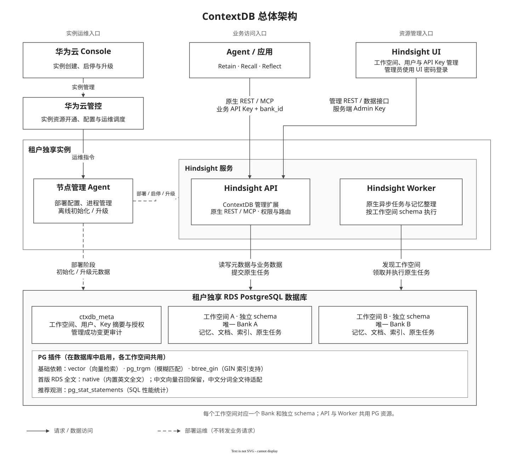
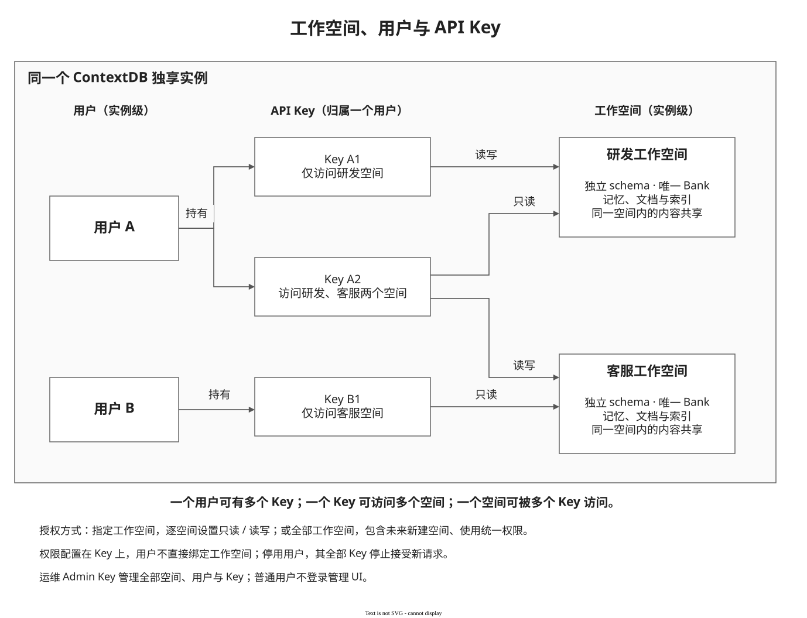

# ContextDB 首发设计：工作空间、用户与 API Key（RSIXDB 团队集成）

> 工作空间创建/删除统一使用 Bank REST，保留两个 UI 创建入口及 description；只读目录、详情和 usage 保留，MCP Bank 管理仅在插件模式下关闭。UI 源码目录为 `contextbase-control-plane`。合同见[第8章](#bank-api-reuse-design)，测试方式和边界见[验证入口](VALIDATION.md)。

本文是当前唯一业务与技术规格。首次使用从[客户接入与管理员操作](../../hindsight-extensions/contextdb-service/README.md)开始；运营者直接使用[同版本部署指南](../../hindsight-extensions/contextdb-service/docs/deployment.md)。开发者从下方目录进入架构和实现，无需先阅读历史提交记录。


本文按总体设计、实例管理、UI 管理、应用访问、核心实现和本期边界组织。接口、数据结构、安全依据及异常恢复规则完整保留在本文，便于连续阅读和实现核对。验证方法见[验证入口](VALIDATION.md)；历史实现与评审通过 Git/PR 记录追溯。

[管控部署指南](https://github.com/ZhuQingping/ContextDB-Research/blob/5f9993c2c1d9eb68a83decdb99590f4dfe7d76dd/hindsight/deployment/contextdb-service-integration-guide.md) · [Agent部署合同](https://github.com/ZhuQingping/ContextDB-Research/blob/5f9993c2c1d9eb68a83decdb99590f4dfe7d76dd/hindsight/deployment/contextdb-deployment-contract.md) · [运维手册](https://github.com/ZhuQingping/ContextDB-Research/blob/5f9993c2c1d9eb68a83decdb99590f4dfe7d76dd/hindsight/operations/contextdb-operations-runbook.md) · [原生v1.0.0对接](https://github.com/ZhuQingping/ContextDB-Research/blob/5f9993c2c1d9eb68a83decdb99590f4dfe7d76dd/hindsight/deployment/native-v1.0.0/contextdb-service-integration-guide.md) · [API curl 验证手册](https://github.com/ZhuQingping/ContextDB-Research/blob/5f9993c2c1d9eb68a83decdb99590f4dfe7d76dd/hindsight/api/contextdb-management-api-curl-guide.md) · [同版管理OpenAPI](../../hindsight-extensions/contextdb-service/schemas/contextdb-control-plane.openapi.yaml)

| 章节 | 主要内容 |
| --- | --- |
| [1. 总体设计](#overview) | 三个入口、对象关系、组件职责、实现版本 |
| [2. 华为云实例管理](#instance) | 数据库准备、离线初始化、凭据、密码、启动与升级 |
| [3. 管理员通过 UI 管理服务](#ui) | 操作流程、用户与 Key 管理、授权格式和状态变化 |
| [4. 客户应用访问记忆服务](#business) | 原生 REST/MCP、权限检查、按名称查询与按身份操作 |
| [5. 核心实现与设计理由](#implementation) | 认证安全、同步管理决策、当前生命周期实现、PG 字段与约束、完整管理 API |
| [6. 规格约束与 Q&A](#boundaries) | 支持范围、删除使用前提、超时/取消边界、安全约束及常见问题 |
| [7. 记忆与知识召回统计](#7-记忆与知识召回统计) | 统计口径、权限、升级、配置及UI展示 |
| [8. Bank 接口复用设计](#bank-api-reuse-design) | 插件模式、兼容边界、生命周期、接入取舍及验收条件 |

<a id="overview"></a>

本轮机器契约见[同版OpenAPI](../../hindsight-extensions/contextdb-service/schemas/contextdb-control-plane.openapi.yaml)及[完整SQL/COMMENT](../../hindsight-extensions/contextdb-service/hindsight_ext_contextdb/schema.sql)。本文资料仓链接固定在固定资料快照，提供背景；本次资料恢复不改变已经确定的同步管理和首发支持边界；其中部署示例未包含的团队新增配置，以本文第2.3～2.4节及当前代码资产为准。

## 1. 总体设计

以下为逻辑架构与对象关系；API、Worker、UI 的框不代表独立容器。首版部署形态见第2.5节：单容器、API 内置 Worker、独立 UI 进程。

### 1.1 三个入口

一个独享实例使用一个 PG 数据库。用户与工作空间同属实例；用户可以持有多个 API Key，每个 Key 独立配置空间范围和权限。工作空间与 Hindsight Bank 一对一，每空间使用独立 schema。



[可编辑 drawio 源文件](diagrams/source/contextdb-first-release-architecture.drawio)

实线表示请求或数据访问，虚线表示部署运维。节点管理 Agent 负责配置、启停、升级及离线初始化；业务 Agent 和 Hindsight UI 的请求直接由 Hindsight API 处理。

三个入口各自负责：

| 场景 | 调用关系 | 职责 |
| --- | --- | --- |
| 业务访问 | 应用 → Hindsight API / MCP | 携带业务 Key、可读 bank_id，调用 Retain、Recall、Reflect 等原生接口 |
| 实例运维 | Console → 华为云管控 → 节点管理 Agent | 准备 PG、配置凭据和模型、离线初始化、部署与启停；已有 Agent 负责升级/高可用调度 |
| 资源管理 | 管理员 → Hindsight UI → Hindsight API | 管理工作空间、用户、API Key；UI 后端持有 Admin Key |

工作空间管理已放在 UI，华为云 Console 不再维护空间目录。运维也可直接使用 Admin Key 调管理 REST API。本期没有新增实例注册 HTTP 接口，也没有实现一套新的 Agent 升级或高可用协议。

### 1.2 工作空间、用户与 Key



[可编辑 drawio 源文件](diagrams/source/contextdb-first-release-workspace-model.drawio)

用户与工作空间同属实例，彼此没有从属关系。用户 A 可以持有多个 Key；Key A2 可同时访问研发和客服空间，并分别设置只读、读写。不同用户的 Key 可以访问同一个空间，空间内的内容共享。

图中的实例归属是逻辑关系，不需要在每张表重复保存 instance_id。新建空间名称同时作为可读 bank_id，按 NFKC、去首尾空白及小写规范化，须符合 `[a-z][a-z0-9_]{0,53}`；例如 MySQL 规范化为 mysql。服务端生成 schema `ctxdb_ws_mysql`。内部 workspace_id 为安全随机源生成的32位小写十六进制ID（本文简称UUID），用于授权关联及管理对象身份，不用于业务寻址，也不要求跟踪全部旧执行者。名称和 bank_id 在对象存续期间不可修改；完整删除后可以同名重建，内部 UUID 必须变化。连字符会使原生未加引号的 schema DDL 无法执行，首版禁止连字符以避免扩大内核修改。

可读 bank_id、可读 schema 与内部 UUID 各有职责；保留内部身份的具体原因见[第5.3.4节](#workspace-identity)。

用户用于记录 Key 归属、名称和启停状态，没有角色选择或用户级空间授权。后台 users 表同时保存唯一受保护的系统管理员，role 为 admin；普通成员固定为 member。**权限配置在 Key 上**，不再叠加“用户权限与 Key 权限取交集”。用户不是 PG 登录角色，工作空间也不是 UI 登录账号。

### 1.3 组件分工

| 组件 | 职责 |
| --- | --- |
| 节点管理 Agent | 下发配置、离线初始化、管理服务进程，对接已有运维调度 |
| Hindsight API | 扩展层完成认证、授权、空间管理；原生内核执行记忆接口 |
| Hindsight Worker | 执行原生记忆异步任务，按空间 schema 访问数据 |
| Hindsight UI | 管理员操作入口；服务端持有 Admin Key |
| PostgreSQL | 保存管理元数据和各空间业务数据；API 与 Worker 共用 |

<a id="contextdb-extensions"></a>

#### 1.3.1 为什么使用四个 ContextDB 扩展

四个类都属于同一个 `hindsight_ext_contextdb` Python 包，分别接入 Hindsight 已有的 Tenant、Operation Validator、HTTP、MCP 扩展入口。扩展框架来自 Hindsight，下面的具体实现由 ContextDB 提供；它们随服务进程加载，无须单独部署，与 PG 的 vector、pg_trgm 等数据库插件无关。

新增工作空间、用户、Key 管理后，除了提供管理接口，还必须让原生 REST、MCP 和后台任务遵守同一套空间与权限规则。因此需要覆盖不同入口：

| 扩展实现 | 对应配置变量 | 职责 |
| --- | --- | --- |
| ContextDBTenantExtension | HINDSIGHT_API_TENANT_EXTENSION | 认证 Key，按目标工作空间选择 PG schema；提供空间发现和后台任务的空间身份接入 |
| ContextDBOperationValidator | HINDSIGHT_API_OPERATION_VALIDATOR_EXTENSION | 在原生引擎操作处检查读写权限、管理员权限及内部任务归属；阻止绕过管理接口创建或删除 Bank |
| ContextDBHttpExtension | HINDSIGHT_API_HTTP_EXTENSION | 提供工作空间、用户、Key 的管理 REST 接口；在请求内同步初始化或清理空间，校验部署和元数据 |
| ContextDBMCPExtension | HINDSIGHT_API_MCP_EXTENSION | 从原生 MCP 工具调用中确定实际 Bank，校验当前消息的 Key，适配空间目录、读写权限和业务任务响应脱敏 |

公共逻辑集中在扩展内部：`authorization.py` 保存本次调用的认证结果及受信管理上下文；`transport.py` 处理REST入口的身份、路由及诊断边界；`lifecycle.py` 只组织同步创建和删除，没有自研调度或执行屏障。

**职责不同，认证规则共用。** 管理员与业务 Key 都由 `Repository.authenticate` 查询 PG、校验 HMAC；角色与空间权限也来自同一份元数据。各入口调用它完成必要检查，不各自维护一套密钥或权限表。

例如，某 Key 对 `mysql` 只有只读权限：Tenant 扩展负责将已认证请求路由到 `ctxdb_ws_mysql`；Validator 负责允许 Recall、拒绝 Retain。通过 MCP 调用时，目标空间还可能位于工具参数中，MCP 扩展需要先确定本次调用的 Bank，不能只依赖 REST URL。HTTP 扩展则让管理员能够创建空间、签发这个 Key，并按管理员已停止访问、等待已有工作的前提删除空间。

MCP 扩展复用原生工具，不新增工作空间、用户或 Key 的管理 MCP 工具。启用 MCP 的当前部署需要四个扩展配套；关闭 MCP 时，MCP 接入没有调用用途，但 REST 的前三项职责仍然存在。原生Worker通过Tenant和Validator进行正常身份及schema检查；工作空间管理在API请求内执行，不交给Worker。首版交付为API内置Worker。

**设计选择：保留这些接入入口，集中复用公共逻辑。** 减少扩展类数量本身不会减少必须完成的检查；强行统一加载入口会扩大 Hindsight 内核改动。本版优先在外围实现管理和隔离，继续复用原生记忆算法。扩展、API、UI和启动脚本仍须同版交付；本轮没有新增或保留原生执行保护钩子。

### 1.4 版本与验证依据

本文描述同一 checkout 的业务与技术规格；接口以[同版管理 OpenAPI](../../hindsight-extensions/contextdb-service/schemas/contextdb-control-plane.openapi.yaml)为准。
公开管理 API 使用 `/ext/contextdb/v1`；元数据结构版本1、API v1和资源 version 各自独立。
部署步骤见[同版本部署指南](../../hindsight-extensions/contextdb-service/docs/deployment.md)，测试方法和证据边界见[验证入口](VALIDATION.md)。
设计来源为 [ContextDB-Research@5f9993c2](https://github.com/ZhuQingping/ContextDB-Research/blob/5f9993c2c1d9eb68a83decdb99590f4dfe7d76dd/hindsight/design/contextdb-release-design.md)；
历史移植、修复与评审记录通过 Git/PR 追溯，不作为当前版本已验证的依据。

<a id="instance"></a>

## 2. 华为云实例管理

实例部署由华为云管控通过已有节点管理 Agent 完成；空间、用户和业务 Key 的管理在服务启动后通过 UI 或管理 REST 完成。

### 2.1 实例如何开通

数据库连接不强制 SSL：部署示例不附加 sslmode，PGADMIN_URL 与 HINDSIGHT_API_DATABASE_URL 均按调用方提供的 URL 连接。未开启 SSL 的 PG 可接入；需要证书校验时部署方再显式配置 sslmode 和 CA，不由服务自动升级或降级策略。MaaS HTTPS 和 UI/API 对外入口的 TLS 配置独立。

当前管控输入、PG权限和命令以[同版本部署指南](../../hindsight-extensions/contextdb-service/docs/deployment.md)为入口；自动化以同版 `hindsight_ext_contextdb.deployment schema` 输出的 JSON Schema 和部署脚本为准。[原始 Agent 配置合同](https://github.com/ZhuQingping/ContextDB-Research/blob/5f9993c2c1d9eb68a83decdb99590f4dfe7d76dd/hindsight/deployment/contextdb-deployment-contract.md)提供历史背景。PG数据库必须先存在；管控接收用户UI密码并提供秘密文件。节点渲染配置后初始化ctxdb_meta管理表、管理员身份、秘密文件及原生共享维护函数，再启动API/Worker、检查ready及实例身份，最后启动UI。原生业务表仅在创建空间时初始化到ctxdb_ws_<bank_id>。模型、插件和端口不依赖人工临时export。

管控调用已有节点管理 Agent 完成部署。本期不新增“创建实例”的 Hindsight HTTP 接口，工作空间目录也不在 Console 维护。

| 步骤 | 执行内容 | 完成结果 |
| --- | --- | --- |
| 1. 准备数据库 | 准备专用 UTF8 PG、服务账号、vector / pg_trgm / btree_gin；首版 RDS 固定 native + english | 数据库可连接，所选扩展可用 |
| 2. 准备配置与秘密 | 配置实例归属、数据库和模型；生成并私密保存 Admin Key、pepper、UI 密码 | 重启时可复用同一份配置 |
| 3. 离线初始化 | 执行 service.sh init：持久秘密文件、管理表初始化/核验、管理员导入、共享维护函数安装/核验；不迁移public业务表 | API 尚未启动，也能准备管理员身份 |
| 4. 启动服务 | 启动 API、Worker，检查 readiness，再启动 UI | 管理与业务接口可用 |
| 5. 交付 | 提供 UI 地址和密码；管理员进入 UI 创建空间、用户与业务 Key | 应用可以接入 |

自研实例的具体命令见[同版本部署指南](../../hindsight-extensions/contextdb-service/docs/deployment.md)。原生联调指南不包含 ContextDB 初始化与管理接口，不能混用。已有 `service.sh` 用于部署和启动，由节点 Agent、systemd 或容器监督器管理前台进程。

### 2.2 三种凭据及保存位置

| 凭据 | 生成与保存 | 能力 |
| --- | --- | --- |
| 运维 Admin Key | 离线生成并私密保存；初始化时将 HMAC 摘要写入 PG，UI 服务端保存明文 | 管理全部空间、用户、Key；访问全部 active 空间的原生 REST/MCP 数据接口 |
| UI 登录密码 | 客户侧可选择随机生成或自定义，通过 HINDSIGHT_CP_ACCESS_KEY 配置并持久保存 | 仅用于管理员登录 UI，不是 API Key |
| 业务 API Key | 管理员通过 UI 或管理 API 创建；数据库只存 HMAC-SHA256 摘要 | 按 Key 的范围和权限访问原生 REST/MCP；不能调用管理 API，也不能登录 UI |

UI 使用 `CONTEXTBASE_CP_DATAPLANE_API_KEY`，兼容 `HINDSIGHT_CP_DATAPLANE_API_KEY`，值为运维 Admin Key；前者优先。浏览器只持有登录会话，不接收这个后台 Key。运维 Key 不作为普通用户/Key 显示在“用户管理”中。

业务 Key 格式为 `ctx_live_<32位Key ID>_<随机秘密>`。明文只在创建成功时返回一次；普通列表只返回 `display_key`，例如 `ctx_live_***5f82bf`，以及授权和时间等元信息。尾缀取自真实凭据末6字符；历史 Key 无法恢复尾缀时返回 null，不伪造脱敏值。

`CONTEXTDB_KEY_PEPPER` 是服务端 HMAC 秘密，不写入元数据表。保留现有 Key 时必须沿用 pepper。管理员与业务 Key 均依赖相同 pepper。轮换管理员 Key 使用受控离线命令更新 PG 摘要，并同步 UI 私密配置、重启 UI；本期没有在线恢复、双 Key 轮换或成员自助签 Key。摘要存储与 pepper 的安全依据、运维影响见第 5.1 节。

<a id="ui-password"></a>

### 2.3 UI 登录密码配置

`HINDSIGHT_CP_ACCESS_KEY` 是兼容的 UI 服务端环境变量；当前团队通过 `controlPlaneEnv` 优先读取 `CONTEXTBASE_CP_ACCESS_KEY`。两套前缀同时设置时，团队前缀生效，不能只改低优先级值后认为已改密。客户侧可以使用部署时随机生成的密码，也可以自行设置密码；两种方式使用相同的 Hindsight UI 登录入口。当前是实例级管理密码，不为业务成员提供个人 UI 账号，也没有页面内改密功能。

| 配置方式 | 建议 |
| --- | --- |
| 随机密码 | 使用密码管理器或密码学安全随机源生成24～32位字符串，例如从大小写字母、数字、`_`、`-` 中随机选择；生成后持久保存，普通重启复用原值 |
| 自定义密码 | 建议16～32字符，可混合大小写字母、数字及 `- _ . @` 等符号；需要记忆时，可使用5～6个随机、互不相关的单词，以 `-` 分隔，不必限制在32字符以内 |

自定义密码优先保证长度、不可预测和不复用，不强制同时包含大写、小写、数字和特殊字符。避免姓名、生日、公司或产品名加年份、连续数字、名句等易猜组合。[NIST 密码指南](https://pages.nist.gov/800-63-4/sp800-63b/passwords/)同样强调长度，不建议强制字符类型组合。

当前实现的硬性约束与使用建议分开说明：

- 原生UI要求非空；本版托管部署合同额外要求至少12字符，不设置字符类型组合规则。上述16～32字符是使用建议。直接运行UI的基础校验与管控部署入口的约束不可混淆。
- 密码不能等于 `HINDSIGHT_CP_DATAPLANE_API_KEY`，也不能以 `ctx_live_`、`ctx_ctrl_`、`ctx_admin_` 开头。
- 登录精确匹配，区分大小写，不自动去除首尾空格或做 Unicode 归一化。可使用中文等可输入字符；为方便跨终端配置和输入，推荐使用可打印 ASCII 字符。
- 环境变量不能包含 NUL。避免换行、控制字符和首尾空格；单双引号、反引号、`$`、反斜杠等会增加 Shell 引用或转义要求，建议避开。它们并非应用的字符黑名单。

随机生成示例（执行一次生成32字符密码；部署工具需将结果安全持久保存，不在每次启动时重新生成）：

```bash
export HINDSIGHT_CP_ACCESS_KEY="$(python3 -c 'import secrets; print(secrets.token_urlsafe(24))')"
```

选择自定义方式时，由客户将自己的密码写入私密 UI 配置，例如 Shell 环境文件中的 `export HINDSIGHT_CP_ACCESS_KEY='<客户自定义密码>'`，其中占位符必须替换为实际密码，并按所用配置格式正确引用。配置文件限制为部署账号可读，不把实际密码写入设计文档、版本库或普通日志。

修改密码时，托管部署更新 ui-secrets.json 的 password 并重启 UI；直接原生启动才通过环境变量配置。仅编辑文件不会使运行中的进程自动生效。无需重新构建 UI、重启 API/PG 或修改后台 Admin Key。所有提供该实例 UI 的进程应使用同一新值；生效后旧密码及旧密码签发的登录会话失效，管理员重新登录。托管启动会用持久秘密覆盖 shell 中同名环境变量，不能只改 ui.env 或临时 export 后声称改密完成。

<a id="deployment"></a>

### 2.4 部署、启停与未来升级

运行方式可选[Linux/macOS宿主进程](../../hindsight-extensions/contextdb-service/docs/deployment-native.md)或[Linux Docker Compose](../../hindsight-extensions/contextdb-service/docs/deployment-docker.md)。二者复用同版生成器、四个扩展、离线初始化和service.sh；API内置Worker与Node UI的merged逻辑不变。容器是交付形态，宿主进程使用实际部署账号及路径，不能套用容器UID或会话目录。操作与配置入口仍统一在[部署总览](../../hindsight-extensions/contextdb-service/docs/deployment.md)。文档目标平台与实际运行验收分开记录。

离线顺序：准备专用 UTF8 PG 与扩展 → 私密目录保存配置和生成凭据 → 离线 migrate 导入管理员摘要 → 启动 API/Worker → readiness 通过后启动 UI。使用代码仓 `hindsight-extensions/contextdb-service/scripts/service.sh`，由已有节点 Agent/systemd/容器监督器管理前台进程；不引入新常驻管理服务。

必要配置收敛为 HINDSIGHT_API_DATABASE_URL、CONTEXTDB_INSTANCE_ID、CONTEXTDB_CLOUD_TENANT_ID、私密持久化的 pepper、四个扩展及模型配置。实例初始化、管理员离线轮换和API/Worker统一使用HINDSIGHT_API_DATABASE_URL及同一个专用服务账号，不提供另一套引导连接地址。运行期创建工作空间仍需DDL权限；PG数据库和插件由管控/数据库管理员预先准备。后台 Admin Key 与业务 Key 统一由PG中的HMAC摘要校验。

部署目录保存 `api.env`/`ui.env`、`admin-key.json`、`api-secrets.json`、`ui-secrets.json`，秘密文件0600、目录0700。API/Worker 加载 PG、模型、实例及扩展配置，另从秘密文件加载 pepper，不加载 Admin Key 明文或 UI 密码；UI 只得到登录密码/后台 Admin Key/API URL，不接收 PG 或模型密钥。重复初始化保留原值；已初始化但秘密文件缺失时拒绝补生，要求恢复备份。托管启动设置标准`PYTHON_DOTENV_DISABLED=1`，利用python-dotenv已有能力阻止意外.env覆盖；扩展依赖要求python-dotenv>=1.2.1，无须改原生config.py。

首发管理元数据结构版本固定为1。migrate仅初始化新库，或核对已经采用当前结构的数据库；开发期试验结构不作为已发布版本，不自动升级或直接改号。本期不存在旧实例升级到当前版本的场景，不提供旧开发结构迁移；不支持结构或归属不一致的数据库明确拒绝接管，不能手改metadata_version冒充匹配。未来正式发布结构变更时，再从版本1增加有序迁移。正常重启不执行结构迁移或重新生成凭据。

预检检查真实导入路径、扩展接口、Python3.11～3.14、Node22.12+/24及平台 esbuild、目标 PG 扩展和语言后端。外部 PG 不必安装 pg0；测试/内嵌路径使用 `hindsight-api-slim[embedded-db]`，发行包名 pg0-embedded，导入名 pg0。UI 使用系统字体，构建不下载 Google Fonts。原设计的Node22/24构建属于来源版本证据；当前团队集成本机使用Node23.11.0、CI配置Node24，未在本轮重跑其他Node版本；源码路径检查不能替代部署方对镜像摘要和供应链的记录。

UI 启动只对暂时网络、5xx、429 有界重试，错误凭据、成员身份、畸形响应立即失败。每个新请求或每条MCP消息重新校验；同次调用复用受信Principal，Key/成员/授权变更阻止后续请求，不中断已受理操作。管理代理保留会话和同源保护，上游管理接口验证当前管理员Key；原生UI数据路径仍单独检查管理员身份。HTTPS、入口限流和网络隔离由部署入口提供，不能把本机功能测试称为生产入口验收。

#### 2.4.1 部署语言检查参数

**R04已实施：删除 `CONTEXTDB_VALIDATION_LANGUAGE`。** 托管部署预检固定使用english，不再渲染或读取这一派生变量。部署输入中的 `topology`、`language`、`text_search` 分别只接受首版固定值merged、english、native；它们不是客户可自由选择的组合。

原生全文后端、语言/分词配置和研究预检CLI的显式 `--language` 保留。固定english只定义首版全文验收范围，不限制中文输入或中文向量召回。没有为了替代该变量而在运行时重新读取部署输入文件、增加秘密挂载或新增参数；中文分词全文仍需独立适配与验收。

#### 2.4.2 团队UI配置、秘密与会话目录

新增服务端UI读取统一使用 `controlPlaneEnv`：`CONTEXTBASE_CP_*` 优先于兼容 `HINDSIGHT_CP_*`。渲染器仍输出兼容名称，启动器支持两套；持久秘密加载时覆盖两套密码/Admin Key，避免高优先级遗留变量遮蔽秘密文件。

| 配置后缀 | 当前团队ContextDB模式要求 |
| --- | --- |
| CONTEXTDB_ENABLED | 精确字符串true |
| ACCESS_KEY | 非空、独立UI密码；建议及托管至少12字符约束见2.3 |
| DATAPLANE_API_KEY | 当前有效系统Admin Key，仅UI服务端接收 |
| DATAPLANE_API_URL | UI服务器访问API的内部地址 |
| AUTH_MODE | local，或省略沿用团队local默认；拒绝bootstrap |
| PUBLIC_ORIGIN | 浏览器实际HTTP(S) origin，含实际端口；不带用户信息、路径、query、fragment |
| SESSION_DIR | 绝对路径、私有、可写的持久会话目录 |

部署意图增加必填 `ui_public_origin`，区别于内部 `ui_api_url`；`ui_session_dir` 默认 `/var/lib/contextdb/ui-sessions`，源码宿主机部署应设置实际私有路径。render创建0700的ui-sessions并拒绝符号链接/过宽权限；Compose只将会话目录独立rw挂载，秘密目录ro。部署者须匹配宿主/容器UID-GID，改变路径同步修改挂载。

UI启动器移除PG/模型秘密并保留必要系统/产品配置，API/Worker移除UI凭据；同容器同UID仍不构成强秘密隔离。单行秘密输入文件允许一个结尾换行，内容中拒绝换行、CR、NUL；shell/JSON按各自格式正确引用。托管render检测密码输入与ui-secrets.json不一致时拒绝，不负责秘密轮换。直接环境启动的UI，改实际生效ACCESS_KEY并重启；托管模式还需同步持久秘密和密码输入，不能仅临时export。

#### 2.4.3 数据库准备与migrate的职责

目标数据库和登录角色由PG管理员预先创建，不由Hindsight启动时创建；服务账号需要自身数据库内的schema/DDL权限，不要求SUPERUSER。准备示例见代码仓 `deployment/prepare-pg.sql`，客户SQL边界示例见 `pg-role-boundary.sql`；二者不是可无检查地用于现有客户库的修复脚本。

`python -m hindsight_ext_contextdb migrate --admin-key-file <私密文件>`读取数据库连接、实例/云租户ID、pepper和持久管理员凭据，离线建立或核验ctxdb_meta六表、管理员摘要及四个原生共享维护函数，重复执行保留凭据与部署绑定。它不是配置查询、客户密码查询或CREATE DATABASE命令。public保留vector等扩展对象及默认部署的共享维护函数，不创建原生业务表；每个工作空间的原生Alembic由空间Lifecycle负责。API/Worker要求 `RUN_MIGRATIONS_ON_STARTUP=false`，不在请求/并发启动路径自动升级元数据。

实例备份必须包括ctxdb_meta、所有业务schema以及匹配pepper、UI/Admin秘密；原生单Bank导出不能重建实例用户和Key。首发无开发期旧结构自动迁移、滚动升级/降级或目标RDS灾备已验收承诺。

#### 2.4.4 UI健康探测

团队proxy检查Host；用127.0.0.1默认Host直接探测公网origin配置下的UI会返回421。`ui_probe.py`连接本地端口并发送规范化的公网Host，处理域名大小写、默认端口、IDNA和IPv6；只接受200，不跟随重定向、不依赖公网DNS或环境代理，也不放宽认证。

Compose shell加载配置后显式将origin/port传给探测进程；source本身不导出变量，且不向探测器导出密码/Admin Key。API仍用原生健康模块。规范化地址矩阵和实际Compose shell命令的回归见验证记录。

<a id="api-worker-deployment"></a>

**本版部署/更新规则（S16）：** ContextDB托管部署不得再运行 `run-db-migration --schema public`，也不得在系统fixture中补建public业务表。扩展安装仍需预建专用数据库和vector等扩展，不能删除public schema。正常重启只加载既有秘密和核验格式；正式发布后各空间原生结构更新由已有受控升级入口处理，不额外迁移public业务表，不新增自动元数据迁移框架。对已有开发库不自动删除历史表或接管旧布局；本轮只验证全新独立测试库。纯原生过渡部署材料保留其原含义。

### 2.5 API 与 Worker 如何部署

本节保留首版容器交付的选择及其边界；当前宿主进程和Docker两种执行路径见[第2.4节](#deployment)及[部署总览](../../hindsight-extensions/contextdb-service/docs/deployment.md)，均复用同一merged逻辑。下述容器资源与整体重启约束适用于容器交付，不排除宿主运行。

2026-10-19 决策：**首版一个容器合并部署 API、Worker 和 UI**。外部 RDS PG 保存全部持久业务数据；LLM、Embedding、Rerank 均调用华为云 MaaS，节点不运行模型推理。

```text
Console → 管控 → 节点 Agent → 一个 Hindsight 容器
                              ├─ Python：API :8888 + 内置 Worker
                              └─ Node.js：UI :9999 → 127.0.0.1:8888
应用 ────────────────────────→ API → 外部 RDS PG / MaaS
浏览器 ──────────────────────→ UI
```

一个容器、两个应用主进程；Worker 是 API 进程内的后台执行器，不另起 Worker 进程。init/监督器负责信号转发和退出清理，不计作业务进程。API 和 UI 均可从其他机器访问，默认端口 8888/9999，部署时可配置；容器内部 UI 通过 loopback 访问 API。

选择依据是首版减少部署对象、配置和排障分支，复用原生内置 Worker。原生联调直接使用官方镜像的 start-all.sh；自研镜像的 service.sh all 监督既有 api/ui 入口，保留原来的预检、秘密加载和 UI 等待就绪逻辑，不修改记忆算法。任一应用主进程退出，自研监督器停止另一进程并退出，由容器运行时重启整个服务；正常停止给全部子进程组发送 SIGTERM，并设置退出超时。健康检查覆盖 API 和 UI；unhealthy 本身不触发 Docker 自动重启，持续不健康由节点 Agent 按已有恢复策略处理。

| 项目 | 首版配置与边界 |
| --- | --- |
| topology | 固定 merged，不要求管控在多种拓扑间选择 |
| HINDSIGHT_API_WORKER_ENABLED | true，API 内置 Worker |
| HINDSIGHT_API_WORKERS | 1；不是后台任务并发数 |
| HINDSIGHT_API_WORKER_ID | 固定且实例内唯一，重启不变，不能使用随机容器 hostname |
| 独立 Worker 容器/8889 | 本期不启动、不发布 |
| 初始化 | 自研版在启动前运行一次性初始化命令，结束后退出；不算长期运行容器 |
| CPU/内存 | API、Worker、UI 共享一个容器限额，不提供组件级限额或独立重启 |
| 秘密边界 | 同容器、同 UID，不声称强隔离；自研启动器仍按进程加载必要环境，但挂载文件可由同 UID 读取 |

API 与 Worker 仍通过 PG 原生任务系统协作；同步 Recall、Reflect 在 API 执行。ContextDB工作空间创建/删除由API在管理请求内同步调用，不另起管理任务服务、调度循环或在途屏障。单容器不会改变认证授权和第5.2节的使用约束。

[组件资源与磁盘预算](https://github.com/ZhuQingping/ContextDB-Research/blob/5f9993c2c1d9eb68a83decdb99590f4dfe7d76dd/hindsight/deployment/contextdb-resource-sizing.md)给出 CPU/内存开销、磁盘分类、初始规格、采样方法和验收边界。Compose示例上限为2 vCPU/4 GiB，可按节点调整，不是官方推荐规格；ECS与容器的生产规格均待目标负载压测，不固定要求4 vCPU/8 GiB节点或扣留一半资源。后续明确出现后台挤占、需独立扩容或恢复的场景后，再评审 API/Worker/UI 分容器；历史分离模式测试保留为机制证据，不作为本期交付选项。

### 首版后台写入边界

此前为增强执行结束保证新增的async_execution_scope及持久准入已删除；本版复用原生任务取消和检查点语义。删除前先停止业务并等待已有工作结束；同名新空间使用新UUID，旧selected授权不继承。

原生LLM Trace、业务Audit正文和Webhook在独立schema下的正常路由与存储归属尚未完成首版验收，本期维持关闭，后续独立评估，不再要求恢复完整代次屏障：`HINDSIGHT_API_LLM_TRACE_ENABLED=false` 必填（原生缺省true，所以缺省也拒绝），`HINDSIGHT_API_AUDIT_LOG_ENABLED=false`；不支持非空 `HINDSIGHT_API_WEBHOOK_URL`。Admin/内部默认模板不能开启 audit_log_enabled，旧 Bank 开启原生审计或 enabled Webhook 时先停用，启动/迁移会拒绝。`ctxdb_meta.audit_events` 管理事务审计继续保留。UI原生调用正文/原生审计不产生新记录，运维使用JSON日志、任务、PG统计和按需OTEL，详见[运维手册](https://github.com/ZhuQingping/ContextDB-Research/blob/5f9993c2c1d9eb68a83decdb99590f4dfe7d76dd/hindsight/operations/contextdb-operations-runbook.md)。

<a id="fulltext-selection"></a>

### 2.6 中英文全文检索与许可证（补充调研，待选型）

**2026-10-19 RDS 首版决策：去掉 PGroonga/Groonga 部署依赖，固定 native + english。** 意图模板和部署指南同步采用该组合，不引入替代全文插件。中文内容可写入并通过 MaaS bge-m3 向量召回，中文分词/关键词全文未完成适配，列为 TODO。language=english 仅表示当前全文验收范围，不限制中文输入；不会放宽 native + chinese/multilingual 的预检。既有 PGroonga 试验库不执行卸载或直接切换；新基线使用新建专用库。

下文保留未来中文方案的调研比较，不是当前 RDS 安装清单。**撤回“PGroonga 已确定为云上默认插件”的预设。** 选型先满足目标 RDS 可安装和许可证要求，再比较 Hindsight 适配成本、检索效果及运维能力。一套部署选择一个全文后端；向量检索继续使用 `vector`，不因全文方案改变。

#### 2.6.1 PGroonga 与 Groonga 的关系

PGroonga 是 PG 扩展，依赖的 Groonga 是搜索引擎库，不是必须另起一个 Groonga 网络服务，也不是再执行一次 `CREATE EXTENSION groonga`。库及其运行依赖需要部署在 **PG 节点**；装进 Hindsight 的 ECS 容器不能让外部 RDS 自动获得插件。[源码安装要求](https://pgroonga.github.io/install/source.html)。

| 组件 | 官方许可证 | 本项目关注点 |
| --- | --- | --- |
| PGroonga | PostgreSQL License | 不能只审核这一层而遗漏底层库 |
| Groonga | 官方当前说明为 LGPL-2.1-or-later | LGPL 与 GPL、AGPL 的条件不同，不能统称“GPL 禁止商用”；锁定实际交付版本及其许可声明 |
| ParadeDB / pg_search 社区源码 | AGPL-3.0 | 云上使用、修改、组合及镜像交付的具体义务需核对；商业授权可作为另一条路线，不能当作规避 LGPL 的宽松许可证替代品 |
| pg_textsearch | PostgreSQL License | 与 timescaledb 不是同一个插件，不能套用后者的授权或 RDS 支持情况 |
| zhparser / SCWS | 分别为 PostgreSQL 风格宽松许可 / BSD | 字典、可选依赖和最终二进制仍按实际发行物核查 |

依据：[PGroonga 许可](https://github.com/pgroonga/pgroonga/blob/main/COPYING)、[Groonga 官方许可说明](https://groonga.org/docs/reference/api/index.html)、[pg_search 许可](https://github.com/paradedb/paradedb/blob/main/LICENSE)、[pg_textsearch 许可](https://github.com/timescale/pg_textsearch/blob/main/LICENSE)、[zhparser 许可](https://github.com/amutu/zhparser/blob/master/COPYRIGHT)、[SCWS 许可](https://github.com/hightman/scws/blob/master/COPYING)。

许可评估需区分仅在服务端运行与向客户交付镜像/二进制、是否修改库、静态或动态链接；不能由“动态链接”直接推出完全无义务，也不能由“LGPL”直接推出全部业务代码必须开源。交付清单应记录组件版本、源码来源、许可证/NOTICE、补丁及相应源码提供方式；最终结论针对实际交付形态确认。

#### 2.6.2 可行方案与当前代码差距

| 方案 | 英文 | 中文及混合语言 | 当前 Hindsight 接入与工作量 |
| --- | --- | --- | --- |
| PG 原生 tsvector + GIN | 可用 english 配置，含词干与停用词处理 | 默认英文配置不足；需中文 parser 和 text search configuration | 纯英文改动最少；中文候选为原生 + zhparser，须补齐预检及配置一致性，工作量中等 |
| PGroonga + Groonga | 同一索引处理英文，但不等价于 English stemming/BM25 | 当前 TokenBigram + NormalizerNFKC150；中文主要按字符二元片段，不依赖中文词典 | 已有索引及查询适配，接入改动少；新增底层库及备份恢复、WAL/主备验收工作 |
| pg_search + Jieba 等 tokenizer | 支持英文 tokenizer，混合语言效果随所选 tokenizer 而异 | 已有 Jieba、chinese_compatible、Lindera 等配置入口，需核实发行版本是否包含 | 已有适配，接入改动少；AGPL/商业授权及 RDS 插件交付是独立前提 |
| pg_textsearch + english / 中文配置 | 当前代码已支持 BM25 英文后端 | 插件可用自定义 PG text_config；配合 zhparser 是候选，并非安装后自动中文 | 当前 Hindsight 索引使用 english；要参数化 DDL/查询、重建策略及预检，工作量中等，不能宣称已有中文开箱即用 |
| vchord_bm25 + pg_tokenizer | Hindsight 已有对应后端 | 效果取决于所配 tokenizer/model；现有路径使用 llmlingua2，不能据名称保证中文效果 | 依赖、模型文件及发行物更多，保留比较入口，首版暂不新增默认组合 |

`pg_trgm` 是三元片段相似度/模糊匹配能力，`btree_gin` 提供普通标量类型的 GIN 操作符类；二者不是中文分词器，也不能单独替代上述完整全文方案。`vector` 负责向量相似度，同样不替代关键词检索。[PG 全文机制](https://www.postgresql.org/docs/current/textsearch.html)、[ParadeDB tokenizer 说明](https://www.paradedb.com/blog/v2api)。

**原生 + zhparser 的实际差距：** 当前 `HINDSIGHT_API_TEXT_SEARCH_EXTENSION_NATIVE_LANGUAGE` 允许自定义配置名，memory_units 写入和查询已有对应参数；但 mental_models 的生成表达式和关键词查询仍固定 english，现有 ContextDB 中文预检也只接受 PGroonga/pg_search。故不能只安装 zhparser、改一个变量，就宣称所有中文检索完成适配。需统一索引、写入、查询、schema search_path 与升级重建，覆盖普通记忆和 mental_models 两条路径。

**RDS 可用性：** 本次查看的华为云[官方插件清单](https://support.huaweicloud.com/intl/zh-cn/usermanual-rds-pg/rds_09_0045.html)列有 zhparser，未查到 PGroonga、pg_search、pg_textsearch。公开清单未列出不等于所有内部版本均不支持，也不构成已可用的证据；必须由 RDS 同事确认区域、PG 大/小版本和实际插件列表，包含必需的 vector。不能在安装脚本里自动退回英文后端并将其标为中文验收通过。

#### 2.6.3 选型顺序与验收

1. **纯英文基线：** 原生 tsvector + GIN + english，先保证最小依赖下完整运行；不把它包装为中英文交付。
2. **现有 RDS 中文候选：** 优先验证原生 + zhparser，因为官方有该组件；若平台将来提供 pg_textsearch，再比较 pg_textsearch + zhparser 的 BM25 收益与额外适配成本。
3. **可新增插件的 PG 平台：** 并行评估 PGroonga；通过 LGPL 依赖核查、RDS 接入及恢复测试后，才决定是否作为固定中英文方案。pg_search 在可接受授权成立后参与同条件比较。
4. 当前首版固定 native 英文全文；中文分词关键词全文待适配，不声称已发布中英文全文组合。不向客户暴露复杂选型开关。保留原生后端配置能力供运维使用；更换全文后端必须执行受控索引重建/迁移，不能视为无状态参数切换。

对照使用相同 PG 版本、数据、embedding、reranker 和查询集，分别记录“只测关键词”和“完整混合召回”的结果：中文术语/新词、中英混写、英文词形、标识符/错误码、短查询、误匹配和空间隔离；统计 Recall@K、排序质量、p95、索引体积及写入成本。另验证备份恢复、异常退出后索引一致性和目标 PG 主备机制。原设计来源版本记录过独立PG18.4的12条材料/7查询 SQL 对照及 pg_dump/restore一致性检查、真实MaaS中英完整调用链；当前团队分支未重新执行这些试验，这些小样本不替代生产并发、中文质量基准或云 RDS 实测。结果和局限见[补充验证记录](https://github.com/ZhuQingping/ContextDB-Research/blob/5f9993c2c1d9eb68a83decdb99590f4dfe7d76dd/hindsight/archive/2026-10-19-before-reorganization/design/contextdb-service-research-validation.md)。

<a id="ui"></a>

## 3. 管理员通过 UI 管理服务

管理员只需输入 UI 密码。UI 后端使用 Admin Key 调用管理 API 和原生数据接口，管理员可以查看全部可用空间。

### 3.1 从创建空间到交付 Key

两个创建入口使用同一个表单，填写名称和可选描述；创建完成后直接返回工作空间。流程见[第5.2节](#workspace-sync-decision)。

| 顺序 | 页面操作 | 服务端行为 |
| --- | --- | --- |
| 1 | 创建工作空间，填写名称和可选描述 | 严格Bank PUT在请求内初始化独立schema和唯一Bank，完成返回200；UI再GET核对原身份 |
| 2 | 等待空间可用 | 等待当前创建请求完成；active后刷新目录并可进入、授权 |
| 3 | 在“用户管理”创建用户，只填写名称 | 建立实例级用户，不选择空间或管理员角色 |
| 4 | 展开用户，创建 Key | 填写 Key 名称、选择空间范围和权限 |
| 5 | 复制 Key 给应用 | 明文仅本次展示一次；以后只显示脱敏值 |
| 6 | 切换工作空间查看内容 | UI 使用后台 Admin Key 读取对应 Bank |

普通用户没有个人 UI 账号。受保护的系统管理员不出现在普通用户和 Key 列表中，也不能通过这些页面修改或吊销。

### 3.2 UI 展示、秘密处理与操作恢复

本轮已移除管理操作轮询和浏览器操作恢复。下拉选择器与Dashboard复用同一个创建对话框，均支持名称、可选描述和一致校验；未提交时不显示“服务端正在处理”。

工作空间目录提供创建、删除、查询及失败状态。内容切换器只列 active 空间，管理目录保留创建中、删除中和失败状态。创建填写名称、可选描述；删除需确认并等待Bank DELETE返回200。列表使用完整可用宽度、明确列间距和长文本换行；状态及操作保留独立区域，窄窗口可横向滚动查看，不增加额外查询。

“用户管理”是实例级页面。创建用户只填名称，成员行展开查看 Key，更多菜单提供编辑、停用、删除。创建 Key 填名称，选择“指定工作空间”或“全部工作空间（包含未来新创建工作空间）”；指定模式按空间设置权限，默认读写。编辑保留原有只读设置，支持改名。吊销后从列表移除。

Key 明文只在本次创建结果中展示和复制，不写入 localStorage/sessionStorage。工作空间操作不持久保存操作ID、幂等标识或待重放请求；提交中禁止重复点击。超时或断连显示结果未知，只查询普通资源并核对UUID/状态，不自动重放写请求。成员和 Key 创建不透明重试；结果未知时先核对列表，不能按模糊名称或“最新一条”自动吊销。

本轮页面职责与未知结果处理：

- 创建用户成功后显示名称和返回ID，刷新当前搜索；不自动遍历所有页定位并展开。用户主动展开目标行管理Key。
- Key编辑使用已有响应中的授权快照，分页目录仅提供可选空间，不为每个已有授权额外GET。保存时携带原workspace_id及Key版本；后端在同一管理事务中检查UUID、版本和权限，过期返回400/409/412。只改名称不重发授权。目录已观察到同名不同UUID时提示旧项不可用，不自动换绑。
- 用户/Key写入结果未知或冲突时保留原目标信息，管理员刷新、搜索普通列表后明确处理；取消全量ID扫描。刷新不证明原请求已停止，也不重放写入；签发明文丢失仍不能补取。
- ContextDB工作空间删除只在工作空间管理目录执行；原生Bank详情提供管理链接，不再维护第二套删除快照和恢复交互。原生模式Bank删除照常保留，服务端生命周期旁路限制不变。
- UI服务器保留会话、同源、固定目标、路径/方法和敏感字段保护，业务请求字段与权限由Python模型统一校验，避免两份业务字段白名单。组件集中`components/contextdb/`，无新API、生产参数或状态管理框架。

当前管理UI补充行为（S18～S19、S21～S26）：

- 权限说明分成只读、读写两行，并共同说明不能管理工作空间、用户或API Key；授权模型与逐空间权限不变。
- Secret只在内存展示，复制成功/失败分别反馈；复制失败或Clipboard API不可用时可手工保存，不丢失明文。取消60秒和纯隐藏清理，用户保存后明确关闭；真正离页、卸载、切换用户继续清理，签发/复制迟到不能复活旧结果。此取舍意味着未关闭窗口中的明文可以保留更久，不持久化、不自动重签。
- 用户、空间、Key目录与授权选择器区分加载、首次GET失败、成功为空、搜索无匹配及刷新失败；失败时不显示确定的0或把旧结果当成当前结果。重试只GET，写入未知仍按原UUID/版本只读核对。
- 用户管理入口有当前页状态，管理页不显示添加文档。沿用团队basePath及本地化路由，以完整管理路径判断；`/banks/users`及其本地化路径仍是内容页，保留上次空间便于返回。
- 授权选择器向现有API发送q、limit、offset，搜索变化中止旧请求并从0开始。已选草稿独立按workspace_id保存，不随搜索/分页丢失，不升级原只读授权，也不按同名新UUID换绑。
- 用户和实际展开Key面板的日期使用当前UI locale，不改变时区。管理列表复用现有Table/Select和主题token、轻量目录分页；统一间距、搜索提示、危险操作和创建/编辑动词，用户行只有一个展开入口，完整ID和时间仍可查看。
- 窄屏宽度仅通过管理Dialog局部class调整，公共Dialog不改；保留原最大宽度、纵向滚动和底部动作。视觉、焦点和剪贴板须通过真实浏览器检查，不把JSDOM或生产HTTP故事当成视觉验收；验证边界见[验证入口](VALIDATION.md#验证边界)。

管理弹窗关闭返回实际触发按钮，目标移除/禁用时尝试同页备用入口；编辑窗切换Secret窗时保留新窗焦点，离页不延迟抢焦点。空间下拉创建返回稳定选择按钮。仅自研调用点接线，不修改公共Dialog；空间行头按真实名称显示，不继承列标题的大写样式。

当前U4/U5/U9/U10管理呈现规则：主目录继续使用公共Table；Key子详情用一套语义列表响应桌面/窄屏，突出名称、脱敏值、空间权限及编辑/更多。危险动作统一进入更多菜单并二次确认；空/单页不重复子表头与页脚计数，多页仍服务端分页。完整Key ID与时间在可键盘展开的详情中保留，summary用16px Chevron且不显示原生marker。窄屏父表采用自动布局，日期列收起、状态放到名称下，主要Key动作不依赖横向寻找；390×600允许弹窗内部纵向滚动，底部动作及焦点可达。日期继续使用UI locale；不修改公共Dialog、Table或建立两套移动/桌面状态。

### 3.2.1 团队页面、认证与会话适配

当前集成保留ProductRuntime、产品配置v2、动态metadata、data-contextdb-name、团队主题/品牌占位替换及en/zh-CN回退。ContextDBModeProvider叠加于团队布局；管理请求使用productFetch携带X-Product-Name，保留旧标签页产品不匹配保护。展示品牌不是授权身份；本地系统字体不增加Google Fonts下载前提。

旧middleware.ts已删除，全部策略组合在团队proxy.ts。沿用auth/session.ts：随机令牌、磁盘会话记录、24小时有效、退出撤销，Cookie名称绑定PUBLIC_ORIGIN/basePath；令牌签名也绑定密码与实例地址。登录先检查配置、Host/写Origin、密码及当前后台Admin身份，再签发会话；密码更换/退出后旧Cookie应被拒绝。已有会话不能绕过后台Key失效：原生私有UI/API检查当前Admin，管理请求由实际管理API重新认证。

管理代理路由自身检查会话和同源，固定服务端上游与Admin Key，白名单限制路径/方法和q-limit-offset，body必须是JSON对象；业务字段及权限交给Python模型统一校验；浏览器不能指定目标URL或Authorization。对非成功Key创建响应防御性剔除secret/digest，所有管理响应no-store。ContextDB只支持local认证，拒绝bootstrap；Host、Origin、产品身份、动态带扩展名API ID和内部本地化登录重写不能因移植回退。

### 3.3 空间授权及请求格式

| 授权方式 | 适用情况 | 权限规则 |
| --- | --- | --- |
| 指定工作空间 | 只访问部分空间，或不同空间需要不同权限 | 每个空间分别选择只读 / 读写 |
| 全部工作空间（包含未来新创建工作空间） | 应用需要覆盖整个实例 | 所有空间使用统一权限，不设置例外 |

例如，同一个 Key 可以对“研发空间”读写、对“客服空间”只读。需要这种差异时选择指定空间。创建默认读写；编辑时保留原有设置，替换授权以本次完整选择为准。

公开请求统一使用 `authorization` 对象。

指定空间允许每个空间设置不同权限：

```json
{
  "name": "订单应用",
  "authorization": {
    "mode": "selected",
    "workspaces": [
      {"bank_id":"mysql", "workspace_id": "aaaaaaaaaaaaaaaaaaaaaaaaaaaaaaaa", "permission": "read_write"},
      {"bank_id":"pg", "workspace_id": "bbbbbbbbbbbbbbbbbbbbbbbbbbbbbbbb", "permission": "read"}
    ]
  }
}
```

全部空间使用统一权限，包含未来新建空间：

```json
{"name":"实例应用","authorization":{"mode":"all","permission":"read_write"}}
```

- selected：1～1000个不同的 active 空间，每项 bank_id 独立选择 read / read_write，不接收统一 permission。可选 workspace_id 是预期对象身份，UI始终发送；旧选择指向同名新对象时返回409 workspace_generation_changed并回滚。直接API省略该字段表示明确授权请求处理时的当前同名对象。读取结果始终包含内部UUID，不能只靠可复用名称持久保存授权。
- all：不提交 workspaces，统一 permission 作用于全部当前及未来空间。需要差异权限时选择 selected；all 不支持例外覆盖。
- 创建 Key 必须提供 authorization 和 mode；permission 省略时默认 read_write。UI 默认读写，保留只读选择。
- 编辑可以只改 name；一旦提交 authorization，就完整替换授权，未列出的旧空间授权被移除，所有 permission 必须明确填写，不使用创建时默认值。
- 旧版平铺 access_mode / workspace_ids / permission 不再是公开输入，不能与新格式混用。数据库内部仍有 access_mode 等列，不代表客户端继续使用旧格式。

| 权限 | 可执行 | 边界 |
| --- | --- | --- |
| read | Recall、Reflect、记忆/文档/知识等已有内容读取 | Reflect 调用模型，使用时间和日志也可能写入；不是 PG 只读事务 |
| read_write | read 能力，加 Retain 和允许的内容增改删 | 不包含空间生命周期、用户/Key 管理、Bank 配置写入、Webhook 管理、归档导出/下载等运维能力 |
| Admin Key | 全空间业务及管理能力 | 仍受空间状态、schema映射及删除使用约束；原生 Bank 生命周期也必须走空间管理接口 |

### 3.4 停用、吊销、删除与生效时机

| 操作 | 对后续访问的影响 | 是否删除空间数据 |
| --- | --- | --- |
| 停用用户 | 该用户全部 Key 无法认证；恢复后未吊销的 Key 可继续使用 | 否 |
| 删除用户 | 该用户及其 Key 不再可用，后台保留用户历史 | 否 |
| 吊销 Key | 该 Key 永久失效，从普通列表移除，后台保留记录 | 否 |
| 删除工作空间 | 管理员先停止访问并等待已有工作结束；服务清理业务数据、schema、空间记录和授权，不提供全局自动排空 | 是 |

用户停用阻断全部 Key 的后续认证；恢复仅恢复未吊销 Key。删除用户保留墓碑，使其全部 Key 无法继续使用，不删除工作空间数据。

吊销 Key 记录 `api_keys.revoked_at`，永久失效，不能恢复。普通 Key 列表在 SQL 中先过滤吊销记录，再计算 total 和分页，因此吊销后该行消失；后台保留历史及审计。

权限变更、停用和吊销对后续 REST 请求/MCP 工具调用重新检查，不承诺强制取消已受理请求。已经接受的原生异步任务继续执行，避免因 Key 失效丢失已接收的数据处理。

<a id="business"></a>

## 4. 客户应用访问记忆服务

客户应用通过业务 Key 使用原生记忆接口；空间目录和 Key 由管理员维护。

### 4.1 请求如何到达目标空间

应用取得业务 Key 和可读 bank_id（例如 mysql），沿用 Hindsight 原生 REST/MCP 接口。管理路径 `/workspaces/mysql` 与业务路径 `/v1/default/banks/mysql/...`、单空间MCP `/mcp/mysql/` 使用同一个标识。内部 workspace_id 不作为调用地址。

```text
应用携带 API Key + bank_id
    → 认证 Key，检查用户及吊销状态
    → 检查 Key 对目标空间的权限、空间是否可用
    → 根据管理元数据定位独立 schema
    → 调用原生 Retain / Recall / Reflect
```

管理层负责认证、授权与路由，记忆算法和原生接口请求、返回结构沿用 Hindsight。多空间 Key 允许切换目标空间，不代表一次 Recall 联合查询多个空间。

原生分块详情是特殊路径 `GET /v1/default/chunks/{chunk_id:path}`，URL不单独携带bank_id。扩展transport使用原生parse_chunk_id，并以build_chunk_id回编码检查canonical形式；合法ID中的Bank进入与其他业务请求相同的认证和schema上下文。歧义、非canonical、负数/非法索引安全拒绝，不简单按下划线切分、不重复URL解码、不遍历schema或猜默认空间。原生REST、SDK、Tenant无目标拒绝和引擎后续文档/Bank权限检查均保留；SEC-01配置响应投影复用现有路径，不新增认证SQL或重复权限钩子。验证时覆盖发布SDK异步写入、后台完成、recall include_chunks及list/get_chunk闭环，入口见[验证入口](VALIDATION.md)。

### 4.2 不同 Key 能做什么

| 凭据 / 权限 | 可执行 | 主要限制 |
| --- | --- | --- |
| 业务 Key：只读 | Recall、Reflect，以及允许的记忆、文档、知识内容读取 | 不能 Retain 或修改内容；Reflect 仍可能调用模型和写日志 |
| 业务 Key：读写 | 只读能力，加 Retain 和允许的内容增改删 | 不能管理空间、用户、Key，不能登录 UI |
| Admin Key | 全部可用空间的业务访问及管理 API | 仍遵守空间状态与删除安全规则 |

Admin Key 与业务 Key 使用相同的 Bearer 携带方式、相同的认证入口，权限由 PG 中的身份和授权决定。“全部工作空间”的业务 Key 仍然不是管理员。

插件接管Bank REST的创建、更新和删除，仅Admin可管理并维护空间映射；克隆、别名、恢复到未知Bank等旁路仍不开放，所有Key均不能绕过映射。具体接口边界见第 6.1 节。

### 4.3 可读寻址与对象身份条件

管理与业务统一使用可读bank_id，删除条件仍绑定原对象身份。没有管理任务历史和强制幂等键；未知结果按[第5.2.5节](#workspace-sync-failures)查询核对。

管理详情 GET 使用 `/ext/contextdb/v1/workspaces/{bank_id}`，删除使用 `/v1/default/banks/{bank_id}`；Key选择也使用 bank_id。新建名称同时就是规范化 bank_id；不接受中文、空格或连字符，不额外提供显示名、别名或改名接口。首发使用新建专用库；不自动接管开发期 UUID bank_id/schema 结构。本期不设计旧开发实例到当前版本的迁移流程。

空间列表和详情返回 bank_id、workspace_id、version、etag；详情同时发送ETag头。DELETE必须发送原对象的If-Match：缺条件428、身份或版本不匹配412。响应丢失不能盲目更新条件去删除当前同名对象；先核对原UUID和状态。

UI 在显示删除确认前捕获对象身份，重试继续使用原ETag，不重新获取同名对象条件。selected选择包含预期UUID并在服务端事务内校验。删除清理授权会使Key version递增；旧编辑412；空selected拒绝所有空间而不变成all。

<a id="implementation"></a>

## 5. 核心实现与设计理由

以下保留完整认证、生命周期、数据库及接口规则，说明功能如何实现、失败时如何处理。

<a id="security"></a>

### 5.1 API Key 统一认证与安全设计

#### 为什么只保存摘要

API Key 是持有即可使用的访问凭据。数据库只保存用于验证的摘要，避免表或备份泄露时直接暴露可用的完整 Key。调用方持有明文，服务端收到请求后重新计算摘要并比较，不需要从 PG 还原 Key。明文仍需防止在客户端配置、传输、日志及 UI 签发结果中泄露；生产访问通过 HTTPS 保护。

本系统的 Key 由密码学安全随机源生成，秘密部分使用32字节随机值，提供256位随机熵；公开前缀和 key_id 用于识别格式、定位记录，不是秘密，也不能决定权限。该设计针对高强度随机凭据，不应照搬到用户自行选择的短密码。OWASP 对用户密码建议使用 Argon2id 等专用密码哈希，明确不建议只用快速 SHA-256 保存密码。[OWASP 密码存储指南](https://cheatsheetseries.owasp.org/cheatsheets/Password_Storage_Cheat_Sheet.html)

#### HMAC 与 pepper 分别是什么

HMAC-SHA256 是以 SHA-256 和秘密密钥构成的消息认证算法，定义见 [RFC 2104](https://www.rfc-editor.org/rfc/rfc2104.html)。这里使用它计算 API Key 的校验摘要；没有解密操作，无法直接从摘要还原原 Key。校验通过重新计算、恒定时间比较完成；不可逆不等于弱凭据无法被猜测，随机强度仍是基础。

pepper 是安全领域对“与凭据摘要分开保管的共享秘密”的称呼；在本系统中就是 HMAC 使用的密钥，由 CONTEXTDB_KEY_PEPPER 提供。它独立生成，不是 Admin Key，也不是生成各 API Key 的种子。与通常每条不同、可随摘要保存的 salt 相比，pepper 在当前部署内共享且必须保密。[OWASP pepper 说明](https://cheatsheetseries.owasp.org/cheatsheets/Password_Storage_Cheat_Sheet.html#peppering)

当前业务 Key 的处理流程：

```text
签发：随机生成完整 API Key → 交给调用方，明文只展示一次
      HMAC-SHA256(pepper, 完整 API Key) → 摘要写入 PG

认证：请求携带完整 API Key → 解析 key_id，查询 PG
      用服务端 pepper 重新计算 HMAC → 与 PG 摘要做恒定时间比较
      → 再检查用户状态、吊销状态及目标空间权限
```

计算覆盖完整 Key，包括公开 ID 和随机秘密部分。pepper 由服务端配置持有，调用方无需知道，也不在 API 请求中传递。

#### 为什么 pepper 不放 PG，能保护到哪里

分开保存的目标是增加独立于数据库的一层保护：只获得数据库只读副本或备份的人，无法仅凭其中的摘要计算候选 Key 的 HMAC 进行离线核对。若 pepper 与摘要放在同一数据库，一次数据库泄露就可能同时获得两者，失去这层隔离。OWASP 要求 pepper 与密码摘要分开保存；本设计采用同样的秘密隔离原则，应用于随机 API Key 校验。[OWASP 保管要求](https://cheatsheetseries.owasp.org/cheatsheets/Password_Storage_Cheat_Sheet.html#common-requirements-for-peppering-strategies)

| 风险 | 保护范围与限制 |
| --- | --- |
| 只读数据库或备份泄露 | 不直接暴露完整 Key，pepper 仍在独立的受保护配置中 |
| 完整 API Key 泄露 | 攻击者可直接携带该 Key 请求服务，无需知道 pepper；应吊销并重新签发 |
| 服务端配置与数据库同时泄露 | pepper 的隔离保护失效，需按凭据泄露处理 |
| 数据库任意写入或真正 PG SUPERUSER | 可以篡改用户、授权或数据；摘要校验和 pepper 不能代替数据库权限边界 |

pepper 不保证系统绝对安全，仍需正确的权限校验、HTTPS、秘密保管及受控数据库访问。当前配置文件应仅部署账号可读；生产可交给秘密管理系统。备份恢复流程必须分别覆盖数据库和所匹配的 pepper，且都不进入普通日志、设计文档或版本库。

#### 重启、丢失和更换的影响

pepper 在实例首次部署时生成并持久保存，正常重启、扩容和升级复用原值；同一部署的 API/Worker 使用一致配置。它不是每次启动生成的临时随机数。

| 认证方案 | 更换或丢失 pepper 的影响 |
| --- | --- |
| 本次统一认证实现 | 管理员与业务 Key 都使用 PG 中的 HMAC 摘要，原 Key 均受影响，UI 后台调用也会失败 |

数据库与记忆数据不会因 pepper 改变而消失，服务健康检查也可能仍正常，但凭据认证会失败。误改时恢复原值并让相关进程重新加载；正常轮换必须配套迁移，持有原 Key 明文才能计算新摘要，否则需要重新签发受影响凭据。不能从旧 HMAC 摘要直接转换出使用新 pepper 的摘要，也不能只改环境变量后认为轮换完成。

#### 当前决策与待评估项

所有 Key 都经过同一个 Repository.authenticate：解析 Key ID → PG 联查 api_keys/users → 常量时间比较完整凭据的 HMAC-SHA256 → 检查吊销与用户状态 → 按 PG role 和目标空间授权。前缀只用于格式和定位，不授予角色。管理员使用 role=admin；普通 all Key 仍是 member，不能调用管理 API。

这属于 ContextDB 扩展的实现。Hindsight 原生 StaticKeys 的配置 Key 比较和 UI 会话签名并非同一套机制。本次没有改变记忆算法，也没有运行时 SHA 回退。generate-admin-key 仍可输出 sha256，**只校验离线凭据文件的 secret 是否与 checksum 一致；可省略，不作为 PG 认证摘要或部署环境变量**。

保留独立 pepper，当前不采用取消 pepper 的 SHA-only 候选。数据库和秘密配置分别备份并一起恢复；只恢复数据库、丢失 pepper 无法恢复原 Key 认证。系统管理员不出现在普通用户/Key 列表，普通 CRUD 不能改名、停用、删除、追加 Key 或吊销它；运维显式离线轮换是另一个操作。

#### 5.1.1 配置可见性与插件字段过滤（SEC-01）

**决定：在自研插件内统一过滤配置响应，不修改原生引擎，不把GET改成管理员专属。** `get_allowed_config_fields`继续定义可见配置字段；业务Key仍可调用配置查询并返回200，当前member字段集合为空时，config和overrides都为空对象。Admin保留允许配置的读取、更新和重置；未来允许部分字段时，两部分同步使用相同可见字段集合。

当前原生运行目录与各自基线一致，先前尝试的MemoryEngine修改和新增原生测试已全部撤回。只改插件transport.py及插件自己的测试；没有原生方法替换、monkey patch、路由移除或改写。

需区分公开schema、功能位和实际配置读取：

| 入口 | 当前事实 |
| --- | --- |
| /version、/v1/version | 可返回audit_log、llm_trace、worker等功能位，反映全局默认，不是完整环境变量集合；本次不修改 |
| 默认/openapi.json、/docs | 可查看路由/schema定义，不等于读取实际部署配置；本次不修改 |
| GET /v1/default/banks/{bank_id}/config | 插件保持200读取，对成功响应统一过滤config/overrides；空字段权限返回两个空对象 |
| PATCH、DELETE同一/config资源 | 原生继续校验写权限，插件对成功响应应用同一投影；拒绝/失败保持原状态码和错误body |
| POST /v1/default/banks/{bank_id}/prompts/preview | 仅Admin；预览会包含run_settings等运维配置，不作为业务配置读取入口 |
| MCP get_bank / Bank列表 | 读取已授权空间的基本元信息，继续保留；不等于/config接口 |
| GET /v1/default/banks/{bank_id}裸路径 | 当前原生没有此GET路由，返回405；不能作为插件禁止配置读取的证据 |
| 宿主环境/部署文件 | 部署账号/运维访问，不属于业务Key接口能力 |

**原问题和复现。** 管理员给demo设置非秘密retain_chunk_size=1800，业务read/read_write或all-read Key调用原生GET配置。Tenant对member返回set()，但原生响应只有config应用字段过滤，overrides直接返回已存配置：

```json
{
  "config": {},
  "overrides": {"retain_chunk_size": 1800}
}
```

在审视客户配置可见性时，由Tenant权限沿原生GET→MemoryEngine→ConfigResolver代码走读发现；先用离线探针复现，再分别启动原始a05b80885和团队bc38b0624，以真实PG/API、管理签发的Key、发布SDK/MCP确认结果相同。相关六个方法在ddf5c360、a05和bc38的AST相同；ddf只做静态比较，没有单独启动验证。问题不是本次移植新引入，也不是创建/删除Bank限制失效。现有插件采用字段权限模型，因此修复保持字段屏蔽，不把无可见字段解释成整个操作无权调用。

**插件实现。** 复用已安装的纯ASGI WorkspaceAuthorizationMiddleware。原生接口完成认证、操作检查和响应组装后，仅对规范Bank配置路径的GET/PATCH/DELETE成功JSON响应执行 `_bank_config_json`：使用宿主公开BankConfigResponse模型解析数据，保留bank_id和已过滤config，把overrides投影到config键集合，保留原override值。不调用第二次Tenant权限钩子、不新增Repository认证查询、不修改PG或缓存，不把全局默认字段伪造成Bank override。

配置响应与原有任务诊断共享定点JSON缓冲函数。分块body组装后投影，重算Content-Length，保留其他响应头；向下游请求identity编码，避免解析压缩字节。仅配置/既有诊断JSON使用该路径，Retain、MCP/SSE及其他响应不缓冲。成功响应若不是JSON或不符合宿主公开模型，返回安全503，不把未过滤内容发给客户；原生403/404/500等错误保持状态/body/头，不被投影伪装成成功。原生生命周期限制和MCP工具权限保持不变。

**当前预期。** 普通业务Key读取成功、配置字段均为空；Admin仍可读取1800、修改及重置配置。若以后允许业务读取部分字段，overrides只返回已授权且真正存储过的条目。GET不由ENABLE_BANK_CONFIG_API写开关关闭，本次保持原生语义。没有启用本插件的普通原生服务不受此修复影响。

**预览入口补齐（质量适配）。** Prompt Preview会在`run_settings`中返回例如retain_chunk_size的值，不能因为GET config已投影为空就视为所有配置读取入口都受保护。插件transport复用现有身份及空间授权，将`/prompts/preview`限制为Admin（含尾斜杠）；不修改原生REST/SDK，不改变GET config的200字段投影策略。真实SDK测试覆盖selected/all及read/read_write拒绝、Admin成功和拒绝后recall仍可用；证据仅证明该配置入口，不推断任意秘密泄漏。

**测试与范围。** 插件test_transport新增16项，覆盖空/部分/完整可见字段、默认字段不冒充override、合成秘密排除、GET/PATCH/DELETE、分块与gzip协商、Content-Length、认证SQL只执行一次、非法成功响应安全503、错误保留及其他路径不误过滤。原有诊断投影测试一起回归，避免共享缓冲逻辑改变任务状态行为。插件system/test_114新增双Worker真实故事，使用管理API建空间/签Key和发布SDK验证read/read_write/all-read得到空配置，跨空间拒绝，Admin更新/读取/重置正常，MCP get_bank保留且生命周期工具隐藏。

本次解决ContextDB配置HTTP响应字段过滤一致性，不承诺原生MemoryEngine在未装插件时采用该额外投影；没有导出完整部署变量的MCP工具。原始真实探针只设置非秘密字段，没有证明PG密码、任意模型密钥或跨空间秘密泄露。version/schema可见性和权限钩子异常时的既有策略不在本次改动范围；不将单项修复扩大成整个服务的保密性保证。


<a id="lifecycle"></a>

### 5.2 工作空间管理

<a id="workspace-sync-decision"></a>

**首版决策（2026-10-19，已在本地实施）：工作空间创建、删除改为同步；删除后允许复用相同 schema、bank_id，行为边界与原生 Bank 保持一致。** 不额外实现“并发删除、重建期间，所有旧请求和 Worker 都绝不影响新空间”的增强保证。删除前停止业务访问、等待在途请求及后台任务结束，是使用前提，不通过自研排空平台强制实现。

本决策替代此前“必须证明全部执行者退出，才能允许删除/同名重建”“忙时409加完整执行屏障”“补齐原生所有并发缺口”的设计要求。原生存在同样的并发现象，本期聚焦工作空间、用户和 Key 管理，不为解决这一原生边界扩大内核修改。

同步流程及六表结构保持；当前扩展管理/usage共12项，Bank写入口另见第8章。`Lifecycle.create_bank/delete`直接调用原生迁移和Bank方法，没有后台管理调度。验证方法见[验证入口](VALIDATION.md)，实际结果以对应提交和产物为准。原生依据、约束和失败处理如下。

#### 5.2.1 原生 Bank 语义与验证结论

基线为官方 Release v1.0.0：`39c65ffe2f140d0c84cee58566cad8900c5b9908`。

| 原生接口 | 实现方式 | 成功结果 |
| --- | --- | --- |
| `PUT /v1/default/banks/{bank_id}` | 等待 `MemoryEngine.update_bank()`；不存在时创建，存在时更新 | 200，Bank profile |
| `DELETE /v1/default/banks/{bank_id}` | 等待 `MemoryEngine.delete_bank()`；清理业务数据和 Bank | 200，删除结果 |

两个接口均不返回管理 operation_id。Python 的 `async def` / `await` 用于异步 I/O，不表示 HTTP 返回后再由管理任务执行。默认模板可能触发原生记忆任务，不改变 Bank 创建接口的同步语义。

<a id="native-bank-deletion"></a>

原生删除在事务内锁定 Bank 行、清理业务数据并删除 Bank；任务表通过外键级联删除。Worker 在分派入口及执行检查点按旧 operation_id 检查：记录消失时跳过或停止后续处理，最终状态更新不会复活旧记录。**这些机制直接复用，不另写一套任务取消和重试实现。**

但原生采用协作停止：删除返回不代表所有在途协程已退出；检查点通过后，当前批次仍可能写入。Bank 的 internal_id 也不是所有请求都校验的执行代次。原生不删除整个 schema，不管理 ContextDB 的授权关系。

依据：[原生创建/更新路由](https://github.com/vectorize-io/hindsight/blob/39c65ffe2f140d0c84cee58566cad8900c5b9908/hindsight-api-slim/hindsight_api/api/http.py#L8592)、[删除路由](https://github.com/vectorize-io/hindsight/blob/39c65ffe2f140d0c84cee58566cad8900c5b9908/hindsight-api-slim/hindsight_api/api/http.py#L8684)、[级联外键](https://github.com/vectorize-io/hindsight/blob/39c65ffe2f140d0c84cee58566cad8900c5b9908/hindsight-api-slim/hindsight_api/alembic/versions/e5f6g7h8i9j0_cascade_delete_ops_on_bank_delete.py)、[任务检查及引擎实现](https://github.com/vectorize-io/hindsight/blob/39c65ffe2f140d0c84cee58566cad8900c5b9908/hindsight-api-slim/hindsight_api/engine/memory_engine.py#L5115)。

2026-10-19 已做隔离验证：使用从该提交导出的原生代码、独立临时 PG、本地模型 stub；以模型响应停顿控制时序，没有修改原生运行文件。测试机制和业务时序分开统计：

| 已执行验证 | 结果及适用范围 |
| --- | --- |
| 16项原生取消测试、3项定向机制测试、6项MCP结果观测测试 | 25 passed；原生取消测试文件未改，测试环境使用本地模型替身；不是原生全量回归 |
| 同步/异步 Retain，在模型调用中删除 Bank，分别不重建或立即同名重建 | 4个场景中旧文档和记忆均在恢复后写入；未重建时甚至留下无 Bank 行的业务记录；重建时写入同名新 Bank。旧异步任务记录没有复活 |
| 同步/异步 Retain，删除 Bank、DROP schema、迁移重建相同 schema 和 Bank 后恢复模型响应 | 2个场景均出现旧数据写入新 schema；不能仅靠独立 schema 消除名称复用问题 |
| 跨进程配置缓存，TTL设为3600秒后同名重建 | 新请求仍可能使用另一进程缓存的旧 mission；放大TTL用于确定性验证，不代表原生默认TTL |
| Consolidation 模型调用中删除、同名重建 | 此场景恢复后未写入新记忆，说明不同任务的原生存活检查不同，不能推断所有任务都存在相同缺口 |

上述8个时序场景没有未匹配的模型调用，相关测试进程已停止。结论是存在明确的原生并发边界，不是已经验证新的 ContextDB 实现；不据此承诺生产性能、其他存储后端或全部任务路径。

#### 5.2.2 取舍与使用约束

| 项目 | 首版决定 | 原因 |
| --- | --- | --- |
| 管理接口执行方式 | 同步调用原生方法；不自建管理任务调度 | 原生已有同步能力，本期没有跨重启自动接续管理请求的需求 |
| 删除期间业务访问 | 不支持；删除前由管理员停止访问并等待已受理请求和任务结束 | 接受原生边界，避免为增强并发保证引入多层保护 |
| 相同名称复用 | 正常删除完成后允许；bank_id、schema_name相同，workspace_id不同 | 保留可读地址，内部身份继续隔离授权和管理对象 |
| 在途检测与排空 | 不建设全局在途登记、任务排空、执行代次屏障或未知故障恢复框架 | 不把强于原生的保证作为首版目标 |
| 忙时409 | 不再要求实现可靠的 `workspace_busy` 检测；409仍用于名称占用、管理状态冲突等 | 任务数为0不证明执行结束；不把提示性查询包装成安全保证 |
| 多进程缓存 | 复用原生缓存失效及TTL，不承诺跨进程瞬时一致 | 不为同名重建缓存一致性新增 Worker 全程钩子；独立优化另行评估 |
| 文件及索引清理 | 复用原生实现及其失败语义；PG schema按归属清理 | 不另建严格文件排空及恢复体系，也不把同步描述成整体事务 |

**操作约束应同时写入 UI 删除说明和部署/使用手册：** 删除前停止向目标空间发送新请求，等待已受理的同步请求、异步任务和相关维护工作结束，再删除；删除成功后才能创建同名空间。取消任务或任务列表为空，不能单独证明执行者已经退出。不满足前提时可能出现旧请求继续写入、缺表错误或旧配置被继续使用；服务不额外提供原生没有的并发删除重建保证。

这是一项首版支持边界，不是问题已修复，也不放弃正常认证授权。未来若明确要求业务不中断删除或并发同名重建，再以独立需求评估代价，不在本版保留一整套“以备将来使用”的框架。

<a id="execution-completion-decision"></a>

##### 5.2.2.1 执行结束判断

**实施结果：已随同步管理撤销增强执行结束判断。** 请求超时、任务取消不代表后台执行者已经停止，这一原生事实继续存在。但首版不再提供增强的并发删除保证，因此不需要额外精确判断每个请求、Worker及其最终状态写入是否全部结束，也不再以此为理由修改引擎和Worker。撤销仅为该目标新增的全程执行跟踪、最终状态写入屏障、quiescent传播及故障结束通知；原生的超时、取消、检查点、重试和最终状态处理保持不变。

同步创建/删除请求超时后的资源查询、身份核对和部分失败清理仍然需要，这是普通管理错误处理，不重新引入执行者登记或自动恢复平台。删除使用前提与不提供的保证统一见[第6.1节规格约束](#feature-specification)。

<a id="mcp-fault-notification-decision"></a>

##### 5.2.2.2 MCP故障通知

**实施结果：已移除仅服务于删除屏障的MCP故障通知，原生MCP运行代码恢复官方v1.0.0。** 下文保留改动来源及清理范围，便于检视。 不以解析工具错误结果建立替代通知，也不因此删除整个ContextDB MCP扩展。

**改动由来：** 部分原生工具捕获内部异常后返回错误JSON，HTTP/MCP协议层仍可能正常完成。原生已经记录异常；自研failure_reporter没有改变这种返回方式，而是额外把错误通知ContextDB，将当前调用标记failed，保留request_admissions中的interrupted记录，阻止旧增强删除流程误放行。因此它不是日志、认证、重试或MCP功能的必要条件。

| 调用路径 | 旧通知的影响范围（已撤销） |
| --- | --- |
| 新增工作空间、用户、Key管理REST | 不经过MCP回调；但工作空间删除会间接受到已有删除屏障阻塞 |
| 原生Retain/Recall/Reflect等REST | 不经过本回调；同套REST准入中间件的错误检测是另一条路径，随屏障统一清理 |
| 原生MCP retain、sync_retain、recall、reflect及许多文档/知识管理工具 | 未知异常可能触发；不仅覆盖写工具。成功、预期权限拒绝和部分预期输入错误不触发 |
| MCP异步retain已受理，之后Worker失败 | 本回调不报告后续后台失败，继续由原生任务状态处理 |
| 普通部署未安装ContextDB回调、无HTTP请求上下文等情况 | 通知不产生对应的删除屏障副作用；不等于取消原生错误响应或日志 |

此前通知链为：原生工具异常 → failure_reporter → 调用failed → 保留interrupted记录 → 删除等待waiting_for_admissions。读取工具的未知异常也可能保守阻止删除，并不证明仍存在后台写入。新规格已不提供增强并发删除保证，删除屏障移除后，这条通知链没有保留用途。

| 代码/测试位置 | 已实施的清理 |
| --- | --- |
| 原生 `api/mcp.py` | 移除 `_report_request_failure()`、仅供其使用的导入及MCPToolsConfig中的failure_reporter注入 |
| 原生 `mcp_tools.py` | 移除failure_reporter字段、`_report_fault()`及各工具异常分支的通知调用；复用原生异常分类、错误JSON和日志 |
| 扩展 `hindsight_ext_contextdb/mcp.py` | 移除request scope故障通知的安装/恢复、仅为屏障设置的admitted.failed；保留当前消息身份、Bank解析、逐空间鉴权、目录适配和诊断脱敏 |
| 扩展 `hindsight_ext_contextdb/admission.py` | 随准入表及执行屏障移除故障标记、消费和持久interrupted记录逻辑；按职责保留或拆出公共鉴权与协议策略 |
| `tests/test_mcp_fault_reporting.py`及相关系统测试 | 移除专用通知/屏障断言；保留原生错误结果与日志行为、REST/MCP权限及隔离回归，不以旧增强删除测试迫使恢复通知 |

验收重点：MCP正常与异常调用的参数、工具错误结果形状保持原生；MCP异步受理及后续任务状态正常；REST管理接口不受通知移除影响；管理员/成员、只读/读写、每条MCP消息认证及跨空间隔离不退化。上述删减已实施；具体回归结果与尚未完成的验收以验证摘要为准。

<a id="extension-pool-removal-decision"></a>

##### 5.2.2.3 扩展连接池与关闭流程

**实施结果：已删除为执行登记、删除保护创建的额外运行时连接池，普通管理元数据通过既有Repository适配复用原生主库连接池。** 不新增另一套等效连接池，也不为未来分离部署保留无实际用途的关闭补丁。

此前扩展有两类额外池：Tenant中的metadata_pool用于控制元数据和执行保护，AdmissionGuard中的pool用于持有请求准入锁。原设计将其与原生业务池分开，是为了避免长请求持锁、管理等待排空时耗尽业务连接。新方案不再执行这些长时间等待和保护，原用途随之消失；同步本身并不要求多个连接池，也不意味着允许全程占用管理连接。

原生 `memory.close()` 负责关闭引擎自己的资源，不能替扩展关闭自建池。因此此前在独立Worker增加Tenant的on_shutdown调用，用于清理这些扩展资源；这是自研设计的配套修改，不是原生连接池泄漏的证据。移除额外池后，该新增关闭调用也一并撤销；API原有扩展生命周期及原生连接池关闭保持不变。

| 代码/配置位置 | 已实施的清理 |
| --- | --- |
| 扩展 `tenant.py` | 移除metadata_pool、仅供其使用的初始化锁、create_pool/close_control_pool以及http_lifecycle_owner等所有权分支；control_repository调用改用既有公共Repository适配或合并，不能仍创建独立池 |
| 扩展 `admission.py` | 随准入和执行屏障移除AdmissionGuard的额外连接池、持锁事务及启动/关闭逻辑；保留或迁出仍需使用的鉴权、路由和脱敏策略 |
| 扩展 `http.py` | 管理路由和元数据检查复用原生主库池；删除额外池的启动、关闭和关闭顺序协调，不影响管理接口正常事务 |
| 扩展 `config.py`、部署渲染及意图模型 | 清除CONTEXTDB_METADATA_POOL_MAX_SIZE、CONTEXTDB_ADMISSION_POOL_MAX_SIZE及metadata_pool_max/admission_pool_max等仅服务于上述池的字段；同步模板、配置合同和相关测试 |
| 原生 `worker/main.py` | 移除专为扩展额外池新增的Tenant on_shutdown调用；保留原生memory.close和正常退出流程，不误删其他实际资源清理 |
| 连接管理公共适配 | 复用既有repository_for与原生主库池；不为访问ctxdb_meta增加新的原生池访问接口，不把元数据写入交给只读库池 |

管理元数据事务保持短小：短事务登记creating/deleting并释放连接 → 等待原生迁移/Bank操作 → 短事务更新结果。不得持有管理事务、连接或对象锁，再调用需要独立取连接或执行DDL的原生流程；不强行将整个同步请求包装为一个大事务。原生迁移自有的连接与事务方式、原生只读库池等不属于本次删除范围。

验收检查正常认证、用户/Key CRUD、空间创建/删除与失败处理，以及API/Worker正常退出；同时确认没有剩余的扩展运行时create_pool路径、废弃参数和对已移除池的关闭调用。共享原生池后的连接预算和管理/业务并发需实测，不以减少池数宣称性能一定提高。池和配置删减已在本地实现，最终并发及退出验证以本轮日志为准。

#### 5.2.3 同步创建流程（当前实现）

1. 认证管理员，规范化名称；通过唯一约束占用新 workspace_id，记录 `creating`，该状态不接受新的业务访问。
2. UI 严格创建携带 `If-None-Match: *`，同名任意状态已登记均返回412。无条件 PUT 仅对 active 目标执行原生属性更新，其他状态返回409；不接管旧 schema 或覆盖旧对象。正常删除完成后才释放名称。
3. 使用原生迁移初始化 `ctxdb_ws_<bank_id>`，调用原生 Bank 创建方法，复用配置和索引处理；不直接写 banks 表，不另建任务队列。UI 使用条件 PUT 实现严格创建，不将同名创建误当作属性更新。description 存管理元数据，不转为 mission。
4. 校验映射后记录 `active`，返回200原生 BankProfileResponse，并在 `X-ContextDB-Workspace-ETag` 返回本次激活身份条件；默认模板产生的原生记忆任务仍由原生 Worker 处理，不等待所有记忆任务完成。
5. 失败时记录可核对的状态并返回错误。未清理残留继续占名；确认本次创建已结束后，按原对象清理，不启动后台自动重试。

同名新空间生成新 UUID，旧 selected 授权不继承；all 授权按定义包含未来新空间。原生迁移等步骤可能跨事务执行，不能将非成功响应解释为所有步骤都已回滚。

#### 5.2.4 同步删除与同名重建流程（当前实现）

**前提：管理员已按5.2.2停止目标空间访问并等待现有工作结束。服务不负责证明所有旧执行者已经退出。**

1. 认证管理员，按可读 bank_id 找到对象并核对 If-Match 中的原 workspace_id/version；记录 `deleting`，拒绝后续新业务请求。保留普通管理并发控制，不让两个管理请求同时创建、删除同一对象。
2. 同步调用原生 `delete_bank()`，由原生清理业务数据、任务记录、索引、文件和缓存；不新增逐任务取消、完整执行跟踪或后台排空调度。原生级联清理是基础能力，不是为违反操作前提提供额外承诺。
3. 核对目标 schema 归属和外部依赖，在PG事务中清理本空间 schema、selected 授权及空间元数据，完成后返回200及原生 DeleteResponse。只清理确认属于该空间的资源，不扩大到其他空间。
4. 清理未完成时不释放名称，保留错误和对象状态供核对；成功删除后允许同名创建，bank_id/schema_name复用，新 workspace_id必须变化。

删除的是空间及其授权关系，不是关联的 API Key；Key对其他空间的权限保持。旧 selected Key不能因名称相同获得新空间权限，旧 If-Match不能删除同名新对象；all Key按既有定义访问新空间。以上属于正常对象和权限安全，不能随执行屏障一起删掉。

`deleting` 状态只能阻止之后的认证和管理操作，不能撤回已经通过检查的业务请求；本版不增加跨进程在途互斥来弥补这个窗口。插件模式下的 Bank 路径、200响应体和条件头共同构成公开合同，详见第8章。

<a id="workspace-sync-failures"></a>

#### 5.2.5 失败、断连与重试

- 同步不代表迁移、Bank事务、索引、文件和管理元数据能整体回滚。部分失败保留可核对的状态和身份；不盲目重新开放部分删除的空间或接管同名残留。
- 超时、HTTP断开或进程退出不等于未执行。先查询资源并核对身份，确认原执行结束后再清理或重试，不新增管理租约、持久执行者屏障或自动恢复循环。
- 条件 PUT 同名冲突返回412；DELETE继续使用原对象条件，条件不匹配412、缺少条件428。响应丢失后不能对同名新对象无条件重放旧删除。
- 不要求强制Idempotency-Key或保存管理任务历史；未来版本升级仍需正常的元数据版本及迁移，不为开发期旧实例提供兼容协议。

<a id="native-bank-management-adaptation"></a>

##### 5.2.5.1 先复用原生处理，再适配空间管理

**2026-10-19：以下最小适配已在本地实施，最终检视与验证仍在进行。** 对超时、失败清理及内部授权，先沿用官方v1.0.0已有机制，仅处理每空间独立schema、管理元数据和禁止绕过映射带来的差异。原生事实依据官方提交 `39c65ffe2f140d0c84cee58566cad8900c5b9908` 的源码走读；本轮运行验证的范围另见验证摘要，不能将源码依据当成全部场景通过。

| 项目 | 原生Bank的具体做法 | ContextDB首版处理 |
| --- | --- | --- |
| 超时、断连 | UI创建/删除代理等待SDK返回，没有ContextDB代理新增的固定15秒超时；API直接await引擎方法。Bank管理没有专用持久操作查询或断连接续机制 | 同步等待结果，移除空间创建/删除路径自研的固定15秒等待限制；入口若有超时由部署配置匹配。超时提示结果未知，通过空间列表/详情核对，不自动重放写请求 |
| 失败清理 | Bank行和初始向量索引在事务内创建；删除核心数据及Bank行在事务内完成。创建后的配置/模板、删除后的索引/文件并不处于同一整体事务 | 复用原生Bank操作、事务、局部重试和文件清理语义；扩展只处理schema、空间映射及授权清理，不封装新的全局回滚/恢复系统 |
| 内部授权 | 外部请求由Bearer构造RequestContext，经Tenant认证选schema，再按已有Validator入口检查。后台任务由服务端构造internal上下文，跳过重复客户Key认证；并不自动跳过操作校验 | 复用RequestContext、schema上下文和Validator。已认证管理路由设置本次管理目标及用途，替换原operation/lease依赖；客户Header不能赋予内部权限 |

**超时范围。** 原生数据库命令/SQL有自己的超时配置，部署入口及运行时也可能有等待限制；“原生没有固定15秒Bank代理超时”不等于无限等待或保证操作一定完成。原生断连取消中间件针对Recall、Reflect及Retain POST，不覆盖Bank创建/删除；本期不将其扩大成管理请求可靠取消机制。浏览器停止等待不代表服务端停止；不自动回滚、重发、续跑，也不承诺断连后一定执行完毕。

**清理范围。** 原生删除的索引清理在数据库事务提交后执行，有限重试后仍可能报错；此时数据删除可能已经提交。文件清理为best-effort，失败记日志，不使已完成的数据删除失败。原生默认模板应用失败也会记日志，不自动删除已创建Bank。本期沿用这些边界，不额外承诺文件零残留或端到端原子性。原生删除不存在的Bank为无操作成功；但这不表示schema缺失、表不完整时仍能直接调用该方法，更不表示重复调用能修复所有事务外残留。

扩展额外的失败分支按下表处理，不建立新的操作对象：

| 场景 | 空间记录与名称 | 后续处理 |
| --- | --- | --- |
| 管理记录写入前明确失败 | 本次没有占用名称 | 修正输入或数据库问题后重新创建；不覆盖已有对象 |
| 创建明确失败，schema/表可能部分存在 | 保留同一UUID；尽力记录failed及安全错误信息，继续占名 | 确认原调用已结束后，可对同一对象发起DELETE清理；完整业务结构存在时复用原生删除，结构未完成时只清理核实归属的初始化残留，不能接管同名对象 |
| 原生删除失败，或Bank已提交删除而schema尚未清理 | 保留空间记录、同一UUID和名称；明确失败时尽力记failed，不自动重新开放业务访问 | 确认原调用结束并重新取得同一对象的当前ETag后重试DELETE；依据实际Bank/schema是否存在继续必要清理，不保证重复原生删除能清除全部事务外残留 |
| 最终schema、授权、空间元数据清理事务失败 | 同一PG事务中的变更回滚；空间行和名称继续保留 | 修正原因后清理同一对象；不拆成互不关联的提交。目标正常路径不应出现该事务“schema已提交删除、空间行仍保留”的中间结果 |
| 断连、超时、进程退出，结果未知 | 不凭时间推断成功/失败；可能仍为creating/deleting，写失败信息本身也可能失败 | 先查资源身份和状态。不能确认原执行结束时不并发接管；必要时运维停止仍可能执行的相关进程后核对清理，不按TTL自动恢复或释放名称 |

正常DELETE仍遵守停止业务并等待已有工作结束的前提。failed对象清理同样核对UUID、当前ETag、schema归属及依赖。操作日志和现有空间记录用于核对；必要的安全错误信息不包含凭据，不因此增加新PG表或客户字段。残留处置不是新增自动恢复协议。

**内部调用范围。** 普通原生Bank管理请求本来就使用客户RequestContext，并不依赖管理租约；Worker的internal上下文也是原生已有机制。ContextDB仍需区分合法空间管理调用和被禁止的原生Bank生命周期入口：管理路由先认证管理员，再通过受信进程内上下文限定用途、workspace_id、bank_id及schema，调用原生方法并接受扩展校验。不能将客户extra_headers、Admin角色或internal标志单独作为放行条件；普通Worker不能因此取得管理生命周期权限。仅在扩展内调整上下文和Validator，不新增原生钩子、管理令牌、租约、执行登记或全程保护。

源码依据：[原生UI创建代理](https://github.com/vectorize-io/hindsight/blob/39c65ffe2f140d0c84cee58566cad8900c5b9908/hindsight-control-plane/src/app/api/banks/route.ts)、[UI删除代理](https://github.com/vectorize-io/hindsight/blob/39c65ffe2f140d0c84cee58566cad8900c5b9908/hindsight-control-plane/src/app/api/banks/%5BbankId%5D/route.ts)、[断连取消范围](https://github.com/vectorize-io/hindsight/blob/39c65ffe2f140d0c84cee58566cad8900c5b9908/hindsight-api-slim/hindsight_api/api/disconnect.py)、[创建事务](https://github.com/vectorize-io/hindsight/blob/39c65ffe2f140d0c84cee58566cad8900c5b9908/hindsight-api-slim/hindsight_api/engine/retain/bank_utils.py#L355)、[删除流程](https://github.com/vectorize-io/hindsight/blob/39c65ffe2f140d0c84cee58566cad8900c5b9908/hindsight-api-slim/hindsight_api/engine/memory_engine.py#L11377)、[原生认证及internal处理](https://github.com/vectorize-io/hindsight/blob/39c65ffe2f140d0c84cee58566cad8900c5b9908/hindsight-api-slim/hindsight_api/engine/memory_engine.py#L3528)。

后续检视聚焦：上述处理是否只补新增资源差异、是否误删正常授权、是否又引入原生没有的恢复保证。实施时验证超过旧15秒限制的等待、断连未知结果、事务及部分失败、合法管理调用和伪造上下文拒绝；不重新要求全局执行排空。实现已按这些规则收敛，不能以文档更新代替最终回归和独立检视。

<a id="workspace-sync-api"></a>

#### 5.2.6 早期同步化实施清单（历史）

本小节记录首次同步化时的 POST/201、DELETE/204 合同；当前入口及响应以第5.4节和第8章为准。

| 范围 | 本轮实现 |
| --- | --- |
| 管理API/UI | POST完成201、DELETE完成204；移除管理operation_id/latest_operation_id、GET /operations/{id}、强制Idempotency-Key和UI轮询；加入删除使用约束 |
| 管理后台任务 | 移除领取、租约、续租、延期、自动接续及终态操作清理；显式删除CONTEXTDB_OPERATION_RETENTION_HOURS、settings/Repository的operation_retention_hours及所有传参、专用测试和部署说明；不影响原生记忆任务接口或管理审计 |
| 原生 extensions/tenant.py | 撤销新增的 async_submission_scope / async_execution_scope，复用原生 Tenant接口 |
| 原生 engine/memory_engine.py | 撤销提交屏障、为排空增加的statuses参数及为释放屏障增加的Append结束通知；保留原生算法、任务取消和错误处理 |
| 原生 worker/poller.py | 撤销全程执行代次、quiescent传播及相关分支，复用原生Worker行为 |
| 精确判断执行结束 | 与同步管理及屏障移除同批落地；撤销为覆盖执行和最终状态写入而新增的跟踪，不另建等效机制；保留原生超时、取消、重试和状态更新 |
| 原生 api/mcp.py、mcp_tools.py及扩展通知消费 | 按[5.2.2.2](#mcp-fault-notification-decision)撤销failure_reporter、回调桥接及故障标记；不以MCP错误结果解析替代，保留原生协议、日志和扩展鉴权 |
| 扩展公共认证/HTTP/MCP | 保留动态Key认证、逐空间读写、当前MCP消息身份和schema路由；从admission中拆出仍需复用的请求级认证结果，不随屏障删除 |
| 扩展连接池及关闭补丁 | 按[5.2.2.3](#extension-pool-removal-decision)移除额外metadata/admission池、专用配置和独立Worker关闭补丁，元数据复用原生主库池，保持短事务 |
| 原生utils.py及worker/main.py日志打印 | 来源功能撤销其自研原生日志修改；团队集成不回退团队已有脱敏。扩展正常错误/诊断脱敏保留。原生敏感日志问题由[Issue #3](https://github.com/ZhuQingping/ContextDB-Research/issues/3)单独跟踪，风险未修复，独立修复是否随正式发行交付未决定 |
| 对象及PG安全 | 保留UUID、唯一约束、selected授权外键清理、管理条件请求及schema归属/依赖校验；不将UUID继续扩展为全链路执行代次 |

本轮管理API已由14项减为13项，管理表由8张减为6张；来源功能的七个原生Python运行文件自研差异已撤销；当前团队集成运行目录与团队基线一致，保留团队已有改造。正常认证、MCP隔离及协议职责已迁至扩展公共模块；这不代表UI、扩展、CI和测试没有改动，也不替代最终回归。

实施时同步更新机器OpenAPI、UI代理、curl、部署/运维手册与测试。现有“并发删除必须等待所有执行者、故障后永久屏障”的增强测试不再是首版通过标准，须改写为新支持边界，不能为让旧测试通过重新引入已放弃的设计。

验收保留：正常创建/删除、管理同名冲突、删除后同名重建、旧selected授权不继承、旧DELETE条件拒绝、无越权和跨空间泄漏、部分失败不接管残留，以及原生Retain/Recall/Reflect、记忆任务取消/重试和REST/MCP回归。并发删除与业务访问的复现保留为原生行为记录，不要求本版将其修复。

#### 5.2.7 前期异步方案及删除理由

前期方案返回202，由 `management_operations` 保存幂等历史和租约，后台循环执行迁移/删除，UI轮询操作进度；`request_admissions`、执行scope、MCP故障通知及额外池共同承担强于原生的删除保护。为证明全部执行者退出，还扩展了原生引擎和Worker。

首版不要求跨重启自动接续管理任务，也不支持业务与删除并发，因此这些配套实现已删除。操作保留窗口、幂等重放及浏览器操作恢复不再是当前合同；旧评审经过保留在[简化清单第7章](https://github.com/ZhuQingping/ContextDB-Research/blob/5f9993c2c1d9eb68a83decdb99590f4dfe7d76dd/hindsight/design/contextdb-simplification-plan.md#r01-r07-review-plan)。原生记忆任务、取消/重试及管理审计继续保留。

#### 5.2.8 专家检视要点

<a id="workspace-native-gap-validation"></a>

该锚点保留供已有链接使用；本节不再要求先补齐原生并发边界才能实施。检视以新支持范围为准：

1. **需求是否一致。** 同步管理已定；相同schema、bank_id允许复用；管理员先停止业务并等待已有工作结束。不再宣称自动排空、跨进程瞬时缓存一致或并发删除重建无旧写入。
2. **原生能力是否复用。** 创建/删除、任务级联、operation_id检查、取消及重试沿用社区，不把原生已存在的边界都列为本特性必须修复的问题。
3. **是否真正减少复杂度。** 按5.2.6撤销管理调度和增强执行屏障，不以新的通用框架、PG触发器或MCP结果解析替代原有复杂度。
4. **权限是否完整。** 正常认证授权、逐空间隔离、schema映射、旧授权不继承和旧管理条件不作用于新对象仍是硬性验收项。
5. **材料是否诚实。** 当前本地实现、历史原生验证与剩余TODO分开；不把使用约束写成运行时强制保证，不把同名地址等同于同一个对象。

<a id="metadata"></a>

### 5.3 PG 元数据表、字段、索引与约束

管理表位于 `ctxdb_meta`，原生业务表位于各空间 schema；本次优化不修改 Hindsight 原生业务表结构。当前管理结构包含以下6张表。`management_operations`、`request_admissions`及其专用索引、约束和仓储逻辑已删除；结构版本仍为首发的1，不接管开发期旧结构。

| 表 | 关键字段与职责 |
| --- | --- |
| deployment_info | 单行 singleton；instance_id、cloud_tenant_id、metadata_version=1、format_id、installed_at；承接管理事务短行锁 |
| workspaces | workspace_id、唯一 bank_id、唯一 schema_name、description、state、version、时间、metadata；成功删除后移除行 |
| users | user_id、name/name_key、role(admin/member)、status、version、时间、metadata；无用户级空间授权 |
| api_keys | key_id、user_id、name、digest、access_mode、permission、revoked_at、version、时间、metadata；无明文 |
| key_workspace_permissions | key_id + workspace_id 联合主键、permission；外键关联 Key 与空间，仅 selected 模式使用 |
| audit_events | event_id、request_id、workspace_id/user_id/key_id、control_key_id、action、result、created_at；成功管理变更追溯 |

#### 5.3.1 字段、索引与约束

- `instances` 与 `schema_versions` 合并为 `deployment_info`，不是删除 PG 系统表。
- 各业务表不再重复 instance_id，workspaces/audit_events 不再重复 cloud_tenant_id；去掉固定的 actor_subject 和 Key.created_by。实例、租户只在部署单行保存，不为尚不支持的共享版保留重复字段。
- selected 授权从 api_keys.workspace_ids 数组迁至 key_workspace_permissions，每个空间一条权限；此时 api_keys.permission 为 NULL。all 无逐空间记录，统一权限保存在 api_keys.permission。
- 保留 user_id 等真实归属、workspace_id 等真实关联；不因独享部署而删除必要外键。
- 内部受控ID使用varchar(32)并校验小写十六进制；可读bank_id为varchar(54)，schema_name实际为text，由等于ctxdb_ws_加bank_id的CHECK间接限制到最多63字节，工作空间输入最多54字符；用户/Key名称varchar(64)，外部实例/租户 ID varchar(128)，digest 固定校验32字节。状态及不定长说明保留 text；类型选择用于约束，不宣称同长度 varchar 比 text 更快。
- 空间bank_id使用唯一约束，name仅在响应中派生；Key 正常列表索引排除已吊销行。分页、空间授权与审计索引对应实际查询；逐空间授权有联合主键，并增加 `(workspace_id,key_id)` 反向索引以定位空间删除时的授权及关联 Key，避免扫描全部授权。约束和延迟触发器保证 all 没有逐空间记录、selected 在创建/替换输入中有1～1000项，删除清理后存储允许0项，空 selected 拒绝全部空间。
- schema、表、列已补充 PG COMMENT。实体 metadata JSONB 默认空对象，只预留非安全扩展；新 Key 的真实脱敏尾缀由服务端保存，不作为授权来源。

#### 5.3.2 管理审计与使用时间

`audit_events` 在成功管理变更的同一事务写入，记录管理员Key ID、目标身份、动作、请求ID和时间。工作空间创建在激活事务记录成功，删除在最终清理事务记录成功；失败和结果未知不能被解释为成功审计。审计不负责调度、恢复或证明执行结束，目前不自动过期。

原生记忆异步任务继续保存在各空间的原生表中，不与管理审计混用。`last_used_at` 最多每60秒更新一次，是近似使用时间，不作为审计或编辑版本。Key列表返回该统计但不发ETag；创建/编辑响应排除统计，版本只保护可编辑内容。新请求重新认证，同一请求内可复用经过认证的结果。

#### 5.3.3 唯一性与标识

| 对象 | 规则 |
| --- | --- |
| workspace_id | 随机32位内部 UUID，PG 主键唯一，授权及管理对象关联且不复用 |
| 新空间 name / bank_id | 同一个规范化可读标识，实例内唯一；完整删除后可复用，不继承旧对象授权 |
| schema_name | `ctxdb_ws_<bank_id>`，唯一且由服务端生成；新 bank_id 最长54字节，加9字节前缀不超 PG 的63字节 |
| workspace bank_id | NFKC、trim、小写ASCII规范化，数据库唯一；成功物理删除后可复用名称，name响应为同一值 |
| users name_key | 相同规范化规则；active/disabled 共用唯一部分索引，包含管理员保留名；软删除后可复用 |
| key_id | 随机32位 ID 主键；不是 API Key 的秘密长度；Key 另有32字节随机秘密 |

成员重名或并发重复创建/改名返回409；停用不释放名称。删除后同名成员用新 user_id，不继承旧 Key。开发期旧结构拒绝自动导入，不自动合并成员或转移授权。

<a id="workspace-identity"></a>

#### 5.3.4 为什么可读 Bank ID 之外仍保留内部 workspace_id

**设计结论：对外使用可读 bank_id，对内保留不可复用的 workspace_id。主要依据是对象身份的正确性；减少现有代码改动是次要收益。即使从零实现，也建议保留这两种职责。** 本节说明本轮标识、寻址和同名重建保护的设计依据。

**名称相同，不代表同一个对象。** 本产品允许彻底删除空间后同名重建：

| 项目 | 旧空间 | 删除后同名新建的空间 |
| --- | --- | --- |
| 名称 / 对外 bank_id | jiamu | jiamu |
| 实际 schema | ctxdb_ws_jiamu | 旧 schema 完全删除后重新创建 |
| 内部 workspace_id | UUID A | UUID B，与 A 不同 |
| 对象归属 | 旧数据、旧授权、旧操作 | 新数据、明确的新授权、新操作 |

bank_id 负责让人和应用找到当前空间；workspace_id 负责区分这个空间在生命周期中的具体对象。名称的唯一约束只能保证当前没有两个同名空间，不能区分删除前后的 A 与 B。

**一、授权需要关联具体对象。** selected Key 的授权表关联 UUID A。删除 A 时清理对应授权，并递增受影响 Key 的版本；B 不继承 A 的权限。不能把可复用的 jiamu 字符串作为授权关联的全部依据。内部 UUID 让外键和查询持续表达同一个对象，但授权清理和权限校验仍必须正确执行，保存一个字段本身不会自动产生保护。all Key 按既定语义允许访问未来新空间，因此可访问 B。

**二、旧删除请求需要识别原对象。** 当前接口使用 `DELETE /v1/default/banks/jiamu`，同时要求原对象的条件凭据。GET 返回的 ETag 包含对象身份和版本，例如以下示意：

```text
旧空间：bank_id=jiamu，workspace_id=A，version=1，ETag="object-A-v1"
新空间：bank_id=jiamu，workspace_id=B，version=1，ETag="object-B-v1"

旧 DELETE /v1/default/banks/jiamu
If-Match: "object-A-v1"

当前对象是 B，条件不匹配，拒绝执行；不能删除 B。
```

上例的 A/B 是对象身份占位符，不是实际 UUID 格式；实际ETag为带双引号的 `<workspace_id>:<version>`；客户端作为不透明条件原样使用。只有 `version=1` 不够，新对象也可能从1开始。同步删除在管理事务中核对UUID/版本并记录deleting，后续按该对象清理；不再把身份交给后台管理任务调度。不能先检查名称、稍后再无条件按名称删除，留出同名对象被替换的窗口。HTTP `If-Match` 支持对 DELETE 等变更操作实施条件校验，参见 [RFC 9110 第13.1.1节](https://www.rfc-editor.org/rfc/rfc9110.html#section-13.1.1)。

**三、管理变更与审计需要保留对象归属。** 同步创建/删除及历史记录引用原对象身份，避免把旧管理操作或审计归给同名新对象。原有后台管理任务、准入和执行屏障按第5.2节移除；UUID继续用于对象和授权关联，不再据此要求全链路执行代次、租约或排空。

该分工有成熟系统的参考：Kubernetes 同时保留资源名称和 UID，用 UID 区分历史上的不同对象。参考 [Kubernetes Object Names and IDs](https://kubernetes.io/docs/concepts/overview/working-with-objects/names/)。这是可参考的设计依据，不代表直接复制其完整实现。

**必须保留的是不可复用的对象身份，格式不限定为 UUID。** 全局递增 ID 或不会因同名重建而重置的 generation 也可以承担这一职责。当前选择 UUID，表达直接且已有稳定关联；删除 workspace_id 后再增加一个 generation，并没有消除区分对象代际的机制。授权记录也可以设计为“名称＋generation”，但本版保留单独 UUID 作为关联键更清楚。

UUID 不承担凭据认证职责；安全访问仍依赖 Key 认证、角色/空间授权及对象状态检查。本方案保护原对象关联、生命周期操作及重试；不承诺所有携带可读地址的陈旧业务请求都能被自动识别。

**评审与验证依据：** 当前变更须按仓库代码检视要求核对后端、UI/TS及测试完整性；自动化、视觉和部署验证的范围见[验证入口](VALIDATION.md#验证边界)。结果绑定实际提交、环境和产物。

<a id="api"></a>

#### 5.3.5 完整字段组与索引核对


| 表 | 字段及含义 | 关键约束/索引 |
| --- | --- | --- |
| deployment_info | singleton；instance_id/cloud_tenant_id 各varchar(128)；metadata_version；format_id；installed_at | PK/CHECK最多一行，启动要求恰好一行；版本1、固定format；管理写锁此行 |
| workspaces | workspace_id varchar(32)；bank_id varchar(54)；schema_name text；description≤512；state；version bigint；created_at/updated_at；metadata jsonb | ID格式/PK；bank_id、schema各唯一；schema必须等于固定前缀+bank_id；4状态枚举；version>0；分页(created_at,workspace_id) |
| users | user_id；name varchar(64)；name_key；role；status；version；时间；metadata | name_key 对非deleted行唯一；role=admin部分唯一索引；分页(created_at,user_id)；保留名由应用层检查 |
| api_keys | key_id；user_id；name；digest bytea；access_mode；permission；revoked_at；version；时间；last_used_at；metadata | user FK；digest32字节；all必须permission非空，selected必须NULL；未吊销(user_id,created_at,key_id)部分索引 |
| key_workspace_permissions | key_id；workspace_id；permission | 联合PK；两端FK；反向(workspace_id,key_id)索引用于空间删除 |
| audit_events | identity event_id；request_id；workspace_id/user_id/key_id可空；control_key_id；action；result；created_at | 目标ID格式；(workspace_id,created_at)索引；无凭据正文；当前记录成功变更 |

所有实体 metadata 必须是JSON对象，不参与角色/授权。Key metadata 的 display_suffix 是服务端保存的真实末6字符，只用于脱敏展示，不是恢复秘密的材料。管理API不接受客户任意写入 metadata。

名称：用户名 NFKC、trim 后保留展示，casefold 后写 name_key；active/disabled 名称不可重复，deleted 释放名称。Key 名称无全局唯一约束。工作空间名称规范化及输入/存量格式差异见 第1.2及5.2.3节。


#### 5.3.6 授权约束的实现


1. all Key：主表 permission=read/read_write，关联表零行。
2. selected Key：主表 permission=NULL，每空间关联表一行；存储最多1000行。
3. 新建/替换 selected 输入至少一行，但空间删除可能使存储变零行；零行是空授权，不转换为all。
4. 关联表外键指向不可复用 workspace_id，不能仅以 bank_id 授权。
5. 约束触发器在事务结束检查最终状态；批量 grants 语句用 transition table 按不同Key调度父表校验，避免每条授权重复全量计数。

审阅 `check_key_authorization` / `schedule_grant_check` 时需检查 INSERT/UPDATE/DELETE 全路径，尤其 all↔selected 完整替换。触发器不是客户端输入校验；坏输入应尽量在 models/Repository 得到稳定错误。


#### 5.3.7 管理事务与认证快照


| 路径 | 锁与提交边界 | 为什么这样做 |
| --- | --- | --- |
| 用户/Key写入 | 连接池短事务，deployment单行FOR UPDATE；必要Key行锁；成功审计同事务 | 串行化管理写，签Key不能越过成员停用；不与业务执行全局互斥 |
| 预留空间 | 短事务，部署行锁，查名称/孤立schema，插入creating后提交 | 保留名称/身份，不跨原生迁移持有metadata连接 |
| 激活空间 | 短事务，部署行锁，原ID/creating/version条件更新；审计同事务 | 原生初始化完成后才宣告成功 |
| 标记删除 | 短事务，部署行锁+空间行锁，身份与版本检查，deleting后提交 | 关闭新业务准入；不代表存量执行结束 |
| 最终删除 | 短事务，部署及空间行锁，验证归属/依赖，DDL+授权/目录清理+审计 | 清理身份映射和授权一起提交；原生事务外副作用不回滚 |
| 目录分页 | repeatable_read只读事务，count与page同快照 | 保证单次响应total/items一致；多次翻页仍可能看到目录变化 |
| 认证 | 一条SQL快照查询部署、当前Key/用户、目标空间和目标grant | 不读取不相关空间的全部授权；不是长事务认证锁 |

`_instance_lock` 仅锁管理元数据，原生业务访问不取该锁。锁顺序和最终清理须由PG审阅者检查。`last_used_at` 更新是独立近似统计，不改version、不产生管理审计、不作为吊销缓存。


最终DROP前检查schema/表/函数/类型所有者、扩展驻留及外部依赖。`_has_external_schema_dependencies`覆盖view/rule、FK、函数、类型、trigger/default/policy等关联；仍需按实际PG目录审查未知依赖分类，不能把“自有schema”解释为允许CASCADE删除客户其他schema对象。客户任意并发DDL不属于本服务的应用隔离承诺。

### 5.4 管理 API、公共约束与响应字段

当前插件管理视图及用户/Key接口为12个方法与路径组合（包含第7章的usage GET）；工作空间创建/删除统一使用第8章的 Bank REST。机器契约由同版源码生成；不提供管理操作查询、强制幂等键或异步/同步模式选择。

下表11项管理操作统一使用前缀 `/ext/contextdb/v1` 和 `Authorization: Bearer <Admin Key>`；usage读取权限单独见第7章。不接收 CK、actor 身份头、客户指定的实例/租户/schema。公网入口的 HTTPS 和网络准入由部署环境提供。

| 方法与路径 | 用途 | 必要输入 | 成功响应 |
| --- | --- | --- | --- |
| GET /admin/identity | 检查部署管理员身份 | 无 | 200，部署身份 |
| GET /workspaces | 工作空间目录 | q、limit、offset 可选 | 200，分页空间 |
| GET /workspaces/{bank_id} | 查询空间状态及删除条件 | 可读bank_id | 200，空间 |
| POST /users | 创建用户 | name | 201，用户 |
| GET /users | 用户列表 | q、limit、offset 可选 | 200，分页用户 |
| PATCH /users/{id} | 改名、停用或恢复 | name/status 至少一项；If-Match | 200，用户 |
| DELETE /users/{id} | 删除用户 | 路径 ID | 204，无正文 |
| POST /users/{id}/keys | 创建业务 Key | name、authorization | 201，Key 元数据及一次性 secret |
| GET /users/{id}/keys | 未吊销 Key 列表 | 路径 ID；q、limit、offset 可选 | 200，分页 Key 元数据 |
| PATCH /users/{id}/keys/{key_id} | 改名或完整替换授权 | name/authorization 至少一项；If-Match | 200，Key 元数据，无 secret |
| DELETE /users/{id}/keys/{key_id} | 永久吊销 | 路径 ID | 204，无正文 |

上表11项均需Admin；另有usage GET沿用内容读取权限（第7章），合计12项。旧workspace POST/DELETE已退役，直接API返回405，UI旧写代理返回404，不新增管理 MCP。没有实例创建/注册/查询接口、Admin Key 在线恢复接口、单用户详情、单 Key 详情或工作空间 PATCH。

#### 5.4.1 公共约束与返回字段

- 用户/Key名称先NFKC、trim，再检查1～64字符；工作空间名称另须规范化为小写ASCII标识 `[a-z][a-z0-9_]{0,53}`，最长54字符；description最多512字符。用户、Key路径ID为32位小写十六进制。
- 列表 q 默认空、最多128字符，按名称不区分大小写包含匹配；limit 默认20、范围0～100；offset 默认0、非负。返回 items、total、limit、offset。
- 工作空间写入不提供持久幂等重放；UI条件PUT严格创建，名称占用返回412。结果未知先GET核对原UUID和状态，不能自动重发写请求。
- PATCH 使用带双引号的正整数 If-Match，如 `"1"`，最多22位数字；缺失/格式错误400，版本不符412。刷新并确认最新资源后再编辑，不能自动覆盖。
- Bank创建/更新返回200原生profile，删除返回200原生删除结果；不返回管理操作Location。DELETE必须携带原对象UUID和版本组成的If-Match：缺失428、格式错误400、身份或版本不符412。用户/Key编辑快照带数字ETag；空间详情带身份与版本ETag，列表亦返回etag字段。
- 管理响应带 X-Request-ID、Cache-Control: no-store；错误含 code、message、request_id，可附安全的 fields 提示，不回显凭据或原始敏感输入。

| 响应对象 | 公开字段 |
| --- | --- |
| 管理员身份 | user_id、role、instance_id、cloud_tenant_id |
| 工作空间 | workspace_id、bank_id、name、description、state、version、etag、created_at |
| 用户 | user_id、name、status、version、created_at |
| Key 编辑快照 | key_id、user_id、name、display_key、authorization、version、created_at；列表另含last_used_at |

Key 的 revoked_at 留在后台，普通响应不再带 status/revoked_at；用户响应不再重复 instance_id。空间响应不暴露 schema_name；摘要、actor和metadata不作为客户权限输入。version 是资源并发控制版本，修改后递增。

#### 5.4.2 q的PG字段、分页与UI使用


三个管理列表均默认limit=20、offset=0，limit范围0～100，offset≥0，q最多128字符。limit=0可读取总数。返回 `{items,total,limit,offset}`，稳定排序 created_at + 实体ID，count/page在同一repeatable_read快照；不承诺跨多次HTTP请求的快照分页。

| 列表 | 实际PG过滤 | UI场景 |
| --- | --- | --- |
| workspaces | `strpos(w.bank_id,lower($1))>0` | 空间目录搜索、授权空间选择器 |
| users | `strpos(lower(name),lower($1))>0`，排除deleted及admin | 实例用户列表搜索 |
| user keys | `strpos(lower(k.name),lower($2))>0`，owner条件且未吊销 | 展开用户后的Key搜索 |

q为自研管理目录的字面子串匹配，空串不过滤；不是原生记忆语义搜索、PG全文检索、正则或LIKE通配符。工作空间过滤不查询description、原生banks.name或记忆正文。搜索不自动trim；大小写转换按PG lower规则，不等同用户名称唯一性所用NFKC+casefold。分页索引不等于子串检索索引；本机无大规模目录性能承诺。

客户端见 `src/lib/contextdb-api.ts` 及 contextdb-workspaces-view、contextdb-users-view；不能只过滤已加载第一页。全空间选择必须遵循分页/服务端搜索，不能默认只有20项。


#### 5.4.3 错误分类与重试


管理错误基本结构：

```json
{"code":"version_conflict","message":"Workspace changed; refresh before deleting","request_id":"server-generated","fields":[]}
```

| 状态 | 常见code | 客户端动作 |
| --- | --- | --- |
| 400 | invalid_request / invalid_version / invalid_workspace | 修正参数/条件；fields仅白名单位置及required/invalid/unknown |
| 401 | invalid_key | 更新凭据；不向响应写明文输入 |
| 403 | admin_required / deployment_mismatch | 不升级业务Key为管理员；核对部署和权限 |
| 404 | not_found | 核对对象身份；不是自动创建依据 |
| 409 | name_conflict / schema_conflict / workspace_state / workspace_generation_changed / inactive_user / immutable_key | 刷新目录并由人确认；不得覆盖同名对象 |
| 412 | version_conflict | 核对最新对象后重新形成变更意图 |
| 428 | precondition_required | 读取原空间并携带其ETag |
| 503 | metadata_unavailable | 数据库/IO异常；管理写结果可能未知，先查询 |
| 500 | management_failed | 其他未预期异常；先查询，不自动重放 |

没有持久幂等键或“原请求保证仅执行一次”的接口。客户端/网关重试策略须区分只读与写入。UI代理对同步Bank PUT/PATCH/DELETE不自加15秒AbortSignal，其余转发有15秒超时；这不保证浏览器/网关不会断连，也不保证断连会取消服务端操作。


### 5.5 本轮实现组织与持续验证

六张管理表、UUID授权与删除使用前提保持；当前Bank写接口及12项扩展管理/统计操作见第5.4节与第8章。历史来源a05b808主要整理状态归属、共享检查、目录查询和测试组织，不新增生产参数、管理任务表或执行屏障。

#### 5.5.1 数据库检查、授权投影与MCP目录

`database_checks.py`统一提供verify_format、verify_binding、verify_background_write_policy；离线migrate、管理员轮换、运行启动及目录发现调用同一组检查，不再反向调用Repository私有方法。函数体保持原检查语义，连接/事务/主池仍由调用者拥有。

Repository用静态源码函数 `_grant_projection(targeted=...)`产生固定SQL投影，替代字符串replace；目标认证仍在单条SELECT快照核验部署、用户、Key、目标空间和目标grant。复用Pydantic TypeAdapter不增加权限结果缓存。

`permission_scopes`统一read/read_write到Scope的投影。MCP每条消息读取当前凭据；单空间发现按该空间原生可见配置与权限筛选，多空间发现逐个可见active空间筛选后取工具并集。实际tools/call仍认证具体目标，发现不是执行授权，不跨消息缓存身份。`discovery_scopes`与单次validator筛选的1/10/1000空间三条元数据查询测试仍保留，但不代表整条MCP消息查询量；当前root发现成本随可见空间数增加，未做规模性能验收，详见第5.5.4节。

`metadata_errors()`仅把插件元数据阶段的PG/连接/IO故障转换为安全的`metadata_unavailable`，不返回原始数据库诊断；Tenant、Validator和MCP入口复用该边界，失败保持关闭访问。MCP的原生工具执行不在转换范围；`list_banks`也只在adapter的authenticate/visible_workspaces处转换，原生backend、目录查询和详情组装的错误沿用宿主处理，避免误报元数据故障。原生错误是否包含敏感诊断是独立原生问题，不据此承诺全局错误脱敏；不新增跨消息身份缓存或重复权限策略。

Repository移除未调用的`select_workspace`和只转发的异步`_admin`，原七处调用点直接执行同一`_tenant`检查，Admin权限、事务和实例绑定检查不变。

#### 5.5.2 UI响应边界与状态归属

`contextdb-api.ts`将错误JSON先作unknown解析；null、数组、标量或非JSON不产生未分类TypeError，保留HTTP状态和request_id回退。空间创建必须满足Bank PUT的200 profile与原身份头，再以GET详情核对规范bank_id、UUID/版本/ETag及描述后才报告成功；签Key必须满足201、目标用户、Key ID及必需secret，否则结果未知，不自动补发。创建用户同样必须验证201、有效user_id、与提交名称按Python NFKC/strip规则一致的名称、active状态、正整数版本及有效创建时间；不完整或身份不符的成功JSON进入结果未知核对，不能关闭表单并报告成功。

TypeScript与Python分别对齐KeyEditable（编辑快照）、KeyMetadata（列表，含last_used_at）、KeyIssued（签发，secret必需）；PATCH不读取secret、DELETE204允许空正文。专门Node合同检查比较消费字段、required、nullable和权限枚举，不生成第二套SDK。

空间创建弹窗关闭或卸载时中止当前前端请求，迟到成功不触发导航；旧请求finally仅能清理自己的controller，不能解除新请求的取消保护。这不等于服务端回滚，创建结果未知时仍需GET核对，不能自动重放。

组件集中 `components/contextdb/`。users-view只管理成员，展开状态仅保存user_id并使用当前目录行，不另存完整User对象；user-keys-panel以user_id为React key持有该成员Key目录、一次性secret及吊销状态；key-editor-dialog持有编辑快照/草稿/原version；use-key-workspaces仅分页加载选项，旧grant不自动换成同名继任UUID，name-only编辑不重发authorization。workspace-result-check只GET核对原bank_id/UUID/ETag，不使用新ETag重放旧DELETE，不将观察结果当作执行结束证明。

lib/contextdb.ts加server-only，Vitest只在测试环境映射为空模块；生产构建保留服务端边界。Secret在内存中保持到用户明确关闭；不再因60秒超时或单纯标签页隐藏而清除。真正离页/pagehide、卸载、切换用户仍清理，迟到签发不得恢复旧Secret，旧复制回调不得影响新Secret；剪贴板不可用时保留可手工保存的明文。验证时覆盖状态/响应测试、生产UI故事，以及真实浏览器的复制/粘贴、日期、目录状态、指定尺寸和关闭焦点；负面复制竞态须单独记录是否执行，见[验证边界](VALIDATION.md#验证边界)。

#### 5.5.3 测试位置、运行环境和CI门禁

| 位置 | 运行环境与职责 |
| --- | --- |
| 插件tests/python | 独立插件Python环境；元数据、授权、HTTP、生命周期、部署和健康探测；默认pytest只收集该目录 |
| 插件tests/system | 既有hindsight-system-tests环境、发布SDK、真实API/Worker和模型桩；通过pytest-system.ini接线 |
| 插件tests/ui | 既有Control Plane Vitest、TypeScript、ESLint、Prettier和knip；不新增Node锁或第二测试工程 |
| 插件tests/contracts | 有Node的系统Python环境；对照OpenAPI与TS Key投影，单独执行 |

python/support提供合成身份、管理ASGI装配及PG资源owner；system/support提供部署/客户端/UI进程owner。fixture仅包装owner，故障测试直接检查资源清理，不导入test文件或fixture.__wrapped__。原生服务器/客户端/Bank fixture留原conftest，共享pytest_plugin只含模型替身、规则重置和未匹配调用校验。

团队旧集成独有的21项UI健康探测及productFetch测试也迁入相应插件目录，不能因默认收集路径变化遗漏。UI进程owner保留团队local认证、PUBLIC_ORIGIN、私有SESSION_DIR；迁移/独立Worker环境继续清除所有旧/团队API前缀，避免宿主污染。

CI普通system job分别运行原生及插件故事。独立test-contextdb-system-ui job从同一源码正式build-ui，直接运行双Worker生产UI故事并输出JUnit；check_production_ui.py要求两个明确参数项各出现一次且无skip/failure/error。缺报告、缺用例或跳过均失败，并进入汇总门禁；普通本地运行可沿用无构建时的skip，不以此声称生产UI验收完成。旧CONTEXTDB_REQUIRE_UI_TESTS不再作为门禁机制，不新增生产严格模式参数。

集成验收包装器 `scripts/verify_integration.py`分api、system、contextdb-system、extension、contracts五个入口，用临时PG隔离各测试；system不再隐含插件故事，contextdb-system必须显式运行，并要求生产UI存在。当前运行入口见[验证入口](VALIDATION.md)，结果以对应提交的报告为准。

#### 5.5.4 MCP配置作用域与共享维护函数（Issue #31、#32）

**MCP配置读取。** 原生工具列表筛选、调用前筛选和审计决策可能先于引擎的Tenant认证读取Bank配置。原插件只设置Bank、清空schema，导致这些读取落到`public.banks`；数据库异常被原生解析器记录后回退为空配置，客户端功能成功也会产生错误日志。

插件`ContextDBMCPExtension`在原生工具注册完成后包住FastMCP公开的`list_tools`和`call_tool`操作。先使用当前HTTP消息的Key认证，再把元数据中登记的bank_id/schema放入请求作用域；作用域涵盖原生内外两次筛选、审计决策和工具执行，结束或异常均恢复ContextVar。内部`run_middleware=False`递归沿用外层作用域，不重复插件入口认证。继续使用原生配置解析、审计和Validator，不修改原生REST、SDK、配置字段投影或引擎代码。

`/mcp/{bank_id}/`只筛选指定空间；`/mcp/`对每个可见空间分别计算“原生可见配置允许的工具 ∩ 该空间权限”，然后求并集。不能把首空间的配置限制套给其他空间，也不能把所有空间的权限并集套回某个只读空间。该实现复用原生筛选，代价是目录发现随可见空间数量增长；本轮未引入跨请求权限缓存、批量配置协议或第二套权限规则。SEC-01业务Key配置字段投影保持原状。

**共享维护函数。** 不迁移public业务表，不等于不需要public共享函数。原生维护循环通过以下函数发现跨空间候选；缺失会使后台合成补偿、定时Mental Model刷新及相应保留期清理无法正常发现工作。

| 函数 | 用途 |
| --- | --- |
| `banks_needing_consolidation()` | 发现有待合成事实、没有在途合成操作的Bank |
| `mental_models_with_cron()` | 发现配置了cron、没有在途刷新操作的Mental Model |
| `schemas_with_expired_rows(text,text,integer)` | 查找指定表/时间字段中存在过期记录的schema |
| `schemas_with_expired_operations(integer)` | 查找存在过期终态任务的schema；不清理pending/processing |

`migrate_connection`在原有元数据事务中、部署信息行锁保护下调用插件`initialize_maintenance`。后者仅离线生成并执行原生Alembic revision `c8b4e2a71f95`的四条函数定义，保留原生250ms锁等待及DDL竞态处理；使用named参数风格生成SQL，避免PostgreSQL函数体`format()`中的`%`被转义成`%%`。不运行完整public迁移，不写public版本表，不修改各工作空间Alembic历史，不新增元数据版本、生产变量或依赖。升级原生版本时须重新核对该revision、返回合同和维护循环调用方。

函数位于原生`database_schema`配置指定的schema，默认为public；自定义schema须事先由运维创建；不支持名称中含双引号或NUL字符。离线CLI复用团队原生配置桥接：CONTEXTBASE前缀存在时优先，含显式空值；兼容HINDSIGHT前缀，不加载父目录`.env`。初始化与API/Worker必须使用相同配置。`EXTERNALLY_OWNED_ROUTINES`沿用原生逻辑名称列表：已声明接管的函数不覆盖，仍须提供相同输入签名、集合返回列/类型及当前初始化账号的EXECUTE权限；不满足则初始化失败、事务回滚，不自动提升权限或修改ACL。

已有部署的修复步骤为：在本实例维护窗口停止API/Worker，保留部署配置和秘密文件，使用同版`service.sh init`补齐/核验函数，再启动并检查ready与后台日志。无需创建public业务表、删除历史表或清空用户数据。正常API/Worker启动不自动修改这些函数；本轮开发验证只操作任务自有临时实例。

<a id="boundaries"></a>

## 6. 规格约束与 Q&A

本章供专家、开发者和使用者核对支持范围。以下为首版规格；同步管理和执行保护删减已在本地实施，API/DDL以本文同步合同及同版源码生成物为准；最终验收状态见验证摘要。

<a id="feature-specification"></a>

### 6.1 特性规格约束

#### 6.1.1 支持范围

| 项目 | 规格 |
| --- | --- |
| 实例与空间 | 独享实例使用专用PG数据库；一个工作空间对应一个Bank、一个独立schema；不提供共享版多租户或组织IAM |
| 名称与身份 | 工作空间名规范化后作为可读bank_id，实例内唯一，规则为 `[a-z][a-z0-9_]{0,53}`；存续期间不可改名，正常删除后可复用；内部UUID不复用 |
| 管理入口 | 管理员通过UI或REST管理；空间写入统一用插件接管的Bank REST，用户/Key保留扩展管理接口；包括Admin均不能绕过映射 |
| 用户与Key | 普通用户用于归属和统一停用；权限配置在Key上。selected可逐空间配置只读/读写，all以统一权限覆盖当前及未来空间，不支持逐空间例外或子Key |
| UI登录 | 仅实例管理员登录，使用UI密码；后台Admin Key由部署配置持有，不向浏览器或成员公开，不提供成员个人UI登录 |
| 全文检索 | 首版部署基线为native + english；中文可使用向量等已有召回路径，中文分词/关键词全文不在已验收范围，见第2.6节 |
| 审计 | 当前仅提供管理成功变更的后台留痕，不提供客户审计查询API/UI或完整业务请求审计，见第6.2节 |

#### 6.1.2 工作空间生命周期与执行限制

| 场景 | 使用前提或服务行为 | 不提供的保证 |
| --- | --- | --- |
| 删除工作空间 | 管理员先停止目标空间的新请求，等待已受理调用和原生后台任务结束，再发起删除 | 不支持删除与业务访问并发，不由服务自动排空全部执行者 |
| 判断工作结束 | 超时、断连、任务取消或任务列表为空均不能单独当作执行结束证明；无法确认已有工作结束时暂不删除，交由运维核对 | 不新增可靠的全局在途检测、完整执行跟踪或workspace_busy强制拦截 |
| 删除后同名重建 | 旧空间正常清理成功、名称释放后才允许重建；新UUID不同；旧selected授权不继承，all按定义覆盖新空间 | 不额外保证违反上述前提时，旧HTTP/MCP请求或Worker绝不会写入同名新空间 |
| 同步创建/删除 | 请求等待本次管理结果；原生记忆任务仍可异步执行；创建不等待模板触发的所有记忆任务完成 | 同步不代表整体事务、固定耗时或所有后台任务结束 |
| 超时、取消及断连 | 原生取消和检查点语义保持；管理请求结果未知时先查询资源并核对身份、状态，再明确清理或重试 | 不保证立刻终止执行、自动回滚、断连后自动接续或跨重启续跑管理操作 |
| 清理失败与旧请求重试 | 部分失败保留可核对状态，不接管同名残留；旧DELETE条件不能作用于同名新对象 | 不以盲目重发POST/DELETE代替结果核对，不建设后台管理操作恢复体系 |
| 跨进程配置缓存 | 复用原生缓存失效与TTL；同名重建后其他进程可能暂时使用旧配置 | 不承诺跨进程瞬时缓存一致，不为此新增Worker全程执行钩子 |

违反删除前提时，已在原生v1.0.0复现旧Retain继续写入；独立schema删除重建也不能消除该窗口，另外可能出现缺表或旧配置现象。**这些是接受的原生行为边界，不是已经修复，也不作为首版新增功能的验收承诺。** 依据见[第5.2.1节](#native-bank-deletion)。

UI删除说明、API调用说明和部署/运维手册须采用同一规格：提示先停止业务并等待已有工作结束，说明超时/取消并不等于停止；不得将“同步完成”宣传为“全部在途工作已停止”。实施时一并刷新这些材料，不新增自动排空或强制停机流程。

#### 6.1.3 必须保留的安全边界与产品限制

1. 业务使用原生 REST/MCP 的可读 bank_id，内部UUID负责授权关联和管理对象身份，不额外承诺在途执行代次隔离。每次请求按 Key、目标空间、空间状态和 schema 校验；不能通过相同 URL 或 MCP 复用会话越权。
2. Bank REST创建、更新和删除由插件管理适配层维护映射，仅Admin可用；克隆、恢复到新Bank、别名写入等旁路继续拒绝，包括Admin。MCP管理工具只在插件模式关闭。
3. 业务不能用 operation include_payload=true 读取内部任务负载；Webhook 投递诊断隐藏负载、结果元信息和错误详情。原生审计读取、整库归档导出/下载等可能含运维凭据的入口限 Admin。业务配置响应由第5.1.1节的插件投影统一过滤，当前member得到两个空对象；其他已授权诊断读取仍受现有边界。诊断读取仅兼容历史数据；首版关闭新增原生 Trace/Audit 正文和 Webhook，运行限制见2.5。
4. 运维 Key 是服务凭据，不是 PG 超级用户。一个 PG 数据库内无法防止真正 SUPERUSER 或 OS root 读取和修改数据；客户 SQL 账号应为非超级用户，且不拥有服务 schema。
5. 实例运维、同步空间管理、原生记忆任务各用既有或相应管理入口；保留正常鉴权、管理并发和管理变更留痕，不额外建设生命周期租约或执行屏障。本期不实现跨空间联合查询；当前部署中Trace/Audit正文、Webhook等关闭限制见第2.5节，不因本次简化自动开放。

接受原生并发删除边界，不放宽正常请求的鉴权、跨空间隔离、schema映射及管理对象条件。旧selected授权不得因名称复用而迁移到新空间；这些仍是实施和回归的硬性要求。

### 6.2 Q&A 与首发初始化、未来升级边界

**工作空间为什么改为同步？** 原生Bank创建/删除已有同步能力，本版不要求后台自动接续管理任务，也没有耗时数据证明必须异步。采用同步调用、明确使用约束和重试规则，减少操作表、调度、租约及UI轮询。同步不保证多步骤整体回滚或旧任务立即停止；取舍和验收条件见[第5.2节](#workspace-sync-decision)。当前实现已按该决策改造，最终验收见验证摘要。

**原生同名重建也存在旧写入，首版是否额外解决？** 不额外解决。已在原生v1.0.0复现同步/异步Retain在删除、同名重建后继续写入。首版接受相同行为边界，删除前由管理员停止访问并等待已有工作结束；复用原生级联和任务检查，不再要求通过全局准入、执行代次、排空及故障屏障增强保证。正常认证、空间授权、旧selected权限不继承仍须保证，见[第5.2节](#workspace-sync-decision)。

**还需要精确判断请求和Worker是否真正停止吗？** 不作为本特性额外实现。超时、取消不等于执行结束仍是原生事实；首版已不支持删除与业务访问并发，因此移除仅为增强删除保证增加的执行跟踪和最终状态屏障，保留原生取消、重试及状态处理。同步管理的未知结果仍需查询核对，见[执行结束判断决策](#execution-completion-decision)和[规格约束](#feature-specification)。

**可以给 MySQL 读写、PG 只读吗？** 可以。使用 selected，在两个 workspaces 条目分别设置 read_write 和 read。同一个明文 Key 可访问两者，URL 用各自 bank_id。

**全部工作空间能设置个别只读例外吗？** 不能。all 是含未来空间的统一权限；需要差异权限时改为 selected。

**是否提供客户面审计？** 当前只有管理变更留痕，记录在 `ctxdb_meta.audit_events`，覆盖工作空间、用户和 Key 的成功管理变更事务，包含管理员 Key ID、目标对象 ID、动作、请求 ID 和时间，不包含密钥明文。空间创建和删除只在各自成功管理事务记录；失败请求和 Retain/Recall/Reflect 不在这份记录范围内。没有提供客户审计查询 API、审计 UI 或完整审计产品能力。原生 Audit 正文、LLM Trace 和 Webhook 在本版关闭，原因见运行边界与 TODO。

**权限给用户还是 Key？** 给 Key；用户只管理归属和统一停用，一个用户可以有多个不同授权的 Key。

**为什么 UI 吊销看起来像删除？** 列表移除该行，后台仍保留 revoked_at 和审计。删除用户则阻断该用户全部 Key，两者都不会删除空间内容。

**管理员能调用原生 REST/MCP 吗？** 能访问全部 active 空间；但原生 Bank 生命周期不能绕过空间管理。全空间业务 Key 也不会因此成为管理员。

**UI 登录是否需要知道后台 Key？** 不需要，只输入 UI 密码。后台 Key 由部署设置，不发给浏览器或普通业务用户。

**客户可以自定义 UI 密码或修改已有密码吗？** 可以。随机密码与自定义密码均配置到 `HINDSIGHT_CP_ACCESS_KEY`。托管部署更改 ui-secrets.json 的 password 后重启 UI，启动器再注入 HINDSIGHT_CP_ACCESS_KEY，旧登录会话失效；无需修改后台 Admin Key，详细限制和建议见第 2.3 节。使用逐文件挂载的Compose时，原子替换秘密后须force-recreate UI重新建立挂载，并同步input/ui-password的源值，避免后续render不一致；不要仅普通restart。

**工作空间映射写在哪里？** ctxdb_meta.workspaces；原生记忆表结构没有因这次管理优化而改变。

**元数据版本为什么是1？** 这是第一个正式发布版本，deployment_info.metadata_version从1开始。以后发布表结构变更时才增加结构版本；管理API v1和资源version各自独立。

**删了哪几张表？** 当前共6张：deployment_info、workspaces、users、api_keys、key_workspace_permissions、audit_events。instances和schema_versions已合并，management_operations和request_admissions已随本轮简化删除。历史试验库不自动升级，不能依据数据库名称或手改版本号推断结构。

**为什么管理员也要入库？** 同一个认证函数从 PG 读取角色与摘要，再分配权限。离线生成解决 API 尚未启动的问题，离线迁移完成导入，普通运行无第二套配置摘要认证。

**删除后能同名重建吗？** 能，正常删除成功后名称释放；新UUID不同，可读schema名相同，但应先按使用约束结束旧业务，再完成正常删除；服务不证明所有旧执行者均已停止。旧的 selected 授权和旧删除条件仍绑定旧身份；all Key 按定义可访问未来的新空间。当前同步方案没有管理操作历史，响应丢失后查询空间并核对身份，不对同名新对象盲目重试删除。

**管理与业务地址为何统一？** 首版对外只使用可读bank_id，降低接入成本；内部UUID用于授权关联和删除条件。对象身份仍保留，但不因此要求新增全链路执行代次保护。

**客户直连 PG 的边界：** 客户 SQL 账号不拥有、也不授权读写服务 schema；不支持绕过服务直接修改元数据、并发向服务表建立跨 schema 依赖。删除前和最终 DROP 前的依赖检查用于拒绝已有异常依赖，不构成对数据库所有者任意并发 DDL 的隔离承诺。

[重新编排前的完整设计](https://github.com/ZhuQingping/hindsight/blob/07028c3561bd6601dd72af137ea5d96658210ae9/hindsight-extensions/contextdb-service/docs/archive/before-scenario-restructure-20261016-201640/member-apikey-bank-service-design-first-release.md) · [精简版归档](https://github.com/ZhuQingping/hindsight/blob/07028c3561bd6601dd72af137ea5d96658210ae9/hindsight-extensions/contextdb-service/docs/archive/before-full-detail-restore-20261016-201944/member-apikey-bank-service-design-first-release.md)

## 同名重建的进程缓存处理

原生Bank profile/config缓存按(schema,bank_id)保存；删除只失效执行删除的进程，其他进程可能在原生TTL内持有旧配置。本版接受这一缓存边界，不承诺同名重建后的跨进程瞬时失效。

本轮已删除扩展的UUID代次缓存、锁及各入口刷新跟踪，保留原生缓存清理。UUID继续用于授权关联及管理对象条件，不承担全链路缓存或执行代次。PG统计缓存位于业务schema，正常DROP时一并清理。前期一小时TTL的增强缓存测试属于历史实现证据，不能据此承诺新方案有相同保证。

## 本轮实现收敛与 TODO

本次已应用a05b808的共享检查、MCP目录查询、UI状态/响应及测试归组变化，技术细节见第5.5节。来源自检不等于当前版本批准，验证须绑定实际提交和环境。

实施范围与逐项状态见[简化实施清单](https://github.com/ZhuQingping/ContextDB-Research/blob/5f9993c2c1d9eb68a83decdb99590f4dfe7d76dd/hindsight/design/contextdb-simplification-plan.md)，R01～R07最新核对入口见[第7.8节](https://github.com/ZhuQingping/ContextDB-Research/blob/5f9993c2c1d9eb68a83decdb99590f4dfe7d76dd/hindsight/design/contextdb-simplification-plan.md#r01-r07-review-plan)。下列条目记录来源方案及团队集成保留的实现；当前验证方式见[验证入口](VALIDATION.md)，不继承来源版本的历史接受结论。

已实施：

- Bank创建/删除同步200；扩展管理/usage共12项，旧workspace写路径退役；不提供管理操作查询、强制幂等键和UI轮询。
- 删除管理调度、租约、操作保留和持久在途屏障，两张管理表及额外运行时池；元数据复用原生主库池，管理事务不跨原生迁移/整个Bank操作。
- 来源功能七个原生Python运行文件恢复其官方v1.0.0基线；团队集成保持原生运行目录相对团队base零差异；取消、重试、Append冲突及最终状态写入沿用原生。日志敏感信息问题由[Issue #3](https://github.com/ZhuQingping/ContextDB-Research/issues/3)独立跟踪，恢复原生不代表风险已修复。
- `authorization.py` 承担轻量请求认证快照和限定用途/目标的管理上下文；`transport.py` 保留REST认证、路由与诊断边界，没有执行追踪。Tenant通过FastMCP公开Request取得当前消息Key；MCP保留目标解析、目录和脱敏，不追踪传输任务结束。
- `asgi:create_app` 仍包裹原生应用并复用其lifespan、内置Worker和资源关闭。仅设置四扩展后直接运行原生API CLI不是支持的启动方式。
- 保留内部UUID、条件请求、正常schema归属检查和旧selected授权不继承；原生Bank生命周期不能绕过空间管理。
- R04派生变量已删除，托管部署只接受merged/native/english；保留研究CLI与原生全文配置。ContextDB故事依赖移至系统测试显式可选 `contextdb` group，CI显式安装与执行；不删除lock或静默跳过覆盖。
- 两个创建入口共享支持描述的表单；工作空间管理表格增加宽度、列间距和长文本换行。组件、构建及真实流程验证状态以验证摘要为准，不把源码变化当作所有窗口均已人工验收。
- 来源版本保留原生env模板、语言包和Next配置；当前团队集成保留团队品牌、配置别名、ProductRuntime和语言回退，并加入管理文案，不以官方形态覆盖团队改造。系统字体用于无网络构建；原生过渡部署工具由资料仓独立管理。

已完成及继续保留的TODO：

- **已完成：SEC-01配置响应权限过滤一致性。** 已按插件内字段过滤方案修复并补齐真实回归，见第5.1.1节；不再作为开放问题，原生运行目录保持基线一致。
- **团队文档生成基线失败。** [Issue #14](https://github.com/RSIXDB/hindsight/issues/14)单独跟踪，当前分支未包含其修复；完整提交钩子及相关CI不标通过。

- **R05固定镜像启动免扫描。** 构建manifest和源码/bundle完整匹配检查保持。现有启动路径尚无可信的不可变镜像及挂载身份校验，不能仅凭manifest或环境变量跳过扫描。本轮保守保留完整检查；待交付链有充分依据后再精简，不新增产物平台，也不声称启动性能已有提升。
- **跨空间目录性能。** 原生Bank全局q、最近写入排序及total语义保持；后续评估批量查询或可靠水位，不能提前分页改变结果。
- **原生可选诊断能力。** 首版Trace/Audit正文和Webhook继续关闭；后续单独验证独立schema下的正常路由和存储归属，不预设必须恢复完整代次屏障。
- **RDS中文全文。** native+english只作为英文全文基线。中文分词、普通记忆及mental_models索引/查询一致性、预检和迁移重建另行评审，不顺带引入zhparser或其他插件。
- **生产验收。** 目标ECS原样镜像、RDS插件/权限/备份PITR、依赖与镜像安全、混合负载及管理并发、资源规格和HA尚须独立验收。
- **管理错误日志进一步收敛。** 团队main的6993b3a0e已增加带request_id的logger.exception服务端诊断，本次保留；客户500/503响应仍为安全消息。它不是仅记录异常类别的安全日志方案，后续若要求限制内部日志内容，应单独评估原始异常/凭据脱敏，不能继续写成“日志尚未增加”或声称该风险已关闭。

目标生产环境、原生可选后端、模型质量和性能须有对应环境的验证证据；本地检查不自动构成这些范围的验收。验证方法与结果记录要求见[验证入口](VALIDATION.md)。

### 认证与授权复用评审（2026-10-19，本地已实施）

**一次目标认证、多个入口复用结果，操作权限仍逐项检查。** 四扩展共用 `Repository.authenticate`；本轮将请求认证上下文从旧Admission中解耦至 `authorization.py`。目标工具先解析可信Bank，再完成目标认证并用同一Principal检查权限及脱敏；Validator不再为同一目标先后执行两套角色查询。

| 入口 | 保留的职责 | 共用的事实来源 |
| --- | --- | --- |
| Tenant | 目标空间映射schema、填充原生上下文 | PG/HMAC、Key和用户状态、目标空间授权 |
| Validator | 操作到读写/管理员权限的映射、正常内部任务及受信管理上下文检查 | 当前调用Principal及Repository |
| HTTP | 管理请求解析、管理员认证、条件请求及响应 | 统一认证和条件契约 |
| MCP | 当前消息身份、实际Bank、目录及诊断脱敏 | 统一认证和操作策略，不按会话缓存Key |

复用仅限当前有效请求/工具调用的同一凭据、部署和目标Bank/UUID；目录请求不能拿单空间Principal冒充完整目录权限。新请求和每条MCP消息重新认证。普通Worker保留原生内部任务身份及schema校验，不持有客户Key或新增执行代次。

授权SQL及操作行为的验收以当前测试为准；减少认证查询不等于全局目录已批量优化，也不能据此宣称生产延迟或吞吐已达标。

### v1.0.0 Append冲突与原生任务行为

原生v1.0.0已有Append冲突延期重试及并行子批次取消，本版直接复用。旧完整执行准入、未知故障屏障和单输入Append结束通知已删除，原生引擎/Worker没有为此新增钩子。继续验证正常冲突重试和内容完整性；是否把原生同步冲突500改为409属于独立议题，本版不修改协议。

来源状态补记（S16适配阶段历史，不代表当前HEAD）：任务开始时为a05b808上的未提交修复；任务期间外部流程将来源提交为`c56c7ac17ff438228d257be42072a12c7f72e7c5`，来源当前仅有原有verification/未跟踪项。本轮未在来源提交或写入，目标HEAD保持eb055aff3，仍以开始时冻结补丁650ab6ac…作为适配和验证依据，不将外部新提交冒充本轮测试版本。

## 7. 记忆与知识召回统计

Issue [#38](https://github.com/RSIXDB/hindsight/issues/38) 定义记忆与知识页召回统计。当前代码的权限、接口和运维合同以本节为准；系统故事须分别验证直接召回计数与内部检索排除，测试入口见[验证入口](VALIDATION.md)。

### 7.1 口径与实现位置

仅客户通过 REST/MCP 直接发起的记忆 Recall、知识库搜索更新召回次数和最后召回时间。记忆 Recall 在成功完成钩子取得最终记忆 ID 后计数；知识搜索在 REST 成功 JSON 或 MCP 成功工具结果可解析后计数。一次调用每对象最多加 1，MCP Recall 不再从工具结果重复计数。采集后发送失败不撤销，指标不证明客户端收到或模型采用。

| 调用场景 | 召回次数与最后召回时间 |
| --- | --- |
| REST `POST /v1/default/banks/{bank_id}/memories/recall`，MCP `recall` | 对最终返回的记忆累计次数，合并 UTC 采集时间 |
| REST `GET /v1/default/banks/{bank_id}/knowledge-base/search`，MCP `search_knowledge_base` | 对最终返回的知识页累计次数，合并 UTC 采集时间 |
| Worker consolidation 合并、去重及相关内部检索 | 均不更新；即使命中已有非零统计的记忆也保持原值 |
| Reflect 内部检索，包括客户直接调用 Reflect 所触发的检索 | 均不更新；Reflect 不等同于直接 Recall |
| 知识页/Mental Model 的后台生成、手动触发的异步刷新及自动刷新 | 均不更新知识页及其检索到的记忆统计 |
| 详情、目录、统计 GET/刷新、候选及 source_facts | 均不更新 |

区分依据是调用入口与执行上下文，不是 Key 的管理员/业务身份，也不是人工/定时调用。管理员直接 Recall、客户定时任务通过 REST/MCP 直接 Recall 均按同一口径计数。内部检索没有单独累计到另一套使用统计。

插件 transport/MCP 仅为上述直接调用指定统计类型；记忆完成钩子还要求 `request_context.internal=false`。`UsageCall` 核对类型、Bank 和有效期，在根调用退出时失活，避免继承上下文的迟到后台任务计数。知识统计只观察指定搜索接口/工具的成功结果，不观察内部知识读取。这些条件同时约束次数和时间，不能仅保持次数而刷新时间。

验收须先通过外部调用建立非零统计，再完成真实内部检索并跨过异步刷盘观察窗口，比较次数和时间均不变。`tests/python/test_usage.py` 覆盖内部标记、非直接调用和上下文失效；`tests/system/test_121_contextdb_usage.py` 在嵌入/独立 Worker 两种模式下覆盖直接 REST/单Bank及root MCP、Reflect 非空命中、consolidation 命中已有 observation，以及知识页手动/自动后台刷新。必须确认合并/刷新实际完成，不以未命中、未执行或立即查询的零值替代排除验证。

统计开启时，插件 `usage.py` 复用根调用上下文，并维护每 API 进程唯一、事件循环所属的聚合器；HTTP 生命周期负责启停，纯 Worker 不启动。每秒或 500 个不同对象触发刷盘，待写与在途共用 10,000 个对象上限；到期轮次冻结当前有限键，按空间连续分批写入并让出事件循环，避免低流量多空间逐个多等一秒。新事件不无限延长当前轮次。

`usage_repository.py` 在每个空间 schema 保存一张 `ctxdb_usage_stats`：bank_id、object_type、object_id、recall_count、last_recalled_at；前三项为主键。空间身份来自ctxdb_meta.workspaces及已认证请求，保留在内存事件中，不再逐行保存。记忆使用规范 UUID，知识使用页面 ID，后者不是 Mental Model ID。批量原子加次数、时间取最大 UTC 事件时间；不修改内容表及其时间字段。短目录行锁与 UUID/schema 校验防止旧事件落入同名新空间。

每批只提交一次。明确失败丢弃，提交结果不确定也不重放；后续新批通过有限冷却重试访问数据库，原批不重试。故障、溢出、异常退出、无法解析均可能漏计，不适合计费或无损审计。日志报告待写数、最老事件等待时间、失败/丢弃量及目录巡查时间。

#### 7.1.1 异常重启与统计持久性

待写统计仅保存在各 API 进程的内存缓冲区，没有持久化事件队列。API 进程崩溃、被强制终止或节点异常重启时，尚未提交到 PostgreSQL 的增量会丢失；重启后不会恢复缓冲区或自动补算。各状态的处理如下：

| 中断时的状态 | 统计结果 |
| --- | --- |
| 增量仍在内存缓冲区 | 丢失 |
| 正在写入，但事务最终未提交 | 该批增量不保留 |
| 数据库可能已提交，但 API 未收到提交确认 | 结果不确定；不重放该批，以免重复累计 |
| 数据库已成功提交 | 不因 API 进程重启而丢失 |

每秒刷盘是正常运行时的调度间隔，不是“最多丢失 1 秒统计”的保证。数据库变慢、批次积压或故障冷却都可能延长待写时间。正常关闭时，聚合器停止接收事件，并在最多 5 秒预算内尝试排空；正在写入的批次被取消、处于故障冷却或预算耗尽时，仍可能漏计。异常退出不保证执行关闭处理。

漏计可能使召回次数偏小、最后召回时间停留在较早的已落库时间，不会因此删除记忆或知识正文，也不会清除此前已提交的统计。该功能用于观察使用情况，不承诺完整历史或无损计数。若以后要求异常重启也不丢事件，需要另行设计持久化事件及提交去重，或将统计提交纳入业务请求完成条件；当前不提供这些保证。

### 7.2 统计读取与刷新权限

`GET /ext/contextdb/v1/workspaces/{bank_id}/usage` 沿用对应内容的读取权限，不要求管理员或写权限。管理员及获授权的只读、读写业务 Key 均可调用；`all/selected` 授权按现有规则生效。统计是该空间内对象的累计使用情况，不按当前用户或 Key 拆分。

| 操作 | 权限与行为 |
| --- | --- |
| 读取 memory 统计 | 有效 Key、目标 active 空间授权及 `memory.read` |
| 读取 knowledge_page 统计 | 有效 Key、目标 active 空间授权及 `knowledge.read` |
| UI 刷新统计 | 同一次普通 GET，重新验证当前授权；不增加次数、不强制后台刷盘 |
| 后台累计与刷盘 | 由已授权的成功召回触发；不要求调用者具备写权限，刷盘不重新鉴权用户 Key，继续校验事件的空间 UUID/Bank/schema |

当前业务授权粒度为工作空间加操作 scope，统计沿用同一模型；现有查询标签筛选不扩展为新的标签 ACL。每次 GET 用现有 `Repository.authenticate(credential, bank_id)` 一次性解析授权和空间身份，再检查对应读取 scope；不额外调用管理员鉴权或目录查询，不按每个 ID 重复认证。匿名/无效/吊销 Key、禁用用户返回401；无空间授权、空间不存在/非active或缺少读取scope返回403。授权修改和同名空间重建后的旧selected授权在下一次GET生效。

参数为 `object_type=memory|knowledge_page` 和重复的 `ids`（1～100 个规范对象 ID）。返回 bank_id、object_type 和 items；每项含 object_id、recall_count、last_recalled_at。已授权空间内不存在或已删除的对象不返回；现存对象没有统计时返回0/null。缺表/PG查询失败返回503，不能冒充零记录；参数错误400。功能关闭时，已授权读取返回404 usage_disabled，未授权请求仍先被拒绝。接口只读取统计，不提供增量上报、清零或重建操作。

实现链为：原生 HttpExtension 加载器挂载 `/ext` → 插件 `get_router()` 的 `/contextdb/v1` → 独立 `UsageReadRoute` → `read_usage()` → `UsageRepository.read()`。使用现有公共错误封装、请求ID及no-store响应头；`UsageReadRoute`只覆盖usage的鉴权方式，除usage以外的11项管理操作（含管理员身份接口）仍使用`ManagementRoute`的管理员鉴权。OpenAPI中的`WorkspaceReadKey`仅描述现有Bearer凭据的读取用途，不新增Key类型或权限项。

旧workspace写接口退役后，扩展资源管理11项加只读统计查询1项，总计12项；Bank根路径的三个方法另见第8章。管理元数据仍为六表；统计功能不改变内容REST/MCP/SDK合同，不新增统计查询MCP工具。插件Bank管理差异另见第8章，UI统计展示见7.5节。

仅在统计开启时，REST 知识搜索没有完成钩子，插件对这个小接口请求 identity JSON 并限量观察 512 KiB，不实现解压器或响应投影；意外编码、类型、超限/解析错误有诊断且业务响应原样转发。该接口取消应用 gzip 可能增加网络字节，其他接口仍正常压缩。

### 7.3 清理与恢复

失效记忆移入归档后保留统计，同 ID 恢复继续累计。单对象永久删除、文档重导入、知识页/模型/子树删除通过周期清理收敛；整个 Bank 清空复用扩展表登记，删除空间随 schema 删除，同名重建 UUID 不继承。

后台每 10～13 秒至多清理一个空间的 20 个对象，目录每页 32 条、当前空间只有一个固定上界及续查游标，总尝试预算 1 秒。使用同连接短 RR 快照，并显式进入 `bank_target` 后核对有效/归档对象，未核实不删；提交成功才推进对象游标。固定上界避免新插入无限延长一轮。确定缺表/无权空间跳过本轮，让其他空间继续；瞬时故障保留位置。多进程可重复有界巡查，过载时暂停并暴露积压。

统计表经 `extra_bank_tables` 登记备份与 Bank 清理。整库一致性恢复含管理目录且身份匹配时可保留快照统计；原生单 schema 恢复/内容导入后，开放业务前一律清零。原生恢复不核对 ContextDB UUID，也不会自动执行该清零步骤。回退旧快照后次数可以回退。

### 7.4 离线命令

已有ContextDB实例支持离线升级：无统计表时补建，早期含workspace_id的表在归属校验后调整结构并保留次数/时间，当前结构可重复执行。原记忆、知识、管理数据和凭据不因统计升级而重建；启用前的历史召回不补算。升级按空间分别提交，中途失败保持停服、处理后重跑。

部署顺序为备份数据库/配置/秘密及旧产物 → 停止新访问并等待已接受工作及统计结束 → 停止相关服务 → 准备同版原生schema → 显式加载原api.env并执行upgrade-usage → 配置true并发布匹配API/UI → 验证原数据、原凭据和统计。`--directory`只加载pepper等秘密，不加载PG URL和实例身份；不能仅传目录而省略原环境。可直接执行的[升级步骤、参数表与最小示例](../../hindsight-extensions/contextdb-service/README.md#已有实例升级)集中在插件README。

先停止业务入口、排空 API/Worker 和统计任务，并保留现有部署配置与秘密文件。以下在已加载原api.env并设置CONTEXTDB_DEPLOY_DIR的shell中执行；reset示例另需设置BANK_ID。只使用已登记空间，不运行默认public业务迁移：

```bash
python -m hindsight_ext_contextdb upgrade-usage --offline \
  --directory "$CONTEXTDB_DEPLOY_DIR" --admin-key-file "$CONTEXTDB_DEPLOY_DIR/admin-key.json"

# 单 schema 恢复完成后、重新开放业务前执行：
python -m hindsight_ext_contextdb reset-usage --offline \
  --directory "$CONTEXTDB_DEPLOY_DIR" --admin-key-file "$CONTEXTDB_DEPLOY_DIR/admin-key.json" \
  --bank-id "$BANK_ID"
```

`--offline` 是操作方对停服排空前提的明确声明，不会自行启停或排空服务。命令仍需提供同版配置（包括 PG URL、实例身份），`--directory` 读取受保护的 pepper。upgrade-usage 创建插件表，或显式离线迁移旧版含workspace_id的统计表；不修改原生业务schema，后者必须已按正常升级流程准备。迁移在短锁预算事务中核对原主键及所有行的空间身份/Bank，发现异代行或非预期结构中止，不合并或丢弃计数；正常记录的次数、时间不变，重复执行可识别已完成。按空间独立事务提交；后续空间失败时可能已有空间完成升级，应保持停服，处理问题后重跑，不宣称整实例原子迁移。它不是完整原生软件升级。新空间正常创建时自动 provision，既有空间需要显式 upgrade，重复 init 不等于统计升级。reset-usage 清空目标空间整个统计表，包括恢复带入的其他Bank行，不清除原生内容。

每个事务配置连接等待/锁/语句与总尝试时间预算；超时不是“后台执行已停止”的业务证明。删除仍遵循已有停止访问并等待工作结束的约束，本功能不增加执行屏障。


### 7.5 UI展示与读取成本（2026-10-28）

记忆表格在文本下显示召回次数/最后召回时间，记忆详情和知识页详情显示同一组字段。知识目录不逐页加载统计，记忆关系图/时间线保持原有展示，但点击记忆详情可查看。只在ContextDB模式且后端插件明确声明统计能力开启时展示；原生模式无能力/统计请求，能力缺失或失败隐藏统计且正文保持。

展示由自研 `components/contextdb/recall-usage.tsx` 负责；三个原页面仅导入组件、提供当前Bank/对象ID并挂载。现有受保护UI代理增加固定GET统计及管理员身份路径，统计参数严格白名单；管理员Key只在服务端加入，浏览器不接触Key。代理复用UI会话、产品身份与原有Host/Origin策略，资源管理API逐请求认证并拒绝业务Key，usage单独执行空间读取鉴权，不额外重复认证SQL。当前Control Plane仍为管理员登录，统计与正文继续使用同一服务端配置身份，不新增业务用户登录或接收浏览器提交的任意Key。

| 场景 | 请求与显示合同 |
| --- | --- |
| 记忆表格 | 原内容先显示，effect只批量查询当前页最多100个不同ID；翻页/筛选改变ID集合时换批，排序后集合相同不重复请求 |
| 记忆/知识页详情 | 正文先显示，异步查询当前对象；打开详情可增加一次查询，不建立跨视图缓存 |
| 切换空间、对象或产品身份 | 立即屏蔽旧统计、取消旧请求，并忽略迟到响应；卸载时取消 |
| 加载/失败 | 显示加载中或不可用，正文可读；失败不显示0，不重放正文请求；重试仅重新GET统计 |
| 有效零值/删除对象 | 存在且无记录才显示0/暂无记录；响应遗漏的对象显示不可用，不伪造零值 |
| 更新策略 | 不轮询；点击刷新仅重新GET，不增加次数或强制刷盘。展示是读取时快照，不保证搜索后立刻可见；时间随当前locale、沿用浏览器时区 |

界面示例：[记忆表格](screenshots/recall-usage-memory.jpg)、[知识页](screenshots/recall-usage-knowledge.jpg)、[统计开启](screenshots/recall-usage-enabled.jpg)、[统计关闭](screenshots/recall-usage-disabled.jpg)。截图用于说明页面，不代表当前提交重新执行了浏览器验收。

这会增加HTTP、认证、对象存在性核对和PG读取开销；独立表不等于零成本。原生列表/正文请求不增加统计SQL，也不等待统计响应，因此不会串入完整的统计等待时间。网络慢时统计晚出现，额外负载仍可能间接影响整体性能；客户端10秒取消等待，不能把客户端超时解释为服务端执行已停止。

原表方案同样可行：在 `memory_units`、`knowledge_pages` 增字段，并将原生列表/详情的Store、查询、响应模型及权限投影一起适配，可以随内容返回统计，省去本轮额外HTTP请求；代价是原生迁移、归档/恢复和社区升级维护。只加列不能自动让UI取得字段。独立表也可以通过组合查询随内容返回，但同样需要改变现有读取合同或新增组合接口。本轮保留已经落地的插件表和独立只读API，以减少原生侵入，不将该选择宣称为性能优于原表的结论。


### 7.6 插件统计开关与能力识别（2026-10-28）

`CONTEXTDB_RECALL_USAGE_ENABLED`是唯一运行开关，严格接受小写true/false，默认false；修改后重启API和UI，并刷新已打开页面，使初始化能力快照更新。节点Agent的部署intent支持严格JSON布尔`recall_usage_enabled`（默认false），render仅在api.env写入这个参数，不增加独立UI开关。已启用部署升级时需显式设置true，先在维护窗口备份/排空并运行upgrade-usage，再发布匹配UI。开发测试与实际部署分别记录；数据保全、配置及回退按[部署更新规则](../../hindsight-extensions/contextdb-service/docs/deployment.md#8-停止重启与版本更新)执行。

插件`GET /ext/contextdb/v1/admin/identity`返回`capabilities.recall_usage`。UI在既有ContextDB模式下、离开完整登录路由后，通过现有管理代理读取一次身份能力；旧服务缺字段、false或失败均隐藏统计。自研能力Provider只依据明确的capabilities.recall_usage=true启用展示，不额外判断admin角色；实际对象访问权由后端usage逐请求校验。现有管理员身份接口和UI登录合同不放开。Provider按标签页产品身份隔离、取消旧请求；不轮询、不在每行/每次usage查询额外认证。最少增加locale layout Provider挂载；原生Python、REST/SDK/MCP结果保持不变。

关闭时不创建collector/统计任务，不采集、不刷盘、不执行统计GC，知识搜索直接走原响应，不缓冲/解析也不因统计移除压缩协商。已授权的usage请求返回404 usage_disabled且不读取统计表；匿名/无效Key仍401，无空间读取权限仍403。UI无统计字段/按钮/usage请求，原记忆知识照常可用。已有统计和备份/删除登记保留，新空间仍按受控provision建立插件表；关闭不是删表或撤销身份隔离。重新开启从旧计数继续，关闭期间不补算；无动态热更新或第二套调度框架。

usage请求和响应均不要求workspace_id；UI同步删除格式检查。空间定位与写入前的事务校验仍存在，不新增逐对象JOIN/目录查询。事件必须保存发生时的32位随机工作空间身份，不能在刷盘时按同名bank替换成新身份。管理删除的身份ETag及Key授权中的workspace_id不改。

<a id="bank-api-reuse-design"></a>

## 8. 复用 Bank 接口管理空间：设计方案（Issue #53）

当前实现统一 REST 与 UI 写入口：Bank PUT 接收创建描述，UI 两个创建入口均经严格 PUT 和身份核对，删除携带确认时的身份条件；旧workspace POST/DELETE已移除。描述与已有数据结构保留，MCP管理继续关闭；当前测试入口见[验证入口](VALIDATION.md)。第8.9节说明客户端调用方式。

### 8.1 目标与取舍

对外复用 Bank 创建、更新、删除入口，ContextDB 插件负责空间元数据、独立 schema 和授权关系的生命周期。Bank 与 workspace 仍一对一；`ctxdb_meta.workspaces`、不可变空间 UUID、版本及状态继续保留，不能因减少外部接口而删除内部身份模型。

推荐收敛创建、删除入口，同时保留必要的管理员只读空间目录/详情查询，用于失败对象、UUID、版本、描述及删除条件。当前 ContextDB 适配的 Bank 列表只返回 active 对象，原生响应没有这些管理字段，不能替代完整管理目录。保留查询意味着不是一次移除全部四项 workspace CRUD；本方案不以减少接口数量作为验收目标。

复用 Bank 路径有利于 SDK、CLI 和 UI 使用同一资源入口，但不消除外围协调代码，也不代表原生客户端可以无条件迁移。当前采用三个小型插件处理器，不复制完整原生端点或修改引擎；必要只读管理视图继续保留。

### 8.2 插件模式与 REST 行为

是否改变行为取决于扩展是否实际启用，不取决于是否仅安装 Python 包；沿用现有插件加载条件，不新增生产开关。未启用 ContextDB 时，使用原生应用及原生配置，不能挂载 ContextDB transport 或改变 Bank 合同。启用时继续要求匹配的 Tenant、Validator、HTTP 扩展及自研 ASGI 入口，配置不完整时按既有规则拒绝启动，不能静默退回不受控原生模式。

| 请求 | 未启用 ContextDB | 启用 ContextDB 后的行为 |
| --- | --- | --- |
| `GET /v1/default/banks` | 原生列表 | 保留现有按空间聚合、权限过滤、搜索和分页的 Bank 目录；只返回 active 对象 |
| `PUT /v1/default/banks/{bank_id}`，目标不存在 | 原生创建或更新逻辑 | 仅 Admin 可创建；验证请求后在短事务中处理可选创建条件并登记 UUID/creating，初始化独立 schema，调用一次原生 Bank 创建，完成后激活；成功沿用 `200 BankProfileResponse` |
| 无条件 PUT，目标已 active | 原生更新逻辑 | 仅 Admin 更新，调用 `update_bank(create_if_missing=False)`；不生成 UUID、不重新迁移，Bank 行缺失则404而非隐式重建；成功沿用 `200 BankProfileResponse` |
| PUT 携带 `If-None-Match: *` | 不改变社区原生行为，不额外承诺该条件生效 | 插件严格创建：已登记任何状态的目标返回412；创建条件与身份预留在同一事务，不能先 GET 再创建 |
| `PATCH /v1/default/banks/{bank_id}` | 原生仅更新逻辑 | 仅 Admin 更新本入口管理的属性；保持 `create_if_missing=false`，不存在返回404；成功沿用 `200 BankProfileResponse` |
| `DELETE /v1/default/banks/{bank_id}` | 原生删除及 `DeleteResponse` | 仅 Admin，先校验身份 ETag，再执行完整空间删除；全部成功后返回 `200 DeleteResponse`，不再使用 workspace DELETE 的204 |
| 既有 workspace GET 列表/详情 | 插件路由不存在 | 保留管理员只读管理视图，详情返回身份 ETag；可查询非 active 及部分失败对象 |
| 既有 workspace POST/DELETE | 插件路由不存在 | 已退役；直接API返回405，旧UI写代理返回404；只读目录、详情、usage不受影响 |

以上 Admin 限制针对这些 Bank 管理入口，不收紧独立 Bank config 接口当前的字段策略，不放开普通只读、读写或 all Key 的管理权限。其他内容接口继续逐请求核对身份、目标和原有读写规则。

`creating/deleting/failed` 不能当作 PUT 的普通“已存在”分支更新，也不能静默重试创建；返回明确冲突并引导管理员从只读视图核对结果。新创建时遇到孤立 schema 或归属冲突同样拒绝，不接管不明对象。

### 8.3 字段、身份条件与兼容边界

1. **保留原生字段语义。** `bank_id` 是稳定地址，继续遵守 ContextDB 当前名称规范化、长度和 schema 归属规则；更新原生 `name` 只改变展示名，不改变 UUID、bank_id 或 schema。原生 `name` 虽已标 deprecated，仍按当前兼容规则处理。管理视图和授权选择器仍使用稳定 bank_id/UUID，不新增一份可漂移的展示名真值。
2. **描述只用于管理展示。** 插件 `ManagedBankRequest` 继承原生创建模型，增加创建时可选的 `description`（字符串、最多512字符、默认空）。它原样存入既有管理字段，不能映射为影响模型行为的 mission/reflect_mission。对active目标执行无条件PUT或PATCH时，显式传description返回400 `description_create_only`，包括空字符串；不传则保留原描述。有效严格创建遇任意已登记目标仍返回412；非active的无条件写入仍409。不新增描述编辑接口、原生DTO字段或数据迁移。
3. **不扩充原生响应体。** 引擎返回 profile 或计数字典，边界适配层按原生映射构造 `BankProfileResponse` / `DeleteResponse`，不能把引擎返回值直接当作 HTTP 模型。删除计数为 `memory_units_deleted + entities_deleted + documents_deleted`；本次没有执行原生删除的残留清理计数为0，不推算前次已提交的数量，不统计 DROP SCHEMA 对象数。协调器保留一次执行结果，不为凑响应重新执行操作；响应不塞入 UUID/state/description。新建成功以专用 `X-ContextDB-Workspace-ETag` 响应头返回此次实际激活对象的身份条件；该头不是 BankProfile 内容的标准ETag。完整管理信息与失败状态从插件只读视图获取；原生没有 `GET /banks/{bank_id}`，已退休的 `/profile` 不恢复。
4. **删除仍要求身份 ETag。** 先读取管理详情，取得 `"<workspace_id>:<version>"`，再通过原生 Bank DELETE 路径发送 `If-Match`。保持现有缺失条件428、格式错误400、身份/版本不符412；不存在返回404。已完成删除后重复请求不宣称幂等成功；同名重建的旧 ETag 必须失败。该版本是空间生命周期版本，不随展示名、mission 或业务内容自动递增；它保护对象身份/管理状态，不是 Bank 内容的完整乐观锁。
5. **不能在代理内补取最新 ETag 后自动删除。** 这会丢失用户确认时的目标身份。UI 必须传递确认时的条件，结果未知后只发 GET 核对，不自动重放删除。HTTP 条件并非排空或跨进程执行屏障。
6. **SDK 只部分直接兼容。** 满足名称规则、使用有效 Admin 的无条件创建/更新/列表可按原生路径接入；无条件 PUT 仍是 upsert，不能承诺严格创建。删除客户端须先取得管理身份并显式传 `If-Match`。已核对的逐请求头能力见下表；不修改生成 SDK 或 CLI。业务 Key 的业务读写按既有合同保留。
7. **未纳入的创建旁路继续拒绝。** retain 等业务请求不能隐式创建未知 Bank。导入、克隆、恢复、别名等按现有限制处理，不因统一 Bank URL 顺带开放。整 Bank 删除与 `DELETE .../memories` 内容清空严格区分：内容清空保留空间和授权，按既有扩展表登记清理统计数据。

8. **创建 UI 保持严格创建。** ContextDB 创建 UI 必须发送单个 `If-None-Match: *`。插件只支持这一种可选条件值，其他格式返回400，不实现通用 ETag 框架；Admin 验证后，在既有身份预留事务内判断规范 bank_id，已有任何状态的登记返回412。同名并发后到请求同样412，不能先 GET 后 PUT；仅映射目标 bank_id 的存在/唯一冲突，孤立 schema 仍409 `schema_conflict`，不能把所有数据库错误改成412。无条件 PUT 遇 creating/deleting/failed 仍409，不等待其完成后自动转为更新。未启用插件时不新增条件语义。

| 当前客户端 | 已核对的条件头能力 | 插件模式下的使用方式 |
| --- | --- | --- |
| Python 高层 `delete_bank/adelete_bank` | 方法只接 bank_id，不暴露逐请求头 | 默认删除不兼容必填条件；使用生成底层或独立 REST 请求 |
| Python 生成 `BanksApi.delete_bank` | 支持逐请求 `_headers` | 从管理详情读取 ETag 后传入 `If-Match`；通过 SDK 系统故事验证 |
| TypeScript 高层 `deleteBank` | 方法仅有 signal；构造时 headers 属于实例全局 | 默认删除不兼容；使用请求级低层适配，不能修改共享实例全局条件头 |
| 现成 CLI Bank 删除 | 命令只有 bank_id/yes，没有 If-Match 参数 | 第一阶段使用 REST 替代，不宣称直接兼容，不为原型修改 CLI |
| MCP 管理工具 | 缺少删除条件参数，现有工具结果也不提供空间 ETag | 本版保持关闭，不作为本Issue待开放项 |

源码位置：`hindsight-clients/python/contextbase_client/contextbase_client.py:3238`、`hindsight-clients/python/contextbase_client_api/api/banks_api.py:1261`、`hindsight-clients/typescript/src/index.ts:1143`、`hindsight-cli/src/main.rs:290` / `src/api.rs:683`。上述为源码能力核对，不是兼容性运行通过记录。

复用 Bank 路径是插件模式下的行为适配，不是与社区完全等价的协议。插件 OpenAPI/使用说明须显式列出 Bank 根路径的可选 `If-None-Match`、必填 `If-Match`、响应与412/428等错误；不能只更新旧 workspace 路径。原生模式的 OpenAPI 和生成 SDK 不因本方案被强制改变。

### 8.4 插件实现位置与调用链

下表为当前职责。REST与UI调用方已统一；MCP管理按现有产品边界保持关闭。插件路径前缀为 `hindsight-extensions/contextdb-service/hindsight_ext_contextdb/`。

```text
原生 Bank REST 路径
  ├─ 原生应用（未启用 ContextDB） → 原生路由/引擎
  └─ ContextDB ASGI → 精确的 Bank 管理请求分派
                       → Admin 身份及完整参数验证
                       → 共享生命周期服务
                       → 新建/删除：限定用途的受信管理上下文
                         已有更新：外部 Admin 上下文与正常目标认证
                       → 原生 Bank 引擎（一次）
                       → 必要元数据收尾及类型化响应
MCP create_bank/update_bank/delete_bank → 插件模式隐藏且拒绝；原生模式不变
```

| 文件/模块 | 当前职责 | 需要保留的边界 |
| --- | --- | --- |
| `asgi.py`、`transport.py` | 保留扩展包围原生应用的方式；在常规目标空间认证前，精确匹配 Bank 根资源的 PUT/PATCH/DELETE，交给小型管理适配函数；现有 GET 目录逻辑复用 | 不能前缀匹配所有子路径；不能误接管 config、memories、chunks 等请求；不读取 MCP 消息体猜目标，不重复解码路径 |
| `lifecycle.py` | 最小调整现有共享服务，接受已验证 Bank 参数，区分创建/更新；保留实际原生返回值，由边界构造协议响应 | 新建/删除才使用受信管理上下文；已有 active 更新保持外部 Admin 上下文；不新增 update_workspace 管理用途，不重复转发执行 |
| `repository.py`、`authorization.py` | 复用元数据短事务、归属检查、UUID/版本条件及限定目标/用途的管理上下文 | 客户端不能通过 header、body 或 MCP 参数伪造 internal/schema；管理事务不跨原生 DDL 等待 |
| `tenant.py`、`validator.py` | 仅补足受控管理入口及已有 Bank 更新的策略；业务请求仍按已登记 active 空间授权 | 必须先验证真实 Admin 和请求，才能建立限定管理上下文；沿用原生字段/配置验证，不把受信上下文当作跳过验证的总开关 |
| `http.py` | 保留只读管理视图和 ETag；已退役旧 workspace POST/DELETE，并更新插件 OpenAPI | 不改变用户、Key、usage 的既有权限；不把只读管理视图开放给普通业务 Key |
| `mcp.py` | 保持Bank管理工具隐藏并拒绝，不新增管理工具 | 现有内容工具身份/权限不扩大；独立工具白名单问题由Issue #47跟踪，本轮不宣称已修复 |

不能仅放开 `validate_create_bank()`：原生 `update_bank()` 先认证 Tenant，新目标尚未登记就会被拒绝；该钩子是前置校验，不提供完成激活、失败收尾及删除授权清理的完整生命周期。不要在权限钩子里承担这些副作用。

也不能通过 `HttpExtension.get_root_router()` 注册同名 Bank 路由，假定后注册路径能可靠覆盖原生端点；应沿用现有 transport 入口。不要 monkey patch 引擎、替换 FastAPI 路由表、复制整个原生处理器，或直接写原生 banks 表。

REST原型已验证无新增原生Python修改；以下约束仍适用于后续调用方迁移。外层 transport 直接响应会绕过原生路由及内层中间件，不只绕过 HTTP 审计装饰器。原型必须逐项核对：请求/响应模型、字段转换、依赖与异常映射、参数错误状态/类型、未知参数报告（包括 `X-Ignored-Params`）、HTTP 指标/追踪及适用审计。仅复用模型和一次引擎调用不自动保留这些能力。

原型用插件内三个FastAPI处理器复用原生请求/响应模型、UnknownParamsRoute、HttpObservabilityMiddleware及GzipMiddleware；这里复用的是协议、模型和引擎，不是原生HTTP处理函数。插件重新承担管理认证、条件头、部分响应映射及HTTP装配职责。原生外层FastAPI instrumentation继续包围分派，追踪不重复安装。异常映射复用原生_internal_error，包括包装的StoreWriteUnavailable→503/Retry-After、稳定JSON500，以及原生AuthenticationError→401。该内部辅助函数是明确的上游耦合点，升级时由故障合同测试约束，不修改其原生源码。

本版Settings及Bank配置策略要求原生Audit关闭；原型不执行原生审计装饰器的逐Bank配置探测，避免新建schema前或删除schema后查询错误目标。Repository的管理审计继续保留。验证时覆盖观测/故障单测和真实新库日志，不把Mock审计调用一次等同真实Audit可用。原生断连取消不针对Bank PUT/PATCH/DELETE，不新增管理断连取消器。不复制完整原生处理器、引擎业务或中间件实现，不建立第二套观测框架；插件HTTP适配本身仍有升级维护成本，取舍见8.12节。原型未保留的重要合同须先报告，不顺带扩大内核修改。

### 8.5 生命周期与失败处理

**创建：** Admin 鉴权、规范化及不依赖目标 schema 的参数/配置验证（DTO类型检查及原生ConfigResolver语义预校验） → 同一短事务检查可选创建条件并预留 UUID/creating → 验证 schema 归属 → 原生迁移及插件表 provision → 受信目标上下文执行一次原生创建 → 核对 Bank → 激活并记录管理审计。依赖目标 schema 的原生检查在受控初始化后、激活前完成。当前只有 `Lifecycle.create_bank()` 一条创建路径，接收原生 name/disposition/mission/config 和独立管理description；返回包含本次active空间与原生profile的 `WorkspaceCreated`，不重复查询可能已经替换的同名对象。旧 `create/_create` 分支已移除。

**更新：** 分支以管理目录为准；仅 active 且无严格创建条件的目标进入更新。已有 active PUT 与 PATCH 均使用 `update_bank(create_if_missing=False)`，Bank 行缺失返回404，不在旧 UUID/授权下自动重建。使用外部 Admin RequestContext、bank_target 及正常 Tenant/字段权限检查；仅补足 UPDATE_BANK 的 Admin 策略，不扩张受信管理用途。不改变身份、schema 或 selected 授权，不重复初始化。展示名以 Bank 为准，不改目录稳定地址。

**删除：** Admin 和身份条件验证 → 标记 deleting → schema 归属检查 → 对存在的 Bank 执行一次原生删除 → 清理 selected 授权、递增受影响 Key 编辑版本、删除专属 schema/元数据并记录管理审计。失败空间没有 Bank 行时，只清理已经验证归属的残留；不为不存在的原生操作伪造删除计数。

原生执行成功但激活/删除收尾失败时，不能返回整体成功；创建/删除异常保留 failed 或结果未知状态供管理员核对。超时、断连或取消不代表实际执行停止，不能自动重放 PUT/DELETE，也不新增后台自动修复任务。不要把跨原生事务、DDL、文件清理和管理事务的多步流程描述为整体原子事务。

GET只用于核对，不是恢复。failed在确认旧执行已结束后，可持当前ETag执行DELETE；creating/deleting不会因查询或停服自动解锁，没有公开恢复API/CLI。运维需要放弃并清理中断空间时，按第8.13节先停全部执行者，再按原UUID/版本/状态条件转换为failed，并重新取得当前ETag清理。该操作不恢复数据；原生事务外文件/索引失败的边界继续保留。

删除前仍由管理员停止业务访问并等待已有请求及后台工作结束。标记 deleting 只能关闭后续目标准入，不能排空已经接受的工作。本方案不新增删除调度器、租约、代次屏障或准入连接池。同名重建产生新 UUID，旧 selected 授权和旧事件不继承；all 授权继续沿用“当前及未来空间”的既有含义。

### 8.6 MCP 兼容范围

启用 ContextDB 时，`create_bank`、`update_bank`、`delete_bank` 不出现在可用工具列表，直接调用也被拒绝；包括Admin。本版通过REST/UI管理空间，MCP继续用于既有业务操作。未启用插件时保留原生工具及行为。此关闭策略是明确产品边界，不是本Issue未完成的任务。

不增加MCP字段或管理工具，不从MCP消息体猜测空间，不绕过既有消息身份、空间授权和工具策略。现有工具白名单缺陷单独由Issue #47跟踪，不属于本轮Bank REST收敛的修复结论。若以后开放MCP管理，需另行定义创建字段和删除条件的获取/传递，不能以无条件删除替代身份校验。

### 8.7 必要 UI 改动及原生侵入范围

UI源码位于`contextbase-control-plane`，仍显示“工作空间”产品概念；保留团队ContextBase品牌、locale、productFetch/标签页身份、会话撤销及Host/Origin校验。核心逻辑放在自研组件，原生文件只保留必要接线。

| 位置 | 必要改动 | 是否涉及原生文件 |
| --- | --- | --- |
| `components/contextdb/create-workspace-dialog.tsx`、`workspaces-view.tsx`、`workspace-result-check.tsx` | 创建使用携带 If-None-Match:* 的 Bank PUT，412显示同名冲突；成功后GET管理详情并核对原响应条件，失败/未知只查询；旧创建入口与描述输入均保留 | 自研组件 |
| `components/contextdb/use-key-workspaces.ts` 及授权选择器 | 继续从管理视图取得 workspace UUID，保留服务端搜索、分页、已选授权及同名重建隔离；不能用原生 Bank 列表的 bank_id 替换 UUID | 自研组件 |
| `lib/contextdb-api.ts`、ContextDB 管理代理 | `createContextDBBank`/`deleteContextDBBank`配合 `contextdb-bank-proxy.ts`，识别PUT/DELETE的200响应；保留只读元数据核对、两个条件头、request_id及unknown/conflict判断，不复用仅接受201/Workspace的旧校验 | 自研模块/既有插件接线 |
| `src/app/api/banks/[bankId]/route.ts` | PUT/PATCH/DELETE只增加ContextDB模式的委派分支；受保护地逐请求转发 If-None-Match / If-Match、状态和响应，原生模式保持当前行为 | 原生 UI 文件的必要条件分支修改 |
| `components/bank-selector.tsx`、既有 Bank 创建/删除调用方 | 复用现有自研创建与确认逻辑；本轮无需修改bank-selector.tsx或公共proxy.ts | 本轮无修改 |

创建不能把 BankProfileResponse 强转 Workspace；原生200成功后，从管理GET取得UUID/state等信息；必须与本次PUT响应头的条件完全一致。内部自洽的同名新UUID或新版对象也视为结果未知，不能归为本次创建成功。`respondWithSdk` 可能重塑错误体，代理需保留现有管理错误码、request_id和未知结果判断。条件头使用逐请求传递，不改共享 SDK 的全局 headers 或原生 `lib/api.ts` 通用删除 helper。删除确认先获取并保存身份 ETag，确认时携带同一条件。目录刷新、查询失败、弹窗焦点恢复、UUID 授权、主题和窄屏可达等既有修复继续保留。不能吞掉428/412，不能以查询失败伪装为空实例。

Bank UI代理对上游5xx统一返回友好提示，不转发其JSON、HTML或纯文本错误正文；保留上游HTTP状态、有效的`X-Request-ID`和`Retry-After`，并设置no-store。上述5xx响应未提供请求ID时生成本地ID，错误正文与响应头使用同一个值。只有fetch未取得HTTP响应时才返回本地连接错误503。已收到的4xx业务错误继续保留状态、错误码和说明；其正文无法解析时仍保留原状态及关联头。成功响应正文损坏则返回502 `response_unknown`，不能伪装成网络连接失败或写入成功。所有写入错误仍通过只读查询核对，不自动重放。

后端不修改 `hindsight-api-slim/hindsight_api/`、原生 Store、迁移及生成 SDK；UI 则不能承诺零原生改动。原生 Python 或公共 Dialog 等非必要变更不纳入本方案。

### 8.8 验收与版本兼容

- 真实临时PG、随机端口对照插件启用/未启用，覆盖Admin原生SDK无条件创建/更新、严格创建、并发同名、列表及低层条件删除。验证原生字段/响应/未知字段/错误/观测合同与引擎单次执行。
- 创建描述覆盖缺省、空、中文、多行和512字符；类型错误、null、513字符必须在预留/迁移前拒绝。description不写入mission，已有更新不能擦除描述。
- UI两个创建入口保留描述，严格创建只发1次PUT；其后GET须匹配本次原身份条件。同名412明确提示名称存在；响应丢失、GET失败、同名新UUID/新版对象仅提示未知，不自动重放。
- 删除使用确认时原ETag，200原生删除结果；缺失/错误/过期条件分别428/400/412，不存在404，不补取新条件后重放。用户/Key删除仍204，不能随Bank合同改变。
- 旧workspace POST/DELETE必须失败；GET目录/详情/usage保留。已知脚本、fixture及UI写调用方均迁移，测试故障注入必须作用于新的PUT/DELETE。
- 保留普通read/read_write、all/selected、跨空间、吊销/停用及未知Bank拒绝；同名重建不继承selected授权。两种Worker均执行真实后台流程，模型调用显式替身。
- 覆盖creating/deleting/failed、孤立schema、迁移/原生/元数据收尾失败、断连/取消。仍遵守删除前停止业务并等待已有执行结束的使用约束，不增加删除屏障或自动恢复系统。
- 完整UI、TypeScript、原生相关回归、匹配生产构建/manifest、双Worker生产UI及Chrome分别给出结果。未完成或基线失败不能称为通过。

现有六张管理表、空间UUID、描述、授权、业务数据和凭据格式不变，本次不需要数据迁移。API与UI应作为匹配版本一起交付：旧UI调用已退役路径会失败，必须同时升级；回退应恢复匹配的API/UI版本，不重建空间或重新发Key。新客户端回退到仅有REST原型的旧API时，旧版本不能承诺保存description，不能将HTTP成功当作完整功能兼容。

### 8.9 实施前设计检视结论（历史，2026-10-29）

Hindsight、PG 和 API 三个只读专家视角分别核对当前设计及源码。结论：方向合理，以下技术合同已补齐，可进入 REST 隔离原型；没有发现必须修改原生 Python 的理由，但原型未运行，不能据此批准完整实施或上线切换。

| 检视项 | 修订后的明确结论 |
| --- | --- |
| 外层挂接 | 必须验证路由和内层中间件被绕过后的完整HTTP合同，不只审计；不复制中间件，不增加管理断连取消器 |
| active 更新 | PUT/PATCH均update-only，外部Admin上下文；Bank缺失不沿用旧UUID隐式重建，不扩张受信管理用途 |
| UI严格创建 | Bank PUT支持If-None-Match:*和既有短事务原子预留；未来UI迁移时必传，本轮UI保留严格POST。无条件SDK PUT仍upsert，不把GET预查当并发保证 |
| SDK/MCP | 明列当前客户端实际头能力；CLI/高层删除不直接兼容；MCP需先解决条件获取和传递，第一阶段关闭 |
| 删除/恢复 | 保留身份条件；ETag不是内容版本；GET不等于恢复，creating/deleting缺少公开恢复入口须明确验收限制 |
| 描述与UI | 本轮按授权保留描述及旧创建入口；新Bank入口无description不能作为删功能依据。后续统一写入口时另评描述及UI结果/错误合同 |
| 简化边界 | UUID、只读管理视图及条件头有具体用途，不属于过度设计；不增加表、锁框架、调度器、删除屏障、通用CRUD/工具替换/观测框架 |

本小节记录实施前设计检视，不是运行验收；本地REST原型的后续实现与验证见第8.10节。完整切换仍需明确描述能力的最终合同；MCP如纳入发布还须补齐专门合同与验收。本次授权仅为保留旧入口/描述的REST原型，不包括这两项切换。

### 8.10 REST隔离原型实现与使用（2026-10-29）

原型在PR #57交付；当前继续完成描述和调用方收敛。workspace只保留GET，创建/删除均使用Bank REST；MCP管理继续关闭。没有新增配置变量、表、依赖或原生Python修改。UI原生Bank根路由有必要委派接线，具体见第8.7节。

| 文件 | 本轮实现 |
| --- | --- |
| `asgi.py`、`transport.py` | 插件启用时创建Bank适配应用，仅分派规范Bank根路径PUT/PATCH/DELETE；未启用插件仍由原生应用处理 |
| `bank_rest.py` | 3个类型化REST处理器，Admin前置认证、条件头、active更新、错误映射、公共观测复用及插件模式OpenAPI补充 |
| `bank_contract.py`、`models.py` | 新Bank配置的无副作用语义预校验；原生profile/删除计数到HTTP模型的边界转换，删除计数采用NativeDeletion类型并在最终清理前验证 |
| `lifecycle.py`、`repository.py` | 单一create_bank/既有delete流程；create_only在原短事务内检查并预留，保存描述，返回本次实际激活身份 |
| `validator.py` | 将已有Bank展示属性更新明确归入Admin操作；业务Key及MCP生命周期限制保留 |

最小调用示例（仅对已启用插件的服务；URL与Admin凭据由部署方提供）：

```bash
# 严格创建：存在返回412；成功200。无此条件则按管理目录执行创建或更新。
curl -fsS -X PUT "$API_URL/v1/default/banks/example" \
  -H "Authorization: Bearer $ADMIN_KEY" -H 'Content-Type: application/json' \
  -H 'If-None-Match: *' --data '{"name":"Example","description":"示例工作空间，仅用于管理展示"}'

# 仅更新已存在Bank；不能通过更新重建缺失Bank。
curl -fsS -X PATCH "$API_URL/v1/default/banks/example" \
  -H "Authorization: Bearer $ADMIN_KEY" -H 'Content-Type: application/json' \
  --data '{"name":"Example display"}'

# 读取管理详情及ETag；将响应ETag原样保存为WORKSPACE_ETAG。
curl -fsS -D - "$API_URL/ext/contextdb/v1/workspaces/example" \
  -H "Authorization: Bearer $ADMIN_KEY"

# 删除前停止访问并等待旧请求/后台工作结束；使用上一步确认的ETag。
curl -fsS -X DELETE "$API_URL/v1/default/banks/example" \
  -H "Authorization: Bearer $ADMIN_KEY" -H "If-Match: $WORKSPACE_ETAG"
```

测试使用独立PG、随机API/Worker端口和同源码SDK、UI产物，退出时清理进程。当前运行方式及报告要求见[验证入口](VALIDATION.md)。生产部署、数据升级和已有凭据的变更须按对应部署任务单独验证。

<a id="bank-rest-creation-validation"></a>

### 8.11 创建预校验与元数据故障分类

新Bank请求先通过管理员认证及原生DTO校验，再在 `Lifecycle.create_bank()` 分配UUID/schema之前调用 `bank_contract.validate_creation_config()`。该函数复用当前引擎ConfigResolver的语义规则，以空Bank覆盖值或有效默认模板的标准化覆盖值作为显式投影，提前拒绝如 `retain_chunk_size=0` 的非法配置。非法输入不登记空间、不执行迁移；修正参数后可直接创建同名Bank。创建description由插件DTO提前验证，并由同一生命周期路径保存；旧workspace写路径已退役。

预校验仅检查原生规则，不创建第二套字段/范围规则。它通过 `memory._config_resolver` 复用原生校验器，不传目标上下文、不执行权限钩子或持久化；显式投影避免读取尚不存在的Bank。真正的 `update_bank` 仍执行既有权限及写时复核，预校验不授予权限，也不提前构造受信内部身份。当前ContextDB没有租户级配置覆盖；未来增加该能力或升级ConfigResolver时，须复核这一前提与默认模板投影。原生模板加载器拒绝的格式/语义错误沿用原生忽略行为，不借此改变模板政策。

生命周期身份预留、归属检查、Bank存在性查询、创建激活及删除收尾的Repository调用使用窄范围 `metadata_errors`，将PG连接/接口及OSError映射为503、`code=metadata_unavailable`。active更新的目标认证采用相同边界。原生迁移、更新/删除引擎及响应计数校验不在此转换范围内，继续保留原生500或StoreWriteUnavailable的503/Retry-After合同；不因同样使用PG而把全部异常归为管理元数据故障。

预留后的真正执行故障仍保留failed或结果未知状态；记录failed失败不能覆盖原始错误，取消语义不变。503不保证操作未发生，客户端仍须只读核对，不自动重放PUT/DELETE。无新增表、配置、依赖、恢复框架或原生内核修改；旧UI创建入口、描述能力及MCP管理关闭策略保留。验证时检查真实初始化故障、失败状态与条件请求，入口见[验证入口](VALIDATION.md)。

关联跟踪：[RSIXDB/hindsight#53](https://github.com/RSIXDB/hindsight/issues/53)。

<a id="bank-rest-adapter-decision"></a>

### 8.12 Bank REST接入方式的取舍

当前保留插件ASGI精确分流和三个类型化HTTP处理器。原生Python运行文件没有新增修改，不等于运行链没有接管或上游耦合；插件需要维护HTTP边界，但没有另写Bank引擎或第二套空间生命周期。REST与UI统一使用Bank写入口及单一Lifecycle，PUT/PATCH共享写入适配，底层仍调用原生引擎。

| 方案 | 收益 | 维护责任与当前选择 |
| --- | --- | --- |
| 插件REST适配（当前） | 管理编排集中在插件；无需新增原生扩展合同；已有运行验收 | 跟踪请求/响应模型、profile及删除计数映射、错误合同、原生管线组件装配和插件OpenAPI；当前保留 |
| 原生路由单次定义、可选插件委派 | 可能集中公共HTTP处理，减少外围适配与升级漂移 | 需定义可选执行合同，确认前置认证、别名/审计探测顺序、异常及响应归属；尚无原型证明净成本更低，不作为本PR必修 |

委派若仅放在原生处理函数内，FastAPI请求体解析、UnknownParamsRoute的别名/Tenant探测和审计装饰器的逐Bank配置读取已经可能发生，不能自动保持当前Admin认证先于非法JSON解析的合同。别名/审计探测有异常忽略或回退，不能描述为必然创建失败或安全漏洞。替代方案可以保留插件transport完成前置认证，OpenAPI也可继续由插件补充，不要求新建通用认证或路由框架；实际收益及改动范围须用原型比较，不能预先认定一定更简单或一定大改。

现有Validator是权限校验入口，没有完整的成功、失败及取消收尾，不承载空间创建/删除副作用。若将委派下沉到引擎，还会触及MCP、Worker或隐式创建，超出本次REST范围。创建预校验、元数据收尾与删除前排空约束也不会因路由集中而消失。

出现实际HTTP升级漂移、接管范围持续扩大，或团队决定长期维护/向上游贡献正式扩展合同时，再评审替代方案。比较目标是减少完整HTTP职责和总耦合，不是消除三个装饰器；必须保留插件关闭时原生行为、插件启用时权限/schema/响应合同、旧描述能力及MCP管理关闭。架构替换须基于实际升级漂移、功能和安全检查结果评审。


<a id="bank-rest-interrupted-cleanup"></a>

### 8.13 中断操作的人工清理

适用于创建或删除被进程异常中断后，运维决定**放弃并清理该空间**的情形。后续DELETE会删除该空间的全部剩余数据、schema和授权；需要保留内容时应先备份，调查或恢复数据，不能按本节清理。接口超时、空任务列表或PG当前无活跃查询均不足以证明旧执行者停止。

1. 关闭业务入口，停止所有相关API、Worker、迁移子进程和自动重启，确认它们不能继续执行或重新连接。核对PG连接与事务，保留执行结束依据；只停止一个API副本不够。
2. 备份目标数据库及原部署配置/秘密文件。使用有权维护该专用库的部署管理员连接**该实例原数据库**，核对 `ctxdb_meta.deployment_info` 的实例身份；记录目标行的workspace_id、bank_id、schema_name、state、version，确认schema归属及实际Bank/DDL结果。
3. 原状态已是failed，无需改状态。只有creating/deleting才可按下述条件更新；不要修改active或其他对象，不删除public，不直接改原生banks表。

```sql
-- psql：占位值必须替换为停服后核对的真实记录，不复制其他实例的值。
\set workspace_id '记录的32位workspace_id'
\set bank_id '记录的bank_id'
\set old_version '记录的版本号'
\set old_state 'creating'
-- old_state填写实际的creating或deleting。

BEGIN;
SET LOCAL lock_timeout = '2s';
SET LOCAL statement_timeout = '5s';
UPDATE ctxdb_meta.workspaces
SET state = 'failed',
    version = version + 1,
    updated_at = now(),
    metadata = jsonb_set(metadata, '{error_code}', '"workspace_operation_failed"'::jsonb)
WHERE workspace_id = :'workspace_id'
  AND bank_id = :'bank_id'
  AND version = :'old_version'::bigint
  AND state = :'old_state'
  AND state IN ('creating', 'deleting')
RETURNING workspace_id, bank_id, schema_name, state, version;
-- 必须核对准确返回目标一行后才单独执行COMMIT；否则ROLLBACK、停止处置并重新核查。
-- COMMIT;
```

4. 提交后仅恢复受限管理访问，重新GET管理详情并确认同一workspace_id、failed状态及新版本。使用**本次更新后的当前ETag**进行Bank DELETE；转换前的旧ETag必失效，不能据旧版本重试。不要向其他业务开放部分初始化或删除的空间。
5. 确认该目录行、目标schema及selected授权清理完毕，其他空间和凭据未受影响，保存操作记录。确有需要时再明确创建同名新空间并重新授权。

状态更新本身只改变该行状态、版本、更新时间和安全错误码，不清空业务或统计；真正清理由既有DELETE完成。该维护步骤不新增恢复API、调度器或自动重放，也不承诺修复原生事务外文件/索引残留。验证时通过独立临时PG与真实API检查条件请求及清理结果。

### 8.14 业务 Key 的 MCP 工具策略（Issue #47）

工具策略属于服务端授权输入，不能通过按客户字段可见性裁剪后的公开配置接口读取。ContextDB 的 MCP 适配器在验证当前消息 Key 和实际 Bank 后，以已认证 schema 和绑定的 bank_id，通过 Repository 严格读取原生 banks.config；只返回 MCPToolPolicy，复用原生配置键规范化，不返回其他配置。不使用原生 ConfigResolver 的宽容读取路径，因为其查询失败会回退为空覆盖，无法区分故障与未配置。缺行、畸形策略和 PG 故障均拒绝执行，诊断不回显。

有效工具集合为原生注册集合、全局白名单、Bank 白名单与 Key 操作权限的交集。null/未设置继承全局；空列表拒绝全部。每次消息读取当前策略，不跨 Key、Bank 或 API Worker 缓存安全决定。原有 REST 业务配置投影及管理权限不变，白名单不赋予写权限。

单 Bank 发现和调用均按该 Bank 判断；root 发现为各可见 Bank 允许集合的并集，执行按实际目标重新校验。自研 root list_banks 额外检查其确实已在原生工具注册表注册；只对启用该工具的可见 Bank 读取目录，total/分页在该集合内计算。单 Bank 原生不注册 list_banks，不通过适配器额外开放。MCP Bank 管理工具继续关闭。

这是插件对原生 Bank 存储列及宿主工具注册适配函数的窄依赖，升级时须保留真实 Repository 查询故障、原生注册上限和公开 API/MCP 组合回归；没有修改原生代码、表结构、生成 SDK 或部署设置。验证时覆盖策略查询故障、服务端工具上限以及REST/MCP组合行为，入口见[验证入口](VALIDATION.md)。
