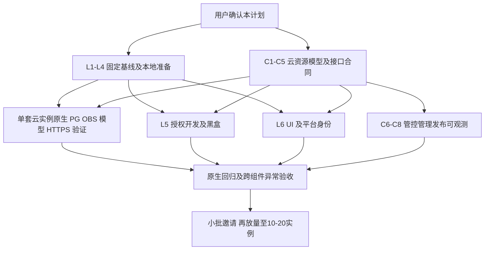

# 单租托管公测：探索结果与待确认执行计划

> 历史探索快照。用户随后要求将当前环境可完成的开发、部署和管控 agent 工作尽量前移。[当前执行计划](EXECUTION-PLAN.md) 已替代本文的建议顺序、确认 Gate 和开发分工；本文的“等待合同后开发”“agent 主要由内部承担”等旧建议不再约束执行。以下只读观察保留其当时证据边界。

日期：2026-10-12。范围依据：[已确认方案](README.md)、[T01—T19 工作包](WORK-ITEMS.md)、[V01—V19 验收](INTEGRATION-AND-ACCEPTANCE.md)。

本轮只读核对源码、进程配置的非敏感字段、本地健康端点和数据库元数据，新增本文及入口链接；没有应用开发、依赖安装、资源申请、服务启停、数据库迁移、业务数据写入或模型调用。下述执行工作须在用户确认后开始。原 V01—V19 仍为 `NOT_RUN`；本地健康检查不将其中任何一项改为通过。

## 1. 建议先做什么

建议保留「一个实例、一套原生 API/UI、API 内置 worker、外部 PG、原生 S3 文件后端」作为最小部署形态。优先新增独立授权扩展和平台边界适配，只有覆盖审计或真实兼容性测试证明存在缺口时才修改核心。实例管理、调度和机器管控能力由内部平台承担，不搬进 MemoryEngine。

确认后先并行推进两条线：

1. **当前环境准备确定的源码与验证基线**：从正式源码构建制品，建立隔离测试环境，复用原生黑盒测试，查清授权入口及后台任务边界。不要在已有体验实例上运行删除、升级或故障测试。
2. **内部提供一套真实云验证资源及合同**：专属机器、PG、OBS、三类模型及 HTTPS 测试入口。先证明原生部署配置能工作，再决定是否需要 OBS／模型适配代码；实例管理和管控 agent 同时盘点已有接口。

授权审计、PG/OBS/模型兼容性和平台身份合同是最早需要消除的不确定性。UI 视觉工作可以并行出稿，但不宜先做大幅页面重构，也不宜等全部管理平台开发结束才验证云依赖。只读／只写 key、完整配额及其他已延后事项继续延后。

## 2. 本轮事实与证据边界

状态含义：`VERIFIED_LOCAL` 是本轮实际只读观察；`VERIFIED_SOURCE` 是当前源码证据；`PROPOSED` 是待确认建议；`UNKNOWN` 是缺少内部信息；`NOT_RUN` 是尚未执行的运行场景。

### 当前环境

| 项目 | 本轮发现 | 状态与限制 |
| --- | --- | --- |
| 检出基线 | 分支 `main`，HEAD `99f7750bf`；其父提交为导入基线 `a9eeed77f`；origin 指向 `RSIXDB/hindsight`，upstream 指向 `vectorize-io/hindsight` | VERIFIED_LOCAL；未查询远端是否有新提交或仓库可见性 |
| 工作区 | 探索开始时有未跟踪的 `.local/`、`docs/architecture-review-zh/`、对应 zip 和 `docs/cloud-vs-oss-20261012/` | VERIFIED_LOCAL；保留原状，不将其纳入本次交付 |
| 机器 | WSL2、AlmaLinux 9.7、x86_64；约 7.7 GiB 内存，检查时 available 约 3.7 GiB；磁盘可用约 725 GiB | VERIFIED_LOCAL；是开发机，不能据此决定云实例规格 |
| 工具 | Python 3.12.13、uv 0.11.3、Node 22.19.0、npm 10.9.3；Docker client/server 均为 29.6.1 | VERIFIED_LOCAL；未安装或升级工具 |
| 本地服务 | `127.0.0.1:8888`、`:9999`、`:5432` 正在监听；PG 容器为 `hindsight-pg`，镜像标签 `pgvector/pgvector:pg17` | VERIFIED_LOCAL；未固定该镜像 digest，未重启 |
| API | `/health/live`、`/health/ready`、`/version` 均 HTTP 200；版本 `0.10.3`，ready 返回 `database=connected` | VERIFIED_LOCAL；没有证明模型、OBS、任务恢复或功能完整性 |
| API 来源 | `.local/experience/venv` 的安装元数据指向当前 `hindsight-api-slim`，editable=true；项目声明版本也是 `0.10.3` | VERIFIED_LOCAL；运行进程并非按 digest 固定的发布制品，进程启动后源码变动也不会自动获得完整运行证明 |
| UI | GET `/` 返回 HTTP 200；进程工作目录为 `.local/experience/ui`；抽查 middleware、dataplane client、package.json 与正式源码相同，`src/i18n/routing.ts` 不同 | VERIFIED_LOCAL；未做浏览器交互或全量副本比较，体验 UI 不能作为正式制品基线 |
| PG | 通过现有本地连接执行只读事务：PG 17.11、vector 0.8.6、pg_trgm 1.6、btree_gin 1.3；`alembic_version=c8e2f4a6b1d3`；当前连接 TLS=false | VERIFIED_LOCAL；未证明迁移到 HEAD 的完整性、云账户权限或云 TLS；最初容器内 psql 默认角色连接失败，改用已有应用连接只读查询成功 |
| 模型配置 | 进程配置为 OpenAI 协议、`glm5.3-flash`；embedding 为 ONNX `intfloat/multilingual-e5-small`、384 维；reranker 为 `rrf` | VERIFIED_LOCAL 配置；本轮没有模型调用。`rrf` 是保留融合排序的实现，不是内部 reranker 服务验收 |
| 配置位置 | 根目录无 `.env`、`.venv`；实际体验配置与 venv 位于 `.local/experience/`，进程中存在模型及数据库配置 | VERIFIED_LOCAL；不应因根目录无 `.env` 判定环境未准备。凭证值未输出、未写入本文 |
| 托管接入 | 所查配置中未见 S3/OBS、tenant/validator 扩展及平台身份配置；开发机同时运行其他项目服务 | VERIFIED_LOCAL 观察；不能推断内部平台不存在这些能力 |
| 云端与平台 | 未提供可核对的专属云实例、云 PG/OBS 接入合同、内部三模型合同、实例管理/agent/网关接口 | UNKNOWN；本轮未连接云资源，也未主动搜索其他项目的凭证 |

上述 HTTP 检查只访问健康、版本及页面入口；数据库查询只读取版本、扩展、当前连接 TLS 和迁移修订号。已有体验验证文件只确认存在，不把其历史结果作为本轮已验证事实。

### 源码可复用能力及其限制

| 领域 | 已核对的源码事实 | 对计划的影响 |
| --- | --- | --- |
| 单租认证 | [builtin/tenant.py](../../hindsight-api-slim/hindsight_api/extensions/builtin/tenant.py#L44) 的 ApiKeyTenantExtension 是单 key；默认实现无认证 | 多 key、有效期、停用及 bank 授权需要新增能力；不能靠多个环境变量直接完成 |
| 现成多 key | [static-keys-tenant](../../hindsight-extensions/static-keys-tenant/README.md) 支持同用户多个静态 key，但按用户生成 schema，无完整有效期和 bank scope | 可参考验证、打包和测试模式，不建议直接启用为公测授权系统 |
| 认证扩展 | [TenantExtension](../../hindsight-api-slim/hindsight_api/extensions/tenant.py#L54) 支持 HTTP/MCP 认证及配置字段权限；单租可始终返回同一 schema | 扩展名有 tenant 不意味着需要引入多租；保持实例内单 schema 和原生 bank |
| Bank 授权 | [OperationValidatorExtension](../../hindsight-api-slim/hindsight_api/extensions/operation_validator.py#L636) 有核心操作、bank 读写、创建、列表及 MCP 工具过滤 hook | 优先独立扩展；接口存在不等于所有路径已覆盖。`bank_list_scope` 优先于列表事后过滤，并影响分页行为 |
| Scope 字段 | [RequestContext.allowed_bank_ids](../../hindsight-api-slim/hindsight_api/models.py#L31) 已声明，但本轮在 `hindsight_api/` 全目录搜索仅找到这一定义 | 不能只给该字段赋值就声称 bank 授权生效，仍须在实际入口和 validator 实现强制检查 |
| 接受后的任务 | [认证与内部上下文](../../hindsight-api-slim/hindsight_api/engine/memory_engine.py#L3528) 跳过内部任务的 tenant 认证；worker 任务可携带 api_key_id | 符合已确认“拒绝新请求、已有任务继续”的方向；新增 validator 仍须正确处理可信内部上下文，不能执行阶段再次按已过期 key 拒绝 |
| MCP 兼容路径 | [MCP middleware](../../hindsight-api-slim/hindsight_api/api/mcp.py#L430) 优先处理旧 `MCP_AUTH_TOKEN`，然后才调用 tenant extension；无 session 的 GET probe 可直接 200 | 公测统一走新认证扩展，不配置旧 token 或 MCP 免认证。MCP GET 200 不能证明已登录或可用，必须测试实际 tools/call |
| UI 凭证和登录 | [hindsight-client.ts](../../hindsight-control-plane/src/lib/hindsight-client.ts#L14) 在服务端使用 dataplane key；[middleware.ts](../../hindsight-control-plane/src/middleware.ts) 是可选共享 access key 的页面/API 登录保护 | 保留服务端全权限身份，另对接平台登录及实例归属；原生 access-key 页面不是平台 SSO/实例权限 |
| OBS 接入 | [S3FileStorage](../../hindsight-api-slim/hindsight_api/engine/storage/s3.py#L11) 接收 endpoint、region、bucket、AK/SK，底层是 obstore；[factory](../../hindsight-api-slim/hindsight_api/engine/storage/__init__.py#L44) 另有 FileStorage 扩展槽 | 先测原生 S3 配置。不能拿任意 S3 CLI 成功代替 Hindsight 使用的客户端兼容性 |
| 上传及清理 | [ObstoreFileStorage](../../hindsight-api-slim/hindsight_api/engine/storage/base.py#L154) 使用流式 writer、head、列表批删和签名 URL；异常写入可能留下未完成分片 | OBS 团队须核对相应权限、签名可达性及未完成分片清理策略；先用实际失败测试确定兼容缺口 |
| PG 与模型维度 | [migrations.py](../../hindsight-api-slim/hindsight_api/migrations.py#L416) 支持独立 migration URL；[向量索引检查](../../hindsight-api-slim/hindsight_api/migrations.py#L723) 对 pgvector HNSW 的维度有条件限制 | 云账户需分别核对运行与迁移权限；内部 embedding 型号、维度先固定，不能把切换模型当普通地址更新 |
| 健康语义 | [MemoryEngine.health_check](../../hindsight-api-slim/hindsight_api/engine/memory_engine.py#L6179) 主要检查初始化和 SELECT 1；[UI health](../../hindsight-control-plane/src/app/api/health/route.ts) 即使 dataplane disconnected 仍返回 200 | agent 要解析响应体、分别观察 API/UI/任务，不能只看 HTTP 200 或容器存活 |
| 停止与恢复 | [内置 worker](../../hindsight-api-slim/hindsight_api/api/http.py#L5150) 使用配置 worker ID 或 hostname，停止等待 30 秒；[wrapper](../../docker/standalone/start-all.sh#L289) 也有 30 秒超时和信号转发 | 固定实例内 worker ID，核对容器与包装脚本等全部超时；外层加长超时不等于内部无限等待，须验证原生未完成任务恢复 |
| 制品与测试 | [Dockerfile](../../docker/standalone/Dockerfile) 已有 standalone、api-only、cp-only；[system tests](../../hindsight-system-tests/README.md) 已有真实服务进程加 stub provider 的黑盒框架 | 不先造新部署器或测试框架。stub 能验证协议和流程，不能验证内部模型质量；该测试框架默认关闭部分后台工作，相关故事需显式开启并等待 |

这些是 `VERIFIED_SOURCE`，并非新增功能的运行验证或完整安全审计。旧架构手册对应更早快照，仅作导航；本计划结论以本轮当前源码为准。

## 3. 当前环境先做的准备与验证

以下全部是 `PROPOSED / NOT_RUN`。优先级表示先解除什么依赖，不表示本轮已经执行；所有工作包均延续原 T/V 编号。

| 次序 | 工作与地点 | 依赖 / 复用 | 输出与验收出口 |
| --- | --- | --- | --- |
| P0-L1 | 固定可复现基线，当前开发机 | T01/T09；正式 API/UI 源码、现有 Dockerfile 和锁文件 | 记录 Git SHA、构建目标、镜像 digest、扩展版本、配置版本、迁移修订与 SDK/OpenAPI；从正式源码构建，不复制体验目录作为制品；构建/启动成功后才称可发布候选 |
| P0-L2 | 原生能力基线，隔离本地数据库和端口 | L1；复用 system tests、现有 fixture/stub；先核对已安装测试依赖，缺失安装在确认后的阶段 | 建立具体接口/UI/文件/任务场景表；测试数据可清理、不触及现有体验库；retain→事实→观察→mental model/knowledge page 按各自终态验收；失败归属为上游、环境或后续修改 |
| P0-L3 | 授权调用链及黑盒案例设计，当前源码 | T12；TenantExtension、OperationValidatorExtension、HTTP/MCP 路由及现有测试 | 每个用户可达入口都有身份来源、资源归属解析、hook、拒绝结果和案例；明确少量核心补点是否必要，再估开发量。按第 5 节验收，不以三个主 API 成功代替覆盖 |
| P0-L4 | 形成 agent 配置和探针合同，文档与配置样例 | T02/A02—A05；现有启动脚本、health、任务 API、metrics | 给出目标/实际版本与配置、secret 引用、worker ID、端口、启动/停止顺序、错误分类和脱敏规则；把探针与业务抽样分开，监控不持续触发付费模型 |
| P1-L5 | 实现并验证最小授权扩展，隔离本地环境 | L3 + key 元数据合同确认；属于确认后的真实开发 | 多 key、有效期、停用、bank 集合、内部管理接口、服务端 UI 身份通过 V09—V11 对应黑盒；已受理任务不因 key 失效中断；完整原生能力不回退 |
| P1-L6 | 最小 UI 适配与平台身份联调 | L1 + T11/T15 登录、路由合同；现有组件和代理 | 先品牌/导航/布局及平台接入；能力菜单逐项保留。页面请求不能绕过平台实例归属；浏览器不持有实例全权限 key；测试退出、Cookie、文件、stream 和跨实例访问 |
| P1-L7 | 本地生命周期与故障演练 | L1/L2/L4；独立测试实例，使用 stub 或获准真实模型 | 正常停止、异常退出、固定 worker ID 重启后任务达到原生终态；配置变更的重启要求、迁移失败和不兼容回退可被识别；这些结果仅是平台联调前置，不宣称云恢复完成 |

L2 基线至少保留：bank 创建/配置/删除及别名；文本/文件/附件 retain；recall 与 reflect（含流式）；文档、chunk、实体/图；directives、observations、mental models、knowledge tree/page；操作状态/取消/重试；文档及 bank transfer、clone、文件下载和清理；webhook、当前启用的日志/诊断页面；REST/SDK/MCP 对应接入。历史已退役的 410 接口保留其原生行为，不当作需要恢复的功能。是否启用 audit/trace 等可配置能力应在 T01 明列，不能把“源码有”都写成默认启用。

本地测试可以先使用现成 stub 与独立本地 PG/pg0；云上仍严格直接连接专属云 PG。开发测试选择不改变首期部署范围。开发机内存与其他项目共用，本地只做有界验证，容量测试放到目标规格云机器。

## 4. 必须由内部提供或协同的工作

所有团队名称是建议职责，不是已确认负责人。先请对应团队提供“已有 API/组件、版本、最小示例、负责人、测试入口”，再将缺口列为新增开发，不能默认各团队从零建设。

| 优先级 / 工作包 | 内部须提供或确认 | 本项目配合与新增边界 | 依赖及验收 |
| --- | --- | --- | --- |
| P0-C1 云资源 T04—T06 | 一套目标 OS/架构的专属 VM、网络、专属 PG；规格、扩展允许清单、账户/TLS、资源 ID 与申请/回收接口 | 配置原生数据库与迁移连接；不把本地 PG Compose 原样部署上云 | L1；V03：真实账户下空库迁移、重启重复启动、向量操作成功，TLS 按平台要求验证；pgvector 必需，pg_trgm/btree_gin 支持和原生降级情况也要记录 |
| P0-C2 OBS T07 | 独立 bucket、受限 AK/SK、region/endpoint、网络、分片生命周期规则、凭证轮转途径 | 先原生 S3FileStorage 测试，再决定是否需要小适配器 | C1 网络 + L1；V06/V07：put/get/head/list/delete/前缀批删/流式大对象及签名链接、附件/导入导出与删除全链路；中断上传有可观察的清理方案 |
| P0-C3 模型 T08 | LLM、embedding、reranker 各自的协议样例、型号/版本、鉴权、维度/输入限制、超时与并发；原生文件能力需要的视觉/OCR 模型条件 | 复用现有 provider；只有协议差异明确才加适配。不能因 LLM 是 OpenAI-compatible 就假设 embedding/rerank 全兼容 | L1；V04/V05：真实抽取、嵌入、重排、reflect、派生处理和代表性文件输入分别通过；保存脱敏响应结构/耗时与质量判定，不只测连通 |
| P0-C4 身份及网关 T11/T15 | 登录/退出/实例归属合同、测试域名及证书、路由、可信头、私网入口和流量限制现成能力 | 对接 UI 服务端身份与 Agent key；建议每实例独立 host，减少 basePath 改造，最终服从平台路由合同 | L4；V12/V13：浏览器和 API/MCP 三种入口均可用，未授权实例拒绝；stream、MCP session/header、文件大小/超时和客户端签名下载可达 |
| P0-C5 Key 权威合同 T02/T12 | 内部 key 操作使用者、管理身份、元数据权威存储、查询与变更接口、生效语义 | 本项目承担原生扩展与内部管理入口；管理平台承担调用与交付。第 5 节是推荐方案，仍须核对已有组件 | L3；创建/查询/停用/期限/scope 更新可审计，有明确生效结果，不能只“下发成功” |
| P0 盘点 / P1 集成 C6 管控 T10/A01—A05 | 已有 agent 安装/注册、身份、执行通道、心跳、制品/secret 获取、进程及日志接口 | 提供 Hindsight 部署描述、探针和命令契约；若已有 agent 可扩展命令处理器，不新建常驻 Hindsight 管控守护进程 | L4 + C1 + T09；部署、启停、配置、升级结果可查询；重复指令安全，agent/管理端重启或超时可继续查询真实结果 |
| P0 合同 / P1 开发 C7 实例管理 T03/T04/T14 | 实例/资源归属、期望与实际状态、操作记录、位置/规格选择、部分失败及回收；管理页面数据合同 | 云 API、调度、页面和 agent 的现成能力优先；本项目不替代平台资源编排 | C1/C6 合同；V01/V02/V16/V17：创建至可用可追踪，重试不重复分配；释放只关闭访问及计算，PG/OBS 保留绑定和数据，另有内部显式销毁 |
| P1-C8 发布与可观测 T09/T16 | 内部镜像仓库/交付身份、日志指标接入、告警通知责任、日志保留与脱敏 | 利用原生日志/metrics、机器 agent，配置实例/版本/操作关联；补少量缺失关联字段须有理由 | L1/L4/C6；V18：API/UI/PG/模型/OBS/任务/磁盘问题可区分，有负责人；不能用每次故障自动重启掩盖依赖错误 |
| P2-C9 集成公测 T17—T19 | 测试租用资源、客户入口、支持流程和反馈归属 | 全部能力及异常验收通过后固定交付材料，分批开放 | V01—V18 后进入 V19；先少量邀请观察，再到已规划 10—20 个实例；节奏取决于结果，不先承诺日期 |

OBS 的 endpoint 同时影响服务器访问与签名 URL。若只有内网 endpoint，服务器上传成功仍可能导致客户无法下载；先验证真实客户端网络。保持原生签名有效期语义，key 停用不撤回已签 URL。OBS 测试必须用原生 obstore 路径；现有 [S3 测试](../../hindsight-api-slim/tests/test_file_storage_s3.py) 针对 SeaweedFS，不能当作 OBS 测试结果。

模型型号/维度在写入测试数据前固定。相同维度但不同 embedding 模型也不能假定语义空间兼容；未来换模型需独立评估重建。单实例默认值先在云测试中测定：进程数、连接池、worker slots、模型与 retain/recall 并发、文件限制、日志保留及磁盘告警。源码默认连接池上限 100、worker slots 10、LLM 并发 32 是待校准输入，不直接批准为公测规格或跨实例总预算。

## 5. 授权最小实现方向与必须先验证的边界

**推荐组合：一个单租认证扩展 + 一个 operation validator + 一个仅内部使用的 key 管理入口。** 保留原生 schema、bank、任务与协议；不增加按 key 划 schema、按网页成员分权或执行中费用取消。可用 [HttpExtension](../../hindsight-api-slim/hindsight_api/extensions/http.py) 承接内部管理 API，或复用已有平台 API；这取决于 C5，尚未选择最终实现。

元数据建议至少包括 key_id、不可逆凭证校验值、显示前缀、实例绑定、有效期（UTC）、停用状态、允许的规范 bank ID 集合、修订号和变更审计。创建时一次性交付明文，之后查询不返回明文。UI 的全权限服务身份与客户 Agent scoped key 分开，内部 key 管理也不能仅凭普通 Agent key 调用。

存储比较：

| 选择 | 优点 / 代价 | 建议 |
| --- | --- | --- |
| 现成内部密钥/权限服务作为权威 | 沿用运维、审计；需解决每请求外部依赖、生效和不可用策略 | 若已有适用能力且能明确完成期限，优先复用 |
| 实例专属 PG 中扩展自有表，内部工具调用该实例管理入口 | 避免新增中心服务；需扩展表迁移、管理认证和数据回收职责 | 无适用内部服务时的首期建议；表由扩展管理，避免改写核心业务表 |
| 静态环境变量/配置文件 | 验证原型简单；停用/期限/授权更新和多进程一致性难以形成可靠管理接口 | 仅临时隔离验证用途，不建议直接作为公测最终交付 |

授权读取失败应拒绝新的外部业务请求，不能照抄 `precheck` 中面向计费快速检查的“异常时接受”建议。首期小规模可优先无跨请求正向缓存，管理变更确认提交后下一新请求读取生效；若复用平台必需缓存，必须明确最长陈旧窗口及停用何时才可报告生效。不能同时声称“即时停用”又容忍未说明的缓存延迟。

| 必测边界 | 已看到的落点 / 待验证问题 | 通过条件 |
| --- | --- | --- |
| 基本身份 | HTTP authenticate、MCP authenticate_mcp；无 key、随机 key、过期/停用 key、期限临界点 | 新请求均按合同拒绝，REST/MCP 一致；管理查询无密钥泄露，时钟与 UTC 语义明确 |
| Bank 读写 | retain/recall/reflect 与 bank read/write 等多类 hook | A key 对 A 成功，对 B 拒绝；不能只过滤 UI 菜单或 MCP 工具展示 |
| 列表与分页 | bank_list_scope 优先于 filter_bank_list | page、total、cursor、空结果、别名都不泄露未授权 bank；所有页结果一致 |
| 资源归属 | [get_chunk](../../hindsight-api-slim/hindsight_api/engine/memory_engine.py#L13485)、[get_operation_status](../../hindsight-api-slim/hindsight_api/engine/memory_engine.py#L21189)、[retrieve_bank_file_stream](../../hindsight-api-slim/hindsight_api/engine/memory_engine.py#L7891) 有归属检查落点 | 错配 bank 和资源 ID、猜测 chunk/文件/任务 ID 均拒绝；任务取消/重试/删除也必须检查；拒绝不返回业务内容 |
| Clone/transfer | [HTTP clone](../../hindsight-api-slim/hindsight_api/api/http.py#L9214) 先取 source profile；[engine](../../hindsight-api-slim/hindsight_api/engine/memory_engine.py#L7827) 校验 target create；restore 目标还可来自归档 manifest | source 和 target 都必须在允许集合；预先授权的新 bank ID 可创建；不能凭 source 权限复制到任意 target，不能只信 URL 忽略归档中的目标 |
| 别名与重建 | [resolve_bank_alias](../../hindsight-api-slim/hindsight_api/engine/memory_engine.py#L20524) 及别名读写 | 建议授权保存规范 bank ID，别名解析后检查；别名变更不转移权限。删除后重建同名 bank 是否继承既有 ID 授权须在 C5 明示，首期按稳定 ID 规则实现并测试 |
| 外部/后台边界 | 内部 RequestContext 绕过 tenant 认证，但 validator 仍可能调用 | 外部参数/头不能伪造 internal；已受理任务继续原生处理，撤销后新操作、轮询、取消/重试请求按新权限判定；正常后台任务不依赖原明文 key |
| MCP 会话 | 路径 bank、X-Bank-Id、工具参数、旧 token 分支和长期连接 | key 停用后现存 session 的下一次工具请求同样拒绝；不以 initialize 成功或 GET probe 200 当作工具级授权证明 |
| 网页及间接能力 | UI 全权限服务身份；配置、webhooks、诊断、知识页、导入导出等原生能力 | 平台客户仅能进入自己实例；指定 bank 内完整操作保持原生语义；凭证/配置展示保持原生脱敏，网页权限不被错误降为某个 Agent key 的 scope |

以上是覆盖清单及抽样追踪结果，完整逐入口矩阵和越权黑盒仍为 `NOT_RUN`。当前没有据此宣布上游存在已证实漏洞，也没有承诺仅扩展就一定零核心改动。发现缺口时列出具体入口、复现、最小补点和回归故事，再纳入实现。

## 6. 依赖、阶段出口与停止条件

| Gate | 可交付结果 | 不通过时的处理 |
| --- | --- | --- |
| G0 计划确认 | 本计划获确认；C1—C8 各有对口人及能力盘点任务；实现范围仍受已确认方案约束 | 本轮到提交计划为止；不启动真实开发或云资源操作 |
| G1 验证基线就绪 | 固定候选源码/制品、隔离数据、功能基线、授权矩阵、最小合同；未知项有负责人 | 版本不可复现或合同冲突时先补齐，避免把体验副本继续扩成部署系统 |
| G2 单实例云配置闭环 | 真实 PG、OBS、三模型、HTTPS 与原生业务跑通；记录配置、资源 ID 和失败归属 | 先区分权限/网络/协议/应用问题；只有可复现兼容缺口才写适配器；该 Gate 不等于对外公测批准 |
| G3 托管完整集成 | 授权、登录/实例归属、UI、manager/agent、启停升级释放、日志告警完成；V01—V18 每项有证据 | 授权绕过、资源归属不明、创建失败遗留、任务恢复失败或模型/文件能力缺失均阻断开放 |
| G4 邀请交付 | 同一 digest/config 可重复部署；操作和接入材料、支持负责人、已知限制、分批观察指标齐备 | 先小批定位问题；原生回归与隔离不通过不放量，不能以 UI 完成代替发布验收 |

在 G2 之前可由内部按明确手工步骤交付第一套验证实例，不必等待全自动实例管理完成；这些步骤应使用同一资源/配置合同，之后由 manager/agent 接管，不另建一次性编排系统。对外开放前必须完成 G3；V08 的跨实例隔离需要至少两套真实专属资源验证，单实例 G2 无法完成。

升级特别验收：目标 digest/config 与实际一致，迁移只有约定执行者，失败不报告可用；能识别数据库已迁移但应用未启动的部分成功。回退仅限数据库兼容的应用版本，不能将“拉回旧镜像”当作通用数据库回滚。释放先移除访问入口并停止计算，保留 PG/OBS 与绑定；数据销毁另行内部显式执行，沿用已确认边界。备份恢复建设和集群能力不加入本轮计划。

每个实际案例建议留下：case_id、关联 T/V、源码 SHA、制品 digest、配置修订、模型/维度、环境及资源标识、时间、脱敏输入、期望/实际结果、原始证据位置、问题归属与复测。正式结果与小型清单放本目录；大日志、截图和中间产物集中放本仓库 `.local/hosted-single-tenant/`；secret、token、含凭证 URL 不进入报告或 Git。

## 7. 本轮交付与下一步授权边界

本轮交付为本报告及 README 索引。只做只读检查和文档变更，未改变 T/V 的运行验收状态，未给未经内部盘点的人天或上线日期。文档相对路径和源码行号范围已检查，Markdown 围栏和空白检查通过；未运行应用测试、构建或浏览器渲染。

建议用户确认后首先授权 **L1—L4 的隔离基线准备与覆盖验证，以及 C1—C5 的内部资源/合同准备**；授权与 UI 的真实实现按本文后续依赖推进。内部对口信息尚缺不妨碍完成本地源码矩阵，但没有资源和平台合同就不能承诺云验收、身份联调或自动部署完成。与其他团队联系、申请资源和生产变更仍按用户实际安排执行，本文仅提出协作交付要求。
