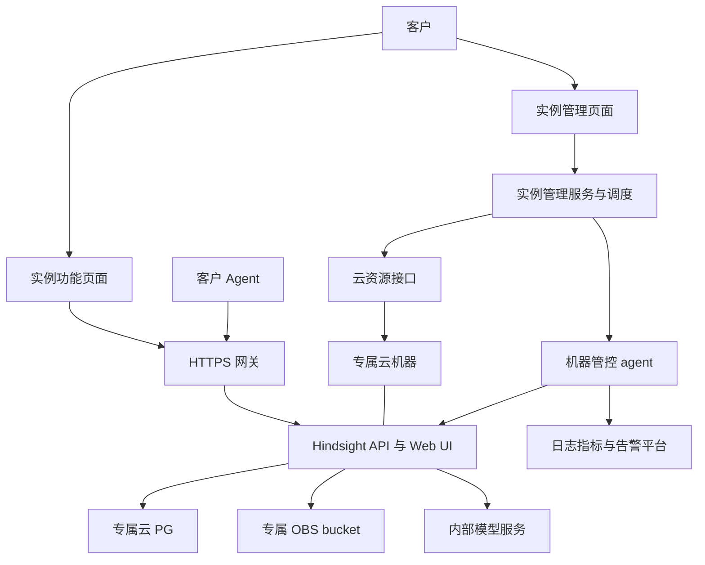

# Hindsight 单租托管公测方案

本方案用于将原生 Hindsight 作为云上托管服务开展邀请公测，覆盖应用适配、实例管理与调度、云资源、机器管控 agent、客户页面及组件集成。工作清单涵盖所有参与团队，具体负责人和排期由内部确定。

首期采用每实例一台专属云机器、一个专属云 PG、一个 OBS bucket 和独立 AK／SK。内部提供默认模型，通过 HTTPS 提供页面及 API／SDK／MCP 接入。保留原生功能和数据生命周期，尽量使用原生配置与扩展点完成适配。

| 项目 | 当前状态 |
| --- | --- |
| 范围 | 2026 年 10 月 12 日讨论确认，包括 HTTPS、管控 agent、OBS 和资源回收边界 |
| 上游 | [vectorize-io/hindsight](https://github.com/vectorize-io/hindsight) |
| 导入代码基线 | `a9eeed77f9bce99d8f97d39a30d3281747300824` |
| 发布版本 | 在 T01 中选择并固定版本、镜像 digest 和配置；导入基线不等于已通过发布验收 |
| 代码与运行状态 | 本次仅提交方案；功能改造、云部署和端到端验收均未执行 |

配套清单：[工作分解与依赖](WORK-ITEMS.md)、[组件对接与上线验收](INTEGRATION-AND-ACCEPTANCE.md)。

## 已确认的首期范围

| 主题 | 确认结果 |
| --- | --- |
| 单租定义 | 尽量少改造的原生 Hindsight 部署版本，保留现有功能；另一个项目承担多租和集群路线 |
| 公测对象 | 邀请制，首批按 10～20 个专属实例规划，逐批开放 |
| 计算与数据库 | 每实例一台专属云机器、一个专属云 PG，直接连接云 PG，不自建本地 PG |
| 对象存储 | 每实例一个 OBS bucket、独立 AK／SK，并用权限策略限定可访问的 bucket |
| 模型 | 内部提供默认可用的 LLM、embedding 和 reranker |
| 实例功能页 | 基于原生 Web UI 修改名字、布局、风格及平台导航，接口能力尽量一致；实例使用者拥有完整管理能力 |
| 实例管理页 | 提供实例创建、状态、维护及 VPC、IP、PG、OBS 等资源信息与管理入口 |
| 对外 API | 修改服务名称、域名和文档标题，保留接口路径、请求响应和 SDK 调用方式 |
| 客户 Agent 接入 | 保留 API／SDK／MCP 直接接入，key 由内部创建和交付，客户不负责自助管理 key |
| Key 授权 | 必做多 key、有效期、bank 范围授权；内部工具负责创建、查询、停用及授权管理 |
| 后台任务 | 沿用原生执行、取消、重试和恢复行为，新增 key 授权尽量只作用于请求入口 |
| HTTPS | 首期必做，由云网关或负载均衡管理证书；内部链路按平台要求配置加密 |
| 调度 | 创建时分配资源及部署位置，支持显式启停、升级、释放；自动迁移和弹性扩缩延后 |
| 可用性 | 接受维护和故障期间暂时不可用，首期不承诺集群高可用 |
| 实例释放 | 释放计算及访问入口与销毁数据分开，PG 和 OBS 数据由内部显式回收 |

Key 已过期或停用后拒绝新请求，已受理任务继续按原生机制处理；不因新增授权额外开发执行中取消、回滚或成本精算。已有任务的后续模型成本由服务承担，原生手动取消等功能继续保留。

## 组件关系

调度管理的是独立实例的资源分配和部署位置。每套 Hindsight 保持单实例运行，默认沿用 API 内置 worker；不因为平台具有调度能力就引入 Hindsight 分布式集群。

## 组件职责

| 组件 | 主要责任 |
| --- | --- |
| 实例管理服务 | 实例归属、资源绑定、目标配置、版本、操作记录和生命周期编排 |
| 调度与云平台 | 资源选择、计算与网络申请、PG 和 OBS 资源管理、分配失败处理 |
| 管控 agent | 执行本机部署、配置、进程与监控操作，上报实际状态和执行结果 |
| Hindsight | 提供原生记忆、文件和后台处理能力，完成必要的应用侧授权适配 |
| 实例管理页面 | 客户操作入口、资源与状态展示、维护操作进度及失败原因 |
| 实例功能页面 | 原生 Web UI 等价能力及已确认的品牌、布局和风格调整 |
| 网关与身份平台 | HTTPS、客户登录、实例访问与路由、证书管理及可信代理配置 |
| PG OBS 模型及可观测平台 | 各自服务的接入配置、权限、可用性和必要运维接口 |

管理服务负责实例应当使用的版本和配置，管控 agent 负责本机实际运行情况。两者通过实例 ID、操作 ID、版本和配置版本对齐，避免各自独立修改同一实例的目标状态。

## 数据存放与生命周期

使用原生 S3 文件后端连接 OBS；优先验证配置接入，只有具体兼容缺口需要时才增加小型适配器。当前源码支持 S3 endpoint、region、bucket 和 AK／SK；OBS 实际兼容性、权限和网络尚未验收。

| 数据 | 首期处理方式 |
| --- | --- |
| 结构化记忆 向量 文本分块 配置 任务状态 | 继续使用原生 PG 存储 |
| 原生 FileStorage 管理的文件 附件 导入导出对象 | 使用原生 S3 后端连接 OBS |
| 上传原文件 | 沿用原生配置；默认在转换并提交 retain 后删除，不增加长期归档要求 |
| 原生文档或 bank 删除 | 保留其清理关联文件与对象的行为 |
| 下载链接 | 沿用原生 API 鉴权与预签名链接行为；已签出的链接按自身有效期失效 |
| 模型缓存 解析临时文件 运行日志 部署制品 | 由各自运行与平台机制管理，不要求统一迁移进业务 OBS bucket |
| 实例释放后的 PG 和 OBS | 保留绑定记录及数据，最终销毁通过内部单独操作完成 |

不同 bucket 和独立受限凭证解决实例之间的对象隔离，原生对象路径无需为实例隔离另加一套命名规则。AK／SK 是 OBS 访问身份，不能与 Hindsight API key 或管控 agent 身份混用。

## 条件加入与延后工作

只读／只写 key 在实现简单可靠或有适用现成实现时加入，否则先完成 bank 范围授权。资源控制只采用低成本的现成配置，首期不开发完整客户额度或费用计量系统。实例规格、连接池、并发、日志保留及磁盘告警仍需给出部署默认值。

以下工作延后：

- Hindsight 多租、集群和高可用。
- 自动故障迁移和自动弹性扩缩。
- 备份恢复建设及演练；已有云平台机制不等于本方案完成恢复验收。
- 网页成员分权、完整组织权限及客户自助 key 管理。
- 完整计费、额度产品及未明确要求的 Cloud 增强功能。
- 上传原件长期归档、回收站和新增数据留存体系。

## 发布路径

版本与接口确定 → 单实例全链路部署 → 页面与授权集成 → 生命周期及异常验收 → 小批试用 → 放量至 10～20 个实例。

页面、agent、云资源、模型及存储可以在接口合同确定后并行推进。授权、原生能力回归和真实环境验收是发布条件，不能由页面完成或进程存活代替。

## 仓库与上游关系

本仓库采用保留上游 main 提交历史的独立私有仓库形式。GitHub 的公开仓库原生 fork 必须保持公开，不能单独改为私有，见 [GitHub fork 可见性说明](https://docs.github.com/en/pull-requests/reference/forks#visibility-of-forks)。上游更新通过 `upstream` 远端获取，合入前检查本目录的范围和验收要求。

本次提交只新增方案文档，保留上游源码及许可证。具体负责人、云资源规格、平台接口、模型型号、凭证接入方式和工期在对应工作包内落实。
