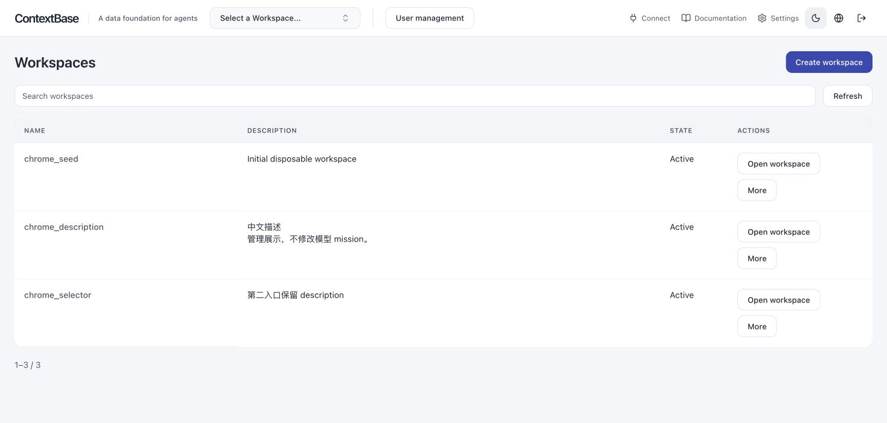

# ContextBase 独享实例服务

本扩展为 ContextBase 增加实例内的工作空间、用户和 API Key 管理，
继续使用原生记忆 REST/MCP、存储和 Worker。
一个实例使用一个 PostgreSQL 数据库，每个工作空间对应一个 Bank 和独立 schema。

| 任务 | 入口 |
| --- | --- |
| 第一次部署并使用 | [阅读顺序](#reading-order) |
| 应用或 Agent 连接已有服务 | [业务接入](#business-quickstart) |
| 管理员创建空间和 Key | [管理员操作](#admin-quickstart) |
| 部署、配置、初始化和维护 | [部署总览](docs/deployment.md) |
| 统计配置、升级和内容恢复 | [召回统计运维](docs/recall-usage.md) |
| 了解实现或参与开发 | [设计与开发](#development) |

## 第一次使用

1. 阅读下面的凭据说明。
2. 按[部署总览](docs/deployment.md)选择[宿主进程](docs/deployment-native.md)或[Docker](docs/deployment-docker.md)，
   或使用[Linux 本地启动](docs/deployment-local.md)，完成配置、初始化、健康和实例身份检查。
3. 按[管理员操作](#admin-quickstart)创建空间、用户及业务 Key。
4. 按[业务接入](#business-quickstart)完成一次写入和召回。

使用同一 checkout 的 API、扩展和 UI。
只安装 Python 模块不等于启用服务；扩展装配、初始化和启动入口由部署指南统一说明。

## 凭据与权限

| 凭据 | 用途 |
| --- | --- |
| UI 密码 | 管理员登录管理 UI，不用于 API 调用 |
| Admin Key | UI 服务端及受控运维管理实例，不交给业务应用 |
| 业务 Key | 应用或 Agent 按空间及只读/读写授权访问 REST/MCP |

用户和空间同属实例，访问范围配置在 Key 上。
多个 Key 获授权访问同一空间时共享内容；业务成员没有个人 UI 登录账号。
秘密保存、轮换和恢复见[部署配置](docs/deployment.md#configuration)
及[凭据设计](../../docs/contextdb-management/DESIGN.md#22-三种凭据及保存位置)。

## 业务接入

向服务方取得 API Endpoint、业务 Key 和已授权的 `bank_id`；
使用远端 MCP 时另取完整 MCP Endpoint，不从 REST 地址推导。
业务 Key 不会自动创建空间；首次写入需要读写授权。

- [Coding Agents 客户安装](../../docs/contextbase/CUSTOMER-GUIDE.md)
- [Python SDK](../../hindsight-clients/python/README.md)
- [Node.js SDK](../../hindsight-clients/typescript/README.md)
- [REST/MCP 连接与授权](../../docs/contextdb-management/DESIGN.md#business)

首次验证按“写入一条事实 → 确认写入处理完成 → Recall 查询”的顺序。
Python 同步 Retain 默认等待处理；异步写入保存 `operation_id`，
使用同一业务 Key 查询 `GET /v1/default/banks/{bank_id}/operations/{operation_id}`，
确认 `status=completed` 后再查询内容。失败或等待超时先诊断，并为等待设置上限。
观察及知识页可能稍后生成，初始知识树为空合法。

## 管理员操作

1. 使用运营方交付的 UI 地址和 UI 密码登录。
2. 创建工作空间，填写名称和可选描述，确认空间可用。
3. 创建用户，为其签发指定空间的只读或读写业务 Key。
4. 保存一次性明文，交付业务 Key、Bank ID 和对外端点。
5. 使用业务身份验证授权、模型调用、写入完成状态和 Recall。

[同名创建冲突示例](../../docs/contextdb-management/screenshots/bank-rest-name-conflict.png)。
截图说明页面，不代表当前提交已重新执行浏览器验收。

空间创建、更新和删除使用 Bank REST，删除需管理员确认的身份条件。
超时、断连或 503 时先只读核查结果，不自动重放创建或删除。
完整规则见[Bank 管理设计](../../docs/contextdb-management/DESIGN.md#bank-api-reuse-design)。

## 召回使用统计

统计 REST/MCP 直接召回的记忆和知识页次数及最后召回时间，默认关闭。
`CONTEXTDB_RECALL_USAGE_ENABLED` 是唯一统计开关；
部署 intent 使用布尔字段 `recall_usage_enabled`，UI 不另设开关。

配置、权限、既有实例升级、内容恢复及查询示例统一见
[召回统计运维](docs/recall-usage.md)。
关闭统计保留已有数据；重新启用继续累计，不补算关闭期间。

## 设计与开发

- [完整设计](../../docs/contextdb-management/DESIGN.md#overview)
- [管理 OpenAPI](schemas/contextdb-control-plane.openapi.yaml)和[DDL](hindsight_ext_contextdb/schema.sql)
- [实现源码](hindsight_ext_contextdb/)
- [部署与维护](docs/deployment.md)
- [云环境交付待办](../../docs/contextbase/CLOUD-READINESS.md)

MCP 工具白名单、业务 Key 配置投影和共享维护函数的合同见设计，
部署与 PG 准备操作见部署指南。

## 测试入口

[验证入口](../../docs/contextdb-management/VALIDATION.md)集中说明单类测试命令、
隔离预检、生产 UI 构建和报告要求。

### ContextDB Service Extension CI

[插件工作流](../../.github/workflows/contextdb-ci.yml)定义实际触发范围和平台矩阵。
当前结果查看对应提交的 Actions、日志和 JUnit；不沿用历史 PASS。
