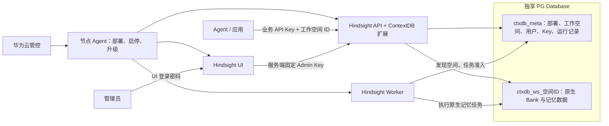
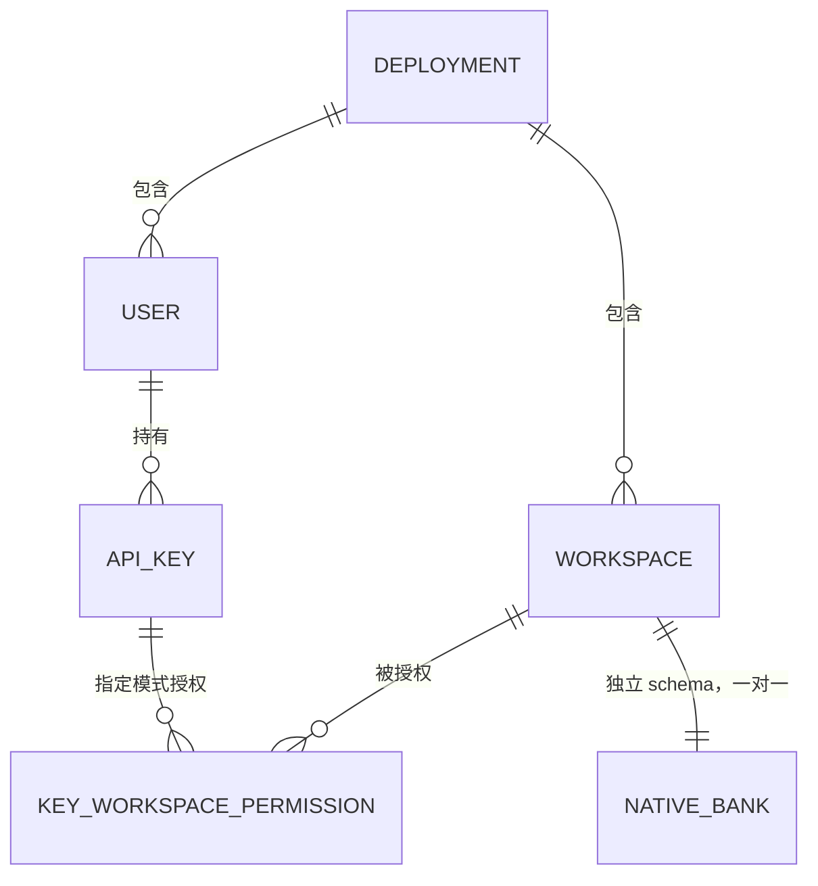
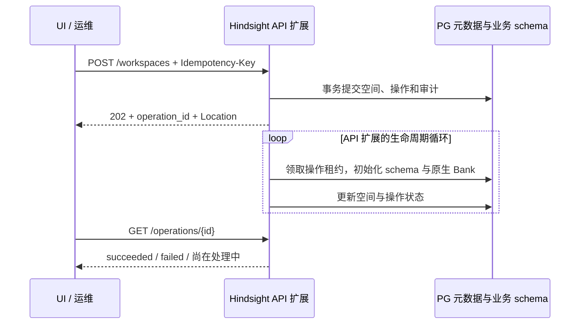

# ContextDB 首发设计：工作空间、用户与 API Key

更新：2026-10-16。本文对应当前已部署的优化版实现。公开管理 API 仍为 `/ext/contextdb/v1`；元数据结构版本为 **2**，用于从优化前结构升级，与产品代次、API 版本、资源 version 无关。

第5.3～5.4节记录后续唯一性约束和按名称查询详情的设计，**尚未实施**；其余章节仍描述当前部署。最新确认的查询优化见[待优化清单](contextdb-optimization-backlog.md)的 WS-04；此前 WS-02 整体可读标识方案仍为候选，不因 GET 改用名称就自动修改业务 Bank ID 或删除接口。

[API curl 验证手册](implementation/contextdb-management-api-curl-guide.md) · [部署与升级](implementation/contextdb-optimized-guide.md) · [OpenAPI](api/contextdb-optimized.openapi.yaml) · [优化前设计](archive/2026-10-16-before-optimization/member-apikey-bank-service-design-first-release.md)

## 1. 总体架构

一个独享实例使用一个 PG 数据库。用户与工作空间同属实例；用户可以持有多个 API Key，每个 Key 独立配置空间范围和权限。工作空间与 Hindsight Bank 一对一，每空间使用独立 schema。



三个入口各自负责：

| 场景 | 调用关系 | 职责 |
| --- | --- | --- |
| 业务访问 | 应用 → Hindsight API / MCP | 携带业务 Key、目标空间 ID，调用 Retain、Recall、Reflect 等原生接口 |
| 实例运维 | 华为云管控 → 节点 Agent | 准备 PG、配置凭据和模型、离线初始化、部署与启停；已有 Agent 负责升级/高可用调度 |
| 资源管理 | 管理员 → Hindsight UI → Hindsight API | 管理工作空间、用户、API Key；UI 后端持有 Admin Key |

工作空间管理已放在 UI，华为云 Console 不再维护空间目录。运维也可直接使用 Admin Key 调管理 REST API。本期没有新增实例注册 HTTP 接口，也没有实现一套新的 Agent 升级或高可用协议。

## 2. 工作空间、用户与授权

### 2.1 对象关系



图中的部署包含关系是逻辑归属，不需要在每张表重复保存 instance_id。`workspace_id = bank_id`，都是服务端生成的32位小写十六进制 ID，不可修改；schema 固定为 `ctxdb_ws_<workspace_id>`。空间名称经 NFKC、去首尾空白、大小写归一后，在未删除空间中唯一；删除后可重建同名空间，但 ID 不复用。

用户只负责 Key 归属、名称和启停，没有用户角色选择，也没有用户级空间授权。**权限配置在 Key 上**，不再叠加“用户权限与 Key 权限取交集”。用户不是 PG 登录角色，工作空间也不是 UI 登录账号。

### 2.2 三种凭据

| 凭据 | 生成与保存 | 能力 |
| --- | --- | --- |
| 运维 Admin Key | 离线生成；API 配置完整 Key 的 SHA-256 摘要，UI 服务端保存明文 | 管理全部空间、用户、Key；访问全部 active 空间的原生 REST/MCP 数据接口 |
| UI 登录密码 | 客户侧可选择随机生成或自定义，通过 HINDSIGHT_CP_ACCESS_KEY 配置并持久保存 | 仅用于管理员登录 UI，不是 API Key |
| 业务 API Key | 管理员通过 UI 或管理 API 创建；数据库只存 HMAC-SHA256 摘要 | 按 Key 的范围和权限访问原生 REST/MCP；不能调用管理 API，也不能登录 UI |

UI 继续使用原生 `HINDSIGHT_CP_DATAPLANE_API_KEY`，值为运维 Admin Key。浏览器只持有登录会话，不接收这个后台 Key。运维 Key 不作为普通用户/Key 显示在“用户管理”中。

业务 Key 格式为 `ctx_live_<32位Key ID>_<随机秘密>`。明文只在创建成功时返回一次；普通列表只返回 `display_key`，例如 `ctx_live_***5f82bf`，以及授权和时间等元信息。尾缀取自真实凭据末6字符；历史 Key 无法恢复尾缀时返回 null，不伪造脱敏值。

`CONTEXTDB_KEY_PEPPER` 是服务端 HMAC 秘密，不写入元数据表。保留现有 Key 时必须沿用 pepper。当前运维 Key 不依赖 pepper，轮换需离线生成并同步更换 API 摘要和 UI 服务端明文、协调重启；本期没有在线恢复、双 Key 轮换或成员自助签 Key。摘要存储与 pepper 的安全依据、运维影响见第 2.5 节。

#### UI 登录密码配置

`HINDSIGHT_CP_ACCESS_KEY` 是 UI 服务端读取的环境变量。客户侧可以使用部署时随机生成的密码，也可以自行设置密码；两种方式使用相同的 Hindsight UI 登录入口。当前是实例级管理密码，不为业务成员提供个人 UI 账号，也没有页面内改密功能。

| 配置方式 | 建议 |
| --- | --- |
| 随机密码 | 使用密码管理器或密码学安全随机源生成24～32位字符串，例如从大小写字母、数字、`_`、`-` 中随机选择；生成后持久保存，普通重启复用原值 |
| 自定义密码 | 建议16～32字符，可混合大小写字母、数字及 `- _ . @` 等符号；需要记忆时，可使用5～6个随机、互不相关的单词，以 `-` 分隔，不必限制在32字符以内 |

自定义密码优先保证长度、不可预测和不复用，不强制同时包含大写、小写、数字和特殊字符。避免姓名、生日、公司或产品名加年份、连续数字、名句等易猜组合。[NIST 密码指南](https://pages.nist.gov/800-63-4/sp800-63b/passwords/)同样强调长度，不建议强制字符类型组合。

当前实现的硬性约束与使用建议分开说明：

- 必须非空；应用当前没有额外的最小长度、最大长度或字符类型校验，上述长度与组合是配置建议，不是已实现的密码策略。
- 密码不能等于 `HINDSIGHT_CP_DATAPLANE_API_KEY`，也不能以 `ctx_live_`、`ctx_ctrl_`、`ctx_admin_` 开头。
- 登录精确匹配，区分大小写，不自动去除首尾空格或做 Unicode 归一化。可使用中文等可输入字符；为方便跨终端配置和输入，推荐使用可打印 ASCII 字符。
- 环境变量不能包含 NUL。避免换行、控制字符和首尾空格；单双引号、反引号、`$`、反斜杠等会增加 Shell 引用或转义要求，建议避开。它们并非应用的字符黑名单。

随机生成示例（执行一次生成32字符密码；部署工具需将结果安全持久保存，不在每次启动时重新生成）：

```bash
export HINDSIGHT_CP_ACCESS_KEY="$(python3 -c 'import secrets; print(secrets.token_urlsafe(24))')"
```

选择自定义方式时，由客户将自己的密码写入私密 UI 配置，例如 Shell 环境文件中的 `export HINDSIGHT_CP_ACCESS_KEY='<客户自定义密码>'`，其中占位符必须替换为实际密码，并按所用配置格式正确引用。配置文件限制为部署账号可读，不把实际密码写入设计文档、版本库或普通日志。

修改密码时，更新实际启动所使用的 UI 配置，重新加载环境变量并重启 UI；仅编辑文件不会使运行中的进程自动生效。无需重新构建 UI、重启 API/PG 或修改后台 Admin Key。所有提供该实例 UI 的进程应使用同一新值；生效后旧密码及旧密码签发的登录会话失效，管理员重新登录。体验环境若同时保留 `ui.env` 和 `ui-settings.json`，应同步更新，且以重启时实际注入进程的值为准。

### 2.3 两种空间授权

公开请求统一使用 `authorization` 对象。

指定空间允许每个空间设置不同权限：

```json
{
  "name": "订单应用",
  "authorization": {
    "mode": "selected",
    "workspaces": [
      {"workspace_id": "aaaaaaaaaaaaaaaaaaaaaaaaaaaaaaaa", "permission": "read_write"},
      {"workspace_id": "bbbbbbbbbbbbbbbbbbbbbbbbbbbbbbbb", "permission": "read"}
    ]
  }
}
```

全部空间使用统一权限，包含未来新建空间：

```json
{"name":"实例应用","authorization":{"mode":"all","permission":"read_write"}}
```

- selected：1～1000个不同的 active 空间，每项独立选择 read / read_write；不接收统一 permission。
- all：不提交 workspaces，统一 permission 作用于全部当前及未来空间。需要差异权限时选择 selected；all 不支持例外覆盖。
- 创建 Key 必须提供 authorization 和 mode；permission 省略时默认 read_write。UI 默认读写，保留只读选择。
- 编辑可以只改 name；一旦提交 authorization，就完整替换授权，未列出的旧空间授权被移除，所有 permission 必须明确填写，不使用创建时默认值。
- 旧版平铺 access_mode / workspace_ids / permission 不再是公开输入，不能与新格式混用。数据库内部仍有 access_mode 等列，不代表客户端继续使用旧格式。

| 权限 | 可执行 | 边界 |
| --- | --- | --- |
| read | Recall、Reflect、记忆/文档/知识等已有内容读取 | Reflect 调用模型，使用时间和日志也可能写入；不是 PG 只读事务 |
| read_write | read 能力，加 Retain 和允许的内容增改删 | 不包含空间生命周期、用户/Key 管理、Bank 配置写入、Webhook 管理、归档导出/下载等运维能力 |
| Admin Key | 全空间业务及管理能力 | 仍受空间状态、schema 映射和安全排空约束；原生 Bank 生命周期也必须走空间管理接口 |

### 2.4 状态变化

用户停用阻断全部 Key 的后续认证；恢复仅恢复未吊销 Key。删除用户保留墓碑，使其全部 Key 无法继续使用，不删除工作空间数据。

吊销 Key 记录 `api_keys.revoked_at`，永久失效，不能恢复。普通 Key 列表在 SQL 中先过滤吊销记录，再计算 total 和分页，因此吊销后该行消失；后台保留历史及审计。

权限变更、停用和吊销对后续 REST 请求/MCP 工具调用重新检查，不承诺强制取消已受理请求。已经接受的原生异步任务继续执行，避免因 Key 失效丢失已接收的数据处理。

### 2.5 API Key 安全设计

#### 为什么只保存摘要

API Key 是持有即可使用的访问凭据。数据库只保存用于验证的摘要，避免表或备份泄露时直接暴露可用的完整 Key。调用方持有明文，服务端收到请求后重新计算摘要并比较，不需要从 PG 还原 Key。明文仍需防止在客户端配置、传输、日志及 UI 签发结果中泄露；生产访问通过 HTTPS 保护。

本系统的 Key 由密码学安全随机源生成，秘密部分使用32字节随机值，提供256位随机熵；公开前缀和 key_id 用于识别格式、定位记录，不是秘密，也不能决定权限。该设计针对高强度随机凭据，不应照搬到用户自行选择的短密码。OWASP 对用户密码建议使用 Argon2id 等专用密码哈希，明确不建议只用快速 SHA-256 保存密码。[OWASP 密码存储指南](https://cheatsheetseries.owasp.org/cheatsheets/Password_Storage_Cheat_Sheet.html)

#### HMAC 与 pepper 分别是什么

HMAC-SHA256 是以 SHA-256 和秘密密钥构成的消息认证算法，定义见 [RFC 2104](https://www.rfc-editor.org/rfc/rfc2104.html)。这里使用它计算 API Key 的校验摘要；没有解密操作，无法直接从摘要还原原 Key。校验通过重新计算、恒定时间比较完成；不可逆不等于弱凭据无法被猜测，随机强度仍是基础。

pepper 是安全领域对“与凭据摘要分开保管的共享秘密”的称呼；在本系统中就是 HMAC 使用的密钥，由 CONTEXTDB_KEY_PEPPER 提供。它独立生成，不是 Admin Key，也不是生成各 API Key 的种子。与通常每条不同、可随摘要保存的 salt 相比，pepper 在当前部署内共享且必须保密。[OWASP pepper 说明](https://cheatsheetseries.owasp.org/cheatsheets/Password_Storage_Cheat_Sheet.html#peppering)

当前业务 Key 的处理流程：

```text
签发：随机生成完整 API Key → 交给调用方，明文只展示一次
      HMAC-SHA256(pepper, 完整 API Key) → 摘要写入 PG

认证：请求携带完整 API Key → 解析 key_id，查询 PG
      用服务端 pepper 重新计算 HMAC → 与 PG 摘要做恒定时间比较
      → 再检查用户状态、吊销状态及目标空间权限
```

计算覆盖完整 Key，包括公开 ID 和随机秘密部分。pepper 由服务端配置持有，调用方无需知道，也不在 API 请求中传递。

#### 为什么 pepper 不放 PG，能保护到哪里

分开保存的目标是增加独立于数据库的一层保护：只获得数据库只读副本或备份的人，无法仅凭其中的摘要计算候选 Key 的 HMAC 进行离线核对。若 pepper 与摘要放在同一数据库，一次数据库泄露就可能同时获得两者，失去这层隔离。OWASP 要求 pepper 与密码摘要分开保存；本设计采用同样的秘密隔离原则，应用于随机 API Key 校验。[OWASP 保管要求](https://cheatsheetseries.owasp.org/cheatsheets/Password_Storage_Cheat_Sheet.html#common-requirements-for-peppering-strategies)

| 风险 | 保护范围与限制 |
| --- | --- |
| 只读数据库或备份泄露 | 不直接暴露完整 Key，pepper 仍在独立的受保护配置中 |
| 完整 API Key 泄露 | 攻击者可直接携带该 Key 请求服务，无需知道 pepper；应吊销并重新签发 |
| 服务端配置与数据库同时泄露 | pepper 的隔离保护失效，需按凭据泄露处理 |
| 数据库任意写入或真正 PG SUPERUSER | 可以篡改用户、授权或数据；摘要校验和 pepper 不能代替数据库权限边界 |

pepper 不保证系统绝对安全，仍需正确的权限校验、HTTPS、秘密保管及受控数据库访问。当前配置文件应仅部署账号可读；生产可交给秘密管理系统。备份恢复流程必须分别覆盖数据库和所匹配的 pepper，且都不进入普通日志、设计文档或版本库。

#### 重启、丢失和更换的影响

pepper 在实例首次部署时生成并持久保存，正常重启、扩容和升级复用原值；同一部署的 API/Worker 使用一致配置。它不是每次启动生成的临时随机数。

| 认证方案 | 更换或丢失 pepper 的影响 |
| --- | --- |
| 当前已实现版本 | 原业务 Key 的摘要不匹配，后续认证失败；Admin Key 使用单独 SHA-256 校验，不受 pepper 变化影响 |
| 待实施统一认证方案 | 管理员与业务 Key 都使用 PG 中的 HMAC 摘要，原 Key 均受影响，UI 后台调用也会失败 |

数据库与记忆数据不会因 pepper 改变而消失，服务健康检查也可能仍正常，但凭据认证会失败。误改时恢复原值并让相关进程重新加载；正常轮换必须配套迁移，持有原 Key 明文才能计算新摘要，否则需要重新签发受影响凭据。不能从旧 HMAC 摘要直接转换出使用新 pepper 的摘要，也不能只改环境变量后认为轮换完成。

#### 当前决策与待评估项

当前业务 Key 使用 HMAC-SHA256 + 独立 pepper；运维 Admin Key 使用配置中的 SHA-256。这是 ContextDB 自研扩展的设计：所基于的 Hindsight 内置 API Key 认证及 StaticKeys 扩展直接比较配置 Key，没有独立 pepper；原生 UI 使用 HMAC 签名登录会话，属于另一用途。

[统一认证方案 AUTH-01](contextdb-optimization-backlog.md) 尚未实施，已记录的目标是管理员与业务 Key 共用 PG/HMAC 认证，再按角色授权；保留 pepper。**统一认证与是否使用 pepper 是两个独立决策。**

对于本系统的高强度随机 Key，可以另行评估“PG 统一保存完整 Key 的 SHA-256 摘要，取消 pepper”的简化方案：它减少一个必须备份和同步的服务端秘密，同时放弃独立 HMAC 密钥提供的隔离保护。这是待评估选项，不是已批准或已实现的变更，不能据此删除当前配置，也不能用于自定义登录密码。若后续选择该方案，必须明确摘要算法及旧 Key 迁移办法，不能将已有 HMAC 摘要当成 SHA-256 使用或运行时随意回退算法。

## 3. UI 交互

工作空间目录提供创建、删除、查询及失败状态。内容切换器只列 active 空间，管理目录保留创建中、删除中和失败状态。创建填写名称、可选描述；删除需确认，随后跟踪操作状态。

“用户管理”是实例级页面。创建用户只填名称，成员行展开查看 Key，更多菜单提供编辑、停用、删除。创建 Key 填名称，选择“指定工作空间”或“全部工作空间（包含未来新创建工作空间）”；指定模式按空间设置权限，默认读写。编辑保留原有只读设置，支持改名。吊销后从列表移除。

Key 明文只在本次创建结果中展示和复制，不写入 localStorage/sessionStorage。工作空间操作仅持久保存非敏感的原始请求、幂等标识与操作 ID：刷新后只恢复 GET 查询；响应丢失且没有操作 ID 时，由管理员明确继续才重放原请求，不自动 POST。成员和 Key 创建不透明重试；结果未知时先核对列表，不能按模糊名称或“最新一条”自动吊销。

## 4. 管理 API

统一前缀 `/ext/contextdb/v1`，全部使用 `Authorization: Bearer <Admin Key>`。不接收 CK、actor 身份头、客户指定的实例/租户/schema。公网入口的 HTTPS 和网络准入由部署环境提供。

| 方法与路径 | 用途 | 必要输入 | 成功响应 |
| --- | --- | --- | --- |
| GET /admin/session | 检查部署管理员身份 | 无 | 200，部署身份 |
| POST /workspaces | 创建 schema、Bank 与映射 | name；description 可选；Idempotency-Key | 202，管理操作 |
| GET /workspaces | 工作空间目录 | q、limit、offset 可选 | 200，分页空间 |
| GET /workspaces/{id} | 查询空间状态 | 路径 ID | 200，空间 |
| DELETE /workspaces/{id} | 关闭准入、排空并清理数据 | 路径 ID、Idempotency-Key | 202，管理操作 |
| GET /operations/{id} | 查询创建/删除进度 | 路径 ID | 200，管理操作 |
| POST /users | 创建用户 | name | 201，用户 |
| GET /users | 用户列表 | q、limit、offset 可选 | 200，分页用户 |
| PATCH /users/{id} | 改名、停用或恢复 | name/status 至少一项；If-Match | 200，用户 |
| DELETE /users/{id} | 删除用户 | 路径 ID | 204，无正文 |
| POST /users/{id}/keys | 创建业务 Key | name、authorization | 201，Key 元数据及一次性 secret |
| GET /users/{id}/keys | 未吊销 Key 列表 | 路径 ID；q、limit、offset 可选 | 200，分页 Key 元数据 |
| PATCH /users/{id}/keys/{key_id} | 改名或完整替换授权 | name/authorization 至少一项；If-Match | 200，Key 元数据，无 secret |
| DELETE /users/{id}/keys/{key_id} | 永久吊销 | 路径 ID | 204，无正文 |

共14个方法与路径组合，不新增管理 MCP。没有实例创建/注册/查询接口、Admin Key 在线恢复接口、单用户详情、单 Key 详情或工作空间 PATCH。

### 4.1 公共约束与返回字段

- 名称1～64字符，拒绝纯空白；description 最多512字符。受控资源路径 ID 为32位小写十六进制。
- 列表 q 默认空、最多128字符，按名称不区分大小写包含匹配；limit 默认20、范围0～100；offset 默认0、非负。返回 items、total、limit、offset。
- Idempotency-Key 必填，1～128个 ASCII 字母、数字、下划线或连字符。同一操作复用原 Key 和相同请求内容，不同内容返回409；失败操作在满足状态条件时可用原 Key 重试执行。GET 不会重启任务。
- PATCH 使用带双引号的正整数 If-Match，如 `"1"`，最多22位数字；缺失/格式错误400，版本不符412。刷新并确认最新资源后再编辑，不能自动覆盖。
- 空间202响应含 Location，指向操作查询；UI 代理转换成自己的 `/api/contextdb/operations/{id}`。单个空间、用户、Key 对象带 ETag。
- 管理响应带 X-Request-ID、Cache-Control: no-store；错误含 code、message、request_id，可附安全的 fields 提示，不回显凭据或原始敏感输入。

| 响应对象 | 公开字段 |
| --- | --- |
| 管理员身份 | user_id、role、instance_id、cloud_tenant_id |
| 工作空间 | workspace_id、name、description、state、version、created_at、latest_operation_id |
| 管理操作 | operation_id、workspace_id、action、state、error_code |
| 用户 | user_id、name、status、version、created_at |
| Key 元数据 | key_id、user_id、name、display_key、authorization、version、created_at、last_used_at |

Key 的 revoked_at 留在后台，普通响应不再带 status/revoked_at；用户响应不再重复 instance_id。空间响应不暴露 schema_name；内部租约、摘要、actor 和 metadata 不作为客户权限输入。version 是资源并发控制版本，修改后递增。

### 4.2 异步创建与删除

**设计决策：创建、删除工作空间都保留异步接口。** POST /workspaces、DELETE /workspaces/{id} 在操作持久受理后返回202，通过 GET /operations/{id} 查询最终结果；本版不增加同步/异步切换参数。这里的“异步”指 HTTP 返回后后台继续执行，与 Python 函数是否使用 async def 是不同概念。

#### 为什么工作空间采用异步

| 操作 | 实际步骤 | 采用异步的主要原因 |
| --- | --- | --- |
| 创建工作空间 | 登记空间及操作 → 在独立 schema 执行原生迁移，创建表和索引 → 创建、校验 Bank → 标记 active | 初始化包含多个步骤；进程中断可能留下部分已完成状态，需要可追踪、可恢复的执行记录；复用现有生命周期执行机制 |
| 删除工作空间 | 关闭新请求准入 → 等待在途请求和已受理后台任务排空 → 清理 Bank 数据 → 标记 deleted | 等待现有任务及清理历史数据的耗时不确定；避免把整个生命周期绑定在一次 HTTP 连接上 |

新空间没有历史数据，建表、建索引可能很快，**不能仅凭“表多”断定创建一定慢或必须异步**。每空间独立 schema 提供数据隔离，但不消除原生迁移、多步骤提交和故障恢复问题。当前没有生产耗时数据证明同步创建不可行，选择异步是可靠性与复用现有实现的取舍。

创建并非一次管理表 INSERT：原生迁移、Bank 写入和管理状态更新不由同一个事务整体提交，不能假设 HTTP 请求失败就能回滚全部初始化结果。当前将操作保存到 management_operations，由 API 进程内的 ContextDB 生命周期循环领取并执行；租约及所有权检查约束接续执行，幂等标识关联同次请求与重试，不新增独立调度服务。失败需明确记录，满足条件后再重试，不承诺任何故障都能自动恢复。

删除还需要协调已经接受的业务工作。即使表互不共享，Retain/Recall/Reflect、原生后台任务仍可能访问目标空间；不能因为删除请求到达就直接清理。空闲空间可以很快删除，繁忙空间或大数据空间则需要等待，未知执行者也不能仅靠时间过去就视为结束。

当前删除入口在写入删除状态前获取空间排他锁，本身可能等待在途请求释放。因此，异步不保证202立即返回，前置校验、锁等待、网络及数据库问题仍可能影响受理响应；实现和验收不能承诺固定耗时。

#### 为什么用户与 API Key 管理采用同步

用户创建、改名、启停、删除，以及 Key 签发、授权编辑、吊销，主要是少量管理记录和必要审计的事务写入。它们不运行原生 schema 迁移，也不等待业务任务排空，事务提交后即可返回最终结果。

| 操作 | 成功返回的含义 |
| --- | --- |
| POST 用户 / Key | 201，记录已经创建并提交；Key 明文仅这次签发返回 |
| PATCH 用户 / Key | 200，修改已经提交 |
| DELETE 用户 / Key | 204，软删除或吊销状态已经提交，后续认证受影响；不强制取消已受理业务任务 |
| GET 管理资源 / 操作状态 | 200，返回本次查询到的状态；查询操作进度不会等待整个操作结束 |

#### 为什么本版不再切换为同步创建

同步可以可靠实现，但需要继续处理请求超时、客户端断开后执行是否继续、重复请求与部分初始化的恢复。仅让 HTTP 等待现有后台任务，简化的是调用方，内部持久状态和恢复机制不会因此消失；直接删掉后台机制，则需重新设计中断恢复及验证。对当前已有实现，收益不足以支持再维护一套执行模式。

本版因此保留异步创建、删除，优先简化 UI：提交后自动查询并更新状态，成功进入正常使用，失败显示原因。后续按 [WS-01](contextdb-optimization-backlog.md) 移除每个正常空间旁常驻的“查询进度”，保留结果未知时的刷新与明确恢复入口；这项 UI 优化尚未实施。用户不必手动管理 operation_id，运维和 API 调用方仍可查询。

#### 交互与完成判定



管理操作状态为 pending / running / succeeded / failed；空间状态为 creating / active / frozen / deleting / deleted / failed，两者不能混淆。latest_operation_id 帮助页面恢复进度，不能代替查询操作结果。

删除先阻止新请求，再等待在途请求和原生任务排空，最后清理 Bank 数据；保留空 schema/表、空间墓碑和幂等记录。未知执行者必须先确认停止，不能按 TTL 强行解除屏障。Admin Key 也不绕过这些步骤。

客户端收到202不能认为空间已创建或删除，必须查询到 succeeded；创建还需空间为 active 才可进入或新增授权。响应丢失、等待超时、浏览器关闭都不能证明服务端操作未执行或已取消。已知 operation_id 时只查询；需要重试时复用原 Idempotency-Key 和原请求，不能因为等不到结果就换标识重复提交。failed 操作在满足条件时可通过明确重试重新执行；GET 不触发重执行。

## 5. PG 元数据

管理表位于 `ctxdb_meta`，原生业务表位于各空间 schema；本次优化不修改 Hindsight 原生业务表结构。当前仍为8张管理表：合并2张为1张，同时新增逐空间授权表。

| 表 | 关键字段与职责 |
| --- | --- |
| deployment_info | 单行 singleton；instance_id、cloud_tenant_id、metadata_version=2、format_id、installed_at；承接管理事务短行锁 |
| workspaces | workspace_id、唯一 schema_name、name/name_key、description、state、version、时间、metadata；保留删除墓碑 |
| users | user_id、name、status、version、时间、metadata；没有角色或空间授权 |
| api_keys | key_id、user_id、name、digest、access_mode、permission、revoked_at、version、时间、metadata；无明文 |
| key_workspace_permissions | key_id + workspace_id 联合主键、permission；外键关联 Key 与空间，仅 selected 模式使用 |
| management_operations | operation_id、workspace_id、workspace_version、action、target_id、idempotency_key、request_hash、state、attempts、lease、时间；空间异步操作及幂等历史 |
| request_admissions | admission_id、workspace_id、owner_id、origin、state、created_at；在途请求与任务提交的删除屏障 |
| audit_events | event_id、request_id、workspace_id/user_id/key_id、control_key_id、action、result、created_at；成功管理变更追溯 |

### 5.1 本次实际精简

- `instances` 与 `schema_versions` 合并为 `deployment_info`，不是删除 PG 系统表。
- 各业务表不再重复 instance_id，workspaces/audit_events 不再重复 cloud_tenant_id；去掉固定的 actor_subject 和 Key.created_by。实例、租户只在部署单行保存，不为尚不支持的共享版保留重复字段。
- selected 授权从 api_keys.workspace_ids 数组迁至 key_workspace_permissions，每个空间一条权限；此时 api_keys.permission 为 NULL。all 无逐空间记录，统一权限保存在 api_keys.permission。
- 保留 user_id 等真实归属、workspace_id 等真实关联；不因独享部署而删除必要外键。
- 受控 ID 使用 varchar(32) 并校验小写十六进制；名称 varchar(64)，外部实例/租户 ID varchar(128)，digest 固定校验32字节。状态及不定长说明保留 text；类型选择用于约束，不宣称同长度 varchar 比 text 更快。
- 空间名称使用未删除行的唯一索引；Key 正常列表索引排除已吊销行。分页、待领任务、空间准入与审计索引对应实际查询；逐空间授权有联合主键。约束和延迟触发器保证 all 没有逐空间记录、selected 有1～1000条授权。
- schema、表、列已补充 PG COMMENT。实体 metadata JSONB 默认空对象，只预留非安全扩展；新 Key 的真实脱敏尾缀由服务端保存，不作为授权来源。

### 5.2 为什么保留三张运行记录表

| 表 | 谁写入/使用 | 何时结束 | 不能混为一张任务表的原因 |
| --- | --- | --- | --- |
| management_operations | 管理 API 提交，API 扩展生命周期循环领取执行 | 操作终态仍保留，支持查询和幂等 | 代表空间创建/删除，具有租约和重试状态；不是 Hindsight Worker 的记忆任务 |
| request_admissions | REST/MCP 和后台任务入口登记/释放，删除流程检查 | 正常完成删除；异常保留直到确认执行者已停止 | 代表正在占用空间的工作，不负责调度，不能按任务租约过期而删除 |
| audit_events | 管理变更在同一事务写入 | 历史保留 | 代表谁提交了何种成功变更，不表示异步空间操作已完成 |

本期不新增统一调度平台，也不自动清理终态幂等历史。保留期限、归档和高频写优化待实测后制定。

### 5.3 工作空间标识与成员名称唯一性（待实施）

本节 bank_id 独立列及可读值属于 WS-02 整体候选方案；第5.4节按名称查询本身不要求新增 bank_id 列。若最终仍以 workspace_id 作为原生 bank_id，主键即可保证该值唯一，无需重复保存同一标识。

**设计决定：实例内的 bank_id 必须唯一；未删除成员的规范化名称必须唯一。** 一实例独享一个 PG 数据库，约束不再附带重复的 instance_id。以下是目标结构要求，不是已执行的 DDL 或可直接套用当前库的迁移脚本。

| 对象 | 目标数据库约束 | 作用范围 |
| --- | --- | --- |
| ctxdb_meta.workspaces.bank_id | `NOT NULL`、`UNIQUE (bank_id)` | 所有仍登记的工作空间，包括创建中、正常、删除中及失败待恢复的空间 |
| ctxdb_meta.workspaces.schema_name | 保留 `NOT NULL`、唯一约束 | 防止不同空间登记到同一物理 schema |
| ctxdb_meta.users.name / name_key | 两列非空；在 `status <> 'deleted'` 的记录上对 name_key 建唯一索引 | 正常及停用用户共同唯一；AUTH-01 引入的内置管理员也包含在内 |

#### 工作空间 bank_id

管理与业务统一使用可读 bank_id，例如 jiamu；原生 Bank 也使用相同值。实例内唯一性必须由 ctxdb_meta.workspaces 的数据库约束保证：原生 banks 表位于不同 schema，各自的约束不能保证跨工作空间唯一。

不对 bank_id 使用排除 deleted 状态的部分唯一索引来提前释放标识。旧空间仍有记录时继续占用 bank_id 和 schema_name；按 WS-03 确认在途工作结束、业务 schema 及关联清理完成并移除旧空间行后，才能复用。同名新空间生成新的内部 workspace_id，不继承旧 selected 授权。

唯一约束解决重名和并发创建，不替代删除执行权、条件删除和幂等保护；这些与 WS-02/03 联合实施。

#### 成员名称

不直接用 `UNIQUE (name)` 代替规范化名称唯一性。服务端创建、改名时统一执行：

1. 对输入名称做 NFKC 规范化、去除首尾空白，检查结果为1～64字符，作为 name 保存。
2. 对该 name 做 casefold，生成内部 name_key；name_key 可用 text，避免规范化扩长后被截断。
3. 在同一事务写入 name 和 name_key，由数据库唯一部分索引保证并发安全。

目标索引定义如下，须通过正式迁移在补列、回填及冲突检查完成后安装：

```sql
CREATE UNIQUE INDEX users_name_unique
ON ctxdb_meta.users (name_key)
WHERE status <> 'deleted';
```

因此 Alice 与 alice、规范化后相同的全角/半角名称及首尾空白变体不能并存；不额外折叠内部空格或进行模糊去重。停用成员不释放名称。删除成员后可用相同名称新建成员，但 user_id 不同，旧成员及旧 Key 保持失效，名称不参与认证或 Key 归属判断。内置管理员名称受保护，普通成员创建或改名不能占用。

#### 错误、迁移与验收

- 创建或改名的唯一性冲突统一返回409，并给出安全的字段提示；UI 保留输入。应用层预检查仅改善反馈，不能代替数据库约束。
- 已有体验数据先回填、检查规范化重名及管理员保留名冲突；发现冲突中止迁移，明确处理后重试，不自动合并、改名、删除用户或转移 Key。
- 新建与升级同步更新约束、COMMENT、模型和接口说明；当前库尚无独立 bank_id 列，users 也尚未添加本节名称唯一索引，不能直接执行上方索引语句完成全部优化。
- 验收覆盖并发重名、规范化等价名称、停用后重名拒绝、删除后名称复用及旧 Key 失效；工作空间另验证清理前不能复用 bank_id、清理后同名新空间不继承旧权限。

本节仅补充设计，未执行数据库变更或上述验收。

### 5.4 工作空间详情按唯一名称查询（待实施）

将 `GET /ext/contextdb/v1/workspaces/{workspace_id}` 改为 `GET /ext/contextdb/v1/workspaces/{workspace_name}`，例如查询 `/ext/contextdb/v1/workspaces/jiamu`。workspace_name 指现有 name 字段，不新增数据库列。

服务端保持管理员认证，按与名称唯一约束一致的 NFKC、去首尾空白、casefold 规则，对 name_key 精确查询未删除空间；不存在返回404，返回结构及内部 UUID 关联保留。中文、空格等名称需要 URL 编码，路径分隔符等特殊字符需明确限制和验证。后续如支持改名，应使用新名称查询；同名重建后查询当前对象。

**本项只优化 GET 详情查询。** 不要求工作空间名称等于 bank_id，不决定原生业务接口的标识形式，也不修改 DELETE、schema 或 Key 授权。工作空间名称唯一约束用于消除歧义，访问安全仍由 Admin Key 校验保障。实施与验收范围见待优化清单 WS-04，当前服务仍按 workspace_id 查询。

## 6. 部署、升级与兼容边界

离线顺序：准备专用 PG 与扩展 → 生成 Admin Key 和 pepper、随机生成或接收客户自定义的 UI 密码 → 写入 API/UI 配置 → 执行 `python -m hindsight_ext_contextdb migrate` → 启动 API/Worker → API 就绪后启动 UI。UI 密码通过 `HINDSIGHT_CP_ACCESS_KEY` 注入，配置建议与改密规则见2.2节。复用 Tenant、HTTP、Validator、MCP 扩展和原生 UI 服务端 Key，不修改 Retain/Recall/Reflect 算法，不另建权限服务。StaticTenant 的静态 schema/Key 映射不能直接表达动态空间及多空间授权。

关键配置为 CONTEXTDB_INSTANCE_ID、CONTEXTDB_CLOUD_TENANT_ID、CONTEXTDB_KEY_PEPPER、CONTEXTDB_ADMIN_KEY_SHA256、HINDSIGHT_API_DATABASE_URL、CONTEXTDB_BOOTSTRAP_DATABASE_URL，以及四个 ContextDB 扩展。保持 HINDSIGHT_API_MIGRATION_ISOLATION=false；启用 MCP 时使用 ContextDBMCPExtension，不能同时使用静态 HINDSIGHT_API_MCP_AUTH_TOKEN。UI 只接收自己的密码、后台 Key 与 API 地址，不接收 PG、pepper 或模型密钥。

向量使用 vector；pg_trgm、btree_gin 为部署依赖，全文后端按场景选择原生英文全文、PGroonga 或已支持的 pg_search 配置；pg_stat_statements 用于观测。本机使用 PGroonga。插件安装和 MaaS 模型配置见部署手册；生产 PGroonga 恢复、主备与性能仍需专项验收。

已实现优化前首发元数据1 → 当前2的离线迁移：停 API/Worker 和其他写入者、备份，以原元数据所有者和原实例/租户配置运行 migrate。事务内严格检查旧结构、对象依赖与数据约束；未知实验格式、定制漂移、绑定不符或超长数据拒绝升级并回滚，不截断、不手改版本号。保留旧 ID、摘要、初始化时间、吊销、审计、幂等历史和原生数据；selected 原统一权限迁为每空间同一权限。历史凭据保持原 pepper，不生成新摘要或虚构尾缀。

公开 API 仍为 v1；本次未发布阶段收敛替换旧平铺授权请求，旧客户端需同步调整。后续已发布合同和元数据变更采用明确的有序迁移；JSONB 预留不能保证永不修改表结构。

当前体验入口为 UI 9998、API 8890。服务使用 `127.0.0.1:5432/contextdb_optimized_20261016_141114`；由原库备份恢复后升级，原库 `contextdb_simple_20261016_091155` 保持不变。其他机器使用部署机器的可达 IP；监听地址为0.0.0.0。

## 7. 安全边界与决策

1. 业务仍使用原生 REST/MCP 的 bank_id=workspace_id。每次请求按 Key、目标空间、空间状态和 schema 校验；不能通过相同 URL 或 MCP 复用会话越权。
2. 原生 Bank 创建、删除、克隆、恢复到新 Bank、别名写入禁止绕过映射，包括 Admin Key；空间生命周期统一走管理 API。
3. 业务不能用 operation include_payload=true 读取内部任务负载；Webhook 投递诊断隐藏负载、结果元信息和错误详情。原生审计读取、整库归档导出/下载等可能含运维凭据的入口限 Admin。已授权业务 LLM trace/config 读取维持现有边界。
4. 运维 Key 是服务凭据，不是 PG 超级用户。一个 PG 数据库内无法防止真正 SUPERUSER 或 OS root 读取和修改数据；客户 SQL 账号应为非超级用户，且不拥有服务 schema。
5. 实例运维、空间任务、原生记忆任务各用现有入口；只保留必要的准入、租约、并发和审计机制。本期不实现共享多租户、组织 IAM、子 Key、个人 UI 登录或跨空间联合查询。

## 8. Q&A

**可以给 MySQL 读写、PG 只读吗？** 可以。使用 selected，在两个 workspaces 条目分别设置 read_write 和 read。同一个明文 Key 可访问两者，URL 用各自 workspace_id。

**全部工作空间能设置个别只读例外吗？** 不能。all 是含未来空间的统一权限；需要差异权限时改为 selected。

**权限给用户还是 Key？** 给 Key；用户只管理归属和统一停用，一个用户可以有多个不同授权的 Key。

**为什么 UI 吊销看起来像删除？** 列表移除该行，后台仍保留 revoked_at 和审计。删除用户则阻断该用户全部 Key，两者都不会删除空间内容。

**管理员能调用原生 REST/MCP 吗？** 能访问全部 active 空间；但原生 Bank 生命周期不能绕过空间管理。全空间业务 Key 也不会因此成为管理员。

**UI 登录是否需要知道后台 Key？** 不需要，只输入 UI 密码。后台 Key 由部署设置，不发给浏览器或普通业务用户。

**客户可以自定义 UI 密码或修改已有密码吗？** 可以。随机密码与自定义密码均配置到 `HINDSIGHT_CP_ACCESS_KEY`。更改后重新加载环境变量并重启 UI，旧登录会话失效；无需修改后台 Admin Key，详细限制和建议见2.2节。

**工作空间映射写在哪里？** ctxdb_meta.workspaces；原生记忆表结构没有因这次管理优化而改变。

**为什么看到版本2？** deployment_info.metadata_version=2 是数据库结构升级序号；管理路径仍为 v1，资源 version 则用于并发编辑，三者含义不同。

**删了哪两张表？** instances、schema_versions 合并为 deployment_info；新增 key_workspace_permissions，总数仍是8张。原数据库未升级，保留旧表。
