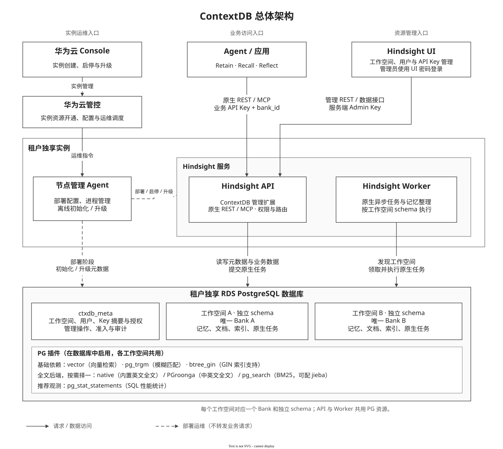

# ContextDB 首发设计：工作空间、用户与 API Key

本文按实例开通、管理员使用、应用访问三个场景说明设计，再介绍共用的认证、生命周期和 PG 存储机制。

设计对应分支 `contextdb/release-hardening-20261016-182619`，尚未替换原体验服务。更新：2026-10-16。

[实现细节附录](member-apikey-bank-service-design-first-release-details.md) · [部署与升级手册](../../contextdb-optimized-guide.md) · [API curl 验证手册](../../contextdb-optimized-curl-guide.md) · [OpenAPI](../../contextdb-control-plane.openapi.yaml)

## 1. 总体设计

### 1.1 三个入口

一个 ContextDB 独享实例使用一个 PG 数据库。Console 负责实例运维，Hindsight UI 负责工作空间、用户和 Key 管理，应用通过原生 REST/MCP 使用记忆服务。



[可编辑 drawio](../../diagrams/contextdb-first-release-architecture.drawio) · [PNG 预览](../../diagrams/contextdb-first-release-architecture.png)

| 场景 | 调用链路 | 负责的事情 |
| --- | --- | --- |
| 实例管理 | Console → 华为云管控 → 节点管理 Agent | 准备资源、部署、启停、升级 |
| 管理员使用 | 管理员 → Hindsight UI → Hindsight API | 管理空间、用户、Key，查看和管理记忆内容 |
| 应用访问 | Agent / 应用 → Hindsight REST / MCP | 写入记忆、检索记忆、基于记忆推理 |

节点管理 Agent 是运维组件；业务 Agent 是服务调用方。UI 和应用的业务请求直接访问 Hindsight API。

### 1.2 工作空间、用户与 Key


[可编辑 drawio](../../diagrams/contextdb-first-release-workspace-model.drawio) · [PNG 预览](../../diagrams/contextdb-first-release-workspace-model.png)

| 对象 | 含义与关系 |
| --- | --- |
| 工作空间 | 记忆数据的隔离单位；对应一个独立 PG schema，其中只有一个 Hindsight Bank |
| 用户 | 人或应用的 Key 归属；与工作空间同属实例，可以持有多个 Key |
| API Key | 应用的访问凭据；每个 Key 独立配置可访问的空间及权限 |

**权限配置在 Key 上。** 用户不直接绑定工作空间；不同用户的 Key 可以访问同一空间，空间内容共享。同一个 Key 可以访问多个空间，但每次原生记忆请求仍指定一个目标 Bank。

### 1.3 组件分工

| 组件 | 职责 |
| --- | --- |
| 节点管理 Agent | 下发配置、离线初始化、管理服务进程，对接已有运维调度 |
| Hindsight API | 扩展层完成认证、授权、空间管理；原生内核执行记忆接口 |
| Hindsight Worker | 执行原生记忆异步任务，按空间 schema 访问数据 |
| Hindsight UI | 管理员操作入口；服务端持有 Admin Key |
| PostgreSQL | 保存管理元数据和各空间业务数据；API 与 Worker 共用 |

## 2. 华为云实例管理

### 2.1 实例如何开通

管控调用已有节点管理 Agent 完成部署。本期不新增“创建实例”的 Hindsight HTTP 接口，工作空间目录也不在 Console 维护。

| 步骤 | 执行内容 | 完成结果 |
| --- | --- | --- |
| 1. 准备数据库 | 准备专用 UTF8 PG、服务账号、vector / pg_trgm / btree_gin；选择全文后端 | 数据库可连接，所选扩展可用 |
| 2. 准备配置与秘密 | 配置实例归属、数据库和模型；生成并私密保存 Admin Key、pepper、UI 密码 | 重启时可复用同一份配置 |
| 3. 离线初始化 | 执行 migrate，创建管理表并导入管理员 Key 摘要 | API 尚未启动，也能准备管理员身份 |
| 4. 启动服务 | 启动 API、Worker，检查 readiness，再启动 UI | 管理与业务接口可用 |
| 5. 交付 | 提供 UI 地址和密码；管理员进入 UI 创建空间、用户与业务 Key | 应用可以接入 |

具体命令见[部署与升级手册](../../contextdb-optimized-guide.md)。已有 `service.sh` 用于部署和启动，由节点 Agent、systemd 或容器监督器管理前台进程。

### 2.2 三种秘密分别做什么

| 秘密 | 用途 | 保存位置 |
| --- | --- | --- |
| Admin Key | 管理全部空间、用户和 Key；访问全部可用空间的记忆接口 | 运维私密文件；UI 服务端持有明文，PG 保存认证摘要 |
| UI 密码 | 管理员登录 UI，配置项为 `HINDSIGHT_CP_ACCESS_KEY` | UI 私密配置 |
| pepper | 服务端计算所有 Key 的认证摘要，配置项为 `CONTEXTDB_KEY_PEPPER` | API 私密配置，与数据库分开保管 |

UI 的 `HINDSIGHT_CP_DATAPLANE_API_KEY` 配置为 Admin Key。浏览器只接收登录会话，不接收后台 Admin Key。业务用户无需感知这些后台秘密。

Admin Key 和 pepper 首次生成后持久保存，普通重启和升级复用。数据库备份必须配套保存对应 pepper；丢失它会使原有 Key 无法认证。秘密文件与数据库分别受控保管。

### 2.3 启停与升级

华为云管控通过节点管理 Agent 管理进程和配置；实例高可用、升级调度复用已有能力。本期没有新增 Agent 管理协议。

升级前备份数据库和秘密配置，停止写入，执行受检查的离线迁移后再启动。正常重启不迁移结构，也不重新生成凭据。配置文件分工、兼容检查和恢复规则见[附录 F](member-apikey-bank-service-design-first-release-details.md#deployment)。

## 3. 管理员通过 UI 管理服务

管理员只需输入 UI 密码。UI 后端使用 Admin Key 调用管理 API 和原生数据接口，管理员可以查看全部可用空间。

### 3.1 从创建空间到交付 Key

| 顺序 | 页面操作 | 服务端行为 |
| --- | --- | --- |
| 1 | 创建工作空间，填写名称和可选描述 | 登记创建操作，初始化独立 schema 和唯一 Bank |
| 2 | 等待空间可用 | UI 自动刷新；空间 active 后可进入和授权 |
| 3 | 在“用户管理”创建用户，只填写名称 | 建立实例级用户，不选择空间或管理员角色 |
| 4 | 展开用户，创建 Key | 填写 Key 名称、选择空间范围和权限 |
| 5 | 复制 Key 给应用 | 明文仅本次展示一次；以后只显示脱敏值 |
| 6 | 切换工作空间查看内容 | UI 使用后台 Admin Key 读取对应 Bank |

普通用户没有个人 UI 账号。受保护的系统管理员不出现在普通用户和 Key 列表中，也不能通过这些页面修改或吊销。

### 3.2 空间权限如何选择

| 授权方式 | 适用情况 | 权限规则 |
| --- | --- | --- |
| 指定工作空间 | 只访问部分空间，或不同空间需要不同权限 | 每个空间分别选择只读 / 读写 |
| 全部工作空间（包含未来新创建工作空间） | 应用需要覆盖整个实例 | 所有空间使用统一权限，不设置例外 |

例如，同一个 Key 可以对“研发空间”读写、对“客服空间”只读。需要这种差异时选择指定空间。创建默认读写；编辑时保留原有设置，替换授权以本次完整选择为准。

### 3.3 停用、吊销与删除

| 操作 | 对后续访问的影响 | 是否删除空间数据 |
| --- | --- | --- |
| 停用用户 | 该用户全部 Key 无法认证；恢复后未吊销的 Key 可继续使用 | 否 |
| 删除用户 | 该用户及其 Key 不再可用，后台保留用户历史 | 否 |
| 吊销 Key | 该 Key 永久失效，从普通列表移除，后台保留记录 | 否 |
| 删除工作空间 | 先停止接受新请求，排空已受理工作，再删除业务数据、schema、空间记录和相应授权 | 是 |

权限变更、停用和吊销在后续 REST 请求/MCP 调用中检查；不强制取消已受理的业务任务。

空间创建和删除提交后，UI 自动跟踪状态；失败显示原因，超时可手动刷新。**收到202表示已受理，操作 succeeded 才表示完成。** 响应丢失时先查询状态，不能自动重复创建、删除或签发 Key。具体恢复规则见[附录 C](member-apikey-bank-service-design-first-release-details.md#lifecycle)。

## 4. 客户应用访问记忆服务

### 4.1 请求如何到达目标空间

应用取得业务 Key 和目标空间的 `workspace_id`，沿用 Hindsight 原生 REST/MCP 接口，`bank_id` 等于 `workspace_id`。

```text
应用携带 API Key + bank_id
    → 认证 Key，检查用户及吊销状态
    → 检查 Key 对目标空间的权限、空间是否可用
    → 根据管理元数据定位独立 schema
    → 调用原生 Retain / Recall / Reflect
```

管理层负责认证、授权与路由，记忆算法和原生接口请求、返回结构沿用 Hindsight。多空间 Key 允许切换目标空间，不代表一次 Recall 联合查询多个空间。

### 4.2 不同 Key 能做什么

| 凭据 / 权限 | 可执行 | 主要限制 |
| --- | --- | --- |
| 业务 Key：只读 | Recall、Reflect，以及允许的记忆、文档、知识内容读取 | 不能 Retain 或修改内容；Reflect 仍可能调用模型和写日志 |
| 业务 Key：读写 | 只读能力，加 Retain 和允许的内容增改删 | 不能管理空间、用户、Key，不能登录 UI |
| Admin Key | 全部可用空间的业务访问及管理 API | 仍遵守空间状态与删除安全规则 |

Admin Key 与业务 Key 使用相同的 Bearer 携带方式、相同的认证入口，权限由 PG 中的身份和授权决定。“全部工作空间”的业务 Key 仍然不是管理员。

所有 Key 都不能通过原生 Bank 创建、删除、克隆等入口绕过空间管理，避免破坏空间与 Bank 的一对一映射。具体接口边界见[附录 G](member-apikey-bank-service-design-first-release-details.md#boundaries)。

### 4.3 空间名称与 ID 的用途

界面展示名称；管理 GET 详情支持按唯一名称查询，返回稳定的 `workspace_id`。删除、Key 授权和原生记忆接口使用这个 ID。

删除旧的“研发空间”后，可以创建同名新空间，但新 ID、schema 不同。旧授权和旧删除请求不会指向新空间。这样既方便按名称查找，也避免名称复用时误操作新对象。

## 5. 核心实现与设计理由

### 5.1 统一认证，数据库不存 Key 明文

管理员与业务 Key 的身份、摘要和授权都存入 PG，通过同一个认证函数验证。Key 签发时计算摘要，认证时重新计算并比较，再检查用户角色和目标空间权限。

```text
认证摘要 = HMAC-SHA256(pepper, 完整 API Key)
```

Key 的秘密部分使用32字节安全随机值。pepper 是独立的服务端秘密，与摘要分开保存，使仅获得数据库或备份的人不能直接进行候选 Key 的离线核对。完整 Key 一旦泄露仍可被直接使用，应吊销重发；pepper 不能阻止数据库超级用户篡改授权。

pepper 的原理、保护范围和轮换影响，以及 UI 密码的配置细节见[附录 B](member-apikey-bank-service-design-first-release-details.md#security)。

### 5.2 为什么空间创建和删除是异步的

| 操作 | 执行过程 | 采用异步的原因 |
| --- | --- | --- |
| 创建 | 登记操作 → 原生 schema 迁移 → 创建 Bank → 标记 active | 多步骤不在一个事务内，需要记录部分完成和失败状态 |
| 删除 | 关闭准入 → 等待在途请求和原生任务 → 清理文件与数据 → 删除 schema、空间及授权 | 排空和清理耗时不确定，需要安全接续执行 |

管理 API 持久受理后返回202，由 **API 进程内的 ContextDB 生命周期循环**执行，调用方查询操作结果。它与 Hindsight Worker 的记忆任务分工不同，不新增调度服务。

创建不一定慢，异步是多步骤恢复和复用现有机制的取舍。用户和 Key 管理只涉及少量元数据事务，提交后同步返回。异步也不保证受理响应立即返回，前置校验和锁等待仍可能耗时。

正常删除完成后不留空 schema 或工作空间墓碑。操作结果默认保留168小时用于查询和幂等重试；审计独立保留。未知执行者或外部依赖未排除时，删除失败保留现场，不按超时强行清理。

### 5.3 PG 保存哪些信息

一个数据库分为两部分：`ctxdb_meta` 保存管理信息；每个 `ctxdb_ws_<workspace_id>` 保存一个空间的原生业务表。各空间表与索引独立，计算、连接和存储资源仍共享。

| 管理表 | 用途 |
| --- | --- |
| deployment_info | 单行保存实例、云租户和元数据结构版本 |
| workspaces | 空间名称、ID、schema 映射和状态 |
| users | Key 归属、角色和用户状态 |
| api_keys | Key 摘要、授权模式、吊销状态等 |
| key_workspace_permissions | 指定空间模式下，每个 Key 对每个空间的权限 |
| management_operations | 空间创建、删除的执行状态与幂等历史 |
| request_admissions | 登记在途工作，供删除时判断是否排空，不负责调度 |
| audit_events | 记录成功管理变更，不代表异步操作已完成 |

不在各表重复保存实例和云租户信息，也不修改 Hindsight 原生业务表结构。必要的 user_id、workspace_id 关联保留。

### 5.4 名称、唯一性与并发

空间和用户名称经统一规范化后校验唯一；用户停用不释放名称。删除后同名重建使用新 ID，不继承旧 Key 或授权。ID 由服务端生成，schema 不允许客户指定。

Key 和用户编辑使用资源 version 防止覆盖他人的修改；空间创建、删除使用 Idempotency-Key 识别同一次请求重试。这些规则分别解决并发编辑和重复提交问题。

表字段、索引、唯一约束和名称查询规则见[附录 D](member-apikey-bank-service-design-first-release-details.md#metadata)；完整管理接口见[附录 A](member-apikey-bank-service-design-first-release-details.md#api)。

## 6. 本期边界

- 一个独享实例使用一个 PG 数据库，不为共享多租户增加组织层或重复归属字段。
- 只设置一个受保护的系统管理员；普通用户由管理员统一管理，没有个人 UI 登录或自助签 Key。
- 一个空间对应一个 schema、一个 Bank；同空间内容共享，不做个人记忆 ACL，也不做跨空间联合 Recall。
- 复用 Hindsight 原生 REST/MCP、记忆算法和 Worker；管理能力优先集中在扩展层。新增管理接口只提供 REST。
- PG SUPERUSER 或 OS root 可以读取、修改数据库；客户 SQL 账号应为非超级用户，且不拥有服务 schema。
- HTTPS、入口限流、网络隔离以及实例运维调度由部署平台提供；本机功能验证不等于生产入口、高可用或容量验收。

详细接口、异常处理和兼容边界保留在[实现细节附录](member-apikey-bank-service-design-first-release-details.md)，不改变本文描述的功能和权限模型。

[本次整理前的完整设计](../before-scenario-restructure-20261016-201640/member-apikey-bank-service-design-first-release.md)保留供历史对照。
