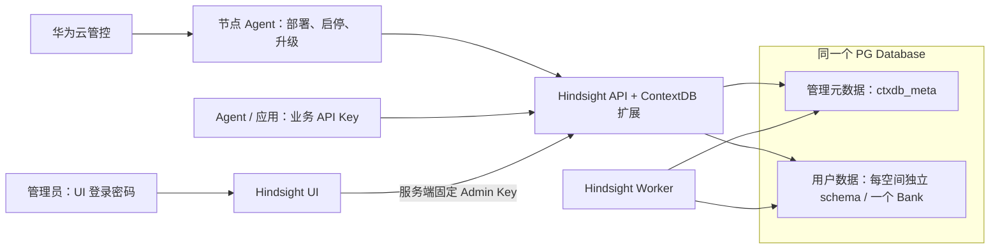

# ContextDB 首发简化设计

> **历史快照，不适用于当前首发版本。** 下文保留当时的配置、接口、表结构和测试环境用于对照，不应照此部署或验证当前代码。当前以[首发设计](contextdb-release-design.md)、[部署合同](contextdb-deployment-contract.md)和[API验证手册](contextdb-optimized-curl-guide.md)为准；开发期旧库不自动升级。

2026-10-16。基于 V2 实验实现收敛；产品首次发布的 API 与元数据版本均为 1。原始 V2 设计与部署文档保留，本文描述本次新方案。

## 总体关系

工作空间创建、删除和查看由 Hindsight UI 管理；UI 服务端调用 Hindsight API 中的扩展接口。华为云管控负责实例的计算、数据库与节点 Agent 调度，不再负责工作空间目录。当前代码不实现新的 Agent 升级或高可用协议。

一个独享实例使用一个 PG 数据库。工作空间 ID 等于 Bank ID，ID 实例内唯一、不可变；每空间独立 schema。工作空间名称规范化后实例内唯一。

## 凭据与授权

| 对象 | 设置与用途 |
| --- | --- |
| 运维 Admin Key | 离线生成一个部署凭据，API 保存 SHA-256 摘要；管理工作空间、用户、Key，并访问全部空间的原生数据接口 |
| UI 登录密码 | 独立于任何 API Key，管理员只输入该密码 |
| UI 后台 Key | 复用原生 HINDSIGHT_CP_DATAPLANE_API_KEY，配置同一运维 Admin Key；浏览器不获取此值 |
| 用户 | 仅名字、启停状态，用于 Key 归属；不再配置用户的工作空间权限 |
| 业务 API Key | 指定全部或一个/多个空间，以及只读或读写；不得管理工作空间、用户或其他 Key |

业务 Key 的权限是唯一授权入口，无“用户权限与 Key 权限求交集”。全部空间包含将来创建的空间；指定空间只包含列出的 ID。一个 Key 的权限档位在全部所选空间相同，本期不提供 A 读写、B 只读的逐空间组合。

- **只读**：Recall、Reflect、记忆、文档、知识和已有业务读取接口。Reflect 会调用模型，服务也可更新使用时间和日志，不能理解为数据库完全不写入。
- **读写**：在只读上增加 Retain 和内容增改删。空间生命周期、用户/Key 管理、Bank 配置、Webhook 配置及投递、归档导出/下载和运维任务控制属于管理员。
- 用户停用会阻断其所有 Key 的新请求；恢复用户只恢复未撤销的 Key。撤销 Key 不可恢复。
- 已接受的后台任务继续处理，不因 Key 撤销丢失任务；下一次 REST 请求/MCP 工具调用按当前权限检查。
- 原生 Bank 创建、删除、克隆、恢复到新 Bank 和别名写入仍禁止绕过工作空间映射，包括使用 Admin Key 时。原生内容接口继续复用。

Admin Key 不作为业务用户或 Key 出现在用户管理页面。丢失或轮换时重新离线生成，同步更换 API 摘要与 UI 服务端凭据、协调重启；本期不实现在线恢复和双 Key 轮换。它是服务部署凭据，不是 PostgreSQL 超级用户。

## UI 操作

沿用原生工作空间列表、切换和内容页面，提供创建和删除入口。创建只填名称，删除先确认；UI 跟踪异步状态，未完成不能作为可授权空间。

“用户管理”是实例级页面：新增用户只填名称，选择用户查看其 Key。创建 Key 填写名称、工作空间范围与只读/读写；修改 Key 只调整范围和权限。明文仅在创建成功后展示一次，之后只显示元信息。用户和空间之间不再分别授予权限，页面不展示四个英文 scope、内部 schema、租户 ID 或部署管理员 Key。

请求超时不能断言任务未提交。工作空间请求保留同一个幂等标识重试，查询任务或列表确认结果。Key 创建不自动重试；丢失创建响应时查看列表，撤销疑似新 Key，再明确创建新 Key。

## 新增 API 的必要性

统一前缀 `/ext/contextdb/v1`，所有接口只接受运维 `Authorization: Bearer <admin-key>`。不使用 CK、actor 身份头或第二套网络认证规则。公网部署由现有网络入口提供 HTTPS 与准入。

| 方法与路径 | 保留原因 | 客户端必要输入 |
| --- | --- | --- |
| GET /admin/session | UI 验证服务端配置是运维 Key | 无 |
| POST /workspaces | 初始化 schema 与 Bank，建立映射 | name；description 可选 |
| GET /workspaces | UI 列表与 Key 空间选择 | limit、offset、q |
| GET /workspaces/{id} | 查询单空间状态、完成后确认 | 路径 ID |
| DELETE /workspaces/{id} | 安全关闭准入、排空任务并清理 | 路径 ID |
| GET /operations/{id} | 跟踪创建、删除进度与错误 | 路径 ID |
| GET /users | 用户管理列表 | limit、offset、q |
| POST /users | 记录 Key 使用者归属 | name |
| PATCH /users/{id} | 改名称、统一停用/恢复 Key | name 或 status |
| DELETE /users/{id} | 删除用户，阻断全部 Key | 路径 ID |
| GET /users/{id}/keys | 查询 Key 元信息，不返回明文 | 路径 ID、limit、offset、q |
| POST /users/{id}/keys | 签发业务 Key | name、access_mode、workspace_ids、permission |
| PATCH /users/{id}/keys/{key_id} | 调整权限，保留原 Key 明文 | access_mode、workspace_ids、permission |
| DELETE /users/{id}/keys/{key_id} | 永久撤销 Key | 路径 ID |

删除四个旧接口：实例注册、实例查询、管理员 Key 恢复、单用户详情。实例绑定在部署命令中完成，用户详情由列表提供。API 共 14 项，没有新增管理 MCP。

列表返回 items、total、limit、offset，q 搜索名称。POST/DELETE 工作空间返回 202 和 operation_id/workspace_id，查询直到 succeeded/failed；不是立即完成。两个接口保留 Idempotency-Key，由 UI 自动生成和复用。PATCH 保留 ETag/If-Match，由 UI 自动处理，避免并发覆盖授权；用户无需理解这些字段。

### 字段取舍

| 字段 | 决策 |
| --- | --- |
| name | 用户、空间、Key 的可读名称，保留 |
| access_mode | all / selected，保留；默认 selected 不隐式授予全部空间 |
| workspace_ids | selected 至少 1 项、不得重复；all 必须空；仅接受本实例 active 空间 |
| permission | read / read_write，统一每 Key；移除 grants 与四类公开 scopes |
| status | 用户 active / disabled；删除是软删除，保留历史审计 |
| expires_at | 本期移除，使用撤销/用户停用管理生命周期 |
| role、user workspace_access | 移除；运维管理员是部署身份，不在普通用户目录 |
| instance_id、cloud_tenant_id | 部署固定绑定，接口不重复接收；不得由客户选择 schema |
| version | 内部并发版本从 1 开始；不是产品版本，UI 不展示 |
| schema_name、lease、actor | 仅内部持久化或诊断所需，用户不配置；不得作为客户权限输入 |
| metadata | 预留 JSONB 对象，不开放权限旁路或任意写入 API |

管理变更与成功审计在同一事务提交。运维身份固定为实例管理员，记录凭据 ID 用于轮换追溯；共享 UI 密码不区分具体操作人，本期不增加个人登录或完整业务审计。

## PG 元数据与演进

本期保持 8 张元数据表，与原生记忆表分离，不修改原生记忆表结构。完整 DDL 以代码仓 `hindsight-extensions/contextdb-service/hindsight_ext_contextdb/schema.sql` 为准。

| 表 | 核心职责与字段 |
| --- | --- |
| schema_versions | version=1 与 format_id；标识首发结构，拒绝旧实验结构 |
| instances | 固定 instance_id/cloud_tenant_id 绑定，并提供目录变更的短行锁 |
| workspaces | workspace_id、唯一 schema_name、规范化名称、state；保留删除墓碑 |
| users | user_id、名称、status；没有角色或空间授权字段 |
| api_keys | user_id、HMAC digest、access_mode、workspace_ids、permission、revoked_at；无明文、子 Key、过期时间 |
| management_operations | 工作空间创建/删除的幂等、进度与执行租约 |
| request_admissions | 持久记录已准入工作，支撑安全删除与未知执行者保护 |
| audit_events | 成功管理变更与运维凭据身份，不是完整业务审计产品 |

instances 由离线部署事务绑定当前实例与云租户，也用作短元数据变更锁。users 仅记录归属与状态；api_keys 保存 HMAC 摘要、空间范围和权限档位，不保存明文。权限字段保持独立受约束列。

workspaces、users、api_keys 三张业务实体表预留 metadata JSONB 默认空对象；非安全标签等未来可以在里面扩展。本期不为预留列增加 GIN 索引，也不预设组织、子 Key、跨实例 IAM 或多角色模型。新增关系、约束和索引仍需要有序迁移，预留字段不能保证永不修改表结构。

元数据首发版本为 1，并使用 format_id=contextdb-first-release 识别结构，避免与旧实验版本 1 混淆。部署检测旧实验结构并拒绝覆盖，不能把原版本 2 直接标成 1。已有体验库保持不变，新方案使用新库。未来已发布版本通过有序、尽量增量的迁移升级，旧字段/请求语义保持兼容；不让客户端提交数据库版本号。这是未来兼容原则，本期尚未实现跨版本升级工具。

## 保留的安全实现

工作空间删除不能简化成直接 DROP schema。保留持久准入、后台任务排空、操作租约、墓碑和未知执行者屏障。删除保留 schema/空表与历史映射，ID 不复用；未知旧执行者必须先停止，不能按时间自动解除屏障。

运维 Admin Key 同样经过空间状态、schema 路由和准入检查，不绕过排空。一个数据库内无法靠权限阻止真正 PG SUPERUSER 或 OS root；客户 SQL 账号应是非超级用户且不拥有服务 schema。

复用 Tenant/HTTP/Validator/MCP 插件、原生 UI 密码和固定服务端 Key；不改 Recall/Retain/Reflect 算法，不因本次简化扩大原生内核 hook。不能直接改用 StaticTenant：它的静态 schema/Key 映射不能表达动态 workspace 与多空间 Key。当前扩展已复用原生扩展点，不再额外建设权限服务。

归档权限例外有明确原因：原生整库导出可能包含 Webhook 签名密钥和 HTTP 认证头。首发将全部归档导出/下载归运维管理，业务 Key 仍能读取文档、记忆与知识内容；以后如需业务数据导出，再提供明确不含运维配置的能力。

## 关键决策记录

1. 空间管理从 Console 移至 UI，实例运维仍由既有管控/节点 Agent 负责。
2. 一个运维 Admin Key 取代 CK+数据库管理员 Key；UI 密码独立。
3. 用户只归属和启停，权限只在业务 Key 上配置一次。
4. 业务权限只读/读写，范围全部/指定；暂不设计细粒度逐空间动作。
5. 删除无需在线服务参与的实例接口，保留异步排空与必要并发保护。
6. 首发版本 1；保留原始 V2 资料，未来升级采用有序迁移，预留 JSONB 不作万能兼容承诺。

## Q&A

**用户能看到运维 Admin Key 吗？** 普通业务用户不会收到它；UI 服务端与运维配置持有。管理员 UI 只展示业务用户/Key，运维 Key不在该列表。

**全空间业务 Key 能管理空间和用户吗？** 不能。all 是空间范围，不是管理员角色。

**只读能 Reflect 吗？** 可以；不能通过该 Key 保存或修改业务记忆。模型调用和使用记录仍可能产生费用与内部写入。

**管理员能调用原生 REST/MCP 吗？** 可以访问全部 active 空间的数据；原生 Bank 生命周期仍被禁止，必须走工作空间扩展接口。

**为什么还有 operation 和 version？** operation 防止把尚未初始化/清理完成的空间当成成功；version 防止两次权限编辑互相覆盖。UI自动处理，不增加用户操作。

**第一版是否提供业务用户自助登录和签 Key？** 不提供；管理员代管，业务用户只使用已发放的 Key，不设计子 Key。
